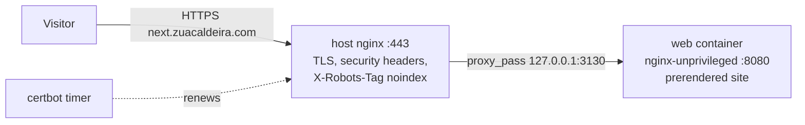

# Preview site: next.zuacaldeira.com

The redesign is previewed at https://next.zuacaldeira.com. A push to the `next` branch runs
`.github/workflows/deploy-next.yml`:

1. **test:** `npm ci` and `npm test` in `frontend/`.
2. **image:** builds `frontend/Dockerfile` with `PREVIEW=true` (which writes a `robots.txt`
   with `Disallow: /`) and pushes `ghcr.io/zuacaldeira/zuacaldeira.com-web:next` and
   `:<commit sha>` to GitHub's container registry.
3. **deploy:** over SSH as `deploy-zuacaldeira`, runs `sudo /usr/local/bin/zc-next-deploy`,
   which pulls the image with the job's token (passed on stdin, expires with the job) and
   restarts the container. Then a `curl` check.

The live site (`main` → zuacaldeira.com, rsync of static files) is not touched.

## How it runs on the host
The host is the shared VPS `217.154.2.230`: about 18 sites, Docker and Compose installed.
The **host nginx owns ports 80 and 443 for every site**, so no container may publish them.



| Server path | From the repo | Owner |
|---|---|---|
| `/etc/nginx/sites-available/next.zuacaldeira.com` | `infra/next/nginx-site.conf` | root |
| `/opt/zuacaldeira-next/docker-compose.yml` | `infra/next/docker-compose.yml` | root |
| `/usr/local/bin/zc-next-deploy` | `infra/next/zc-next-deploy` | root, 0755 |
| `/etc/sudoers.d/zc-next-deploy` | `infra/next/sudoers` | root, 0440 |

`deploy-zuacaldeira` is **not** in the `docker` group: on a shared host that group is root.
It may run exactly the one deploy script through sudo.

Port 3130 on `127.0.0.1` was free on 2026-10-28; check `ss -ltn` before reusing the setup.

## One-time setup
1. **DNS** (Strato; the zone's name servers are `*.rzone.de`): an A record
   `next.zuacaldeira.com → 217.154.2.230`. `zuacaldeira.com` has no AAAA record, so none for
   `next` either. Check: `dig +short next.zuacaldeira.com` prints `217.154.2.230`.

2. **Server files,** as root (copy the four files from `infra/next/` first, e.g. with `scp`):
   ```bash
   install -d -m 755 /opt/zuacaldeira-next
   install -m 644 docker-compose.yml /opt/zuacaldeira-next/docker-compose.yml
   install -m 755 zc-next-deploy /usr/local/bin/zc-next-deploy
   install -m 440 sudoers /etc/sudoers.d/zc-next-deploy && visudo -cf /etc/sudoers.d/zc-next-deploy
   ```

3. **HTTP only first,** so certbot can answer its challenge (the :443 block names a
   certificate that does not exist yet). Install just the port-80 block, then reload:
   ```bash
   awk '/^server \{/{n++} n==1' nginx-site.conf > /etc/nginx/sites-available/next.zuacaldeira.com
   ln -s /etc/nginx/sites-available/next.zuacaldeira.com /etc/nginx/sites-enabled/
   nginx -t && systemctl reload nginx
   ```

4. **Certificate** (needs the DNS record):
   ```bash
   certbot certonly --webroot -w /var/www/certbot -d next.zuacaldeira.com
   ```

5. **Full site:** `install -m 644 nginx-site.conf /etc/nginx/sites-available/next.zuacaldeira.com`,
   then `nginx -t && systemctl reload nginx`. Until the first deploy, the site answers 502.

6. **First deploy:** push `next`. The workflow uses the existing secrets `DEPLOY_SSH_KEY` and
   `DEPLOY_HOST`.

7. **Check:**
   ```bash
   curl -sI https://next.zuacaldeira.com/        # 200, X-Robots-Tag, HSTS, CSP, Cache-Control
   curl -s  https://next.zuacaldeira.com/robots.txt   # Disallow: /
   ssh root@217.154.2.230 'cd /opt/zuacaldeira-next && docker compose ps'
   ```

## Rollback
Every image is also tagged with its commit. As root on the server:
```bash
cd /opt/zuacaldeira-next
docker pull ghcr.io/zuacaldeira/zuacaldeira.com-web:<good sha>   # after docker login ghcr.io
docker tag ghcr.io/zuacaldeira/zuacaldeira.com-web:<good sha> ghcr.io/zuacaldeira/zuacaldeira.com-web:next
docker compose up -d
```

## Later
- **Backend:** the Spring Boot and MySQL containers join this compose file, still bound to
  `127.0.0.1`; the web container's nginx passes `/api` to the backend.
- **Old-URL redirects (D2 in `docs/examples/home.md`):** `301` from `/home`, `/about`, ... to
  `/en/...`, in the web container's nginx once the language routes exist.

## Teardown
As root: `cd /opt/zuacaldeira-next && docker compose down`, then
`rm /etc/nginx/sites-enabled/next.zuacaldeira.com && nginx -t && systemctl reload nginx`, and
optionally `certbot delete --cert-name next.zuacaldeira.com`, remove `/opt/zuacaldeira-next`,
`/usr/local/bin/zc-next-deploy` and `/etc/sudoers.d/zc-next-deploy`.
