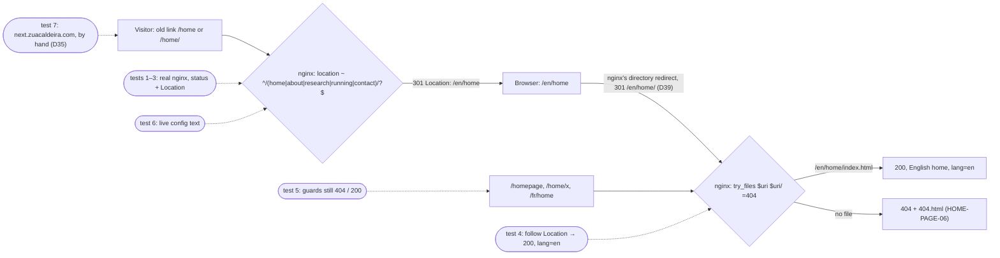
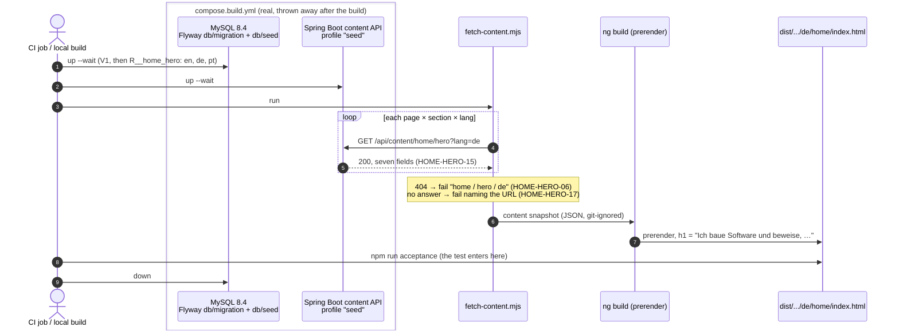
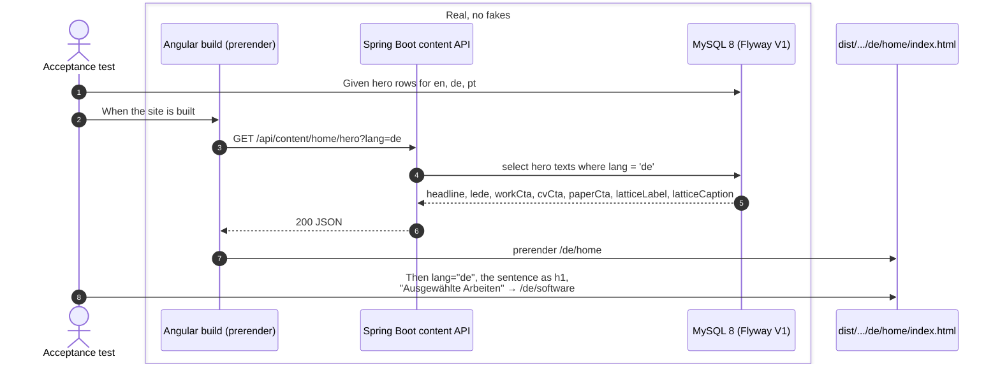
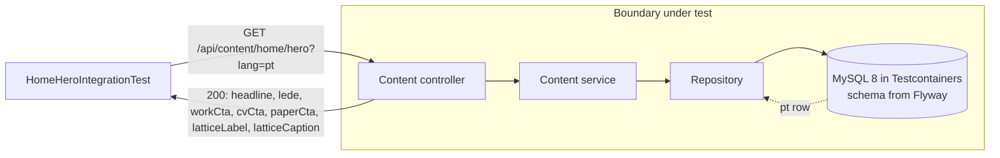
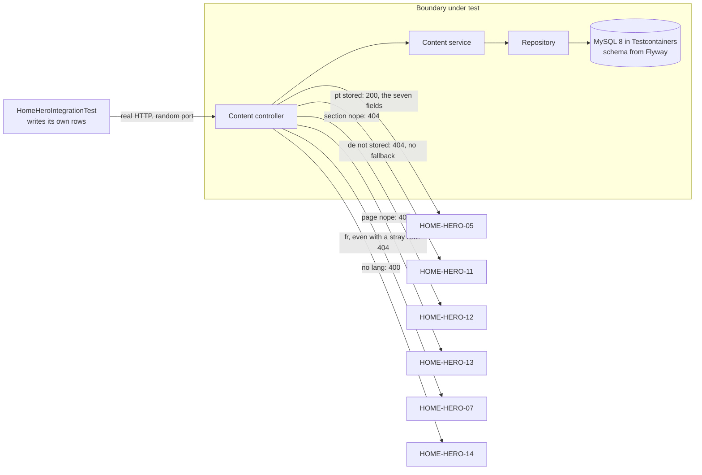
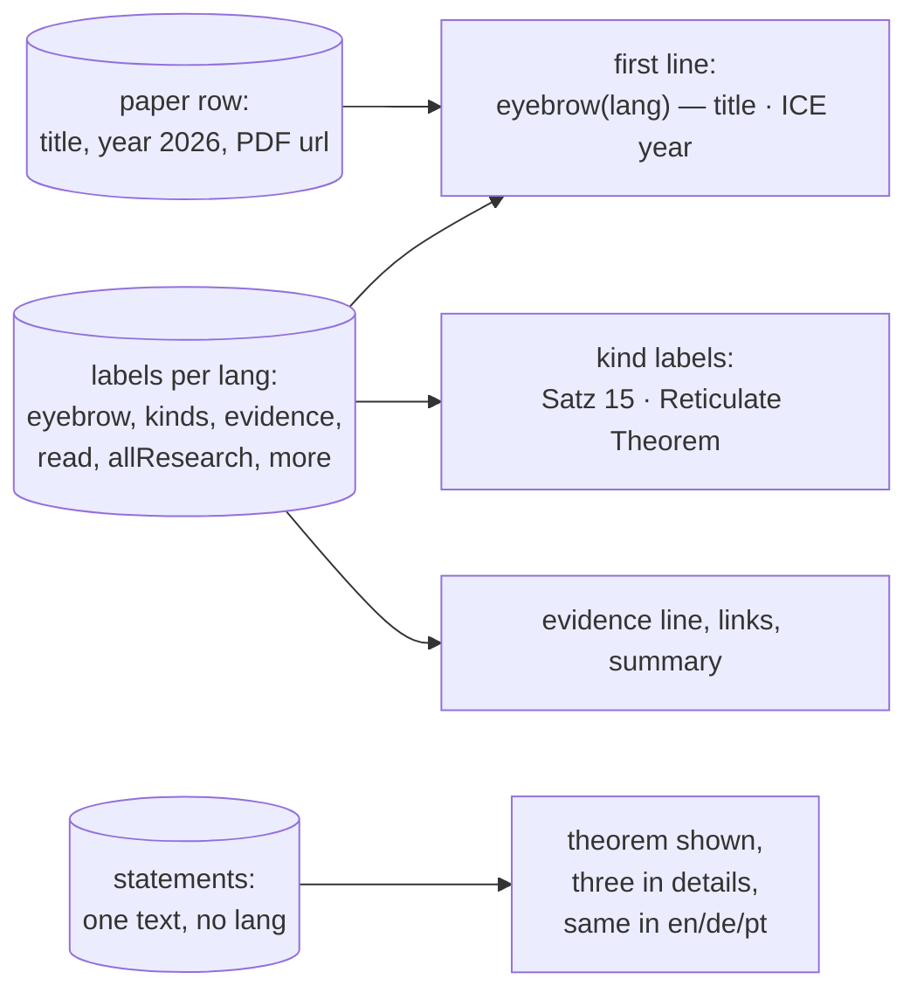

# Examples: Home page

Status: **agreed with the developer on 2026-11-02** (decisions D1–D22; D23 on 2026-11-03), rewritten for Website
v2. The first version was agreed on 2026-10-28. One file is still to come: the CV (D16).

The home page in three languages, at `/en/home`, `/de/home` and `/pt/home`. Design:
`docs/mockups/home/home-spec.md`, with the mock-up beside it. Its hero is the walking
skeleton: the first section that goes through every layer (MySQL, Flyway, the Spring Boot
content API, the Angular build, prerendering, the `next` preview).

Sections, in build order:
1. **Page frame** (`HOME-PAGE-nn`): what every language version of the page needs:
   `lang`, title, alternates, URLs. Built together with the hero, because the hero
   cannot be prerendered in three languages without it.
2. **Hero** (`HOME-HERO-nn`): notation line, sentence, text, three links, the 2³ lattice.
3. **Theorem band** (`HOME-PAPER-nn`): the Reticulate Theorem, its evidence, and three
   more results from the ICE 2026 paper that unfold, with a link to the PDF.

Later, each added here when its turn comes, in v2's order: proof strip, what I do, selected
work (before the theorem band on the page); how I work, writing, about teaser (after it).

Not in this file: the header, language links and footer (`docs/examples/shell.md`), and the
colours and theme settings (`docs/examples/theme.md`).

German and Portuguese labels not listed here come from today's `src/app/i18n/{de,pt}.ts`.

## 1. Page frame

| ID | Given | When | Then | Covered |
|----|-------|------|------|---------|
| HOME-PAGE-01 | the home page content exists in en, de and pt | the site is built | `/en/home/index.html`, `/de/home/index.html` and `/pt/home/index.html` exist, with `<html lang="en">`, `lang="de"` and `lang="pt"` | yes |
| HOME-PAGE-02 | the built `/de/home` | it is read | it has `<link rel="alternate" hreflang="en" href="https://zuacaldeira.com/en/home">`, the same for `de` and `pt`, and `hreflang="x-default"` pointing to `/en/home` | yes |
| HOME-PAGE-03 | the built `/pt/home` | it is read | `<title>` is "Alexandre Caldeira — Construo software e provo que os seus protocolos se cumprem."; en: "Alexandre Caldeira — I build software, and prove its protocols hold."; de: "Alexandre Caldeira — Ich baue Software und beweise, dass ihre Protokolle halten." | reopened: the test holds the old tagline |
| HOME-PAGE-04 | a visitor opens `/` | the page loads | it is the prerendered English home (same content as `/en/home`, `lang="en"`), with visible links to `/de/home` and `/pt/home` (SHELL-01); no redirect (D1) | reopened: the test reads `<link rel="alternate">`, and no visible link exists yet |
| HOME-PAGE-05 | an old link to `/home` (e.g. from a CV) | it is opened | nginx answers `301` with `Location: /en/home`; the same for every old path (`/about`, `/research`, `/running`, `/contact`), with the path kept exactly, so `/home/` → `/en/home/` (D2, D33, D34); the new location then opens the page | yes (web image, live config text, and on `next` on 2026-11-04, D35; the live config waits to be applied on the server, D36) |
| HOME-PAGE-06 | a visitor opens `/fr/home` | the page loads | the 404 page is shown; French is not a language of the site | yes (build, web image, and on `next` on 2026-11-04: `/fr/home` answers `404`, see HOME-PAGE-05's test 7; the live config waits to be applied on the server) |
| HOME-PAGE-07 | the built site | `sitemap.xml` is read | it lists the 15 pages `https://zuacaldeira.com/{en,de,pt}/{home,about,research,running,contact}`, without a trailing slash, and no old path (`/home`, `/about`, `/research`, `/running`, `/contact`); `/` is not listed (D40, D41) | yes (build) |
| HOME-PAGE-08 | the built site | each URL in `sitemap.xml` is checked | each is a prerendered page of the build (`<path>/index.html` exists), so the sitemap cannot name a page that is not there (D43) | yes (build) |

**HOME-PAGE-06, covered on 2026-11-03.** The 404 page of D9 is prerendered at `404/index.html`;
`build-site.yml` copies it to `404.html` without `|| true` (D31), so a build without it fails, and
HOME-PAGE-04's cp check guards the copy's source. Both nginx configs answer unknown paths with
`try_files $uri $uri/ =404` and `error_page 404 /404.html`: the web image's is run for real
(`npm run acceptance:nginx`, D30), the live one is read as text and still has to be applied on the
server. The `**` route keeps the browser on the page (D32). Tests: `frontend/acceptance/home.test.mjs`
(the page, its title, the copy, the live config), `frontend/acceptance/nginx/serve.test.mjs` (404 for
`/fr/home`, 200 for `/`, `/en/home`, `/de/home/`), `pages/not-found/not-found.spec.ts`,
`app.routes.spec.ts`, `i18n.service.spec.ts` (D9's wording in en, de and pt).

### Diagram: HOME-PAGE-06 (the 404 page, D9, D28 to D32)

Each dotted line shows where a test enters. Tests 9 and 10 run the real nginx of the web image in
Docker on the built site; the live config is only read as text (test 11).


Test list: 1–2 acceptance on `404/index.html` (wording, `lang`, title); 3 `build-site.yml` copies it
to `404.html`; 4–6 the component (English wording and link, English after `de`, title); 7 the
routes `/404` and `**`; 8 the `notFound` keys in en, de and pt; 9–10 `npm run acceptance:nginx`
(`/fr/home` → 404 with the page, `/en/home` and `/` → 200); 11 the live config's lines.

### Diagram: HOME-PAGE-05 (old links, D2, D33 to D39; D39 reopened by D42)

Tests 1 to 5 run the real nginx of the web image in Docker on the built site
(`frontend/acceptance/nginx/serve.test.mjs`); the live config is only read as text (test 6); test 7
is a manual check on `next` after the push (D35).



Test list (every test name cites HOME-PAGE-05, D37): 1 `/home` → `301`, `Location: /en/home`;
2 the same for `/about`, `/research`, `/running`, `/contact`; 3 `/home/` → `/en/home/`, a query
string kept; 4 following the `Location` gives `200`, `lang="en"`, not the 404 page; 5 `/homepage`
and `/home/x` still `404`; 6 the live config has the same line; 7 after the push, `curl` on
https://next.zuacaldeira.com (also HOME-PAGE-06's open check).

**HOME-PAGE-05, covered on 2026-11-04.** Tests 1 to 5
are in `frontend/acceptance/nginx/serve.test.mjs`, test 6 in `frontend/acceptance/home.test.mjs`.
Tests 4 and 5 were green on their first run; each was shown to bite (the redirect pointed at `/de`
once; the `$` anchor removed once). Found on the way: nginx answers `/en/home` (and `/de/home`) with
its own directory redirect to `/en/home/`, as it did before this element, so an old link takes two
hops, `/home` → `/en/home` → `/en/home/` → `200`, kept as it is (D39). Test 5 therefore does not expect `/en/home` to
answer `200` directly; test 4 holds that the chain ends on the page with no loop.

**Test 7 on `next` (D35),** run by hand from the developer's main session on 2026-11-04 around
16:45 UTC, after the push of `fbc4228` and its deploy (run 41869439292). Output verbatim:

```
$ curl -sI https://next.zuacaldeira.com/home
HTTP/2 301 
location: /en/home
$ curl -sI https://next.zuacaldeira.com/home/
HTTP/2 301 
location: /en/home/
$ curl -sI https://next.zuacaldeira.com/about
HTTP/2 301 
location: /en/about
$ curl -sI https://next.zuacaldeira.com/research?x=1
HTTP/2 301 
location: /en/research?x=1
$ curl -sI https://next.zuacaldeira.com/fr/home
HTTP/2 404 
$ curl -sIL https://next.zuacaldeira.com/home
HTTP/2 301 
location: /en/home
HTTP/2 301 
location: /en/home/
HTTP/2 200 
$ curl -sL https://next.zuacaldeira.com/home | grep -o "<html[^>]*lang=..."
<html lang="en"
```

The relative `Location` passes through the host nginx unchanged (no `:8080`), the two hops are D39's,
and the chain ends on the English page. The `/fr/home` line closes HOME-PAGE-06's open check on
`next`: it answers `404`. Only the status was checked there; that the body is the 404 page is held by
the web image test (`acceptance/nginx`).

### Diagram: HOME-PAGE-07 and 08 (the sitemap, D38, D40 to D44)

The tests read the built site; nginx is not part of this element (D41).


Test list (every test name cites its ID): 1 HOME-PAGE-07, no old path; 2 HOME-PAGE-07, exactly the
15 URLs of D40, without a slash; 3 HOME-PAGE-08, every `loc` is a page in `dist` (bites: a `loc` for a
page that does not exist, once); then, with no test, `CLAUDE.md`'s Routing and i18n sections (D45).

**HOME-PAGE-07 and 08, covered on 2026-11-04,** in `frontend/acceptance/home.test.mjs`, green on
a real build. Test 3 was green on its first run; it was shown to bite (a `loc` for `/de/software`,
which is not built yet, D15, added to the built sitemap once). Test 1 is implied by test 2's exact
list and kept because it names the old paths. Each URL still answers `301` to its form with a slash
until D42's element is built. Found on the way, not built: the `Language` type, `LANGUAGES` and
`TRANSLATION_MAP` still have `fr`, with `src/app/i18n/fr.ts`, and the comment on
`TRANSLATIONS_ENABLED` in `i18n.service.ts` still speaks of pt/de/fr and an English-only site.

## 2. Hero

None of these were covered, so their IDs were reused for the v2 hero. The photo and the wall
cases went with the old hero (D10, D11).

| ID | Given | When | Then | Covered |
|----|-------|------|------|---------|
| HOME-HERO-01 | the hero content stored in de | the site is built | `/de/home` shows "Ich baue Software und beweise, dass ihre Protokolle halten.", the text "Alexandre Zua Caldeira. Softwareentwickler in Berlin seit 2011 und Forscher im Bereich Programmiersprachen (POPL 2010, ICE 2026). Java-Backends, Verifikationswerkzeuge und KI-Agenten, die an ein geprüftes Protokoll gebunden sind.", and the links "Ausgewählte Arbeiten" → `/de/software`, "Lebenslauf herunterladen" → the CV (D16), "ICE-2026-Paper lesen →" → `#band` | partly: the sentence is the `<h1>`, from the seeded API (D27); the rest comes with the v2 hero |
| HOME-HERO-02 | the hero content stored in pt | the site is built | `/pt/home` shows "Construo software e provo que os seus protocolos se cumprem.", "Alexandre Zua Caldeira. Engenheiro de software em Berlim desde 2011 e investigador em linguagens de programação (POPL 2010, ICE 2026). Backends Java, ferramentas de verificação e agentes de IA sujeitos a um protocolo verificado.", "Ver trabalhos selecionados" → `/pt/software`, "Descarregar CV", "Ler o artigo ICE 2026 →" | partly: the sentence is the `<h1>`, from the seeded API (D27); the rest comes with the v2 hero |
| HOME-HERO-03 | the hero content stored in en | the site is built | `/en/home` shows "I build software, and prove its protocols hold.", "Alexandre Zua Caldeira. Software engineer in Berlin since 2011 and programming-languages researcher (POPL 2010, ICE 2026). Java backends, verification tooling, and AI agents held to a checked protocol.", "See selected work" → `/en/software`, "Download CV", "Read the ICE 2026 paper →"; the lattice figure is labelled "The lattice 2 to the third: software, research and running in parallel." with the caption "2³ · three threads in parallel · the atoms are links" (D23) | partly: the sentence is the `<h1>`, from the seeded API (D27); the rest comes with the v2 hero |
| HOME-HERO-04 | any language | the site is built | the `<h1>` is the sentence; the text starts with "Alexandre Zua Caldeira" in all three, because a name is not translated; the line above the `<h1>` is `Zua = software ∥ research ∥ running` in all three (notation, D13) | |
| HOME-HERO-05 | the hero content stored in pt | `GET /api/content/home/hero?lang=pt` | 200 with `{"headline": "Construo software e provo que os seus protocolos se cumprem.", "lede": "Alexandre Zua Caldeira. Engenheiro de software…", "workCta": "Ver trabalhos selecionados", "cvCta": "Descarregar CV", "paperCta": "Ler o artigo ICE 2026 →", "latticeLabel": "O reticulado 2 ao cubo: software, investigação e corrida em paralelo.", "latticeCaption": "2³ · três fios em paralelo · os átomos são ligações"}` (D3) | yes |
| HOME-HERO-06 | no hero content stored for de | the site is built | the build fails with a message naming page `home`, section `hero`, language `de`; nothing is deployed (D4) | yes (the snapshot script stops the build) |
| HOME-HERO-07 | any language, even a stray `fr` row | `GET /api/content/home/hero?lang=fr` | 404 (D5) | yes |
| HOME-HERO-08 | the built `/de/home` | it is read | the lattice figure is a group labelled "Der Verband 2 hoch 3: Software, Forschung und Laufen parallel." with the caption "2³ · drei Fäden parallel · die Atome sind Links"; the lattice's labels `software`, `research`, `running`, `⊥ end · contact` are the same in every language (D13) | |
| HOME-HERO-09 | the built `/de/home` | the lattice is read | its links are `software` → `/de/software`, `research` → `/de/research`, `running` → `/de/about#running`, `⊥ end · contact` → `/de/contact`; the same with `/en/` and `/pt/` | |
| HOME-HERO-10 | the build ran on `next` | https://next.zuacaldeira.com/de/home/ is opened | it shows the German hero of HOME-HERO-01 (system test) | |
| HOME-HERO-11 | no hero content stored for de | `GET /api/content/home/hero?lang=de` | 404: MISSING, with no fallback to another language (D4, D18) | yes |
| HOME-HERO-12 | the hero content stored in en | `GET /api/content/home/nope?lang=en` | 404: an unknown section is MISSING (D19) | yes |
| HOME-HERO-13 | the hero content stored in en | `GET /api/content/nope/hero?lang=en` | 404: an unknown page is MISSING (D19) | yes |
| HOME-HERO-14 | any stored content | `GET /api/content/home/hero` with no `lang` | 400 (D22) | yes |
| HOME-HERO-15 | an empty MySQL with Flyway and the `seed` profile | `GET /api/content/home/hero?lang=en`, `de`, `pt` | 200 with the seven fields of HOME-HERO-03 (D23), HOME-HERO-01 with 08, and HOME-HERO-05; every field non-empty (D24) | yes |
| HOME-HERO-16 | the default profile, with no `seed` | the backend starts | `home_hero` is empty, so the seed never reaches a database other than the build's (D24) | yes |
| HOME-HERO-17 | the content API cannot be reached | the fetch script runs | the build fails with a message naming the API's URL; nothing is deployed (D25) | yes |

### Diagram: the build's backend (HOME-HERO-06, 15, 16, 17)

The build starts its own MySQL and backend (D20, D26), takes a snapshot of the content, then
prerenders from the snapshot (D25). The unit tests of the script (06, 17) put a fake HTTP server
in place of the API; the integration tests (15, 16) put Testcontainers in place of compose.



### Diagram: HOME-HERO-01 (acceptance, at build time)

The test enters at the build. Everything inside the box is real; nothing is faked.



### Diagram: HOME-HERO-05 (backend integration)



### Diagram: the content API's answers (HOME-HERO-05, 07, 11, 12, 13, 14)

The test writes its own rows, then calls over real HTTP on a random port.



## 3. Theorem band

The four statements are quotations from the paper (Theorem 15, Definition 6, Lemma 8,
Proposition 18). They are notation and stay in English in every language. Only the
labels around them are translated. HOME-PAPER-01 to 05 are unchanged from the first version.

| ID | Given | When | Then | Covered |
|----|-------|------|------|---------|
| HOME-PAPER-01 | the paper stored with title "Session Type State Spaces Form Lattices", year 2026 | the site is built in de | the first line reads "Aus dem Paper — Session Type State Spaces Form Lattices · ICE 2026"; the title is not translated | |
| HOME-PAPER-02 | the same | the site is built in pt | the labels read "Do artigo", "Teorema 15 · Reticulate Theorem", "Definição 6", "Lema 8", "Proposição 18", and the link reads "Ler o artigo (PDF)" | |
| HOME-PAPER-03 | the same | the site is built in de | "Satz 15 · Reticulate Theorem", "Definition 6", "Lemma 8", "Proposition 18", "Paper lesen (PDF)" | |
| HOME-PAPER-04 | any language | the site is built | the statement texts are identical in en, de and pt, e.g. "For every well-formed session type S, ℒ(S)/≡ is a bounded lattice." | |
| HOME-PAPER-05 | any language | the site is built | the PDF link points to `/assets/pdfs/SessionTypeStateSpacesFormLattices-CameraReady.pdf` from the site root, not relative to `/de/home` | |
| HOME-PAPER-06 | the band in en, de and pt | the site is built | under the theorem it reads en "Checked on 108 benchmark protocols from networking, databases, distributed systems and AI. Mechanised in Lean 4, with two independent tool implementations."; de "Geprüft an 108 Benchmark-Protokollen aus Netzwerken, Datenbanken, verteilten Systemen und KI. In Lean 4 mechanisiert, mit zwei unabhängigen Werkzeug-Implementierungen."; pt "Verificado em 108 protocolos de referência de redes, bases de dados, sistemas distribuídos e IA. Mecanizado em Lean 4, com duas implementações independentes." | |
| HOME-PAPER-07 | the built `/de/home` with the band setting at its default (THEME-09) | it is read | Definition 6, Lemma 8 and Proposition 18 are in the HTML, inside a closed `<details>` whose summary reads "Definition 6, Lemma 8, Proposition 18"; pt "Definição 6, Lema 8, Proposição 18" | |
| HOME-PAPER-08 | any language | the site is built | a second link "All research" / "Zur Forschung" / "Toda a investigação" leads to `/xx/research` | |
| HOME-PAPER-09 | the paper labels stored in de | `GET /api/content/home/paper?lang=de` | 200 with `{"eyebrow": "Aus dem Paper", "paperTitle": "Session Type State Spaces Form Lattices", "year": 2026, "theorem": "Satz", "definition": "Definition", "lemma": "Lemma", "proposition": "Proposition", "evidence": "Geprüft an 108…", "read": "Paper lesen (PDF)", "allResearch": "Zur Forschung", "more": "Definition 6, Lemma 8, Proposition 18", "pdfUrl": "/assets/pdfs/SessionTypeStateSpacesFormLattices-CameraReady.pdf", "statements": [four objects: kind, number, name, text]}`; `statements` is the same for every `lang` (D3, D12) | |



## Decisions

Agreed with the developer on 2026-10-28:

- **D1. `/`** is the prerendered English home, with links to de and pt. No redirect by
  browser language.
- **D2. Old URLs** (`/home`, `/about`, `/research`, ...) get a `301` to `/en/...` in nginx.
- **D3. Content API: one call per section.** `GET /api/content/{page}/{section}?lang=xx`
  returns one JSON object per section (changed from "a flat JSON object" by D21).
- **D4. A missing translation fails the build**, naming page, section and language.
  No fallback to English.
- **D5. An unsupported language** (`lang=fr`) gets `404`.
- **D6, D8. Lattice wall:** parked with the wall itself (D11). If it returns, its SVG title
  is translated as drafted in the first version of this file, and its visible credit stays
  English. Note that a wrapper with `aria-hidden="true"` would hide that title from screen readers.
- **D7. Hero wording:** replaced by Website v2 (D10).
- **D9. The 404 page** (2026-10-29, for HOME-PAGE-06): one English page, prerendered at
  `/404` (`lang="en"`), shown for every unknown path, `/fr/home` included. Both nginx configs
  answer unknown paths with status `404` and that page (`error_page 404 /404.html`), not
  `index.csr.html` with `200`; the live config is applied on the server by the developer.
  Wording (en is shown; de and pt fill the translation files; `⊥` is notation, never
  translated): en "⊥ Page not found" / "This path ends at the bottom: there is no page
  here." / "Back to the home page" → `/en/home`; de "⊥ Seite nicht gefunden" / "Dieser Weg
  endet ganz unten: Hier gibt es keine Seite." / "Zur Startseite" → `/de/home`; pt "⊥ Página
  não encontrada" / "Este caminho acaba no fundo: aqui não há nenhuma página." / "Voltar ao
  início" → `/pt/home`.

Agreed with the developer on 2026-11-02:

- **D10. Website v2 stands, and software leads** the home page. The hero is the sentence and
  the 2³ lattice. The photo and "Researcher. Developer. Educator. Runner." are gone.
- **D11. Hero option B, band option C, frame option A.** The hero sits on the lozenge tile
  pattern; the wall leaves the home page. Hero and band are theme settings with these as
  defaults, and only the defaults are built now (`docs/examples/theme.md`).

- **D12. Statements stay in the page's HTML,** so a reader without JavaScript, a search engine
  and a screen reader can reach them.
- **D13. The lattice's labels and the `Zua = …` line are notation:** never translated. Checked
  with reticulateP on 2026-11-02 as `Zua = Software || Research || Running`, with
  `Software = &{build: end}`, `Research = &{prove: end}`, `Running = &{run: end}`: 8 states,
  12 transitions, a lattice.
- **D14. German and Portuguese wording:** the drafts in this file and in `shell.md` are agreed.
- **D15. Links to pages that do not exist yet** (`/software`, `/writing`) stay. `next` shows the
  404 page until those pages are built; `main` gets the new home only once they exist.
- **D16. The CV link** works the same way: it stays, and `main` waits for the file. The
  developer names the PDF and its languages. A public CV carries no phone number or street
  address.
- **D17. The availability line** in the footer is agreed as drafted (SHELL-07).
- **D18. D3's MISSING answer:** missing content answers `404`.
- **D19. An unknown page or section** is MISSING too: `404`.
- **D20. The build's backend:** when the site is built, the backend and MySQL run in containers
  started for the build, seeded by Flyway, so a build does not depend on the live server.
- **D21. D3 changed: one JSON object per section,** not a flat object in every case. The hero is
  flat; a section may nest, as HOME-PAPER-09 does with its `statements`. HOME-PAPER-09 is built
  with the theorem band.
- **D22. The API's error answers:** a `404` has an empty body. A request with no `lang` answers
  `400`.

Agreed with the developer on 2026-11-03:

- **D23. The English lattice text** is the mock-up's own wording: the label "The lattice 2 to the
  third: software, research and running in parallel." and the caption "2³ · three threads in
  parallel · the atoms are links" (HOME-HERO-03). The seed uses it.
- **D24. The seed** lives in its own Flyway location, `backend/src/main/resources/db/seed`, as a
  repeatable script. Only the `seed` profile adds that location, so tests and any other database
  stay empty (HOME-HERO-16).
- **D25. The build takes a snapshot.** Before `ng build`, `frontend/scripts/fetch-content.mjs`
  asks the API for every page, section and language and writes a git-ignored JSON file, which
  Angular imports. No HTTP at prerender or at runtime, so router links between languages keep
  their text. A missing answer or an unreachable API stops the build (HOME-HERO-06, 17).
- **D26. The build's containers:** `backend/Dockerfile` and a root `compose.build.yml` (MySQL 8.4
  and the backend with the `seed` profile). CI runs compose, the script, `ng build` and the
  acceptance tests on the runner; `frontend/Dockerfile` only copies the built site into nginx.
  Both `deploy-next.yml` and `deploy.yml` build this way, and `deploy-next.yml` runs the
  backend's tests first.
- **D27. The hero's sentence comes first.** This element puts only the `<h1>` from the snapshot
  into the v1 hero; the rest of the v2 hero is the next element.

Agreed with the developer on 2026-11-03, for HOME-PAGE-06:

- **D28. The 404 page's text** comes from the i18n files (`notFound` in en, de and pt, D9's
  wording), not from the content API. Only the English page is built.
- **D29. Its title** is "Alexandre Caldeira — Page not found", with no `noindex`: the status `404`
  keeps it out of search results.
- **D30. nginx is tested for real:** `npm run acceptance:nginx` starts
  `nginxinc/nginx-unprivileged:1.27-alpine` with `frontend/docker/nginx.conf` and the built site
  mounted; `build-site.yml` runs it after the copy. The live config, applied by hand, gets a text
  check of the same lines.
- **D31. `404.html` stays** (`error_page 404 /404.html`), copied from `404/index.html` in
  `build-site.yml`, without `|| true`.
- **D32. A `**` route** shows the 404 page too, so the browser's router keeps it on an unknown path
  such as `/fr/home` instead of a blank page.

Agreed with the developer on 2026-11-04, for HOME-PAGE-05:

- **D33. The old paths** are the live site's routes and sitemap entries: `/home`, `/about`,
  `/research`, `/running`, `/contact`. `/` stays the English home (D1). `/work` and `/paedagogik`
  (live from 2026-02-07 to 2026-08-12) keep answering `404`; their redirect comes with their routes.
- **D34. One line, the path kept exactly:** `return 301 /en$request_uri;`, so `/home` → `/en/home`,
  `/home/` → `/en/home/`, and a query string is kept.
- **D35. The check on `next`** is by hand after the developer's push: `curl` on
  https://next.zuacaldeira.com, its output recorded here. It also closes HOME-PAGE-06's open check
  on `next`.
- **D36. The live config** gets the same line, checked as text; it is not applied on the server
  before the first merge of `next` into `main` (`main` has no `/en/home` yet). There nginx answers
  with an absolute `Location: https://zuacaldeira.com/en/home`, the same target.
- **D37. Every test of HOME-PAGE-05 cites the ID in its name,** the one that follows the `Location`
  included.
- **D38. The next element** is the leftovers of HOME-PAGE-05, not built in it: the sitemap's old
  URLs (`frontend/public/sitemap.xml` still lists `/home`, `/about`, ...) and the Routing section of
  `CLAUDE.md` ("`/` redirects to `/home`").
- **D39. An old link takes two hops** (agreed 2026-11-04): `/home` → `/en/home` (our `301`) →
  `/en/home/` (nginx's own directory redirect) → `200`. D34 and HOME-PAGE-05's `Location: /en/home`
  stay as they are, matching the form without a slash that the `hreflang` links use. Test 4 holds
  that the chain ends on the English page with no loop.

Agreed with the developer on 2026-11-04, for D38 (HOME-PAGE-07 and 08):

- **D40. The sitemap lists all 15 pages:** home, about, research, running and contact in en, de and
  pt. `/` is left out: it is the same page as `/en/home` (D1).
- **D41. Without the trailing slash,** `https://zuacaldeira.com/en/home`, matching the `hreflang`
  links. For now such a URL answers `301` to `/en/home/` (D39), so nginx is not tested here.
- **D42. The next element reopens D39:** nginx answers `/en/home` with `200` directly, so a
  canonical URL (sitemap, `hreflang`) never answers with a redirect and an old link takes one hop.
  It is built right after this one, before the first merge of `next` into `main`.
- **D43. No `hreflang` in the sitemap;** the pages carry their alternates (HOME-PAGE-02). The
  sitemap stays hand-written in `frontend/public/sitemap.xml`, tied to the build by HOME-PAGE-08.
- **D44. No `<priority>`** in the sitemap.
- **D45. `CLAUDE.md`** gets a Routing section for the language prefixes, and its i18n section drops
  `'fr'` (French is not supported at the start) and the English fallback for German; one doc commit.
