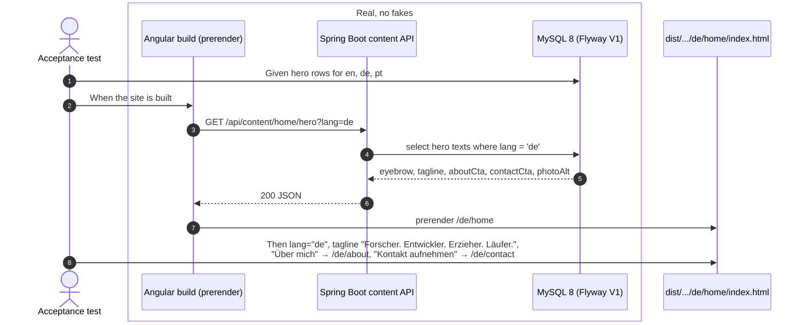
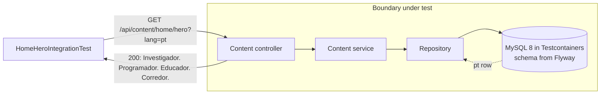
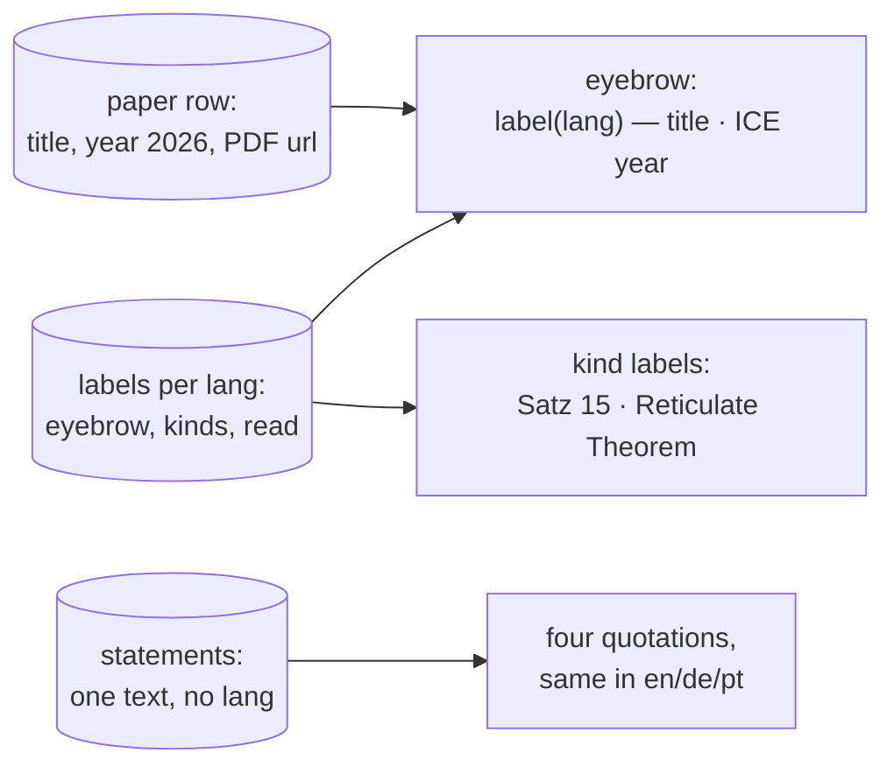

# Examples: Home page

Status: **agreed with the developer on 2026-10-28** (decisions D1–D7 below). One wording
is still to confirm: the German and Portuguese SVG titles in HOME-HERO-09.

The home page in three languages, at `/en/home`, `/de/home` and `/pt/home`. It is the
first page of the new site, and its hero is the walking skeleton: the first section
that goes through every layer (MySQL, Flyway, the Spring Boot content API, the Angular
build, prerendering, the `next` preview).

Sections, in build order:
1. **Page frame** (`HOME-PAGE-nn`): what every language version of the page needs:
   `lang`, title, alternates, URLs. Built together with the hero, because the hero
   cannot be prerendered in three languages without it.
2. **Hero** (`HOME-HERO-nn`): name, eyebrow, tagline, two buttons, photo, lattice wall.
3. **Paper statements** (`HOME-PAPER-nn`): the Reticulate Theorem and three results
   from the ICE 2026 paper, with a link to the PDF.

The navigation, language switcher and footer are shared by every page. They get their
own file (`docs/examples/shell.md`) and are out of scope here.

Texts below are copied from today's `src/app/i18n/{en,de,pt}.ts`. Texts marked
*(proposed)* do not exist yet and need the developer's wording.

## 1. Page frame

| ID | Given | When | Then | Covered |
|----|-------|------|------|---------|
| HOME-PAGE-01 | the home page content exists in en, de and pt | the site is built | `/en/home/index.html`, `/de/home/index.html` and `/pt/home/index.html` exist, with `<html lang="en">`, `lang="de"` and `lang="pt"` | |
| HOME-PAGE-02 | the built `/de/home` | it is read | it has `<link rel="alternate" hreflang="en" href="https://zuacaldeira.com/en/home">`, the same for `de` and `pt`, and `hreflang="x-default"` pointing to `/en/home` | |
| HOME-PAGE-03 | the built `/pt/home` | it is read | `<title>` is "Alexandre Caldeira — Investigador. Programador. Educador. Corredor." (en: "Alexandre Caldeira — Researcher. Developer. Educator. Runner.", de: "Alexandre Caldeira — Forscher. Entwickler. Erzieher. Läufer.") | |
| HOME-PAGE-04 | a visitor opens `/` | the page loads | it is the prerendered English home (same content as `/en/home`, `lang="en"`), with links to `/de/home` and `/pt/home`; no redirect (D1) | |
| HOME-PAGE-05 | an old link to `/home` (e.g. from a CV) | it is opened | nginx answers `301` with `Location: /en/home`; the same for every old path (`/about` → `/en/about`, ...) (D2) | |
| HOME-PAGE-06 | a visitor opens `/fr/home` | the page loads | the 404 page is shown; French is not a language of the site | |

## 2. Hero

| ID | Given | When | Then | Covered |
|----|-------|------|------|---------|
| HOME-HERO-01 | the hero content stored in de | the site is built | `/de/home` shows the eyebrow "Piri → Estremoz → Lissabon → Berlin", the tagline "Forscher. Entwickler. Erzieher. Läufer.", a button "Über mich" to `/de/about` and a button "Kontakt aufnehmen" to `/de/contact` | |
| HOME-HERO-02 | the hero content stored in pt | the site is built | `/pt/home` shows "Piri → Estremoz → Lisboa → Berlim", "Investigador. Programador. Educador. Corredor.", "Sobre mim" to `/pt/about`, "Entrar em contacto" to `/pt/contact` | |
| HOME-HERO-03 | the hero content stored in en | the site is built | `/en/home` shows "Piri → Estremoz → Lisbon → Berlin", "Researcher. Developer. Educator. Runner.", "About me" to `/en/about`, "Get in touch" to `/en/contact` | |
| HOME-HERO-04 | any language | the site is built | the `<h1>` is "Alexandre Zua Caldeira" in all three; a name is not translated | |
| HOME-HERO-05 | the hero content stored in pt | `GET /api/content/home/hero?lang=pt` | 200 with `{"eyebrow": "Piri → Estremoz → Lisboa → Berlim", "tagline": "Investigador. Programador. Educador. Corredor.", "aboutCta": "Sobre mim", "contactCta": "Entrar em contacto", "photoAlt": "Nascer do sol com nevoeiro sobre um campo perto de Berlim"}` (D3) | |
| HOME-HERO-06 | no hero content stored for de | the site is built | the build fails with a message naming page `home`, section `hero`, language `de`; nothing is deployed (D4) | |
| HOME-HERO-07 | any language | `GET /api/content/home/hero?lang=fr` | 404 (D5) | |
| HOME-HERO-08 | the built `/de/home` | it is read | the photo's alt text is German: "Nebliger Sonnenaufgang über einem Feld bei Berlin"; pt: "Nascer do sol com nevoeiro sobre um campo perto de Berlim"; en: "Misty sunrise over a field near Berlin" | |
| HOME-HERO-09 | the lattice wall behind the hero | the site is built in de and in pt | the SVG `<title>` is translated: de "Die 74 verschiedenen Verbände, die 104 Benchmark-Protokolle aus Session Type State Spaces Form Lattices (ICE 2026) auf Stufe R2′ bilden, nach Größe geordnet. Die 47 nicht-distributiven sind in einer anderen Farbe markiert." *(wording to confirm)*; pt "Os 74 reticulados distintos que 104 protocolos de referência de Session Type State Spaces Form Lattices (ICE 2026) formam no degrau R2′, ordenados por tamanho. Os 47 não distributivos estão marcados com outra cor." *(wording to confirm)*. The visible credit "behind: 74 distinct lattices from 104 benchmark protocols at rung R2′, 47 non-distributive" stays English in every language (D6) | |
| HOME-HERO-10 | the build ran on `next` | https://next.zuacaldeira.com/de/home is opened | it shows the German hero of HOME-HERO-01 (system test, after the server is set up) | |

### Diagram: HOME-HERO-01 (acceptance, at build time)

The test enters at the build. Everything inside the box is real; nothing is faked.

### Diagram: HOME-HERO-05 (backend integration)

## 3. Paper statements

The four statements are quotations from the paper (Theorem 15, Definition 6, Lemma 8,
Proposition 18). They are notation and stay in English in every language. Only the
labels around them are translated.

| ID | Given | When | Then | Covered |
|----|-------|------|------|---------|
| HOME-PAPER-01 | the paper stored with title "Session Type State Spaces Form Lattices", year 2026 | the site is built in de | the eyebrow reads "Aus dem Paper — Session Type State Spaces Form Lattices · ICE 2026"; the title is not translated | |
| HOME-PAPER-02 | the same | the site is built in pt | the labels read "Do artigo", "Teorema 15 · Reticulate Theorem", "Definição 6", "Lema 8", "Proposição 18", and the link reads "Ler o artigo (PDF)" | |
| HOME-PAPER-03 | the same | the site is built in de | "Satz 15 · Reticulate Theorem", "Definition 6", "Lemma 8", "Proposition 18", "Paper lesen (PDF)" | |
| HOME-PAPER-04 | any language | the site is built | the statement texts are identical in en, de and pt, e.g. "For every well-formed session type S, ℒ(S)/≡ is a bounded lattice." | |
| HOME-PAPER-05 | any language | the site is built | the PDF link points to `/assets/pdfs/SessionTypeStateSpacesFormLattices-CameraReady.pdf` from the site root, not relative to `/de/home` | |

## Decisions

Agreed with the developer on 2026-10-28.

- **D1. `/`** is the prerendered English home, with links to de and pt. No redirect by
  browser language.
- **D2. Old URLs** (`/home`, `/about`, `/research`, ...) get a `301` to `/en/...` in nginx.
- **D3. Content API: one call per section.** `GET /api/content/{page}/{section}?lang=xx`
  returns a flat JSON object of that section's texts.
- **D4. A missing translation fails the build**, naming page, section and language.
  No fallback to English.
- **D5. An unsupported language** (`lang=fr`) gets `404`.
- **D6. Lattice wall:** the SVG title (what screen readers announce) is translated; the
  visible credit stays English as research notation.
- **D7. Hero wording:** the German and Portuguese texts from the existing translation
  files are kept as they are, including "Erzieher" and "Educador".
