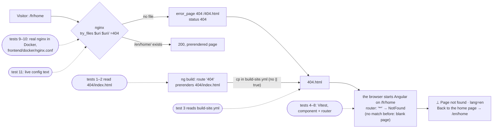
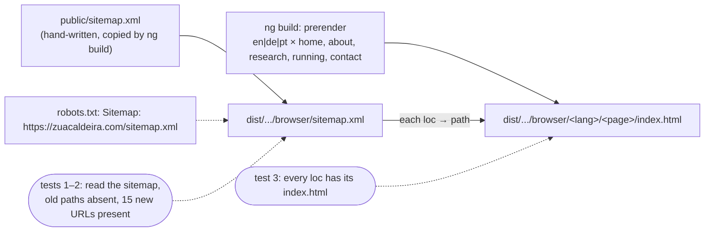
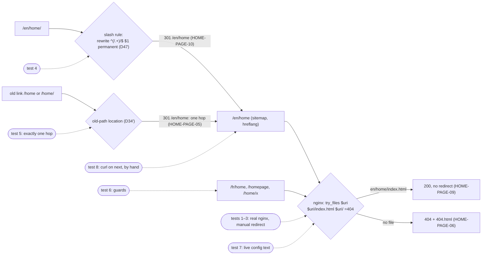
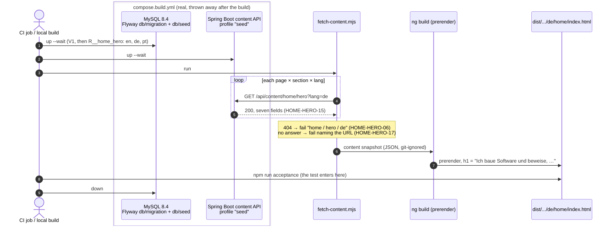
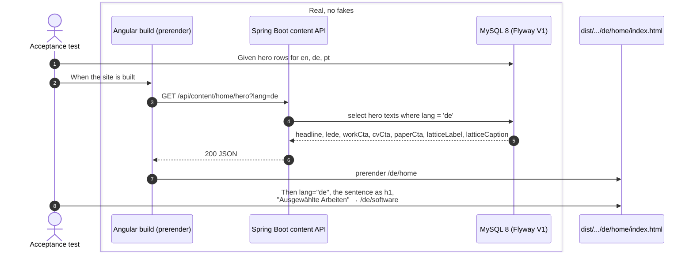
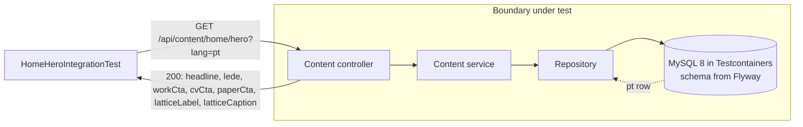
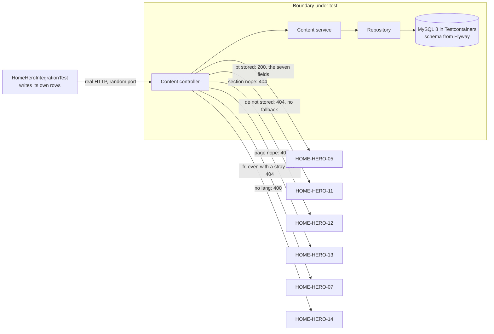
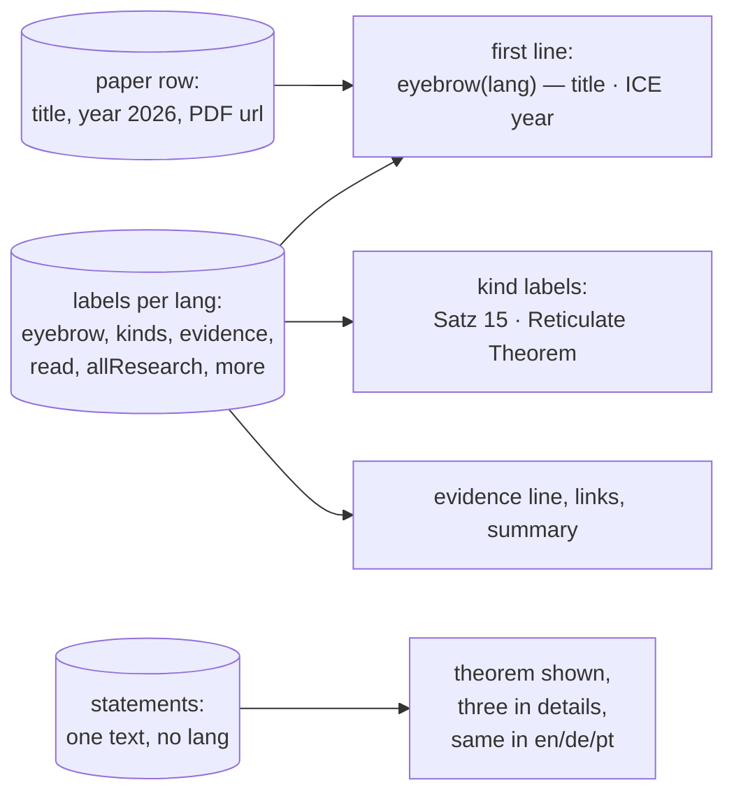

# Examples: Home page

Status: **agreed with the developer on 2026-11-02** (decisions D1–D22; D23 on 2026-11-03), rewritten for Website
v2. The first version was agreed on 2026-10-28. One file is still to come: the CV (D16).

The home page in three languages, at `/en/home`, `/de/home` and `/pt/home`. Design:
`docs/mockups/home/home-spec.md`, with the mock-up beside it. Its hero is the walking
skeleton: the first section that goes through every layer (MySQL, Flyway, the Spring Boot
content API, the Angular build, prerendering, the `next` preview).

Sections, in build order:
1. **Page frame** (`HOME-PAGE-nn`): what every language version of the page needs:
   `lang`, title, alternates, URLs. Built together with the hero, because the hero
   cannot be prerendered in three languages without it.
2. **Hero** (`HOME-HERO-nn`): notation line, sentence, text, three links, the 2³ lattice.
3. **Theorem band** (`HOME-PAPER-nn`): the Reticulate Theorem, its evidence, and three
   more results from the ICE 2026 paper that unfold, with a link to the PDF.

Later, each added here when its turn comes, in v2's order: proof strip, what I do, selected
work (before the theorem band on the page); how I work, writing, about teaser (after it).

Not in this file: the header, language links and footer (`docs/examples/shell.md`), and the
colours and theme settings (`docs/examples/theme.md`).

German and Portuguese labels not listed here come from today's `src/app/i18n/{de,pt}.ts`.

## 1. Page frame

| ID | Given | When | Then | Covered |
|----|-------|------|------|---------|
| HOME-PAGE-01 | the home page content exists in en, de and pt | the site is built | `/en/home/index.html`, `/de/home/index.html` and `/pt/home/index.html` exist, with `<html lang="en">`, `lang="de"` and `lang="pt"` | yes |
| HOME-PAGE-02 | the built `/de/home` | it is read | it has `<link rel="alternate" hreflang="en" href="https://zuacaldeira.com/en/home">`, the same for `de` and `pt`, and `hreflang="x-default"` pointing to `/en/home` | yes |
| HOME-PAGE-03 | the built `/pt/home` | it is read | `<title>` is "Alexandre Caldeira — Construo software e provo que os seus protocolos se cumprem."; en: "Alexandre Caldeira — I build software, and prove its protocols hold."; de: "Alexandre Caldeira — Ich baue Software und beweise, dass ihre Protokolle eingehalten werden." | reopened: the test holds the old tagline |
| HOME-PAGE-04 | a visitor opens `/` | the page loads | it is the prerendered English home (same content as `/en/home`, `lang="en"`), with visible links to `/de/home` and `/pt/home` (SHELL-01); no redirect (D1) | reopened: the test reads `<link rel="alternate">`, and no visible link exists yet |
| HOME-PAGE-05 | an old link to `/home` (e.g. from a CV) | it is opened | nginx answers `301` with `Location: /en/home`; the same for every old path (`/about`, `/research`, `/running`, `/contact`), the query string kept and a trailing slash dropped, so `/home/` → `/en/home` (D2, D33, D34′); the new location then answers `200`: one hop (D46) | yes (web image and live config text, 2026-11-04, and on `next` the same day, test 8; the live config waits to be applied on the server, D48) |
| HOME-PAGE-06 | a visitor opens `/fr/home` | the page loads | the 404 page is shown; French is not a language of the site | yes (build, web image, and on `next` on 2026-11-04: `/fr/home` answers `404`, see HOME-PAGE-05's test 7; the live config waits to be applied on the server) |
| HOME-PAGE-07 | the built site | `sitemap.xml` is read | it lists the 15 pages `https://zuacaldeira.com/{en,de,pt}/{home,about,research,running,contact}`, without a trailing slash, and no old path (`/home`, `/about`, `/research`, `/running`, `/contact`); `/` is not listed (D40, D41) | yes (build) |
| HOME-PAGE-08 | the built site | each URL in `sitemap.xml` is checked | each is a prerendered page of the build (`<path>/index.html` exists), so the sitemap cannot name a page that is not there (D43) | yes (build) |
| HOME-PAGE-09 | the built site in the web image's nginx | each canonical URL is requested: the 15 in the sitemap, and every `hreflang` target of the built pages | each answers `200` with no redirect, and is not the 404 page (D46) | yes (web image, 2026-11-04, and `/en/home` on `next` the same day, test 8) |
| HOME-PAGE-10 | the same | `/en/home/` is requested | `301` with `Location: /en/home`; any path ending in `/` except `/` loses the slash, the query string kept, so `/de/about/?x=1` → `/de/about?x=1` (D47) | yes (web image and live config text, 2026-11-04, and on `next` the same day, test 8) |

**HOME-PAGE-06, covered on 2026-11-03.** The 404 page of D9 is prerendered at `404/index.html`;
`build-site.yml` copies it to `404.html` without `|| true` (D31), so a build without it fails, and
HOME-PAGE-04's cp check guards the copy's source. Both nginx configs answer unknown paths with
`try_files $uri $uri/ =404` and `error_page 404 /404.html`: the web image's is run for real
(`npm run acceptance:nginx`, D30), the live one is read as text and still has to be applied on the
server. The `**` route keeps the browser on the page (D32). Tests: `frontend/acceptance/home.test.mjs`
(the page, its title, the copy, the live config), `frontend/acceptance/nginx/serve.test.mjs` (404 for
`/fr/home`, 200 for `/`, `/en/home`, `/de/home/`), `pages/not-found/not-found.spec.ts`,
`app.routes.spec.ts`, `i18n.service.spec.ts` (D9's wording in en, de and pt).

### Diagram: HOME-PAGE-06 (the 404 page, D9, D28 to D32)

Each dotted line shows where a test enters. Tests 9 and 10 run the real nginx of the web image in
Docker on the built site; the live config is only read as text (test 11).



Test list: 1–2 acceptance on `404/index.html` (wording, `lang`, title); 3 `build-site.yml` copies it
to `404.html`; 4–6 the component (English wording and link, English after `de`, title); 7 the
routes `/404` and `**`; 8 the `notFound` keys in en, de and pt; 9–10 `npm run acceptance:nginx`
(`/fr/home` → 404 with the page, `/en/home` and `/` → 200); 11 the live config's lines.

### Diagram: HOME-PAGE-05 (old links, D2, D33 to D39; D39 replaced by D46)

This diagram and the notes under it are the state of 2026-11-04 before D46: two hops, `/home/` →
`/en/home/`. The one-hop version is the diagram of HOME-PAGE-09 and 10 below.

Tests 1 to 5 run the real nginx of the web image in Docker on the built site
(`frontend/acceptance/nginx/serve.test.mjs`); the live config is only read as text (test 6); test 7
is a manual check on `next` after the push (D35).


Test list (every test name cites HOME-PAGE-05, D37): 1 `/home` → `301`, `Location: /en/home`;
2 the same for `/about`, `/research`, `/running`, `/contact`; 3 `/home/` → `/en/home/`, a query
string kept; 4 following the `Location` gives `200`, `lang="en"`, not the 404 page; 5 `/homepage`
and `/home/x` still `404`; 6 the live config has the same line; 7 after the push, `curl` on
https://next.zuacaldeira.com (also HOME-PAGE-06's open check).

**HOME-PAGE-05, covered on 2026-11-04.** Tests 1 to 5
are in `frontend/acceptance/nginx/serve.test.mjs`, test 6 in `frontend/acceptance/home.test.mjs`.
Tests 4 and 5 were green on their first run; each was shown to bite (the redirect pointed at `/de`
once; the `$` anchor removed once). Found on the way: nginx answers `/en/home` (and `/de/home`) with
its own directory redirect to `/en/home/`, as it did before this element, so an old link takes two
hops, `/home` → `/en/home` → `/en/home/` → `200`, kept as it is (D39). Test 5 therefore does not expect `/en/home` to
answer `200` directly; test 4 holds that the chain ends on the page with no loop.

**Test 7 on `next` (D35),** run by hand from the developer's main session on 2026-11-04 around
16:45 UTC, after the push of `fbc4228` and its deploy (run 41869439292). Output verbatim:

```
$ curl -sI https://next.zuacaldeira.com/home
HTTP/2 301 
location: /en/home
$ curl -sI https://next.zuacaldeira.com/home/
HTTP/2 301 
location: /en/home/
$ curl -sI https://next.zuacaldeira.com/about
HTTP/2 301 
location: /en/about
$ curl -sI https://next.zuacaldeira.com/research?x=1
HTTP/2 301 
location: /en/research?x=1
$ curl -sI https://next.zuacaldeira.com/fr/home
HTTP/2 404 
$ curl -sIL https://next.zuacaldeira.com/home
HTTP/2 301 
location: /en/home
HTTP/2 301 
location: /en/home/
HTTP/2 200 
$ curl -sL https://next.zuacaldeira.com/home | grep -o "<html[^>]*lang=..."
<html lang="en"
```

The relative `Location` passes through the host nginx unchanged (no `:8080`), the two hops are D39's,
and the chain ends on the English page. The `/fr/home` line closes HOME-PAGE-06's open check on
`next`: it answers `404`. Only the status was checked there; that the body is the 404 page is held by
the web image test (`acceptance/nginx`).

### Diagram: HOME-PAGE-07 and 08 (the sitemap, D38, D40 to D44)

The tests read the built site; nginx is not part of this element (D41).



Test list (every test name cites its ID): 1 HOME-PAGE-07, no old path; 2 HOME-PAGE-07, exactly the
15 URLs of D40, without a slash; 3 HOME-PAGE-08, every `loc` is a page in `dist` (bites: a `loc` for a
page that does not exist, once); then, with no test, `CLAUDE.md`'s Routing and i18n sections (D45).

**HOME-PAGE-07 and 08, covered on 2026-11-04,** in `frontend/acceptance/home.test.mjs`, green on
a real build. Test 3 was green on its first run; it was shown to bite (a `loc` for `/de/software`,
which is not built yet, D15, added to the built sitemap once). Test 1 is implied by test 2's exact
list and kept because it names the old paths. Each URL still answers `301` to its form with a slash
until D42's element is built. Found on the way, not built: the `Language` type, `LANGUAGES` and
`TRANSLATION_MAP` still have `fr`, with `src/app/i18n/fr.ts`, and the comment on
`TRANSLATIONS_ENABLED` in `i18n.service.ts` still speaks of pt/de/fr and an English-only site.
(Done on 2026-11-04: I18N-01 and I18N-02 in `docs/examples/i18n.md`.)

### Diagram: HOME-PAGE-09 and 10, and HOME-PAGE-05 with one hop (D46 to D48)

Tests 1 to 6 run the real nginx of the web image in Docker on the built site
(`frontend/acceptance/nginx/serve.test.mjs`), with redirects not followed; the live config is only
read as text (test 7); test 8 is by hand on `next` after the push (D35).



Test list: 1 HOME-PAGE-09, `/en/home` answers `200` with no redirect, `lang="en"`; 2 HOME-PAGE-09,
every `loc` of the built sitemap answers `200` directly; 3 HOME-PAGE-09, every `hreflang` target of
the 15 built pages answers `200` directly; 4 HOME-PAGE-10, `/en/home/` → `301 /en/home`,
`/de/about/?x=1` → `/de/about?x=1`; 5 HOME-PAGE-05, `/home` and `/home/` each take exactly one hop
(the existing test "keeps its trailing slash" changes with D34′); 6 the guards stay: `/` `200`,
`/fr/home`, `/homepage`, `/home/x` `404` (the `200` test's `/de/home/` becomes `/de/home`); 7 the live
config has the same lines (D48); 8 after the push, `curl` on https://next.zuacaldeira.com: `/en/home`
`200`, `/en/home/` `301`, `/home` one `301` then `200`.

**HOME-PAGE-09 and 10, and HOME-PAGE-05 with one hop, covered on 2026-11-04,** on `next`
too (test 8, below). Tests 1 to 6 are in `frontend/acceptance/nginx/serve.test.mjs`, test 7 in
`frontend/acceptance/home.test.mjs`. Red first: tests 1 (`/en/home` answered `301 /en/home/`), 4
(`/en/home/` answered `200`), 5's slash test (`Location: /en/home/`) and 7 (the live config lacked
the lines). Green on the first run, each shown to bite: tests 2 and 3 (the `try_files` fix taken out
once), 5's one-hop test (the old `return 301 /en$request_uri;` put back once), 6 (the slash rule
loosened to `^(.*)/$` once: `/` looped, and the whole file went red in its startup fetch of `/`).
The slash rule sits inside `location /`, not at server level, so the old paths' own location still
catches `/home/` and an old link takes one hop. The live config's `Location` is absolute
(`https://zuacaldeira.com/en/home`), the same target (D36).

**Test 8 on `next` (D35),** run by hand from the developer's main session on 2026-11-04 around
17:40 UTC, after the push of `1b8344d` and its deploy (run 41876588483). Output verbatim:

```
$ curl -sI https://next.zuacaldeira.com/en/home
HTTP/2 200 
$ curl -sI https://next.zuacaldeira.com/en/home/
HTTP/2 301 
location: /en/home
$ curl -sI https://next.zuacaldeira.com/home/
HTTP/2 301 
location: /en/home
$ curl -sIL https://next.zuacaldeira.com/home
HTTP/2 301 
location: /en/home
HTTP/2 200 
```

The canonical URL answers `200` with no redirect (HOME-PAGE-09), the slashed form answers `301`
without the slash (HOME-PAGE-10), and an old link, with or without its slash, takes one hop to
`200` (HOME-PAGE-05, D46). Only the status and `Location` were checked here; that the page is the
English home is held by the web image tests.

## 2. Hero

None of these were covered, so their IDs were reused for the v2 hero. The photo and the wall
cases went with the old hero (D10, D11).

| ID | Given | When | Then | Covered |
|----|-------|------|------|---------|
| HOME-HERO-01 | the hero content stored in de | the site is built | `/de/home` shows "Ich baue Software und beweise, dass ihre Protokolle eingehalten werden.", the text "Alexandre Zua Caldeira. Softwareentwickler in Berlin seit 2011 und Forscher im Bereich Programmiersprachen (POPL 2010, ICE 2026). Java-Backends, Verifikationswerkzeuge und KI-Agenten, die an ein geprüftes Protokoll gebunden sind.", and the links "Ausgewählte Arbeiten" → `/de/software`, "Lebenslauf herunterladen" → the CV (D16), "ICE-2026-Paper lesen →" → `#band` | partly: the sentence is the `<h1>`, from the seeded API (D27); the rest comes with the v2 hero |
| HOME-HERO-02 | the hero content stored in pt | the site is built | `/pt/home` shows "Construo software e provo que os seus protocolos se cumprem.", "Alexandre Zua Caldeira. Engenheiro de software em Berlim desde 2011 e investigador em linguagens de programação (POPL 2010, ICE 2026). Backends Java, ferramentas de verificação e agentes de IA sujeitos a um protocolo verificado.", "Ver trabalhos selecionados" → `/pt/software`, "Descarregar CV", "Ler o artigo ICE 2026 →" | partly: the sentence is the `<h1>`, from the seeded API (D27); the rest comes with the v2 hero |
| HOME-HERO-03 | the hero content stored in en | the site is built | `/en/home` shows "I build software, and prove its protocols hold.", "Alexandre Zua Caldeira. Software engineer in Berlin since 2011 and programming-languages researcher (POPL 2010, ICE 2026). Java backends, verification tooling, and AI agents held to a checked protocol.", "See selected work" → `/en/software`, "Download CV", "Read the ICE 2026 paper →"; the lattice figure is labelled "The lattice 2 to the third: software, research and running in parallel." with the caption "2³ · three threads in parallel · the atoms are links" (D23) | partly: the sentence is the `<h1>`, from the seeded API (D27); the rest comes with the v2 hero |
| HOME-HERO-04 | any language | the site is built | the `<h1>` is the sentence; the text starts with "Alexandre Zua Caldeira" in all three, because a name is not translated; the line above the `<h1>` is `Zua = software ∥ research ∥ running` in all three (notation, D13) | |
| HOME-HERO-05 | the hero content stored in pt | `GET /api/content/home/hero?lang=pt` | 200 with `{"headline": "Construo software e provo que os seus protocolos se cumprem.", "lede": "Alexandre Zua Caldeira. Engenheiro de software…", "workCta": "Ver trabalhos selecionados", "cvCta": "Descarregar CV", "paperCta": "Ler o artigo ICE 2026 →", "latticeLabel": "O reticulado 2 ao cubo: software, investigação e corrida em paralelo.", "latticeCaption": "2³ · três fios em paralelo · os átomos são ligações"}` (D3) | yes |
| HOME-HERO-06 | no hero content stored for de | the site is built | the build fails with a message naming page `home`, section `hero`, language `de`; nothing is deployed (D4) | yes (the snapshot script stops the build) |
| HOME-HERO-07 | any language, even a stray `fr` row | `GET /api/content/home/hero?lang=fr` | 404 (D5) | yes |
| HOME-HERO-08 | the built `/de/home` | it is read | the lattice figure is a group labelled "Der Verband 2 hoch 3: Software, Forschung und Laufen parallel." with the caption "2³ · drei Fäden parallel · die Atome sind Links"; the lattice's labels `software`, `research`, `running`, `⊥ end · contact` are the same in every language (D13) | |
| HOME-HERO-09 | the built `/de/home` | the lattice is read | its links are `software` → `/de/software`, `research` → `/de/research`, `running` → `/de/about#running`, `⊥ end · contact` → `/de/contact`; the same with `/en/` and `/pt/` | |
| HOME-HERO-10 | the build ran on `next` | https://next.zuacaldeira.com/de/home/ is opened | it shows the German hero of HOME-HERO-01 (system test) | |
| HOME-HERO-11 | no hero content stored for de | `GET /api/content/home/hero?lang=de` | 404: MISSING, with no fallback to another language (D4, D18) | yes |
| HOME-HERO-12 | the hero content stored in en | `GET /api/content/home/nope?lang=en` | 404: an unknown section is MISSING (D19) | yes |
| HOME-HERO-13 | the hero content stored in en | `GET /api/content/nope/hero?lang=en` | 404: an unknown page is MISSING (D19) | yes |
| HOME-HERO-14 | any stored content | `GET /api/content/home/hero` with no `lang` | 400 (D22) | yes |
| HOME-HERO-15 | an empty MySQL with Flyway and the `seed` profile | `GET /api/content/home/hero?lang=en`, `de`, `pt` | 200 with the seven fields of HOME-HERO-03 (D23), HOME-HERO-01 with 08, and HOME-HERO-05; every field non-empty (D24) | yes |
| HOME-HERO-16 | the default profile, with no `seed` | the backend starts | `home_hero` is empty, so the seed never reaches a database other than the build's (D24) | yes |
| HOME-HERO-17 | the content API cannot be reached | the fetch script runs | the build fails with a message naming the API's URL; nothing is deployed (D25) | yes |
| HOME-HERO-18 | the built `/de/home` and `/pt/home` (added 2026-11-11, Zua; found by `language.test.mjs`) | the lattice wall's description (`<title id="wall-title">`, which names the paper) is read | it has `lang="en"` and `translate="no"`, as the band's title (HOME-PAPER-10); on `/en/home`, `translate="no"` and no `lang`. The whole `<title>` is marked: it is English throughout, and a screen reader does not honour a `lang` on part of an SVG `<title>`. `render.py` writes it (never hand-edit the wall) | |

### Diagram: the build's backend (HOME-HERO-06, 15, 16, 17)

The build starts its own MySQL and backend (D20, D26), takes a snapshot of the content, then
prerenders from the snapshot (D25). The unit tests of the script (06, 17) put a fake HTTP server
in place of the API; the integration tests (15, 16) put Testcontainers in place of compose.



### Diagram: HOME-HERO-01 (acceptance, at build time)

The test enters at the build. Everything inside the box is real; nothing is faked.



### Diagram: HOME-HERO-05 (backend integration)



### Diagram: the content API's answers (HOME-HERO-05, 07, 11, 12, 13, 14)

The test writes its own rows, then calls over real HTTP on a random port.



## 3. Theorem band

The four statements are quotations from the paper (Theorem 15, Definition 6, Lemma 8,
Proposition 18). They are notation and stay in English in every language. Only the
labels around them are translated. HOME-PAPER-01 to 05 are unchanged from the first version.

| ID | Given | When | Then | Covered |
|----|-------|------|------|---------|
| HOME-PAPER-01 | the paper stored with title "Session Type State Spaces Form Lattices", year 2026 | the site is built in de | the first line reads "Aus dem Paper — Session Type State Spaces Form Lattices · ICE 2026"; the title is not translated | |
| HOME-PAPER-02 | the same | the site is built in pt | the labels read "Do artigo", "Teorema 15 · Reticulate Theorem", "Definição 6", "Lema 8", "Proposição 18", and the link reads "Ler o artigo (PDF)" | |
| HOME-PAPER-03 | the same | the site is built in de | "Satz 15 · Reticulate Theorem", "Definition 6", "Lemma 8", "Proposition 18", "Paper lesen (PDF)" | |
| HOME-PAPER-04 | any language | the site is built | the statement texts are identical in en, de and pt, e.g. "For every well-formed session type S, ℒ(S)/≡ is a bounded lattice." | |
| HOME-PAPER-05 | any language | the site is built | the PDF link points to `/assets/pdfs/SessionTypeStateSpacesFormLattices-CameraReady.pdf` from the site root, not relative to `/de/home` | |
| HOME-PAPER-06 | the band in en, de and pt | the site is built | under the theorem it reads en "Checked on 108 benchmark protocols from networking, databases, distributed systems and AI. Mechanised in Lean 4, with two independent tool implementations."; de "Geprüft an 108 Benchmark-Protokollen aus Netzwerken, Datenbanken, verteilten Systemen und KI. In Lean 4 mechanisiert, mit zwei unabhängigen Werkzeug-Implementierungen."; pt "Verificado em 108 protocolos de referência de redes, bases de dados, sistemas distribuídos e IA. Mecanizado em Lean 4, com duas implementações independentes." | |
| HOME-PAPER-07 | the built `/de/home` with the band setting at its default (THEME-09) | it is read | Definition 6, Lemma 8 and Proposition 18 are in the HTML, inside a closed `<details>` whose summary reads "Definition 6, Lemma 8, Proposition 18"; pt "Definição 6, Lema 8, Proposição 18" | |
| HOME-PAPER-08 | any language | the site is built | a second link "All research" / "Zur Forschung" / "Toda a investigação" leads to `/xx/research` | |
| HOME-PAPER-09 | the paper labels stored in de | `GET /api/content/shared/paper?lang=de` (was `home/paper`; moved on 2026-11-08, D30 in `software.md`: the Software page's band shares these labels, and each page downloads only its own text) | 200 with `{"eyebrow": "Aus dem Paper", "paperTitle": "Session Type State Spaces Form Lattices", "year": 2026, "theorem": "Satz", "definition": "Definition", "lemma": "Lemma", "proposition": "Proposition", "evidence": "Geprüft an 108…", "read": "Paper lesen (PDF)", "allResearch": "Zur Forschung", "more": "Definition 6, Lemma 8, Proposition 18", "pdfUrl": "/assets/pdfs/SessionTypeStateSpacesFormLattices-CameraReady.pdf", "statements": [four objects: kind, number, name, text]}`; `statements` is the same for every `lang` (D3, D12) | partly (2026-11-08, `SharedSeedIntegrationTest`, SW-PROOF-03 in `software.md`): the seed has every label in en, de, pt; `statements` holds Theorem 15 alone until the home band adds the other three (D31) |
| HOME-PAPER-10 | the built `/de/home` and `/pt/home` (added 2026-11-10, Zua; found by `language.test.mjs`) | the band's first line is read | the title "Session Type State Spaces Form Lattices" is in its own element with `lang="en"` and `translate="no"`, as the Research page's paper card has it; on `/en/home`, `translate="no"` and no `lang` | |



## In plain words

| ID | English | Deutsch | Português |
|----|---------|---------|-----------|
| HOME-PAGE-01 | The home page exists in English, German and Portuguese, and each one tells the browser its language. | Die Startseite gibt es auf Englisch, Deutsch und Portugiesisch, und jede sagt dem Browser ihre Sprache. | A página inicial existe em inglês, alemão e português, e cada uma indica ao navegador a sua língua. |
| HOME-PAGE-02 | Each language version tells search engines where the other two are, and that English is the default. | Jede Sprachfassung zeigt Suchmaschinen, wo die beiden anderen sind und dass Englisch die Standardfassung ist. | Cada versão indica aos motores de busca onde estão as outras duas e que o inglês é a versão predefinida. |
| HOME-PAGE-03 | The browser tab shows the name and the site's main sentence, in the page's own language. | Der Browser-Tab zeigt den Namen und den Leitsatz der Seite, in der Sprache der Seite. | O separador do navegador mostra o nome e a frase principal do site, na língua da página. |
| HOME-PAGE-04 | Opening just the site's address shows the English home page at once, with visible links to German and Portuguese. | Wer nur die Adresse der Seite aufruft, sieht sofort die englische Startseite, mit sichtbaren Links zu Deutsch und Portugiesisch. | Quem abre só o endereço do site vê logo a página inicial em inglês, com links visíveis para alemão e português. |
| HOME-PAGE-05 | An old link, such as /home from a CV, still opens the right page. | Ein alter Link, etwa /home aus einem Lebenslauf, öffnet weiterhin die richtige Seite. | Um link antigo, como /home de um CV, continua a abrir a página certa. |
| HOME-PAGE-06 | Asking for a French version, which the site does not have, shows a clear "page not found". | Wer eine französische Fassung sucht, die es nicht gibt, sieht deutlich „Seite nicht gefunden“. | Quem pede uma versão em francês, que o site não tem, vê claramente «página não encontrada». |
| HOME-PAGE-07 | The list of pages given to search engines names all fifteen pages, and no old address. | Die Seitenliste für Suchmaschinen nennt alle fünfzehn Seiten und keine alte Adresse. | A lista de páginas para os motores de busca indica as quinze páginas e nenhum endereço antigo. |
| HOME-PAGE-08 | Every page in the search engines' list really exists, so no one is sent to a missing page. | Jede Seite in der Liste für Suchmaschinen gibt es wirklich, also landet niemand auf einer fehlenden Seite. | Cada página da lista para os motores de busca existe mesmo, por isso ninguém vai parar a uma página em falta. |
| HOME-PAGE-09 | Each page's own address opens the page straight away, without a detour through another address. | Die eigene Adresse jeder Seite öffnet die Seite sofort, ohne Umweg über eine andere Adresse. | O endereço próprio de cada página abre-a logo, sem desvio por outro endereço. |
| HOME-PAGE-10 | An address typed with a slash at the end still leads to the same page. | Eine Adresse mit einem Schrägstrich am Ende führt trotzdem zur selben Seite. | Um endereço escrito com uma barra no fim continua a levar à mesma página. |
| HOME-HERO-01 | On the German home page, the opening sentence, the short introduction and the three links are in German. | Auf der deutschen Startseite stehen Leitsatz, kurze Vorstellung und die drei Links auf Deutsch. | Na página inicial alemã, a frase de abertura, a breve apresentação e os três links estão em alemão. |
| HOME-HERO-02 | On the Portuguese home page, the opening sentence, the short introduction and the three links are in Portuguese. | Auf der portugiesischen Startseite stehen Leitsatz, kurze Vorstellung und die drei Links auf Portugiesisch. | Na página inicial portuguesa, a frase de abertura, a breve apresentação e os três links estão em português. |
| HOME-HERO-03 | On the English home page, the opening, introduction and links are in English, and the drawing is described in words. | Auf der englischen Startseite stehen Leitsatz, Vorstellung und Links auf Englisch, und die Zeichnung ist in Worten beschrieben. | Na página inicial inglesa, a abertura, a apresentação e os links estão em inglês, e o desenho é descrito por palavras. |
| HOME-HERO-04 | In every language the sentence is the main heading, the name is unchanged, and the formula is never translated. | In jeder Sprache ist der Leitsatz die Hauptüberschrift, der Name bleibt gleich, die Formel wird nie übersetzt. | Em todas as línguas a frase é o título principal, o nome fica igual e a fórmula nunca é traduzida. |
| HOME-HERO-05 | When the site asks for the Portuguese opening texts, it gets all seven, exactly as they were stored. | Fragt die Seite nach den portugiesischen Eröffnungstexten, bekommt sie alle sieben, genau wie gespeichert. | Quando o site pede os textos de abertura em português, recebe os sete, tal como foram guardados. |
| HOME-HERO-06 | If a German text is missing, the site is not published, and the message says exactly which text. | Fehlt ein deutscher Text, wird die Seite nicht veröffentlicht, und die Meldung sagt genau, welcher. | Se faltar um texto em alemão, o site não é publicado, e a mensagem diz exatamente qual. |
| HOME-HERO-07 | A request for French texts gets nothing, even if a French text was stored by mistake. | Eine Anfrage nach französischen Texten bekommt nichts, auch wenn versehentlich ein französischer Text gespeichert ist. | Um pedido de textos em francês não recebe nada, mesmo que um texto francês tenha sido guardado por engano. |
| HOME-HERO-08 | On the German page the drawing is described in German, while its small labels stay the same everywhere. | Auf der deutschen Seite ist die Zeichnung auf Deutsch beschrieben, ihre kleinen Beschriftungen bleiben überall gleich. | Na página alemã o desenho é descrito em alemão, mas as suas pequenas etiquetas ficam iguais em todas as línguas. |
| HOME-HERO-09 | Each point of the drawing is a link to its page, in the language the visitor is reading. | Jeder Punkt der Zeichnung ist ein Link zu seiner Seite, in der Sprache, die man gerade liest. | Cada ponto do desenho é um link para a sua página, na língua que o visitante está a ler. |
| HOME-HERO-10 | On the preview site, the German home page really shows the German opening sentence and introduction. | Auf der Vorschau-Seite zeigt die deutsche Startseite wirklich den deutschen Leitsatz und die Vorstellung. | No site de pré-visualização, a página inicial alemã mostra mesmo a frase de abertura e a apresentação em alemão. |
| HOME-HERO-11 | If the German texts are missing, the site gets nothing back, never the English texts in their place. | Fehlen die deutschen Texte, kommt nichts zurück, nie die englischen Texte an ihrer Stelle. | Se faltarem os textos em alemão, não vem nada, nunca os textos ingleses no seu lugar. |
| HOME-HERO-12 | Asking for a part of the home page that does not exist gets nothing back. | Wer nach einem Teil der Startseite fragt, den es nicht gibt, bekommt nichts zurück. | Pedir uma parte da página inicial que não existe não devolve nada. |
| HOME-HERO-13 | Asking for a page that does not exist gets nothing back. | Wer nach einer Seite fragt, die es nicht gibt, bekommt nichts zurück. | Pedir uma página que não existe não devolve nada. |
| HOME-HERO-14 | A request for texts that does not say which language is turned away as incomplete. | Eine Anfrage nach Texten, die keine Sprache nennt, wird als unvollständig abgewiesen. | Um pedido de textos que não diz a língua é recusado por estar incompleto. |
| HOME-HERO-15 | A fresh database, filled with the starting texts, gives all seven opening texts in each language, none empty. | Eine frische Datenbank mit den Starttexten liefert in jeder Sprache alle sieben Eröffnungstexte, keinen leer. | Uma base de dados nova, com os textos iniciais, dá os sete textos de abertura em cada língua, nenhum vazio. |
| HOME-HERO-16 | The starting texts go only into the database used to build the site, never into any other. | Die Starttexte kommen nur in die Datenbank, mit der die Seite gebaut wird, nie in eine andere. | Os textos iniciais só entram na base de dados usada para construir o site, nunca noutra. |
| HOME-HERO-17 | If the texts cannot be fetched at all, the site is not published, and the message says where it looked. | Sind die Texte gar nicht erreichbar, wird die Seite nicht veröffentlicht, und die Meldung sagt, wo gesucht wurde. | Se os textos não puderem ser obtidos, o site não é publicado, e a mensagem diz onde os procurou. |
| HOME-HERO-18 | On the German and Portuguese pages, the lattice wall's description, which names the paper, is marked as English. | Auf der deutschen und der portugiesischen Seite ist die Beschreibung der Verbandswand, die das Paper nennt, als Englisch ausgezeichnet. | Nas páginas alemã e portuguesa, a descrição da parede de reticulados, que nomeia o artigo, está marcada como inglês. |
| HOME-PAPER-01 | On the German page, the paper's title stays in English while the words around it are German. | Auf der deutschen Seite bleibt der Titel des Papers englisch, die Worte drumherum sind deutsch. | Na página alemã, o título do artigo fica em inglês, e as palavras à volta estão em alemão. |
| HOME-PAPER-02 | On the Portuguese page, labels such as Theorem and Lemma, and the link to the paper, are in Portuguese. | Auf der portugiesischen Seite sind Bezeichnungen wie Satz und Lemma und der Link zum Paper portugiesisch. | Na página portuguesa, as etiquetas como Teorema e Lema, e o link para o artigo, estão em português. |
| HOME-PAPER-03 | On the German page, labels such as Theorem and Lemma, and the link to the paper, are in German. | Auf der deutschen Seite sind Bezeichnungen wie Satz und Lemma und der Link zum Paper deutsch. | Na página alemã, as etiquetas como Teorema e Lema, e o link para o artigo, estão em alemão. |
| HOME-PAPER-04 | The mathematical statements from the paper read exactly the same in all three languages. | Die mathematischen Aussagen aus dem Paper lauten in allen drei Sprachen genau gleich. | Os enunciados matemáticos do artigo são exatamente iguais nas três línguas. |
| HOME-PAPER-05 | The link to download the paper works from every language version of the page. | Der Link zum Herunterladen des Papers funktioniert in jeder Sprachfassung der Seite. | O link para descarregar o artigo funciona em todas as versões linguísticas da página. |
| HOME-PAPER-06 | Under the theorem, one line in the reader's language says how it was checked and proved by machine. | Unter dem Satz sagt eine Zeile in der Sprache des Lesers, wie er geprüft und maschinell bewiesen wurde. | Por baixo do teorema, uma linha na língua do leitor diz como foi verificado e provado por máquina. |
| HOME-PAPER-07 | Three more results start folded away under one heading; one click opens them, and search engines see them too. | Drei weitere Ergebnisse sind zunächst unter einer Überschrift eingeklappt; ein Klick öffnet sie, Suchmaschinen sehen sie trotzdem. | Mais três resultados começam recolhidos sob um título; um clique abre-os, e os motores de busca também os veem. |
| HOME-PAPER-08 | A second link leads from the paper to all the research, in the reader's language. | Ein zweiter Link führt vom Paper zur gesamten Forschung, in der Sprache des Lesers. | Um segundo link leva do artigo a toda a investigação, na língua do leitor. |
| HOME-PAPER-09 | When the site asks for the paper's German labels, it gets them, and the statements are the same in every language. | Fragt die Seite nach den deutschen Beschriftungen zum Paper, bekommt sie diese, und die Aussagen sind in jeder Sprache gleich. | Quando o site pede as etiquetas do artigo em alemão, recebe-as, e os enunciados são iguais em todas as línguas. |
| HOME-PAPER-10 | On the German and Portuguese pages, the paper's title is marked as English, so a screen reader says it in English and no translator changes it. | Auf der deutschen und der portugiesischen Seite ist der Titel des Papers als Englisch ausgezeichnet, damit ein Screenreader ihn englisch spricht und kein Übersetzer ihn ändert. | Nas páginas alemã e portuguesa, o título do artigo está marcado como inglês, para que um leitor de ecrã o diga em inglês e nenhum tradutor o altere. |

## Decisions

Agreed with the developer on 2026-10-28:

- **D1. `/`** is the prerendered English home, with links to de and pt. No redirect by
  browser language.
- **D2. Old URLs** (`/home`, `/about`, `/research`, ...) get a `301` to `/en/...` in nginx.
- **D3. Content API: one call per section.** `GET /api/content/{page}/{section}?lang=xx`
  returns one JSON object per section (changed from "a flat JSON object" by D21).
- **D4. A missing translation fails the build**, naming page, section and language.
  No fallback to English.
- **D5. An unsupported language** (`lang=fr`) gets `404`.
- **D6, D8. Lattice wall:** parked with the wall itself (D11). If it returns, its SVG title
  is translated as drafted in the first version of this file, and its visible credit stays
  English. Note that a wrapper with `aria-hidden="true"` would hide that title from screen readers.
- **D7. Hero wording:** replaced by Website v2 (D10).
- **D9. The 404 page** (2026-10-29, for HOME-PAGE-06): one English page, prerendered at
  `/404` (`lang="en"`), shown for every unknown path, `/fr/home` included. Both nginx configs
  answer unknown paths with status `404` and that page (`error_page 404 /404.html`), not
  `index.csr.html` with `200`; the live config is applied on the server by the developer.
  Wording (en is shown; de and pt fill the translation files; `⊥` is notation, never
  translated): en "⊥ Page not found" / "This path ends at the bottom: there is no page
  here." / "Back to the home page" → `/en/home`; de "⊥ Seite nicht gefunden" / "Dieser Weg
  endet ganz unten: Hier gibt es keine Seite." / "Zur Startseite" → `/de/home`; pt "⊥ Página
  não encontrada" / "Este caminho acaba no fundo: aqui não há nenhuma página." / "Voltar ao
  início" → `/pt/home`.

Agreed with the developer on 2026-11-02:

- **D10. Website v2 stands, and software leads** the home page. The hero is the sentence and
  the 2³ lattice. The photo and "Researcher. Developer. Educator. Runner." are gone.
- **D11. Hero option B, band option C, frame option A.** The hero sits on the lozenge tile
  pattern; the wall leaves the home page. Hero and band are theme settings with these as
  defaults, and only the defaults are built now (`docs/examples/theme.md`).

- **D12. Statements stay in the page's HTML,** so a reader without JavaScript, a search engine
  and a screen reader can reach them.
- **D13. The lattice's labels and the `Zua = …` line are notation:** never translated. Checked
  with reticulateP on 2026-11-02 as `Zua = Software || Research || Running`, with
  `Software = &{build: end}`, `Research = &{prove: end}`, `Running = &{run: end}`: 8 states,
  12 transitions, a lattice. **Replaced on 2026-11-08** (D33 and D33b in `shell.md`): the checked
  form is now `docs/notation/zua.st`, `Zua = &{software: end} || &{research: end} || &{running: end}`,
  whose labels are the figure's atoms; the shown line is its short form. The hero's line reuses it.
- **D14. German and Portuguese wording:** the drafts in this file and in `shell.md` are agreed.
- **D15. Links to pages that do not exist yet** (`/software`, `/writing`) stay. `next` shows the
  404 page until those pages are built; `main` gets the new home only once they exist.
- **D16. The CV link** works the same way: it stays, and `main` waits for the file. The
  developer names the PDF and its languages. A public CV carries no phone number or street
  address.
- **D17. The availability line** in the footer is agreed as drafted (SHELL-07).
- **D18. D3's MISSING answer:** missing content answers `404`.
- **D19. An unknown page or section** is MISSING too: `404`.
- **D20. The build's backend:** when the site is built, the backend and MySQL run in containers
  started for the build, seeded by Flyway, so a build does not depend on the live server.
- **D21. D3 changed: one JSON object per section,** not a flat object in every case. The hero is
  flat; a section may nest, as HOME-PAPER-09 does with its `statements`. HOME-PAPER-09 is built
  with the theorem band.
- **D22. The API's error answers:** a `404` has an empty body. A request with no `lang` answers
  `400`.

Agreed with the developer on 2026-11-03:

- **D23. The English lattice text** is the mock-up's own wording: the label "The lattice 2 to the
  third: software, research and running in parallel." and the caption "2³ · three threads in
  parallel · the atoms are links" (HOME-HERO-03). The seed uses it.
- **D24. The seed** lives in its own Flyway location, `backend/src/main/resources/db/seed`, as a
  repeatable script. Only the `seed` profile adds that location, so tests and any other database
  stay empty (HOME-HERO-16).
- **D25. The build takes a snapshot.** Before `ng build`, `frontend/scripts/fetch-content.mjs`
  asks the API for every page, section and language and writes a git-ignored JSON file, which
  Angular imports. No HTTP at prerender or at runtime, so router links between languages keep
  their text. A missing answer or an unreachable API stops the build (HOME-HERO-06, 17).
- **D26. The build's containers:** `backend/Dockerfile` and a root `compose.build.yml` (MySQL 8.4
  and the backend with the `seed` profile). CI runs compose, the script, `ng build` and the
  acceptance tests on the runner; `frontend/Dockerfile` only copies the built site into nginx.
  Both `deploy-next.yml` and `deploy.yml` build this way, and `deploy-next.yml` runs the
  backend's tests first.
- **D27. The hero's sentence comes first.** This element puts only the `<h1>` from the snapshot
  into the v1 hero; the rest of the v2 hero is the next element.

Agreed with the developer on 2026-11-03, for HOME-PAGE-06:

- **D28. The 404 page's text** comes from the i18n files (`notFound` in en, de and pt, D9's
  wording), not from the content API. Only the English page is built.
- **D29. Its title** is "Alexandre Caldeira — Page not found", with no `noindex`: the status `404`
  keeps it out of search results.
- **D30. nginx is tested for real:** `npm run acceptance:nginx` starts
  `nginxinc/nginx-unprivileged:1.27-alpine` with `frontend/docker/nginx.conf` and the built site
  mounted; `build-site.yml` runs it after the copy. The live config, applied by hand, gets a text
  check of the same lines.
- **D31. `404.html` stays** (`error_page 404 /404.html`), copied from `404/index.html` in
  `build-site.yml`, without `|| true`.
- **D32. A `**` route** shows the 404 page too, so the browser's router keeps it on an unknown path
  such as `/fr/home` instead of a blank page.

Agreed with the developer on 2026-11-04, for HOME-PAGE-05:

- **D33. The old paths** are the live site's routes and sitemap entries: `/home`, `/about`,
  `/research`, `/running`, `/contact`. `/` stays the English home (D1). `/work` and `/paedagogik`
  (live from 2026-02-07 to 2026-08-12) keep answering `404`; their redirect comes with their routes.
- **D34. One line, the path kept exactly:** `return 301 /en$request_uri;`, so `/home` → `/en/home`,
  `/home/` → `/en/home/`, and a query string is kept.
- **D35. The check on `next`** is by hand after the developer's push: `curl` on
  https://next.zuacaldeira.com, its output recorded here. It also closes HOME-PAGE-06's open check
  on `next`.
- **D36. The live config** gets the same line, checked as text; it is not applied on the server
  before the first merge of `next` into `main` (`main` has no `/en/home` yet). There nginx answers
  with an absolute `Location: https://zuacaldeira.com/en/home`, the same target.
- **D37. Every test of HOME-PAGE-05 cites the ID in its name,** the one that follows the `Location`
  included.
- **D38. The next element** is the leftovers of HOME-PAGE-05, not built in it: the sitemap's old
  URLs (`frontend/public/sitemap.xml` still lists `/home`, `/about`, ...) and the Routing section of
  `CLAUDE.md` ("`/` redirects to `/home`").
- **D39. An old link takes two hops** (agreed 2026-11-04; replaced by D46 the same day): `/home` → `/en/home` (our `301`) →
  `/en/home/` (nginx's own directory redirect) → `200`. D34 and HOME-PAGE-05's `Location: /en/home`
  stay as they are, matching the form without a slash that the `hreflang` links use. Test 4 holds
  that the chain ends on the English page with no loop.

Agreed with the developer on 2026-11-04, for D38 (HOME-PAGE-07 and 08):

- **D40. The sitemap lists all 15 pages:** home, about, research, running and contact in en, de and
  pt. `/` is left out: it is the same page as `/en/home` (D1).
- **D41. Without the trailing slash,** `https://zuacaldeira.com/en/home`, matching the `hreflang`
  links. For now such a URL answers `301` to `/en/home/` (D39), so nginx is not tested here.
  (Since D46 it answers `200`, HOME-PAGE-09.)
- **D42. The next element reopens D39:** nginx answers `/en/home` with `200` directly, so a
  canonical URL (sitemap, `hreflang`) never answers with a redirect and an old link takes one hop.
  It is built right after this one, before the first merge of `next` into `main`.
- **D43. No `hreflang` in the sitemap;** the pages carry their alternates (HOME-PAGE-02). The
  sitemap stays hand-written in `frontend/public/sitemap.xml`, tied to the build by HOME-PAGE-08.
- **D44. No `<priority>`** in the sitemap.
- **D45. `CLAUDE.md`** gets a Routing section for the language prefixes, and its i18n section drops
  `'fr'` (French is not supported at the start) and the English fallback for German; one doc commit.

Agreed with the developer on 2026-11-04, for D42 (HOME-PAGE-09 and 10):

- **D46. D39 is replaced:** a canonical URL (`/en/home`, the sitemap's and the `hreflang` links'
  form) answers `200` directly, from `<path>/index.html`; an old link takes one hop.
- **D47. A path ending in `/`** answers `301` to the same path without it, the query string kept;
  `/` itself is left alone. One rule for every path, `rewrite ^(/.+)/$ $1 permanent;`, so new pages
  need no nginx change.
- **D34′. D34 changed for the slash only:** the old-path line drops a trailing slash, `/home/` →
  `/en/home`, so a slashed old link takes one hop too. The query string is still kept.
- **D48. The live config** gets the same lines, checked as text, and is applied on the server at
  the first merge of `next` into `main`, as D36.
- **D49. The German hero sentence** (2026-11-10, LA-08 in `docs/language.md`): "Ich baue Software
  und beweise, dass ihre Protokolle eingehalten werden." ("halten" was a calque of "hold"). HOME-HERO-01,
  HOME-PAGE-03's German title and their tests change with it.

## Backlog

Found while building, agreed to wait (2026-11-04):

- **`/en`, `/de`, `/pt`** are prerendered as a blank page with the old title
  (`en/index.html`, no content) and answer `200`. Whether they redirect to `/xx/home` is open.
- **`/404`** answers `200` with the 404 page (a soft 404); before D47 it answered `301`, then `200`.
- The built pages' navigation still links to the old paths (`/home`, `/about`, ...), so each click
  takes a `301`. Covered by SHELL-04, not a new item. (Done 2026-11-04: every link inside the
  site keeps its language, see `shell.md`.)
