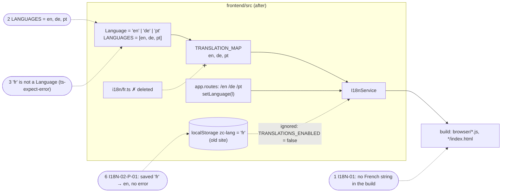

# Examples: Languages of the site

Status: **agreed with the developer on 2026-11-04** (decisions D1–D7).

The site's languages are English, German and Portuguese (`en`, `de`, `pt`); French is not a
language of the site at the start (Zua, 2026-11-04). This file holds what is true of every page's
languages. The page-level guards stay where they are: `/fr/home` answers `404` (HOME-PAGE-06) and
the content API answers `lang=fr` with `404` (HOME-HERO-07).

## 1. French clean-up

The leftover noted under HOME-PAGE-07 and 08: `fr` in the `Language` type, `LANGUAGES`,
`TRANSLATION_MAP`, `src/app/i18n/fr.ts`, and the comment on `TRANSLATIONS_ENABLED`. The build of
2026-11-04 still shipped `fr.ts` to every visitor (`Accueil` in a browser chunk).

| ID | Given | When | Then | Covered |
|----|-------|------|------|---------|
| I18N-01 | the built site | every file under `dist/zuacaldeira-com/browser/` is read | none contains a French string: `Accueil`, `Bonjour, je suis`, `Chercheur. Développeur. Éducateur. Coureur.` (D6) | |
| I18N-02 | the frontend's languages | they are listed | `LANGUAGES` is exactly `['en', 'de', 'pt']` (D5), and `'fr'` is not a `Language` (the compiler refuses it) | |
| I18N-02-P-01 | a returning visitor whose browser saved `zc-lang = 'fr'` on the old site | the page starts in the browser | the language is `en` with the English translations, and no error; the saved value is left alone (D7) | |

### Diagram



### Session type

```
G = Router → I18n : setLanguage(l : Language) .
    I18n → Storage : write(l) .
    Page → I18n : translations .
    I18n → Page : t(l) . end
    where Language = {en, de, pt}        (G_pre: Language = {en, pt, de, fr})
```

Projections:
- Router: `I18n ! setLanguage(Language) . end`
- I18n: `Router ? setLanguage(Language) . Storage ! write . Page ? translations . Page ! t . end`
- Page: `I18n ! translations . I18n ? t . end`

Convention: Storage is never read in G, because `init` returns at once while
`TRANSLATIONS_ENABLED` is false; I18N-02-P-01 holds that.

G_pre → G_post: only the payload sort shrinks. No route ever sends `fr`, so the Router's and the
Page's projections are the same for every message actually sent: nothing a visitor sees changes,
except the French bytes leaving the build (I18N-01).

| Arrow / step | In G | Test rows |
|---|---|---|
| route → `setLanguage(l)` | `Router → I18n : setLanguage(Language)` | 2, 3 (the sort); the existing `setLanguage` tests |
| `setLanguage` → localStorage | `I18n → Storage : write(l)` | the existing localStorage persistence tests (with `pt`) |
| `translations` read | `Page → I18n`, `I18n → Page : t(l)` | the existing parity specs over `LANGUAGES`; 1 |
| forbidden: `setLanguage('fr')` | not in the sort | 3 (refused by the compiler; nothing is stored) |
| forbidden: storage read at start | not in G | 6, I18N-02-P-01 (language stays `en`, storage stays `'fr'`) |

Test list: 1 I18N-01, acceptance on the build (`frontend/acceptance/i18n.test.mjs`); 2 I18N-02,
`LANGUAGES` is en, de, pt; 3 I18N-02, `'fr'` is not a `Language` (`@ts-expect-error`); 4 the
existing specs follow the type (`ALL_TRANSLATIONS` without `fr`, `pt` in the `setLanguage` and
localStorage tests, `pt-PT` in the browser test, the switcher's en, de, pt, the side menu in `pt`);
5 green: `fr.ts` deleted, `fr` out of `TRANSLATION_MAP` and the switcher, the comment on
`TRANSLATIONS_ENABLED` rewritten; 6 I18N-02-P-01, shown to bite; 7 refactor (D4), the whole suite,
the build and `npm run acceptance`; 8 docs, no test: `CLAUDE.md`, the note in `home.md`.

## In plain words

| ID | English | Deutsch | Português |
|----|---------|---------|-----------|
| I18N-01 | The site's files contain no French text, so no visitor downloads a language the site does not offer. | Die Dateien der Seite enthalten keinen französischen Text, also lädt niemand eine Sprache herunter, die die Seite nicht anbietet. | Os ficheiros do site não contêm texto em francês, por isso nenhum visitante descarrega uma língua que o site não oferece. |
| I18N-02 | The site knows exactly three languages, English, German and Portuguese, and French is not one of them. | Die Seite kennt genau drei Sprachen, Englisch, Deutsch und Portugiesisch; Französisch gehört nicht dazu. | O site conhece exatamente três línguas, inglês, alemão e português, e o francês não é uma delas. |
| I18N-02-P-01 | A visitor who once chose French on the old site gets the English page, without an error. | Wer auf der alten Seite einmal Französisch gewählt hat, bekommt die englische Seite, ohne Fehler. | Quem escolheu francês no site antigo recebe a página em inglês, sem erro. |

## Decisions

Agreed with the developer on 2026-11-04:

- **D1. This file** holds the site-wide language examples, prefix `I18N-nn` (`docs/tdd.md`).
- **D2. `LanguageSwitcher`** (rendered nowhere) only loses `fr` now; it is deleted with SHELL-01,
  whose `EN DE PT` links replace it.
- **D3. `TRANSLATIONS_ENABLED`:** only its comment is rewritten now. Removing the flag and its
  skipped suites goes to the backlog.
- **D4. One name for the site's languages:** `Language` and `LANGUAGES`. `SiteLanguage`
  (`content.ts`), `SITE_LANGUAGES` (`app.routes.ts`) and the cast in `hero.ts` go, as a refactor
  on green.
- **D5. Order:** en, de, pt, as the routes and SHELL-01's links.
- **D6. I18N-01's markers** are the three French strings above, copied from `fr.ts` before it is
  deleted.
- **D7. A saved `'fr'`** is left in the browser; the page simply does not read it.

## Backlog

- **Remove `TRANSLATIONS_ENABLED`** and the two suites it skips (saved and browser language): the
  route's prefix decides the language, so that behaviour does not return (D3).
