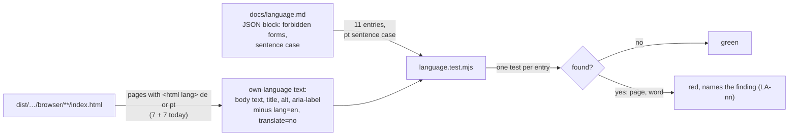

# Examples: the site's language rules (LANG)

The German and Portuguese copy follows `docs/language.md` (rules L1 to L13, the glossary, the
audit's findings LA-nn). A build test guards it: `frontend/acceptance/language.test.mjs`, run by
`npm run acceptance` after the build. It reads its list of forbidden forms from the JSON block in
`docs/language.md`, so the rules and the test cannot drift apart.

No protocol: the test reads files and checks text; nothing interacts, so there is no session
type (G) and no protocol rows.

## Diagram

## Examples

| ID | Example | Given | When | Then | Covered |
|---|---|---|---|---|---|
| LANG-01 | Every German and Portuguese page is read. | the built site | the test collects pages by `<html lang>` | at least `home`, `about`, `contact`, `research`, `running`, `software`, `writing` in each of de and pt; `/de/index.html` (English) is not among them | |
| LANG-02 | A forbidden form on a page in its language is refused, by name. | `/de/contact` reads "Lassen Sie uns vernetzen …" | the entry `de-sie` is checked | red: `de/contact: Sie` (LA-02) | |
| LANG-03 | Text marked English is not read. | `/de/writing` lists "Modular Session Types for Distributed Object-Oriented Programming" with `lang="en"` | the entry `session-types` is checked | the title is not a finding; only own-language text is | |
| LANG-04 | Portuguese headings are in sentence case. | `/pt/about` has the heading "Para Além do Trabalho" | the sentence-case check runs | red: `pt/about: Para Além do Trabalho` (LA-16); "Capítulo Berlim" passes (a name) | |
| LANG-05 | The list comes from `docs/language.md`. | the JSON block | the test starts | it parses the block; no block or an empty list is a failure, not a pass | |
