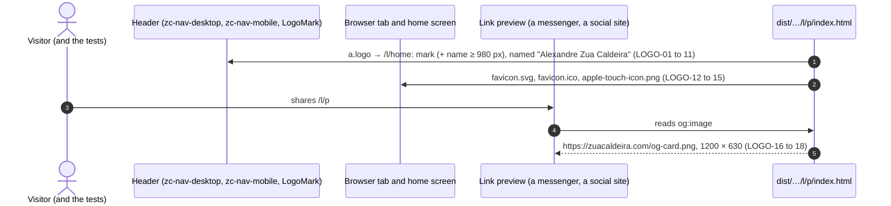

# Examples: the logo

Status: **agreed with the developer on 2026-11-15:** option A, Losango, the lattice diamond; the
cases, the three slices and D1 to D6 as recommended (see "Decisions"). Proposed by ui-design-peer the
same day.

The site's mark in the header, the browser tab, the home screen and on a shared link's card. Design:
`docs/mockups/brand/logo-spec.md` (option A), with the mock-up `docs/mockups/brand/index.html`
(`#a`) and its evidence screenshots beside it. Today the header shows the text `zc` and the tab
Angular's default shield.

Sections, in build order:
1. **Header** (`LOGO-01` to `LOGO-11`): the mark, the name and the link, on both bars.
2. **Tab and home screen** (`LOGO-12` to `LOGO-15`): `favicon.ico`, `favicon.svg`,
   `apple-touch-icon.png`.
3. **Shared-link card** (`LOGO-16` to `LOGO-18`): `og-card.png` and the `og:image` tags.

Not in this file: the rest of the header and the footer (`shell.md`), the colours of the glazes
(`theme.md`). Older cases this work changes: SHELL-13c (the "zc" mark in Fraunces 600 becomes the name
"Zua Caldeira" in Fraunces 600) and `shell.md`'s D8 leftover (the logo's `aria-label="Home"`, D5
here). SHELL-04 (the logo leads to the page language's home) and SHELL-06 (the phone bar holds no
name) hold as they are.

## Who meets it (from `docs/design.md`)

- **Everyone, on every page:** the header's mark is the link home.
- **Hiring managers and recruiters** who keep the site open in a tab, or who receive the link in a
  message: the tab icon and the card are what they see first.
- **Researchers** who share the paper's page: the card.

## 1. Header

| ID | In plain words | Given | When | Then | Test | Covered |
|----|----------------|-------|------|------|------|---------|
| LOGO-01 | On a laptop, the header shows the diamond and the name, linking home. | the built `/de/home` | the desktop header is read | `a.logo` leads to `/de/home` and holds the mark (an inline SVG with `aria-hidden="true"`) and the text "Zua Caldeira"; the header has no text `zc` | build and unit (`zc-nav-desktop.spec.ts`) | yes (build and unit, 2026-11-15) |
| LOGO-02 | The home link has the same name in every language. | the built `/en/home`, `/de/home`, `/pt/home` | the link's accessible name is read | "Alexandre Zua Caldeira" on all three (D5) | build and unit, both bars | yes (build, every page, and unit, both bars, 2026-11-15) |
| LOGO-03 | On a phone, the header shows the diamond alone. | a phone (`Handset`), `/en/home`, `/de/home`, `/pt/home` | the bar is read | `a.logo` holds the mark and no visible name; SHELL-06 still holds | unit (`zc-nav-mobile.spec.ts`) and browser at 390 px | yes (unit, and browser through SHELL-06, 2026-11-15) |
| LOGO-04 | On a narrow laptop or tablet, the name gives way to the diamond. | the desktop bar at 768 and 1280 px | the link is measured | at 768 the name is not shown and the mark is; at 1280 both are | browser | yes (browser, 2026-11-15) |
| LOGO-05 | The diamond is drawn as the spec says. | the mark component | its SVG is read | `viewBox="0 0 48 48"`; four lines (24,7)–(8,24), (24,7)–(40,24), (8,24)–(24,41), (40,24)–(24,41), width 3, round caps; ⊤ at (24,7) r 5.5; atoms at (8,24), (40,24) r 4.5; ⊥ at (24,41) r 4.5 with a ring of width 3 | unit (`logo-mark.spec.ts`) | yes (unit, 2026-11-15) |
| LOGO-06 | The diamond takes the colours of the glaze, in light and at night. | `/en/home` at 1280 px, light, then dark | the mark's computed colours are read | edges, atoms and the ⊥ ring are `--zc-azul` (`#14417a`, then `#7fa5ce`); ⊤ is the ochre D1 names; ⊥'s fill is `--zc-bg-warm` (`#e9eff4`, then `#0b1526`) | browser, light and dark | yes (browser, light and dark, 2026-11-15) |
| LOGO-07 | The diamond and the name are easy to see in light and at night. | the same | the mark and the name are measured against the header behind them | every part of the mark at 3:1 or more, the name at 4.5:1 or more (computed: cobalt 8.06 and 6.65, the name 14.49 and 14.74; ⊤ 4.51 with D1's a) | browser (`contrast.mjs`) | yes (browser, light and dark, 2026-11-15) |
| LOGO-08 | The home link is easy to tap and shows where the keyboard is. | 390 and 1280 px | the link is measured; Tab reaches it | at least 44 × 44 px at both widths; a visible focus ring around it | browser | yes (browser, 2026-11-15; the ring not shown to bite) |
| LOGO-09 | The name is set in the site's display face. | `/en/home`, `/de/home`, `/pt/home` at 1280 px, light | the name's font is read | drawn by Fraunces alone, at weight 600 (SHELL-13c, which read the "zc" mark, now reads the name) | browser (`header-type.test.mjs`) | yes (browser, SHELL-13c, 2026-11-15) |
| LOGO-10 | The new header still fits a phone. | 390 px, `/en/home`, `/de/home`, `/pt/home` | the page is measured | no horizontal scroll; the bar's controls each 44 px or more (SHELL-06 with the mark) | browser | yes (browser, SHELL-06 as it is, 2026-11-15) |
| LOGO-11 | The name is never translated. | the built pages in en, de and pt | the name is read | "Zua Caldeira" on every page, with `translate="no"` | build | yes (build, every page, 2026-11-15) |
| LOGO-P-01 | Putting the letters "zc" back in the header is refused. | a copy of the built `/de/home` | the name is replaced by `zc` | LOGO-01 goes red | break in the build | yes (break in the build) |
| LOGO-P-02 | A fixed colour in the header's diamond is refused. | the mark component | the cobalt is written as `#14417a` instead of `var(--zc-azul)` | LOGO-06 goes red at night | break in the component | yes (break in the component: red at night only) |
| LOGO-P-03 | The name on the phone bar is refused. | the phone bar | the name is shown there | LOGO-03 and SHELL-06 go red | break in the component | yes (break in the template: LOGO-03 and SHELL-06 unit red) |

## 2. Tab and home screen

| ID | In plain words | Given | When | Then | Test | Covered |
|----|----------------|-------|------|------|------|---------|
| LOGO-12 | The browser tab shows the diamond, not Angular's shield. | the built site | `favicon.ico` is read | it holds 16, 32 and 48 px images, and is not today's file (md5 `05bcfe9a02b93e1c5a5da14bfda8c41f`) | build (ICO header and md5) | no |
| LOGO-13 | Browsers that take a drawn icon get the diamond as SVG. | the built pages | their `<head>` and `favicon.svg` are read | each page links `/favicon.svg` (`type="image/svg+xml"`) and `/favicon.ico` (`sizes="16x16 32x32 48x48"`); `favicon.svg` is the small drawing, `viewBox="0 0 16 16"` | build | no |
| LOGO-14 | A phone's home screen gets the diamond on the glaze. | the built pages | their `<head>` and `apple-touch-icon.png` are read | each page links `/apple-touch-icon.png`; the PNG is 180 × 180 and has no transparent pixel | build (PNG header and pixels) | no |
| LOGO-15 | The tab icon can be seen on a light and on a dark tab. | `favicon.svg` drawn at 16 and 32 px on `#dee1e6` and on `#202124` | the icon is measured | the shape stands out from both tab colours at 3:1 or more (with D2's a: the glaze tile, 13.89 on the dark tab; on the tile cobalt 8.77, ochre 3.21) | browser | no |
| LOGO-P-04 | Putting Angular's shield back is refused. | a copy of the built site | today's `favicon.ico` is put back | LOGO-12 goes red | break in the build | no |

## 3. Shared-link card

| ID | In plain words | Given | When | Then | Test | Covered |
|----|----------------|-------|------|------|------|---------|
| LOGO-16 | A shared link to any page shows the card. | every built page | its `<head>` is read | `og:image` is `https://zuacaldeira.com/og-card.png` (absolute), with `og:image:width` 1200, `og:image:height` 630 and `og:image:alt` (D3) | build | no |
| LOGO-17 | The card is in the build at the size a link preview expects. | the built site | `og-card.png` is read | it exists, 1200 × 630 px | build (PNG header) | no |
| LOGO-18 | The card looks as the mock-up draws it. | `og-card.png` | it is looked at beside the mock-up's card (`#a`) | the mark, "Zua Caldeira", the hero's sentence and "zuacaldeira.com" on the cobalt ground, as `logo-spec.md` gives them | by eye, in the review after the build (not automated) | no |
| LOGO-P-05 | A card address without the site's domain is refused. | a copy of a built page | `og:image` reads `/og-card.png` | LOGO-16 goes red | break in the build | no |

18 cases and 5 refused paths, 23 rows.

## Diagram



Session type (the visitor's path), in the convention of `shell.md`: a role that a branch never calls
just ends there.

```
G = Page → Visitor : header(logo(mark, name if wide), named n) .
    Visitor → Page : { home . Page → Visitor : page(/l/home) . end ,
                       share . Page → Preview : card(og-card.png, 1200 × 630) . end ,
                       stay . end }
  n = "Alexandre Zua Caldeira" for every l; the tab and home-screen icons: the same files for every l

Visitor ↾ = Page?header(…) . Page!{ home . Page?page . end , share . end , stay . end }
Page ↾    = Visitor!header(…) . Visitor?{ home . Visitor!page . end ,
                                         share . Preview!card . end , stay . end }
Preview ↾ = Page?card . end
```

| Arrow | Step in G | Rows |
|---|---|---|
| 1 the header | `header(logo(mark, name if wide), named n)` | LOGO-01 to 11 |
| 2 the tab, the home screen | the icon files, the same for every `l` | LOGO-12 to 15 |
| 3–5 the card | `share . card(og-card.png, 1200 × 630)` | LOGO-16 to 18 |
| `home` | `page(/l/home)` | SHELL-04 (holds) |
| forbidden: `zc` in place of the mark | `logo(mark, …)` | LOGO-P-01 |
| forbidden: a colour that does not follow the glaze | `mark` in the glaze's tokens | LOGO-P-02 |
| forbidden: the name on the phone bar | `name if wide` | LOGO-P-03 |
| forbidden: Angular's icon | the icon files | LOGO-P-04 |
| forbidden: a card without the site's domain | `card(og-card.png …)` absolute | LOGO-P-05 |

The site is read-only: no repeat, stale-token or race rows.

## Slices (agreed 2026-11-15)

1. **Header.** The mark component (`common/logo-mark/`), both bars, the name and its breakpoint at
   980 px, the link's name; SHELL-13c and `shell.md`'s D8 leftover move with it. LOGO-01 to 11, P-01
   to P-03. Needs D1 and D5.
2. **Tab and home screen.** The script that draws the image files from one source (D6),
   `favicon.ico`, `favicon.svg`, `apple-touch-icon.png`, the links in `index.html`. LOGO-12 to 15,
   P-04. Needs D2 and D6.
3. **Shared-link card.** `og-card.png` from the same script, the `og:image` tags. LOGO-16 to 18,
   P-05. Needs D3 and D4.

Each slice ships on its own; none depends on a later one. Slice 1 alone already replaces `zc`; slice
2 alone replaces Angular's shield.

Not in these slices: a web app manifest and Android icons; the old `og:title` "Alexandre Caldeira"
and `og:description` "Researcher. Developer. Educator. Runner." in `index.html`, which a link
preview shows beside the card (a wording question for the developer, not part of the mark); a
one-colour version of the mark (in the mock-up, for print, not for the site).

## Slice 1: the header

The markup this slice builds, in both bars: `a.logo` (`aria-label="Alexandre Zua Caldeira"`, D5)
holds `<app-logo-mark>` (an inline `<svg>`, `aria-hidden="true"`, `focusable="false"`) and, in the
desktop bar only, `<span class="logo-name" translate="no">Zua Caldeira</span>`, hidden below 980 px.
The mark's colours are in `logo-mark.css`, from the tokens: `--zc-azul`, ⊤ in `--zc-ochre-text`
(D1), ⊥'s fill `--zc-bg-warm`.

Test list (crossed off in the "Done" note below as each is committed):
- **Acceptance, the outer test** (new `acceptance/logo.test.mjs`, on the build):
  - A1 LOGO-01, declared first: on the built `/de/home`, `a.logo` leads to `/de/home` and holds an
    `<svg aria-hidden="true">` and the text "Zua Caldeira"; the header has no text `zc`. Red today.
- **Unit:**
  - U1 LOGO-05, `LogoMark` (`common/logo-mark/logo-mark.spec.ts`): `viewBox="0 0 48 48"`, the four
    edges, ⊤, the two atoms and ⊥ with the spec's geometry, in that order; `aria-hidden="true"`,
    `focusable="false"`.
  - U2 LOGO-01, the desktop bar (`zc-nav-desktop.spec.ts`): `a.logo` holds `app-logo-mark` and the
    name "Zua Caldeira" with `translate="no"`, and no `zc`.
  - U3 LOGO-02, both bars: the link's name is "Alexandre Zua Caldeira" in en, de and pt (D5; today
    "Home").
  - U4 LOGO-03, the phone bar (`zc-nav-mobile.spec.ts`): `a.logo` holds `app-logo-mark` and no text;
    SHELL-06's unit tests hold.
- **Acceptance, after the units:**
  - A2 LOGO-02 on every built page (the 21, `/` and `/404`): `a.logo` is named "Alexandre Zua
    Caldeira".
  - A3 LOGO-11 on every built page: the name is "Zua Caldeira" with `translate="no"`.
- **Browser** (new `acceptance/browser/logo.test.mjs`, after a build, one run at a time):
  - W1 LOGO-04: the desktop bar at 768 shows the mark and not the name; at 1280 both.
  - W2 LOGO-06: the computed paint of each part in light and dark, `/en/home` at 1280: edges, atoms
    and the ⊥ ring the page's `--zc-azul`, ⊤ the page's `--zc-ochre-text`, ⊥'s fill `--zc-bg-warm`.
  - W3 LOGO-07: each part of the mark at 3:1 or more, the name at 4.5:1 or more, against the
    header's painted background, light and dark.
  - W4 LOGO-08: `a.logo` at least 44 × 44 px at 390 and 1280; the second Tab (after the skip link)
    lands on it, with an outline drawn around it.
  - W5 LOGO-09 (SHELL-13c, `header-type.test.mjs`): the name, not the "zc" mark, drawn by Fraunces
    alone at 600, on the three home pages.
  - W6 LOGO-10 and LOGO-03 in the browser: SHELL-06's test (`shell-phone.test.mjs`) runs as it is
    with the new mark: mark, `EN DE PT`, theme, menu, each 44 px, within 390 px, no name.
- **Protocol rows**, each shown red by its break, then restored (md5 checked):
  - LOGO-P-01: `zc` in place of the name in a copy of the built `/de/home`: A1 red.
  - LOGO-P-02: `#14417a` in place of `var(--zc-azul)` in `logo-mark.css`: W2 red at night.
  - LOGO-P-03: the name in the phone bar: U4 and SHELL-06's unit test red.
- **Docs:** SHELL-13c in `shell.md` reads the name, not "zc"; `shell.md`'s D8 leftover (the logo's
  `aria-label="Home"`) is closed by D5 here.

Not in slice 1: the icon files and the card (slices 2 and 3); the other three living glazes, looked
at in the review after the build.

```mermaid
sequenceDiagram
    autonumber
    actor T as Tests
    participant U as Vitest + jsdom (U1–U4)
    participant H as zc-nav-desktop, zc-nav-mobile, LogoMark
    participant NG as ng build (prerender)
    participant P as dist/…/l/p/index.html
    participant C as Chromium (W1–W6)
    T->>U: U1 the mark's drawing; U2–U4 a.logo in both bars
    U->>H: render with l in en, de, pt
    H->>NG: a.logo → /l/home, named n: mark (+ name, desktop)
    NG->>P: the desktop bar, prerendered (A1–A3, P-01)
    T->>C: open P at 390, 768, 1280, light and dark
    C-->>T: name shown ≥ 980 (W1), paint from the tokens (W2, P-02), contrast (W3), 44 px and focus (W4), Fraunces 600 (W5), phone bar (W6, P-03)
```

Session type. Convention: a role that a branch never calls just ends there. `l` the page's
language, `w` the width, `g` the glaze (light or night), `n` = "Alexandre Zua Caldeira" for every
`l`.

```
G = Build  → Page    : prerender(l, bar = desktop) .
    Page   → Visitor : header(logo(href /l/home, named n, mark(g), name if bar = desktop and w ≥ 980)) .
    Visitor → Page   : { home . Page → Visitor : page(/l/home) . end ,
                         stay . end }
  bar = phone when Handset (after Angular starts); mark(g): edges, atoms, ⊥ ring azul(g), ⊤ ochreText(g), ⊥ fill bgWarm(g)

Visitor ↾ = Page?header(logo(…)) . Page!{ home . Page?page . end , stay . end }
Page ↾    = Build?prerender . Visitor!header(logo(…)) . Visitor?{ home . Visitor!page . end , stay . end }
Build ↾   = Page!prerender . end
```

| Arrow | Step in G | Rows |
|---|---|---|
| 1–2 the mark's drawing | `mark(g)`, its geometry | U1 (LOGO-05) |
| 2–3 a.logo in both bars | `logo(href /l/home, named n, mark, name if …)` | U2, U3, U4 (LOGO-01, 02, 03) |
| 4 the prerendered desktop bar | `prerender(l, desktop)`, `header(logo(…))` | A1, A2, A3 (LOGO-01, 02, 11) |
| 5–6 `name if w ≥ 980` | the width condition | W1 (LOGO-04) |
| 5–6 `mark(g)` | the glaze's tokens | W2, W3 (LOGO-06, 07) |
| 5–6 the link as a control | `logo(…)` reachable and 44 px | W4 (LOGO-08) |
| 5–6 the name's face | `name` in Fraunces 600 | W5 (LOGO-09, SHELL-13c) |
| 5–6 `bar = phone` | no name in the phone bar | W6, U4 (LOGO-03, 10; SHELL-06) |
| `home` | `page(/l/home)` | SHELL-04 (holds) |
| forbidden: `zc` in place of the mark and name | `logo(mark, …)` | LOGO-P-01 (A1) |
| forbidden: a fixed colour | `mark(g)` follows `g` | LOGO-P-02 (W2) |
| forbidden: the name on the phone bar | `name if bar = desktop` | LOGO-P-03 (U4, SHELL-06) |

The header is read-only: no repeat, stale-token or race rows.

**Done 2026-11-15** (`436bc0a` to `fd33c37`). Red first, each for its own reason: A1 the built
`/de/home`'s link held `zc` and no hidden SVG; U1 no `<svg>` at all; U2 `['span zc']`; U3 "Home" three
times, in both bars; U4 `span` and `zc`; W1 the name shown at 768; W2 the parts unpainted (`none`,
`#000000`) in both glazes; W4 the desktop link 164 × 32; W5 SHELL-13c timing out on `.logo-text`, gone
with U2. Green at first and shown to bite, each break restored (md5 checked): A2 (the built `/pt/about`'s
link named "Home"), A3 (`translate="no"` taken off the built `/de/research`'s name), W3 (D1's option b,
⊤ in `--zc-ochre`: "top 2.95" by day). Not shown to bite: W4's focus ring, which is the site's
`:focus-visible` rule. Protocol rows: LOGO-P-01 (`zc` in the built `/de/home`: A1 red), LOGO-P-02
(`#14417a` on the edges: W2 green by day, red at night), LOGO-P-03 (the name in the phone bar: U4 and
SHELL-06's unit test red).

Measured (W3): light, cobalt 8.07, ⊤ 4.52, name 14.51; dark, cobalt 6.64, ⊤ 7.90, name 14.72 (the
spec's computed 8.06, 4.51, 14.49; 6.65, 7.91, 14.74).

Results: unit 279 passed, 5 skipped (47 files); `acceptance` 125/125; `test:scripts` 16/16; browser
161/161 (13 files, one at a time); the build prerenders 26 routes. Not run: `acceptance:nginx` (no
route or server change) and the backend (untouched).

Leftovers, not built:
- **SHELL-12's unit spec** (`zc-nav-mobile.spec.ts`, "after a link in the open menu, focus is on the
  new page's main") lost twice in eight whole-suite runs today (5.4 s, `expected <mat-sidenav> to be
  <main>`), under a load of about 4.5 on 8 cores, green on each rerun. As noted in `shell.md`; not
  touched by this slice.
- **The initial bundle** is 514.71 kB (513.81 before the logo; 500 kB budget).
- **Prettier** wants the SHELL-12 test's `vi.waitFor` laid out differently; left as it is (not this
  slice's code).
- **The bar at 768 px** and the other three living glazes, for the review after the build (on the
  preview).
- **`docs/tdd.md`** still says `next` is merged into `main` page by page; since 2026-11-15 it waits
  for the whole site (above, "Decisions").

## Decisions

Agreed with the developer on 2026-11-15:

- **The cases** LOGO-01 to 18 and LOGO-P-01 to 05, as proposed.
- **The three slices,** as proposed: the header; the tab and home-screen icons; the shared-link card.
- **D1 a:** ⊤ in `--zc-ochre-text` (`#8a5e15` by day, 4.51:1 in the light header; `#d9a94a` at
  night).
- **D2 a:** the tab icon always on its glaze tile, at every size and in every file.
- **D3 a:** the cobalt card as drawn, the same in the light and the night glaze, with `og:image:alt`
  "Zua Caldeira: I build software, and prove its protocols hold."
- **D4 a:** one English card for every page.
- **D5 a:** "Alexandre Zua Caldeira" as the home link's name in every language.
- **D6 a:** a script in the repository draws the image files from one source; the files are
  committed.
- **Merging:** `next` goes into `main` only when the whole site is built (this replaces "page by
  page" in `docs/tdd.md`'s "When to push, merge and deploy" for this work).

The options as proposed, ui-design-peer's recommendation first:

- **D1. The colour of ⊤ in the light glaze.** As drawn, `--zc-ochre` reaches 2.95:1 against the
  light header, under the 3:1 that `docs/design.md` asks of ochre graphics (7.91 at night).
  - a. `--zc-ochre-text` (`#8a5e15`): 4.51 in the light header; at night the token is `#d9a94a`, the
    same ochre as drawn. A slightly darker gold by day. **Recommended.**
  - b. `--zc-ochre` as drawn, accepting 2.95:1 by day.
  - c. `--zc-ochre` with a thin cobalt ring round ⊤, as the theorem band's ⊤ has its outline.
- **D2. The ground of the tab icon.** As drawn, the icon has no ground on a light tab and sits on its
  glaze tile on a dark tab. Without a ground, the cobalt reaches 1.58:1 on a dark tab.
  - a. Always on the glaze tile, at every size and in every file: one drawing, seen on any tab
    (13.89 against a dark tab). **Recommended.**
  - b. As drawn: no ground, and the tile only when the device is set to dark (a `prefers-color-scheme`
    rule inside `favicon.svg`). The rule follows the device, not the browser's tab colour, and
    `favicon.ico` cannot switch.
  - c. No ground anywhere: 1.58:1 on a dark tab.
- **D3. The card and its alternative text.** The mock-up draws one card, cobalt, the same in the
  light and the night glaze; it draws no light-ground card. A link preview shows one image, whatever
  the reader's theme.
  - a. The cobalt card as drawn, with `og:image:alt` "Zua Caldeira: I build software, and prove its
    protocols hold." **Recommended.**
  - b. Draw a light-ground card first (another mock-up round), then choose.
- **D4. The card's language.** The `og` tags are one set in `index.html` for every page today.
  - a. One English card for every page. **Recommended.**
  - b. One card per language with the German and Portuguese hero sentences: per-page `og` tags, a
    larger change.
- **D5. The home link's name.** Today `aria-label="Home"`, the same in every language (`shell.md`'s
  D8 leftover); the mock-up has `aria-label="Alexandre Zua Caldeira"`.
  - a. "Alexandre Zua Caldeira" in every language, as the mock-up: a name, not translated; it holds
    the visible "Zua Caldeira" (WCAG 2.5.3), and the page titles start with it. **Recommended.**
  - b. Keep "Home": it does not hold the visible name, which WCAG 2.5.3 asks for on desktop.
  - c. A translated word for the home page (a new key in en, de, pt): the same WCAG 2.5.3 problem.
- **D6. How the image files are made.**
  - a. A script in the repository draws them from one source; the files are committed; build tests
    check them (LOGO-12 to 14, 17). As the hero wall (`lattice-wall/render.py`). **Recommended.**
  - b. Drawn in CI on every build: a renderer in CI, for files that change only with the mark.
