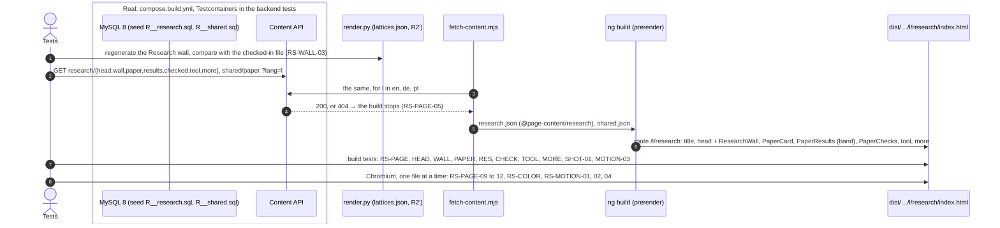
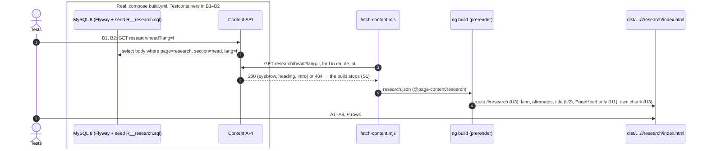

# Examples: Research page

Status: **agreed with the developer on 2026-11-09:** the 71 cases, the four slices and D1 to D10
below, as ui-design-peer proposed them (answers under "Decisions"). R1 to R8 (R4 replaced), Q1 to
Q5 and the choice of option A are answered. Slice 1 is being built.

The Research page in three languages, at `/en/research`, `/de/research` and `/pt/research`: a landing
page for the ICE 2026 paper (R1 b). Design: `docs/mockups/research/research-spec.md`, with the
mock-up and screenshots beside it. The route, the sitemap entries, nginx, the menu link and its
current marker exist already (HOME-PAGE-07 to 09, SHELL-11, D34 in `software.md`); this file
replaces the old page that sits behind them.

Sections, in build order:
1. **Page frame** (`RS-PAGE-nn`): the new page behind the existing route: title, own text, the old
   page gone.
2. **Head** (`RS-HEAD-nn`): eyebrow, `<h1>`, intro.
3. **The wall** (`RS-WALL-nn`): the 74 R2′ lattices beside the head, its label, caption and rung note.
4. **The paper** (`RS-PAPER-nn`): the card with the abstract and the PDF.
5. **What it proves** (`RS-RES-nn`): the four statements.
6. **How it was checked** (`RS-CHECK-nn`): four figures and the evidence.
7. **The tool** (`RS-TOOL-nn`): reticulateP; the BICA screenshot later (`RS-SHOT-nn`).
8. **More research** (`RS-MORE-nn`): the Writing link and ResearchGate.
9. **Colour and motion** (`RS-COLOR-nn`, `RS-MOTION-nn`): the sections' grounds, the wall drawing
   in, pointing, reduced motion and no JavaScript.

Not in this file: the header, language links and footer (`shell.md`), the colours (`theme.md`).
All wording is in the spec's copy table, en, de and pt; a case names a key and gives a language as
its example. "In plain words" says what each case means for a visitor, in English.

## Who reads it (from `docs/design.md`)

- **Researchers and reviewers** (laptop, often from "All research" on a band, so they have seen
  Theorem 15): the abstract, all four results, how they were checked, the PDF.
- **Hiring managers** (a quick look on a phone): that the engineering rests on a proof.
- **Teams building AI agents:** why the protocols hold, and the tool that checks them.

The Writing page lists every text; this page is about the ICE 2026 paper alone and links there once.

## 1. Page frame

| ID | In plain words | Given | When | Then | Covered |
|----|----------------|-------|------|------|---------|
| RS-PAGE-01 | The Research page is the new page in all three languages. | the research content in en, de and pt | the site is built | `/en/research/index.html`, `/de/research/index.html`, `/pt/research/index.html` exist with `<html lang>` en, de, pt, and each has the shared page head (`app-page-head`) | yes (build and unit, 2026-11-09) |
| RS-PAGE-02 | The browser tab names the page in its language. | the built pages | they are read | `<title>` is "Alexandre Zua Caldeira — Research", "— Forschung", "— Investigação" | yes (build and unit, 2026-11-09) |
| RS-PAGE-03 | Search engines still learn that the three pages are one page in three languages. | the built `/de/research` | it is read | `<link rel="alternate">` for en, de, pt to `https://zuacaldeira.com/{en,de,pt}/research`, and `x-default` to `/en/research` | yes (build, 2026-11-09) |
| RS-PAGE-04 | The header shows Research as the page you are on. | the built `/de/research` | the main navigation is read | its Forschung link goes to `/de/research` and carries `aria-current="page"`; no other link does | yes (build, 2026-11-09) |
| RS-PAGE-05 | A missing German text stops the build instead of showing English. | no research content stored for de | the site is built | the build fails, naming page `research`, the section and `de`; nothing is deployed (as WR-PAGE-09) | yes (the snapshot script, 2026-11-09) |
| RS-PAGE-06 | The page downloads only its own text and the paper's shared text. | the built site | the files `/en/research` loads at once are read | its own text and `shared/paper` are among them; none holds the home hero's sentence, the Software lead's title or the Writing intro (as WR-PAGE-10) | own text only (build and unit, 2026-11-09); `shared/paper` in slice 3 (D11) |
| RS-PAGE-07 | The old page is gone: no list of publications and no Material buttons. | the built `/en/research` | `<main>` is read | no heading "Publications", no title or abstract of the POPL, FOOL or ConGu papers, no `mat-card`, `mat-button` or `mat-stroked-button` | yes (build and unit, 2026-11-09) |
| RS-PAGE-08 | "What's next" is not on the page while it has no text. | the built pages | `<main>` is read | no section headed "What's next", "Wie es weitergeht" or "O que vem a seguir", and the sections are, in order: head, paper, what it proves, how it was checked, the tool, more research (D1) | no What's next (build, 2026-11-09); the order grows with slices 2 to 4 |
| RS-PAGE-P-01 | A Research page in only one or two languages is refused. | the build | a language's research page is missing | RS-PAGE-01 goes red, naming the language | yes (break in the build) |
| RS-PAGE-P-02 | An old publication put back on the page is refused. | the built `/en/research` | the POPL title is put in `<main>` | RS-PAGE-07 goes red | yes (red on the old build, and a break in the new one) |

## 2. Head

| ID | In plain words | Given | When | Then | Covered |
|----|----------------|-------|------|------|---------|
| RS-HEAD-01 | The page opens with its name and one sentence about the paper. | the built `/en/research` | the head is read | eyebrow "One paper · ICE 2026", `<h1>` "Research", `head.intro` en; the page has exactly one `<h1>` | yes (build, 2026-11-09) |
| RS-HEAD-02 | The German page reads in German. | the built `/de/research` | the head is read | "Ein Paper · ICE 2026", "Forschung", `head.intro` de | yes (build and unit, 2026-11-09) |
| RS-HEAD-03 | The Portuguese page reads in Portuguese. | the built `/pt/research` | the head is read | "Um artigo · ICE 2026", "Investigação", `head.intro` pt | yes (build, 2026-11-09) |
| RS-HEAD-04 | When the site asks for the German head, it gets its three texts exactly as stored. | `research/head` stored for de | `GET /api/content/research/head?lang=de` | 200 with `{"eyebrow": "Ein Paper · ICE 2026", "heading": "Forschung", "intro": "Der Zustandsraum …"}` as stored | yes (integration, 2026-11-09) |
| RS-HEAD-05 | A fresh database, filled with the starting texts, gives the head in every language, none empty. | an empty MySQL with Flyway and the `seed` profile | `GET /api/content/research/head?lang=en`, `de`, `pt` | 200 with the spec's copy, each field non-empty | yes (integration, 2026-11-09) |
| RS-HEAD-P-01 | English text on the German page's head is refused. | the built `/de/research` | the English intro is put in | RS-HEAD-02 goes red | yes (break in the build) |

## 3. The wall

The wall draws `frontend/scripts/lattice-wall/lattices.json`, the paper's corpus at rung R2′, which
is not the paper's own construction (`scripts/lattice-wall/README.md`). Its counts are R2′ class and
protocol counts, and every place that shows them says so.

| ID | In plain words | Given | When | Then | Covered |
|----|----------------|-------|------|------|---------|
| RS-WALL-01 | Beside the heading, the page shows the paper's 74 distinct lattices as one tile panel, the 47 that are not distributive in ochre. | the built `/en/research` | the head is read | after the intro, one `<figure>` whose SVG has `role="img"` and 74 tiles (`g.t`), in render.py's order (states, then edges), 47 of them `g.t.nd` | |
| RS-WALL-02 | The panel says what it is, and which construction it draws, in the page's language. | the built `/de/research` | the wall's label and caption are read | the SVG's `aria-label` is `wall.label` de and the `<figcaption>` is `wall.caption` de; both name "R2′" and "74", the caption also "104", "108" and "47" | |
| RS-WALL-03 | The panel is the data, drawn: regenerating it gives the same file. | `lattices.json` and the checked-in wall file | `render.py` is run for the Research wall | its output equals the checked-in file byte for byte (D8) | |
| RS-WALL-04 | Each tile carries the name of its protocol, as published, in every language. | the built `/en/research` and `/pt/research` | the tiles are read | tile 1 has `data-name="GoF Facade"`, the last `data-name="Raft Leader Election"`; the 74 names are identical on the three pages | |
| RS-WALL-05 | Under the figures, one sentence tells the paper's count from the wall's. | the built `/en/research` | the checks section is read | after the evidence sentence, `checked.rung` en: "The 93 and 15 are the paper’s own count over its 108 protocols. The wall draws the same corpus at rung R2′, …"; de and pt the same in their language | |
| RS-WALL-06 | Every R2′ number on the page agrees with the data, in every language. | `lattices.json` and the stored `wall` and `checked.rung` in en, de, pt | the numbers are computed from the data and read from the texts | 74 classes, 47 not distributive, 104 protocols (four excluded from 108), 50 in a non-distributive class; each stored text holds exactly these numbers (D9) | |
| RS-WALL-P-01 | Wall numbers shown without their rung are refused. | the built `/de/research` | "R2′" is taken out of the caption | RS-WALL-02 goes red | |
| RS-WALL-P-02 | A hand-edited wall is refused. | the checked-in wall file | one tile is removed | RS-WALL-03 and RS-WALL-01 go red | |
| RS-WALL-P-03 | A wall count that no longer matches the data is refused. | the stored `wall.caption` de | "47" is changed to "15" | RS-WALL-06 goes red | |

## 4. The paper

| ID | In plain words | Given | When | Then | Covered |
|----|----------------|-------|------|------|---------|
| RS-PAPER-01 | The paper comes first, with its year, kind, title, author, venue and status. | the built `/en/research` | the section after the head is read | "2026 · Workshop paper", `<h2>` "Session Type State Spaces Form Lattices", "Alexandre Zua Caldeira" in `<b>`, "ICE 2026 · International Workshop on Interaction and Concurrency Experience", "Camera-ready · to appear in EPTCS" | |
| RS-PAPER-02 | One button opens the paper as a PDF from this site. | any language | the section's links are read | exactly one link, labelled `shared/paper.read` ("Paper lesen (PDF)" on `/de/research`), to `/assets/pdfs/SessionTypeStateSpacesFormLattices-CameraReady.pdf` from the site root, same tab, `hreflang="en"`, `type="application/pdf"`; the file is in the build | |
| RS-PAPER-03 | The abstract is shown word for word, under its label. | the built `/en/research` | the abstract is read | a label "Abstract", then a `<blockquote>` with the abstract of the spec, word for word | |
| RS-PAPER-04 | German and Portuguese readers get the abstract in English, and are told so. | `/de/research`, `/pt/research` | the abstract is read | label "Zusammenfassung" / "Resumo", the line "Auf Englisch" / "Em inglês", the abstract identical to `/en/research`'s with `lang="en"` and `translate="no"`; `/en/research` shows no such line (R2) | |
| RS-PAPER-05 | Title, name and venue stay as published on every page. | `/de/research`, `/pt/research` | the card is read | title, author and venue identical to `/en/research`; each `translate="no"`; the title `lang="en"` | |
| RS-PAPER-06 | When the site asks for the Portuguese card, it gets its labels and the paper's fields as stored. | `research/paper` stored for pt | `GET /api/content/research/paper?lang=pt` | 200 with the stored JSON as it is (D2's shape) | |
| RS-PAPER-07 | A fresh database gives the card in every language, the paper's fields the same in each. | an empty MySQL with Flyway and the `seed` profile | `GET /api/content/research/paper?lang=en`, `de`, `pt` | 200; author, venue and abstract identical in the three; every label non-empty | |
| RS-PAPER-P-01 | A translated abstract is refused. | the built `/de/research` | the abstract's first sentence is put in German | RS-PAPER-04 goes red | |
| RS-PAPER-P-02 | The PDF opening in a new tab is refused. | the built `/de/research` | `target="_blank"` is put on the button | RS-PAPER-02 goes red | |

## 5. What it proves

| ID | In plain words | Given | When | Then | Covered |
|----|----------------|-------|------|------|---------|
| RS-RES-01 | The results open with the theorem, in large type. | the built `/en/research` | the section after the paper is read | `<h2>` "What it proves"; first statement labelled "Theorem 15 · Reticulate Theorem", text "For every well-formed session type S, ℒ(S)/≡ is a bounded lattice." | |
| RS-RES-02 | The three other results follow, all open, in a fixed order. | the same | the section is read | then "Definition 6 · SCC quotient", "Lemma 8 · End", "Proposition 18 · Duality isomorphism", each with its text from the spec; none inside a `<details>` (R3) | |
| RS-RES-03 | On the German page, the labels are German and the statements are not translated. | the built `/de/research` | the section is read | `<h2>` "Was es beweist"; "Satz 15", "Definition 6", "Lemma 8", "Proposition 18"; the names and the four texts identical to `/en/research`, each text `translate="no"` and `lang="en"` | |
| RS-RES-04 | The Portuguese page does the same in Portuguese. | the built `/pt/research` | the section is read | "O que prova"; "Teorema 15", "Definição 6", "Lema 8", "Proposição 18"; the rest as RS-RES-03 | |
| RS-RES-05 | The stored paper holds all four statements, the same in every language. | an empty MySQL with Flyway and the `seed` profile | `GET /api/content/shared/paper?lang=en`, `de`, `pt` | `statements` holds the four of the spec, in its order, identical in the three (HOME-PAPER-09 in full; D3 replaces D31 in `software.md`) | |
| RS-RES-06 | The Software page's band still shows only the theorem. | the built `/de/software` | the band is read | it shows "Satz 15 · Reticulate Theorem" and its text, and no Definition, Lemma or Proposition (SW-PROOF-01 with four statements stored) | |
| RS-RES-P-01 | A translated statement is refused. | the built `/de/research` | Lemma 8's text is put in German | RS-RES-03 goes red | |
| RS-RES-P-02 | Results folded away are refused. | the built `/en/research` | the three are put inside a `<details>` | RS-RES-02 goes red | |

## 6. How it was checked

| ID | In plain words | Given | When | Then | Covered |
|----|----------------|-------|------|------|---------|
| RS-CHECK-01 | Four numbers say how the result was checked, each with its meaning in words. | the built `/en/research` | the section after the results is read | `<h2>` "How it was checked"; a `<dl>` of four: `108` "benchmark protocols, every one a lattice", `93` "distributive", `15` "not distributive", `Lean 4` "mechanised proof", in that order | |
| RS-CHECK-02 | Under them, the sentence the bands use. | any language | the section is read | the paragraph after the `<dl>` is `shared/paper.evidence` in the page's language ("Geprüft an 108 …" on `/de/research`) | |
| RS-CHECK-03 | On the German and Portuguese pages, the meanings are translated and the numbers are not. | `/de/research`, `/pt/research` | the figures are read | the labels of the spec's copy table in de and pt; the values `108`, `93`, `15`, `Lean 4` identical to `/en/research` | |
| RS-CHECK-04 | A fresh database gives the figures in every language, the values the same in each. | an empty MySQL with Flyway and the `seed` profile | `GET /api/content/research/checked?lang=en`, `de`, `pt` | 200; four figures, values identical in the three, every label non-empty | |
| RS-CHECK-P-01 | A changed number on one language's page is refused. | the built `/de/research` | `93` is changed to `94` | RS-CHECK-03 goes red | |

## 7. The tool

| ID | In plain words | Given | When | Then | Covered |
|----|----------------|-------|------|------|---------|
| RS-TOOL-01 | The tool behind the paper is named and described. | the built `/en/research` | the section after the figures is read | `<h2>` "The tool"; kicker "Verification tool"; `<h3>` "reticulateP" (`translate="no"`); the Software page's reticulateP text; stack "Python" | |
| RS-TOOL-02 | One link leads to the tool on the Software page, in the same language. | the built `/de/research` | the section's links are read | exactly one: "reticulateP auf der Software-Seite" → `/de/software`, same tab; no link to a repository (as SW-WORK-02) | |
| RS-TOOL-03 | The tool's text says the same as on the Software page. | an empty MySQL with Flyway and the `seed` profile | `research/tool` and `software/work` are read in en, de and pt | `tool.text` equals the reticulateP row's `text` in each language (D6) | |
| RS-TOOL-P-01 | A link to a private repository is refused. | the built page | a repository link is put on the tool | RS-TOOL-02 goes red | |

## 8. More research

| ID | In plain words | Given | When | Then | Covered |
|----|----------------|-------|------|------|---------|
| RS-MORE-01 | The page ends with two links: earlier papers, and the research profile. | the built `/en/research` | the last section of `<main>` is read | heading "More research"; a list of two links in order: "Earlier papers (2007–2010)" → `/en/writing`, same tab; "ResearchGate" → `https://www.researchgate.net/profile/Alexandre-Caldeira` | |
| RS-MORE-02 | The profile opens in a new tab, and says so in the page's language. | the built `/de/research` | the ResearchGate link is read | `target="_blank"`, `rel="noopener noreferrer"`, the `↗` with `aria-hidden="true"`, and a visually hidden " (öffnet in einem neuen Tab)" | |
| RS-MORE-03 | The German and Portuguese pages translate the words around the links. | `/de/research`, `/pt/research` | the section is read | "Mehr Forschung", "Frühere Paper (2007–2010)" → `/de/writing`; "Mais investigação", "Artigos anteriores (2007–2010)" → `/pt/writing`; "ResearchGate" unchanged | |
| RS-MORE-04 | No other profile links. | any language | the page is read | no ORCID, DBLP or Google Scholar link or text (Q3) | |
| RS-MORE-P-01 | An outside link that does not say it opens a new tab is refused. | the built `/de/research` | the hidden new-tab words are taken out of the ResearchGate link | RS-MORE-02 goes red | |

## 9. The BICA screenshot (later)

| ID | In plain words | Given | When | Then | Covered |
|----|----------------|-------|------|------|---------|
| RS-SHOT-01 | Until the screenshot exists, the tool section shows no empty frame. | the built pages, no BICA image in the repository | "The tool" is read | it holds the reticulateP row only: no frame, no placeholder text, no `` (D10) | |
| RS-SHOT-02 | Once Zua sends it, the screenshot of the BICA plugin marking an out-of-order call sits beside reticulateP, described in the page's language. | the image and its alt text and caption in en, de, pt | "The tool" is read | a `<figure>` with the `` (its width and height set, `alt` in the page's language) and its `<figcaption>`; waits for the image, built as its own change | waits for the image |

## 10. Colour

| ID | In plain words | Given | When | Then | Covered |
|----|----------------|-------|------|------|---------|
| RS-COLOR-01 | "What it proves" stands on the theorem band, as on Home and Software. | `/en/research` in the browser, light and dark | the results section is measured | its background is `--zc-band-bg` (the accent in light, the raised glaze in dark) and its texts `--zc-band-fg` | |
| RS-COLOR-02 | "The tool" stands on the raised glaze. | the same | the tool section is measured | its background is `--zc-bg-light` | |
| RS-COLOR-03 | The "not distributive" figure carries the wall's ochre; the others carry cobalt. | the same | the four figures' top rules are measured | 15's is `--zc-ochre`; 108's, 93's and Lean 4's are `--zc-azul` | |
| RS-COLOR-04 | The lattices and the band's text are easy to see in light and dark. | `/en/research` and `/de/research` at 1280, light and dark | the wall's lines and the band's texts are measured | every lattice line at 3:1 or more against its ground (the mock-up's lowest: 3.2 light, 3.38 dark); every band text at 4.5:1 or more | |

## 11. Motion

| ID | In plain words | Given | When | Then | Covered |
|----|----------------|-------|------|------|---------|
| RS-MOTION-01 | When the page opens, the wall draws itself in, smallest lattice first. | `/en/research` at 1440 in the browser, motion allowed | the page loads and the wall is in view | `<html>` has `motion`, the wall gets `in`; the first tile's lines start before the last tile's (their `--d` rises with the tile's index); after 2 s every line's `stroke-dashoffset` is 0 | |
| RS-MOTION-02 | With reduced motion, the wall is complete at once and nothing moves. | the same with `prefers-reduced-motion: reduce` | the page loads | `<html>` has no `motion`; at once every line's `stroke-dashoffset` is 0 and no transition runs | |
| RS-MOTION-03 | Without JavaScript, the wall is complete. | the built `/en/research`, its scripts not run | the prerendered page is read (and shown in Chromium with JavaScript off) | the 74 tiles are in the HTML; no rule hides a line unless `<html>` has `motion`, which only the script sets | |
| RS-MOTION-04 | Pointing at a tile names its protocol; leaving the wall brings the sentence back. | `/en/research` at 1440 in the browser | the pointer moves over the tile "Two-Phase Commit", then off the wall | the hint reads "Two-Phase Commit" and that tile's lines thicken; then the hint reads `wall.hint` en again; the hint is `aria-hidden` and no tile is focusable | |
| RS-MOTION-P-01 | A wall hidden until a script runs is refused. | the built page | the hiding rule loses its `html.motion` condition | RS-MOTION-03 goes red | |

## In the browser (after the build, `npm run acceptance:browser`)

| ID | In plain words | Given | When | Then | Covered |
|----|----------------|-------|------|------|---------|
| RS-PAGE-09 | The page fits a phone: nothing runs off the side. | a phone at 390 px, `/en/research`, `/de/research`, `/pt/research` | the page is measured | no horizontal scroll; no element in `<main>` ends right of 390 px | |
| RS-PAGE-10 | Every link and the button are easy to tap. | the same | the links in `<main>` are measured | each is at least 44 px tall | |
| RS-PAGE-11 | Keyboard users get to the content first. | `/de/research`, 390 and 1280 px | Tab, then Enter | the skip link goes to `<main>` on the same page (SHELL-10 on the new page) | |
| RS-PAGE-12 | The page's text is easy to read in light and dark. | `/en/research` and `/de/research` at 1280, light and dark | the texts in `<main>` are measured | each at 4.5:1 or more against what is behind it (option A's mock-up lowest: 4.59 light, the ochre kicker on the raised glaze; 4.77 dark), with the shared contrast reader | |

## Diagram: the build (all slices)




Session type (the visitor's path), in the convention of `shell.md`:

```
G = Build → API : get(research, s, l) .
    API → Build : { ok200(s_l) .
                    Build → Page : prerender(head_l, wall(lattices, wall_l), paper_l, results_l,
                                             checked_l, tool_l, more_l) .
                    Page → Visitor : page(lang l, h1, wall[74], paper, statements[thm15, def6, lem8, prop18],
                                          figures[108, 93, 15, lean4], rung_l, tool, more) .
                    Page → Visitor : { motion . draw(wall, smallest first) . end ,
                                       still . end } .
                    Visitor → Page : { point(tile) . Page → Visitor : name(tile) . end ,
                                       pdf(ice2026) . end ,
                                       software(l) . end ,
                                       writing(l) . end ,
                                       out(researchGate, newTab_l) . end ,
                                       stay . end } ,
                    missing404 . Build → CI : fail(research, s, l) . end }
  title, author, venue, abstract, statements, figure values, tiles and their names, targets:
  the same for every l; still = reduced motion or no JavaScript, the wall complete

Visitor ↾ = Page?page(…) . Page?{ motion . Page?draw . end , still . end } .
            Page!{ point . Page?name . end , pdf . end , software . end , writing . end , out . end , stay . end }
Page ↾    = Build?prerender . Visitor!page(…) . Visitor!{ … } . Visitor?{ … }
```

(The two choices are written one after the other for reading; in the browser the drawing runs
while the visitor may already point or follow a link, and nothing depends on their order.)

| Arrow | Step in G | Rows |
|---|---|---|
| 1 test → render.py | `wall(lattices, …)`: the drawing is the data | RS-WALL-03, 06 |
| 2, 4 test/F → API | `get`, `{ok200, missing404}` | RS-HEAD-04, 05; RS-PAPER-06, 07; RS-RES-05; RS-CHECK-04; RS-TOOL-03; RS-PAGE-05; RS-WALL-06 |
| 6 NG → P | `prerender(…)` | RS-PAGE-01 to 04, 06 to 08; RS-HEAD-01 to 03; RS-WALL-01, 02, 04, 05; RS-SHOT-01; RS-MOTION-03 |
| 7 the page | `page(…)` | RS-PAPER-01, 03 to 05; RS-RES-01 to 04, 06; RS-CHECK-01 to 03; RS-TOOL-01; RS-MORE-01, 03, 04 |
| 7 the page's choice | `{motion . draw, still}` | RS-MOTION-01, 02, 03 |
| 7 the visitor's choice | `{point . name, pdf, software, writing, out, stay}` | RS-MOTION-04; RS-PAPER-02, RS-TOOL-02, RS-MORE-01, 02 |
| 8 in Chromium | `page(…)` on a phone, by keyboard, in light and dark | RS-PAGE-09 to 12; RS-COLOR-01 to 04 |
| forbidden: an old publication | `page(…)` holds one paper | RS-PAGE-P-02 |
| forbidden: the abstract, a statement or a number changed for `l` | the same for every `l` | RS-PAPER-P-01, RS-RES-P-01, RS-CHECK-P-01 |
| forbidden: wall numbers without their rung, or not the data's | `wall(lattices, wall_l)`, `rung_l` | RS-WALL-P-01, P-03 |
| forbidden: a wall that is not the data | `wall(lattices, …)` | RS-WALL-P-02 |
| forbidden: a wall hidden in `still` | `still . end` with the wall complete | RS-MOTION-P-01 |
| forbidden: `head_en` on `l = de` | `ok200(s_l)` | RS-HEAD-P-01 |
| forbidden: results folded | `statements[…]` shown open | RS-RES-P-02 |
| forbidden: `pdf` in a new tab, `out` without saying so, a repository | the choice's branches | RS-PAPER-P-02, RS-MORE-P-01, RS-TOOL-P-01 |

The page is read-only: no repeat, stale-token or race rows.

## Slices (agreed 2026-11-09)

The route, menu link and sitemap entry exist already, so every slice is reachable on `next` as soon
as it is pushed. `next` is not merged into `main` until slice 4 is done (D5).

1. **Frame + head:** the route becomes `loadChildren` with `research.routes.ts`, providing
   `RESEARCH_CONTENT` and `SHARED_CONTENT`; `research/head` through the content pipeline; `PageHead`;
   the title; the old page's markup, spec and i18n keys go (D7). RS-PAGE-01 to 08, P-01, P-02;
   RS-HEAD-01 to 05, P-01.
2. **The wall:** render.py's Research output and its regeneration test (D8); `ResearchWall` beside
   the head; `research/wall` (label, caption, hint) through the pipeline; the counts test (D9); the
   draw-in and pointing, with reduced motion and without JavaScript; one browser file for the
   motion. RS-WALL-01 to 04, 06, P-01 to P-03; RS-MOTION-01 to 04, P-01.
3. **The paper and its results on the band:** `research/paper`, `research/results`; the four
   statements in `shared/paper` (D3; `SharedSeedIntegrationTest` changes with it); `PaperCard`,
   `PaperResults` on the band tokens. RS-PAPER-01 to 07, P-01, P-02; RS-RES-01 to 06, P-01, P-02;
   RS-COLOR-01.
4. **Checks, tool, more, and the browser:** `research/checked` with the rung note, `research/tool`,
   `research/more`; `PaperChecks` (ochre rule on 15), the tool row on the raised glaze, the closing
   row; the page's browser file `research-page.test.mjs`. RS-CHECK-01 to 04, P-01; RS-WALL-05;
   RS-TOOL-01 to 03, P-01; RS-SHOT-01; RS-MORE-01 to 04, P-01; RS-COLOR-02 to 04; RS-PAGE-09 to 12.

Not in these slices: RS-SHOT-02 (with the image), What's next (D1), Cite (Q5).

## Slice 1: frame + head

Test list (crossed off in the "Done" note below as each is committed):
- **Acceptance, the outer tests** (`acceptance/research.test.mjs`), declared first and red on
  today's build of the old page:
  - A1 RS-HEAD-02, the German page opens with "Ein Paper · ICE 2026", one `<h1>` "Forschung" and
    the German intro.
  - A2 RS-PAGE-07, the old page is gone from `<main>`: no "Publications", no POPL, FOOL or ConGu
    title or abstract, no `mat-card`, `mat-button` or `mat-stroked-button`.
- **Backend** (Testcontainers, one class per run):
  - B1 RS-HEAD-05, the seed answers the agreed head in en, de, pt, none empty
    (`ResearchSeedIntegrationTest`, new seed `R__research.sql`).
  - B2 RS-HEAD-04, the stored German head as it is (`ContentSectionIntegrationTest`). The table is
    page-agnostic (D11 in `software.md`), so B2 is expected green at once; it is shown to bite by a
    break in `ContentService`.
- **Script:** S1 RS-PAGE-05, the snapshot asks for `research/head` in each language, and a 404 for
  `de` stops it, naming page `research`, section `head`, language `de`.
- **Unit:**
  - U1 RS-HEAD-02, the page shows `PageHead` with the head from `RESEARCH_CONTENT` on a German page,
    and nothing else (the old markup goes here: RS-PAGE-07).
  - U2 RS-PAGE-02, the title `Alexandre Zua Caldeira — ${heading}`.
  - U3 RS-PAGE-01 and RS-PAGE-06 (D11), `/de/research` brings its own text with its route
    (`research.routes.ts`, `loadChildren`; no content at the root), in German.
- **Cleanup (D7, D12):** the old page's template, styles and spec, and the `research` block of
  `Translations` in `en`, `de`, `pt`; the compiler and the suite hold it.
- **Acceptance, after the build:** A3 RS-PAGE-01 (three pages, their `lang`, each with
  `app-page-head`), A4 RS-PAGE-02, A5 RS-PAGE-03, A6 RS-PAGE-04, A7 RS-HEAD-01 and 03 (exactly one
  `<h1>`), A8 RS-PAGE-06 (own text loaded; not the home hero's sentence, the Software lead's title or
  the Writing intro; and the Research intro not in the home page's files), A9 RS-PAGE-08 (no "What's
  next" in any language; `<main>`'s sections are the head alone in this slice, the later slices add
  theirs in the order of D1).
- **Protocol rows:** RS-PAGE-P-01 (a built language moved out: A3), RS-PAGE-P-02 (the POPL title put
  back in `<main>`: A2), RS-HEAD-P-01 (the English intro on `/de/research`: A1); each row that is
  green at first is shown red by its break in the built page, then restored.

Not in slice 1: the wall and everything after the head (slices 2 to 4); `shared/paper` on this page
(slice 3, D11); browser checks (slice 4). The route, menu link, current marker, sitemap entry and
nginx exist already, so the page is reachable on `next` once pushed (D5: no merge before slice 4).



Session type. Convention: a role that a branch never calls just ends there.

```
G = Build → API : get(research, head, l) .
    API → Build : { ok200(head_l) .
                    Build → Page : prerender(l, title_l, alternates, current(research), head_l) .
                    Page → Visitor : page(lang = l, h1, links) . end ,
                    missing404 . Build → CI : fail(research, head, l) . end }

Build ↾   = API!get . API?{ ok200 . Page!prerender . end , missing404 . CI!fail . end }
Page ↾    = Build?prerender . Visitor!page(lang = l, h1, links) . end
Visitor ↾ = Page?page(lang = l, h1, links) . end
API ↾     = Build?get . Build!{ ok200 . end , missing404 . end }
```

| Arrow | Step in G | Rows |
|---|---|---|
| 1–2 test → API → DB | `get`, `ok200(head_l)` | B1, B2 (RS-HEAD-04, 05) |
| 3–4 F → API | `get` × 3, `{ok200, missing404}` | S1 (RS-PAGE-05) |
| 5–6 F → NG → P | `prerender(l, title_l, alternates, current(research), head_l)` | U1, U2, U3 |
| 7 T → P | `page(lang = l, h1, links)` | A1–A9 |
| forbidden: a page missing for some `l` | `prerender` for every `l` | RS-PAGE-P-01 |
| forbidden: `head_en` on an `l = de` page | `ok200(head_l)` | RS-HEAD-P-01 |
| forbidden: the old page's publications in `page(…)` | `page` holds the head alone | RS-PAGE-P-02 |

The build is read-only: no repeat, stale-token or race rows. The old page is not a refactor: what
the visitor sees changes, so there is no `G_pre`/`G_post` claim; A2 and RS-PAGE-P-02 hold the change.

**Done 2026-11-09.** Red first, each for its own reason: A1 on the old build, eyebrow and intro `[]`;
A2 on the old build, the three old headings, the POPL, FOOL and ConGu titles and abstracts and the
Material tags in en, de and pt; B1 `expected: 200 but was: 404` in en, de, pt; S1 "Missing expected
rejection"; U1 `expected [] to deeply equal [ 'research eyebrow de' ]`; U2 `expected '' to be
'Alexandre Zua Caldeira — research heading pt'`; U3 `NullInjectorError`. A9 was red once from a bug
in the test (it read `<main>` twice), fixed in the test. Green at first and shown to bite, each
break in the built page restored from a copy (md5 checked): B2 (the service answering the English
row for every language), A3 (`pt` moved out: RS-PAGE-P-01), A4 (the German title "— Research"), A5
(the `pt` alternate to `/pt/home`), A6 (Texte marked current too), A7 (a second `<h1>` on en; the
German first sentence on pt), A8 (the home hero's sentence in the Research chunk), A9 (a "Wie es
weitergeht" section on de); A1's RS-HEAD-P-01 (the English intro on de) and A2's RS-PAGE-P-02 (the
POPL title in en's `<main>`) on the new build too. The cleanup (D7, D12) was held by the compiler
and the suite.

Results: unit 263 passed, 5 skipped (41 files); scripts 13/13; `acceptance` 82/82;
`acceptance:nginx` 13/13; backend `./mvnw verify` once, 45 tests in 7 classes (`ResearchSeed` 3,
`ContentSection` 8, and the other seed classes with the new seed file); the build prerenders 26
routes. Not run: the browser tests (slice 4; this slice adds no link or control).

Leftovers, not built:
- **For the developer's review on the preview** (Q4): the drafted eyebrow and intro in en, de and pt
  ("One paper · ICE 2026", "Ein Paper · ICE 2026", "Um artigo · ICE 2026").
- **The head at 390, 768 and 1280 px,** light and dark: it is the shared `PageHead`, not measured
  here; the wall beside it comes in slice 2, which may make `PageHead` take projected content (the
  spec's "Components").
- **The title line** (`Alexandre Zua Caldeira — ${heading}`) is now in Writing and Research; a third
  page would make it worth one helper.
- **The initial bundle** is 510.58 kB against the 500 kB warning budget (511.49 kB before).

## Decisions

Answered by the developer on 2026-11-08:

- **R1: b,** a landing page for the ICE 2026 paper alone.
- **R2: a,** the abstract in English on every page, as a quotation, with "Auf Englisch" / "Em
  inglês" on de and pt (as D10 in `writing.md`).
- **R3: a,** all four statements, open.
- **R4: replaced on 2026-11-09** (it was "a, no figure for now"; the developer found the page "too
  monotone", "all the same blunt color, no dynamics"): **option A, the wall in the head.** The 74
  R2′ lattices of the paper's corpus as a tile panel beside the heading, drawing in smallest first,
  pointing at a tile names its protocol. The section colours (results on the theorem band, the tool
  on the raised glaze, the ochre rule on "15") and the BICA screenshot's place in "The tool", shared
  by all options, stay. Options B (two lattices beside the theorem) and C (the corpus as a
  filterable panel) are not chosen; C's filter is not planned.
- **R5: a, under R1 b:** the 2007–2010 line leaves the page as a section; one link, "Earlier papers
  (2007–2010)", to the Writing page stays.
- **R6: a,** "What's next" as a placeholder in the mock-up; built only with text (D1).
- **R7: a, under R1 b:** the profiles sit in the closing row.
- **R8: a,** the Portuguese menu word stays "Investigação".

Not applying with R1 b: the page's own copy of the four publications and the three older
abstracts.

Answered by the developer on 2026-11-09:

- **Q1: a,** the `<h1>` is "Research" / "Forschung" / "Investigação", as on Software and Writing.
- **Q2: a,** the profiles stay in the closing row.
- **Q3:** no ORCID, DBLP or Google Scholar; ResearchGate alone.
- **Q4:** the drafts (eyebrow, intro, headings, figure labels, the wall's label, caption and hint,
  the rung note, the tool link, the closing row) are built as drafted in en, de and pt and listed
  for the developer's review on the preview.
- **Q5: a,** a Cite block only once the EPTCS details exist; nothing now.
- The design hook's "overused font" warning on Fraunces stays unsilenced: Fraunces is settled.

Proposed by ui-design-peer on 2026-11-09 for the build (the developer may change them). D1 and D3
to D7 hold as first proposed; D2 and D5 changed with option A; D8 to D10 are new.

- **D1. "What's next" is left out** while it has no text: no section, no stored row, no key. It comes
  back as its own change, `research/next` `{heading, text}`, between the tool and the closing row.
- **D2. Where the text lives** (changed: `wall` and `checked.rung` added): page `research` holds its
  own sections (`head`, `wall`, `paper`, `results`, `checked` with `rung`, `tool`, `more`, shapes in
  the spec); the paper's title, year, PDF, read label, kind words, evidence and statements come from
  `shared/paper`, as the bands read them, so they are stored once. The wall's drawing does not come
  from the API (D8).
- **D3. `shared/paper.statements` holds all four** from slice 3 on (it replaces D31 in
  `software.md`); the band still shows only the theorem (RS-RES-06).
- **D4. The statements are plain text,** as the band shows Theorem 15: no markup in the stored
  texts, no mono spans for the notation.
- **D5. `next` is not merged into `main` mid-way** (changed: four slices now, so until slice 4): the
  route is already in the menu, so a slice on `main` would show a half-built page.
- **D6. reticulateP's text is copied** into `research/tool` (each page downloads only its own text,
  D20 in `software.md`), and a seed test holds it equal to the Software row's (RS-TOOL-03).
- **D7. The old page goes in slice 1:** its markup, `research.spec.ts` and the i18n keys
  `research.subtitle`, `profilesHeading`, `publicationsHeading`, `paperLink`. `nav.research` stays;
  `ContentService.publications` stays while the home page's `paper-statements` reads it.
- **D8. The wall is generated, as the hero's is:** `scripts/lattice-wall/render.py` gets a second
  output for the Research page (10 tiles wide, no crop, `data-name` per tile, `pathLength="1"` and a
  `--d` delay on each line and state, the tokens of the spec), written to
  `pages/research/research-wall/research-wall.html` and checked in; never hand-edited; a script test
  regenerates it and compares (RS-WALL-03). The hero's `LatticeWall` and its file are not touched.
  Recommended over a shared component with inputs, because the hero's wall is cropped, decorative and
  parked with its own flicker, and the two would pull one component two ways.
- **D9. The wall's counts are stored text, held to the data by a test:** `wall.label`,
  `wall.caption` and `checked.rung` keep their numbers in the sentence (natural in each language),
  and a test computes 74, 47, 104 and 50 from `lattices.json` and checks each text in en, de and pt
  (RS-WALL-06). A regenerated `lattices.json` with other counts stops the build until the texts
  follow.
- **D10. The BICA screenshot is built only when the image exists:** until then "The tool" has no
  frame and no placeholder (RS-SHOT-01). With the image come its alt text and caption in en, de and
  pt, as their own change (RS-SHOT-02).

Answered by the developer on 2026-11-09, for the build:

- **The cases, the slices, D1 to D10: agreed as proposed.** In particular D8 (the Research wall is a
  second output of the hero wall's script; the hero's wall is not touched) and D9 (the wall's numbers
  are written into the sentences, and a test holds them to the data).
- **The drafts are built as drafted** (the eyebrow, intro, headings and labels, and the German and
  Portuguese copy) and listed for the developer's review on the preview (Q4).
- **The BICA screenshot waits for the developer** (D10): nothing for it is built now.
- **`next` is not merged into `main` before slice 4** (D5): the site goes live only when the whole
  site is built.

Taken while planning slice 1 (2026-11-09, tdd-peer; the developer may change them):

- **D11. `RS-PAGE-06` in two halves.** Slice 1 checks the page's own text and that no other page's
  text is loaded; that `shared/paper` is loaded too comes in slice 3, the first slice that reads it.
  Until then the route provides `RESEARCH_CONTENT` only, so the page does not download text it does
  not show.
- **D12. The whole `research` block of `Translations` goes,** not only D7's four keys: with the old
  page gone, `research.title` has no reader either. `nav.research` stays.
