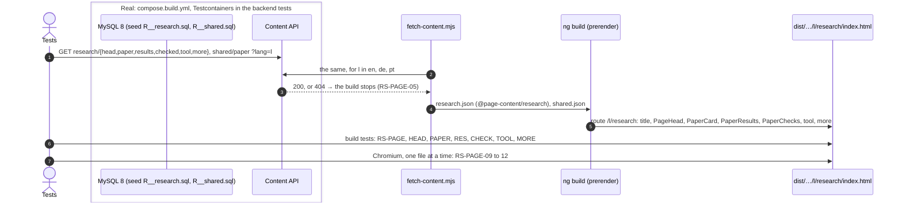

# Examples: Research page

Status: **on hold (2026-11-09): R4 is reopened.** The developer found the mock-up "too monotone",
"all the same blunt color, no dynamics", and asked for graphics (lattices from the wall or the
paper, or a screenshot of the BICA plugin marking an out-of-order call in an IDE). The mock-up now
offers options A, B and C for graphics, colour and motion (`docs/mockups/research/index.html`). The
cases, the slices and D1 to D7 below wait for that choice and are not agreed. R1 to R8 (2026-11-08)
and Q1 to Q5 (2026-11-09) are answered; R4 a ("no figure") no longer holds.

The Research page in three languages, at `/en/research`, `/de/research` and `/pt/research`: a landing
page for the ICE 2026 paper (R1 b). Design: `docs/mockups/research/research-spec.md`, with the
mock-up and screenshots beside it. The route, the sitemap entries, nginx, the menu link and its
current marker exist already (HOME-PAGE-07 to 09, SHELL-11, D34 in `software.md`); this file
replaces the old page that sits behind them.

Sections, in build order:
1. **Page frame** (`RS-PAGE-nn`): the new page behind the existing route: title, own text, the old
   page gone.
2. **Head** (`RS-HEAD-nn`): eyebrow, `<h1>`, intro.
3. **The paper** (`RS-PAPER-nn`): the card with the abstract and the PDF.
4. **What it proves** (`RS-RES-nn`): the four statements.
5. **How it was checked** (`RS-CHECK-nn`): four figures and the evidence.
6. **The tool** (`RS-TOOL-nn`): reticulateP.
7. **More research** (`RS-MORE-nn`): the Writing link and ResearchGate.

Not in this file: the header, language links and footer (`shell.md`), the colours (`theme.md`).
All wording is in the spec's copy table, en, de and pt; a case names a key and gives a language as
its example. "In plain words" says what each case means for a visitor, in English.

## Who reads it (from `docs/design.md`)

- **Researchers and reviewers** (laptop, often from "All research" on a band, so they have seen
  Theorem 15): the abstract, all four results, how they were checked, the PDF.
- **Hiring managers** (a quick look on a phone): that the engineering rests on a proof.
- **Teams building AI agents:** why the protocols hold, and the tool that checks them.

The Writing page lists every text; this page is about the ICE 2026 paper alone and links there once.

## 1. Page frame

| ID | In plain words | Given | When | Then | Covered |
|----|----------------|-------|------|------|---------|
| RS-PAGE-01 | The Research page is the new page in all three languages. | the research content in en, de and pt | the site is built | `/en/research/index.html`, `/de/research/index.html`, `/pt/research/index.html` exist with `<html lang>` en, de, pt, and each has the shared page head (`app-page-head`) | |
| RS-PAGE-02 | The browser tab names the page in its language. | the built pages | they are read | `<title>` is "Alexandre Zua Caldeira — Research", "— Forschung", "— Investigação" | |
| RS-PAGE-03 | Search engines still learn that the three pages are one page in three languages. | the built `/de/research` | it is read | `<link rel="alternate">` for en, de, pt to `https://zuacaldeira.com/{en,de,pt}/research`, and `x-default` to `/en/research` | |
| RS-PAGE-04 | The header shows Research as the page you are on. | the built `/de/research` | the main navigation is read | its Forschung link goes to `/de/research` and carries `aria-current="page"`; no other link does | |
| RS-PAGE-05 | A missing German text stops the build instead of showing English. | no research content stored for de | the site is built | the build fails, naming page `research`, the section and `de`; nothing is deployed (as WR-PAGE-09) | |
| RS-PAGE-06 | The page downloads only its own text and the paper's shared text. | the built site | the files `/en/research` loads at once are read | its own text and `shared/paper` are among them; none holds the home hero's sentence, the Software lead's title or the Writing intro (as WR-PAGE-10) | |
| RS-PAGE-07 | The old page is gone: no list of publications and no Material buttons. | the built `/en/research` | `<main>` is read | no heading "Publications", no title or abstract of the POPL, FOOL or ConGu papers, no `mat-card`, `mat-button` or `mat-stroked-button` | |
| RS-PAGE-08 | "What's next" is not on the page while it has no text. | the built pages | `<main>` is read | no section headed "What's next", "Wie es weitergeht" or "O que vem a seguir", and the sections are, in order: head, paper, what it proves, how it was checked, the tool, more research (D1) | |
| RS-PAGE-P-01 | A Research page in only one or two languages is refused. | the build | a language's research page is missing | RS-PAGE-01 goes red, naming the language | |
| RS-PAGE-P-02 | An old publication put back on the page is refused. | the built `/en/research` | the POPL title is put in `<main>` | RS-PAGE-07 goes red | |

## 2. Head

| ID | In plain words | Given | When | Then | Covered |
|----|----------------|-------|------|------|---------|
| RS-HEAD-01 | The page opens with its name and one sentence about the paper. | the built `/en/research` | the head is read | eyebrow "One paper · ICE 2026", `<h1>` "Research", `head.intro` en; the page has exactly one `<h1>` | |
| RS-HEAD-02 | The German page reads in German. | the built `/de/research` | the head is read | "Ein Paper · ICE 2026", "Forschung", `head.intro` de | |
| RS-HEAD-03 | The Portuguese page reads in Portuguese. | the built `/pt/research` | the head is read | "Um artigo · ICE 2026", "Investigação", `head.intro` pt | |
| RS-HEAD-04 | When the site asks for the German head, it gets its three texts exactly as stored. | `research/head` stored for de | `GET /api/content/research/head?lang=de` | 200 with `{"eyebrow": "Ein Paper · ICE 2026", "heading": "Forschung", "intro": "Der Zustandsraum …"}` as stored | |
| RS-HEAD-05 | A fresh database, filled with the starting texts, gives the head in every language, none empty. | an empty MySQL with Flyway and the `seed` profile | `GET /api/content/research/head?lang=en`, `de`, `pt` | 200 with the spec's copy, each field non-empty | |
| RS-HEAD-P-01 | English text on the German page's head is refused. | the built `/de/research` | the English intro is put in | RS-HEAD-02 goes red | |

## 3. The paper

| ID | In plain words | Given | When | Then | Covered |
|----|----------------|-------|------|------|---------|
| RS-PAPER-01 | The paper comes first, with its year, kind, title, author, venue and status. | the built `/en/research` | the section after the head is read | "2026 · Workshop paper", `<h2>` "Session Type State Spaces Form Lattices", "Alexandre Zua Caldeira" in `<b>`, "ICE 2026 · International Workshop on Interaction and Concurrency Experience", "Camera-ready · to appear in EPTCS" | |
| RS-PAPER-02 | One button opens the paper as a PDF from this site. | any language | the section's links are read | exactly one link, labelled `shared/paper.read` ("Paper lesen (PDF)" on `/de/research`), to `/assets/pdfs/SessionTypeStateSpacesFormLattices-CameraReady.pdf` from the site root, same tab, `hreflang="en"`, `type="application/pdf"`; the file is in the build | |
| RS-PAPER-03 | The abstract is shown word for word, under its label. | the built `/en/research` | the abstract is read | a label "Abstract", then a `<blockquote>` with the abstract of the spec, word for word | |
| RS-PAPER-04 | German and Portuguese readers get the abstract in English, and are told so. | `/de/research`, `/pt/research` | the abstract is read | label "Zusammenfassung" / "Resumo", the line "Auf Englisch" / "Em inglês", the abstract identical to `/en/research`'s with `lang="en"` and `translate="no"`; `/en/research` shows no such line (R2) | |
| RS-PAPER-05 | Title, name and venue stay as published on every page. | `/de/research`, `/pt/research` | the card is read | title, author and venue identical to `/en/research`; each `translate="no"`; the title `lang="en"` | |
| RS-PAPER-06 | When the site asks for the Portuguese card, it gets its labels and the paper's fields as stored. | `research/paper` stored for pt | `GET /api/content/research/paper?lang=pt` | 200 with the stored JSON as it is (D2's shape) | |
| RS-PAPER-07 | A fresh database gives the card in every language, the paper's fields the same in each. | an empty MySQL with Flyway and the `seed` profile | `GET /api/content/research/paper?lang=en`, `de`, `pt` | 200; author, venue and abstract identical in the three; every label non-empty | |
| RS-PAPER-P-01 | A translated abstract is refused. | the built `/de/research` | the abstract's first sentence is put in German | RS-PAPER-04 goes red | |
| RS-PAPER-P-02 | The PDF opening in a new tab is refused. | the built `/de/research` | `target="_blank"` is put on the button | RS-PAPER-02 goes red | |

## 4. What it proves

| ID | In plain words | Given | When | Then | Covered |
|----|----------------|-------|------|------|---------|
| RS-RES-01 | The results open with the theorem, in large type. | the built `/en/research` | the section after the paper is read | `<h2>` "What it proves"; first statement labelled "Theorem 15 · Reticulate Theorem", text "For every well-formed session type S, ℒ(S)/≡ is a bounded lattice." | |
| RS-RES-02 | The three other results follow, all open, in a fixed order. | the same | the section is read | then "Definition 6 · SCC quotient", "Lemma 8 · End", "Proposition 18 · Duality isomorphism", each with its text from the spec; none inside a `<details>` (R3) | |
| RS-RES-03 | On the German page, the labels are German and the statements are not translated. | the built `/de/research` | the section is read | `<h2>` "Was es beweist"; "Satz 15", "Definition 6", "Lemma 8", "Proposition 18"; the names and the four texts identical to `/en/research`, each text `translate="no"` and `lang="en"` | |
| RS-RES-04 | The Portuguese page does the same in Portuguese. | the built `/pt/research` | the section is read | "O que prova"; "Teorema 15", "Definição 6", "Lema 8", "Proposição 18"; the rest as RS-RES-03 | |
| RS-RES-05 | The stored paper holds all four statements, the same in every language. | an empty MySQL with Flyway and the `seed` profile | `GET /api/content/shared/paper?lang=en`, `de`, `pt` | `statements` holds the four of the spec, in its order, identical in the three (HOME-PAPER-09 in full; D3 replaces D31 in `software.md`) | |
| RS-RES-06 | The Software page's band still shows only the theorem. | the built `/de/software` | the band is read | it shows "Satz 15 · Reticulate Theorem" and its text, and no Definition, Lemma or Proposition (SW-PROOF-01 with four statements stored) | |
| RS-RES-P-01 | A translated statement is refused. | the built `/de/research` | Lemma 8's text is put in German | RS-RES-03 goes red | |
| RS-RES-P-02 | Results folded away are refused. | the built `/en/research` | the three are put inside a `<details>` | RS-RES-02 goes red | |

## 5. How it was checked

| ID | In plain words | Given | When | Then | Covered |
|----|----------------|-------|------|------|---------|
| RS-CHECK-01 | Four numbers say how the result was checked, each with its meaning in words. | the built `/en/research` | the section after the results is read | `<h2>` "How it was checked"; a `<dl>` of four: `108` "benchmark protocols, every one a lattice", `93` "distributive", `15` "not distributive", `Lean 4` "mechanised proof", in that order | |
| RS-CHECK-02 | Under them, the sentence the bands use. | any language | the section is read | the paragraph after the `<dl>` is `shared/paper.evidence` in the page's language ("Geprüft an 108 …" on `/de/research`) | |
| RS-CHECK-03 | On the German and Portuguese pages, the meanings are translated and the numbers are not. | `/de/research`, `/pt/research` | the figures are read | the labels of the spec's copy table in de and pt; the values `108`, `93`, `15`, `Lean 4` identical to `/en/research` | |
| RS-CHECK-04 | A fresh database gives the figures in every language, the values the same in each. | an empty MySQL with Flyway and the `seed` profile | `GET /api/content/research/checked?lang=en`, `de`, `pt` | 200; four figures, values identical in the three, every label non-empty | |
| RS-CHECK-P-01 | A changed number on one language's page is refused. | the built `/de/research` | `93` is changed to `94` | RS-CHECK-03 goes red | |

## 6. The tool

| ID | In plain words | Given | When | Then | Covered |
|----|----------------|-------|------|------|---------|
| RS-TOOL-01 | The tool behind the paper is named and described. | the built `/en/research` | the section after the figures is read | `<h2>` "The tool"; kicker "Verification tool"; `<h3>` "reticulateP" (`translate="no"`); the Software page's reticulateP text; stack "Python" | |
| RS-TOOL-02 | One link leads to the tool on the Software page, in the same language. | the built `/de/research` | the section's links are read | exactly one: "reticulateP auf der Software-Seite" → `/de/software`, same tab; no link to a repository (as SW-WORK-02) | |
| RS-TOOL-03 | The tool's text says the same as on the Software page. | an empty MySQL with Flyway and the `seed` profile | `research/tool` and `software/work` are read in en, de and pt | `tool.text` equals the reticulateP row's `text` in each language (D6) | |
| RS-TOOL-P-01 | A link to a private repository is refused. | the built page | a repository link is put on the tool | RS-TOOL-02 goes red | |

## 7. More research

| ID | In plain words | Given | When | Then | Covered |
|----|----------------|-------|------|------|---------|
| RS-MORE-01 | The page ends with two links: earlier papers, and the research profile. | the built `/en/research` | the last section of `<main>` is read | heading "More research"; a list of two links in order: "Earlier papers (2007–2010)" → `/en/writing`, same tab; "ResearchGate" → `https://www.researchgate.net/profile/Alexandre-Caldeira` | |
| RS-MORE-02 | The profile opens in a new tab, and says so in the page's language. | the built `/de/research` | the ResearchGate link is read | `target="_blank"`, `rel="noopener noreferrer"`, the `↗` with `aria-hidden="true"`, and a visually hidden " (öffnet in einem neuen Tab)" | |
| RS-MORE-03 | The German and Portuguese pages translate the words around the links. | `/de/research`, `/pt/research` | the section is read | "Mehr Forschung", "Frühere Paper (2007–2010)" → `/de/writing`; "Mais investigação", "Artigos anteriores (2007–2010)" → `/pt/writing`; "ResearchGate" unchanged | |
| RS-MORE-04 | No other profile links. | any language | the page is read | no ORCID, DBLP or Google Scholar link or text (Q3) | |
| RS-MORE-P-01 | An outside link that does not say it opens a new tab is refused. | the built `/de/research` | the hidden new-tab words are taken out of the ResearchGate link | RS-MORE-02 goes red | |

## In the browser (after the build, `npm run acceptance:browser`)

| ID | In plain words | Given | When | Then | Covered |
|----|----------------|-------|------|------|---------|
| RS-PAGE-09 | The page fits a phone: nothing runs off the side. | a phone at 390 px, `/en/research`, `/de/research`, `/pt/research` | the page is measured | no horizontal scroll; no element in `<main>` ends right of 390 px | |
| RS-PAGE-10 | Every link and the button are easy to tap. | the same | the links in `<main>` are measured | each is at least 44 px tall | |
| RS-PAGE-11 | Keyboard users get to the content first. | `/de/research`, 390 and 1280 px | Tab, then Enter | the skip link goes to `<main>` on the same page (SHELL-10 on the new page) | |
| RS-PAGE-12 | The page's text is easy to read in light and dark. | `/en/research` and `/de/research` at 1280, light and dark | the texts in `<main>` are measured | each at 4.5:1 or more against what is behind it (the mock-up's lowest: 4.91 light, 5.36 dark), with the shared contrast reader | |

## Diagram: the build (all slices)



Session type (the visitor's path), in the convention of `shell.md`:

```
G = Build → API : get(research, s, l) .
    API → Build : { ok200(s_l) .
                    Build → Page : prerender(head_l, paper_l, results_l, checked_l, tool_l, more_l) .
                    Page → Visitor : page(lang l, h1, paper, statements[thm15, def6, lem8, prop18],
                                          figures[108, 93, 15, lean4], tool, more) .
                    Visitor → Page : { pdf(ice2026) . end ,
                                       software(l) . end ,
                                       writing(l) . end ,
                                       out(researchGate, newTab_l) . end ,
                                       stay . end } ,
                    missing404 . Build → CI : fail(research, s, l) . end }
  title, author, venue, abstract, statements, figure values, targets: the same for every l

Visitor ↾ = Page?page(…) . Page!{ pdf . end , software . end , writing . end , out . end , stay . end }
Page ↾    = Build?prerender . Visitor!page(…) . Visitor?{ … }
```

| Arrow | Step in G | Rows |
|---|---|---|
| 1, 3 test/F → API | `get`, `{ok200, missing404}` | RS-HEAD-04, 05; RS-PAPER-06, 07; RS-RES-05; RS-CHECK-04; RS-TOOL-03; RS-PAGE-05 |
| 5 NG → P | `prerender(…)` | RS-PAGE-01 to 04, 06 to 08; RS-HEAD-01 to 03 |
| 6 the page | `page(…)` | RS-PAPER-01, 03 to 05; RS-RES-01 to 04, 06; RS-CHECK-01 to 03; RS-TOOL-01; RS-MORE-01, 03, 04 |
| 6 the links | the Visitor's choice `{pdf, software, writing, out, stay}` | RS-PAPER-02, RS-TOOL-02, RS-MORE-01, 02 |
| 7 in Chromium | `page(…)` read on a phone, by keyboard, in light and dark | RS-PAGE-09 to 12 |
| forbidden: an old publication | `page(…)` holds one paper | RS-PAGE-P-02 |
| forbidden: the abstract, a statement or a number changed for `l` | the same for every `l` | RS-PAPER-P-01, RS-RES-P-01, RS-CHECK-P-01 |
| forbidden: `head_en` on `l = de` | `ok200(s_l)` | RS-HEAD-P-01 |
| forbidden: results folded | `statements[…]` shown open | RS-RES-P-02 |
| forbidden: `pdf` in a new tab, `out` without saying so, a repository | the choice's branches | RS-PAPER-P-02, RS-MORE-P-01, RS-TOOL-P-01 |

The page is read-only: no repeat, stale-token or race rows.

## Slices (proposed)

The route, menu link and sitemap entry exist already, so every slice is reachable on `next` as soon
as it is pushed. `next` is not merged into `main` until slice 3 is done (D5).

1. **Frame + head:** the route becomes `loadChildren` with `research.routes.ts`, providing
   `RESEARCH_CONTENT` and `SHARED_CONTENT`; `research/head` through the content pipeline; `PageHead`;
   the title; the old page's markup, spec and i18n keys go (D7). RS-PAGE-01 to 08, P-01, P-02;
   RS-HEAD-01 to 05, P-01.
2. **The paper and its results:** `research/paper` and `research/results`; the four statements in
   `shared/paper` (D3; `SharedSeedIntegrationTest` changes with it); `PaperCard`, `PaperResults`.
   RS-PAPER-01 to 07, P-01, P-02; RS-RES-01 to 06, P-01, P-02.
3. **Checks, tool, more, and the browser:** `research/checked`, `research/tool`, `research/more`;
   `PaperChecks`, the tool row, the closing row; the browser file `research-page.test.mjs`.
   RS-CHECK-01 to 04, P-01; RS-TOOL-01 to 03, P-01; RS-MORE-01 to 04, P-01; RS-PAGE-09 to 12.

## Decisions

Answered by the developer on 2026-11-08:

- **R1: b,** a landing page for the ICE 2026 paper alone.
- **R2: a,** the abstract in English on every page, as a quotation, with "Auf Englisch" / "Em
  inglês" on de and pt (as D10 in `writing.md`).
- **R3: a,** all four statements, open.
- **R4: a,** no figure for now.
- **R5: a, under R1 b:** the 2007–2010 line leaves the page as a section; one link, "Earlier papers
  (2007–2010)", to the Writing page stays.
- **R6: a,** "What's next" as a placeholder in the mock-up; built only with text (D1).
- **R7: a, under R1 b:** the profiles sit in the closing row.
- **R8: a,** the Portuguese menu word stays "Investigação".

Not applying with R1 b: the page's own copy of the four publications and the three older
abstracts.

Answered by the developer on 2026-11-09:

- **Q1: a,** the `<h1>` is "Research" / "Forschung" / "Investigação", as on Software and Writing.
- **Q2: a,** the profiles stay in the closing row.
- **Q3:** no ORCID, DBLP or Google Scholar; ResearchGate alone.
- **Q4:** the drafts (eyebrow, intro, headings, figure labels, the tool link, the closing row) are
  built as drafted in en, de and pt and listed for the developer's review on the preview.
- **Q5: a,** a Cite block only once the EPTCS details exist; nothing now.
- The design hook's "overused font" warning on Fraunces stays unsilenced: Fraunces is settled.

Proposed by ui-design-peer on 2026-11-09 for the build (the developer may change them):

- **D1. "What's next" is left out** while it has no text: no section, no stored row, no key. It comes
  back as its own change, `research/next` `{heading, text}`, between the tool and the closing row.
- **D2. Where the text lives:** page `research` holds its own sections (`head`, `paper`, `results`,
  `checked`, `tool`, `more`, shapes in the spec); the paper's title, year, PDF, read label, kind
  words, evidence and statements come from `shared/paper`, as the bands read them, so they are
  stored once.
- **D3. `shared/paper.statements` holds all four** from slice 2 on (it replaces D31 in
  `software.md`); the band still shows only the theorem (RS-RES-06). The home band later reads the
  same four.
- **D4. The statements are plain text,** as the band shows Theorem 15: no markup in the stored
  texts, no mono spans for the notation (the mock-up's mono `S` and `ℒ(S)/≡` are not built).
- **D5. `next` is not merged into `main` mid-way:** the route is already in the menu, so a slice on
  `main` would show a half-built page.
- **D6. reticulateP's text is copied** into `research/tool` (each page downloads only its own text,
  D20 in `software.md`), and a seed test holds it equal to the Software row's (RS-TOOL-03).
- **D7. The old page goes in slice 1:** its markup, `research.spec.ts` and the i18n keys
  `research.subtitle`, `profilesHeading`, `publicationsHeading`, `paperLink`. `nav.research` stays;
  `ContentService.publications` stays while the home page's `paper-statements` reads it.
