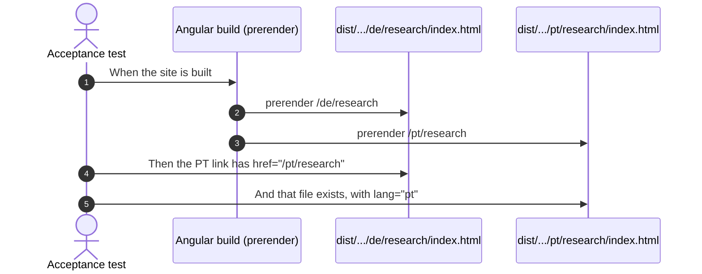

# Examples: Shell

Status: **agreed with the developer on 2026-11-02.**

The header, language links and footer that every page shares. Design:
`docs/mockups/home/home-spec.md` (frame option A, agreed 2026-11-02). Built together with
the home hero, because the hero's page needs them.

## Cases

| ID | Given | When | Then | Covered |
|----|-------|------|------|---------|
| SHELL-01 | the built `/de/home` | the header is read | a navigation labelled "Sprache" has three links, `EN`, `DE`, `PT`, to `/en/home`, `/de/home`, `/pt/home`; each has `hreflang`, `lang` and the accessible name of its language in that language (English, Deutsch, Português); `DE` has `aria-current` and is underlined | |
| SHELL-02 | a visitor on `/de/research` | they follow `PT` | they reach `/pt/research`: the same page in the other language | |
| SHELL-03 | the built `/pt/home` | the footer is read | it lists English, Deutsch, Português as links, Português with `aria-current` | |
| SHELL-04 | the built `/de/home` | the main navigation is read | it reads Software, Forschung, Texte, Über mich, to `/de/software`, `/de/research`, `/de/writing`, `/de/about`; no link drops the language prefix | |
| SHELL-05 | the built header | it is read in each language | the contact button reads en "⊥ write to me", de "⊥ Kontakt", pt "⊥ Contacto", to `/xx/contact` | |
| SHELL-06 | a phone (the CDK `Handset` query) | the page loads | the bar shows the mark, `EN DE PT`, the theme button and the menu button, each at least 44 px, with no horizontal scroll at 390 px in all three languages; the name "Zua Caldeira" and the menu links are not in the bar | |
| SHELL-07 | any language | the footer is read | it shows en "⊥ end · every protocol ends here", de "⊥ end · hier endet jedes Protokoll", pt "⊥ end · todo o protocolo acaba aqui", the heading "Let's talk about your system." (de "Sprechen wir über Ihr System.", pt "Vamos falar do seu sistema."), the availability line en "Open to software engineering and research roles, and to collaborations on protocols, verification and agent systems.", de "Offen für Stellen in Softwareentwicklung und Forschung und für Zusammenarbeit zu Protokollen, Verifikation und Agentensystemen.", pt "Aberto a funções em engenharia de software e investigação, e a colaborações em protocolos, verificação e sistemas de agentes.", `hello@zuacaldeira.com`, GitHub, LinkedIn and CV | |
| SHELL-08 | the phone's menu is open | it is read | it lists the four navigation links and the contact link, each at least 44 px high, translated; Escape or the close button closes it and focus returns to the menu button | |
| SHELL-09 | the 404 page at `/fr/home` | it is read | the header and footer are English, and `EN`, `DE`, `PT` lead to the three home pages; none is marked current | |
| SHELL-10 | a keyboard user on `/de/home` | they press Tab once | focus lands on "Zum Hauptinhalt springen", visibly, and following it moves to `<main>` | |

## Diagram: SHELL-02 (acceptance, at build time)

## Width of the header

The bar is the tightest part of the page, so these were measured in the mock-up in all three
languages. The real header needs a check at both sides of the CDK `Handset` query.

| Width | Bar |
|-------|-----|
| 390 | mark, `EN DE PT`, theme, menu |
| 768 | mark, four links, `EN DE PT`, contact button, theme (below 980 px the name gives way to the mark) |
| 1280, 1440 | mark and name, four links, `EN DE PT`, contact button, theme |

## In plain words

| ID | English | Deutsch | Português |
|----|---------|---------|-----------|
| SHELL-01 | At the top, EN, DE and PT switch the language; screen readers say each full name, and the current one is underlined. | Oben wechseln EN, DE und PT die Sprache; Vorleseprogramme nennen den vollen Namen, die aktuelle ist unterstrichen. | No topo, EN, DE e PT mudam a língua; os leitores de ecrã dizem o nome completo, e a atual está sublinhada. |
| SHELL-02 | Switching language keeps the visitor on the same page, only in the other language. | Beim Sprachwechsel bleibt man auf derselben Seite, nur in der anderen Sprache. | Ao mudar de língua, o visitante fica na mesma página, só que na outra língua. |
| SHELL-03 | The footer offers the three languages again, written out in full, with the current one marked. | Die Fußzeile bietet die drei Sprachen noch einmal ausgeschrieben an, die aktuelle ist markiert. | O rodapé volta a oferecer as três línguas, escritas por extenso, com a atual assinalada. |
| SHELL-04 | The main menu has four translated links, and none of them takes the visitor into another language. | Das Hauptmenü hat vier übersetzte Links, und keiner führt in eine andere Sprache. | O menu principal tem quatro links traduzidos, e nenhum leva o visitante para outra língua. |
| SHELL-05 | The contact button at the top is in the page's language and leads to the contact page. | Der Kontakt-Knopf oben steht in der Sprache der Seite und führt zur Kontaktseite. | O botão de contacto no topo está na língua da página e leva à página de contacto. |
| SHELL-06 | On a phone the top bar fits without sideways scrolling, and every button is big enough for a thumb. | Auf dem Handy passt die obere Leiste ohne seitliches Scrollen, und jeder Knopf ist groß genug für den Daumen. | No telemóvel, a barra de cima cabe sem deslizar para o lado, e cada botão tem tamanho para o polegar. |
| SHELL-07 | The footer ends with an invitation to talk, the work Zua is open to, an email address and profile links. | Die Fußzeile endet mit einer Einladung zum Gespräch, der Arbeit, für die Zua offen ist, E-Mail und Profil-Links. | O rodapé termina com um convite para conversar, o trabalho a que o Zua está aberto, um e-mail e links de perfil. |
| SHELL-08 | On a phone the menu lists every link, easy to tap; Escape or its button closes it, and focus returns. | Auf dem Handy zeigt das Menü alle Links, leicht zu tippen; Escape oder der Knopf schließt es, der Fokus kehrt zurück. | No telemóvel, o menu mostra todos os links, fáceis de tocar; fecha com Escape ou o botão, e o foco volta. |
| SHELL-09 | On the "page not found" page, the top and bottom are in English, and the language links lead home. | Auf der Seite „Seite nicht gefunden“ sind Kopf- und Fußzeile englisch, und die Sprachlinks führen zur Startseite. | Na página «página não encontrada», o topo e o rodapé estão em inglês, e os links de língua levam ao início. |
| SHELL-10 | A keyboard user's first press of Tab shows a visible link that jumps straight to the main content. | Beim ersten Druck auf Tab erscheint sichtbar ein Link, der direkt zum Hauptinhalt springt. | Ao premir Tab pela primeira vez, aparece um link visível que salta diretamente para o conteúdo principal. |

## Decisions

- **Frame option A** (2026-11-02): language codes in the bar, at every width.
- **Language names in full appear in the footer** too, as a second way to reach them.
- **"⊥ Kontakt" and "⊥ Contacto"** use today's translated nav words, because "Kontakt
  aufnehmen" does not fit the bar at 768 px.
