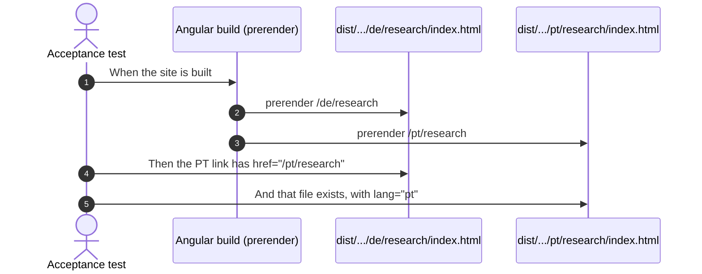
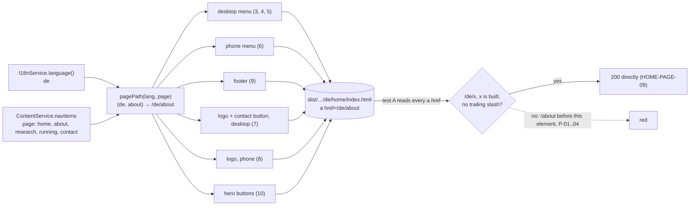
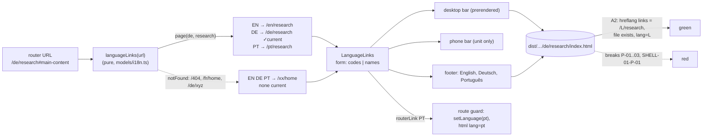
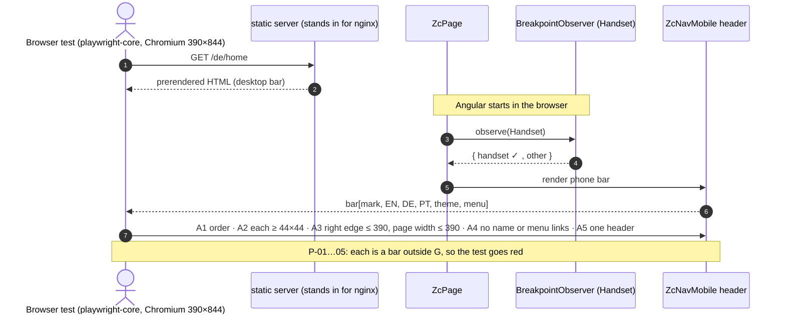

# Examples: Shell

Status: **agreed with the developer on 2026-11-02.**

The header, language links and footer that every page shares. Design:
`docs/mockups/home/home-spec.md` (frame option A, agreed 2026-11-02). Built together with
the home hero, because the hero's page needs them.

## Cases

| ID | Given | When | Then | Covered |
|----|-------|------|------|---------|
| SHELL-01 | the built `/de/home` | the header is read | a navigation labelled "Sprache" has three links, `EN`, `DE`, `PT`, to `/en/home`, `/de/home`, `/pt/home`; each has `hreflang`, `lang` and an accessible name that gives the language's name in that language and its code, "English (EN)", "Deutsch (DE)", "Português (PT)" (WCAG 2.5.3); `DE` has `aria-current` and is underlined | yes (build and unit, 2026-11-04; the underline not yet seen in a browser) |
| SHELL-02 | a visitor on `/de/research` | they follow `PT` | they reach `/pt/research`: the same page in the other language | yes (build, every page, and unit, 2026-11-04) |
| SHELL-03 | the built `/pt/home` | the footer is read | it lists English, Deutsch, Português as links, Português with `aria-current` | yes (build and unit, 2026-11-04) |
| SHELL-04 | the built pages in en, de and pt, and `/` and the 404 page (both English) | their links inside the site are read: the menu, the phone menu, the logo, the contact button, the footer, the hero's buttons | each starts with the page's language, `/de/about` on a German page, names a page of the build and has no trailing slash; none is an old path (`/about`), so no click takes a redirect (the D42 finding in `home.md`). Links to files (the paper's PDF) are not read; the language links (they carry `hreflang`) go to the same page in their own language instead (SHELL-02) | yes (build, 2026-11-04; P-01 to P-04) |
| SHELL-05 | the built header | it is read in each language | the contact button reads en "⊥ write to me", de "⊥ Kontakt", pt "⊥ Contacto", to `/xx/contact` | |
| SHELL-06 | a phone (the CDK `Handset` query) | the page loads and has started in the browser | the bar shows the mark, `EN DE PT`, the theme button and the menu button, each at least 44 px, with no horizontal scroll at 390 px in all three languages; the name "Zua Caldeira" and the menu links are not in the bar | |
| SHELL-07 | any language | the footer is read | it shows en "⊥ end · every protocol ends here", de "⊥ end · hier endet jedes Protokoll", pt "⊥ end · todo o protocolo acaba aqui", the heading "Let's talk about your system." (de "Sprechen wir über Ihr System.", pt "Vamos falar do seu sistema."), the availability line en "Open to software engineering and research roles, and to collaborations on protocols, verification and agent systems.", de "Offen für Stellen in Softwareentwicklung und Forschung und für Zusammenarbeit zu Protokollen, Verifikation und Agentensystemen.", pt "Aberto a funções em engenharia de software e investigação, e a colaborações em protocolos, verificação e sistemas de agentes.", `hello@zuacaldeira.com`, GitHub, LinkedIn and CV | |
| SHELL-08 | the phone's menu is open | it is read | it lists the four navigation links and the contact link, each at least 44 px high, translated; Escape or the close button closes it and focus returns to the menu button | |
| SHELL-09 | the 404 page at `/fr/home` | it is read | the header and footer are English, and `EN`, `DE`, `PT` lead to the three home pages; none is marked current | the language links only (build `/404` and unit, 2026-11-04) |
| SHELL-10 | a keyboard user on `/de/home` | they press Tab once | focus lands on "Zum Hauptinhalt springen", visibly, and following it moves to `<main>` | |
| SHELL-11 | the built `/de/home` | the main navigation is read | it reads Software, Forschung, Texte, Über mich, to `/de/software`, `/de/research`, `/de/writing`, `/de/about`; no link drops the language prefix (waits for the Software and Texte pages) | |
| SHELL-01-P-01 | a language page in the build | its language links are read | exactly one is `aria-current`, the page's own language; none, or two, is refused | yes (break in the build) |
| SHELL-02-P-01 | `/de/research` | its language links are read | a language link to another page (`PT` → `/pt/home`) is refused | yes (break in the build) |
| SHELL-02-P-02 | any built page | its language links are read | a link whose `hreflang` and `href` disagree (`hreflang="pt"`, `/en/research`) is refused, here and by SHELL-04 | yes (break in the build, both) |
| SHELL-02-P-03 | any built page | its language links are read | a language the site does not offer (a fourth link, `/fr/research`) is refused | yes (break in the build) |
| SHELL-02-P-04 | a visitor in the browser on `/de/research` | they move to `/de/about` | `PT` follows at once to `/pt/about`; links left at `/pt/research` are refused | yes (unit) |
| SHELL-06-P-01 | a phone at 390 px, on `/en/home`, `/de/home`, `/pt/home` | the bar is measured | a control smaller than 44 × 44 px (its visible box) is refused | |
| SHELL-06-P-02 | the same | the bar is measured | a bar or a page wider than 390 px is refused | |
| SHELL-06-P-03 | the same | the bar is read | the name "Zua Caldeira" or a link of the menu in the bar is refused | |
| SHELL-06-P-04 | the same | the bar is read | any order other than mark, `EN`, `DE`, `PT`, theme, menu is refused | |
| SHELL-06-P-05 | the same | the page is read | a second header (the desktop bar as well) is refused | |

## Diagram: SHELL-02 (acceptance, at build time)



## Diagram: SHELL-04 (links inside the site keep the language)



Session type. The visitor's projection loses the `moved301` branch: a change of behaviour, not a
refactor.

```
G_pre  = Page → Visitor : links(hrefs) .
         Visitor → Nginx : get(href) .
         Nginx → Visitor : { ok200(page) . end ,
                             moved301(loc) . Visitor → Nginx : get(loc) . Nginx → Visitor : ok200(page) . end }
G_post = Page → Visitor : links(hrefs) . Visitor → Nginx : get(href) . Nginx → Visitor : ok200(page) . end
Visitor ↾ : Page?links . Nginx!get(href) . Nginx?ok200 . end
Page ↾    : Visitor!links(hrefs) . end      (hrefs ⊆ { /lang/x | x is built })
```

| Diagram arrow | Step in G_post | Rows |
|---|---|---|
| `pagePath` → components → `dist` | `Page → Visitor : links` | 1–10 |
| test A reads every `a href` | `links(hrefs)`, hrefs of the form `/lang/x` | A |
| yes → `200` directly | `Nginx → Visitor : ok200` | HOME-PAGE-09 |
| no → red | the forbidden `moved301` branch, hrefs outside the set | P-01 to P-04 |

Test list. Acceptance A (`frontend/acceptance/shell.test.mjs`): every link inside the site on every
built page (the 15, `/` and `/404` as English) keeps its language and is a page of the build. Unit:
1 `pagePath('de', 'about')` → `/de/about`; 2 `pagePath('pt', 'home')` → `/pt/home`; 3 the desktop
menu on a German page links to `/de/home`, `/de/about`, `/de/research`, `/de/running`, without
contact; 4 it follows a change of language; 5 on `/de/about` only About is active; 6 the phone menu
links to `/pt/…`; 7 the desktop logo → `/de/home`, the contact button → `/de/contact`; 8 the phone
logo → `/de/home`; 9 the footer's menu → `/de/…`; 10 the hero's buttons → `/de/about`,
`/de/contact`. Protocol rows, each a link A must refuse: P-01 an old path `/about` (the first red),
P-02 another language `/en/about` on a German page, P-03 a trailing slash `/de/about/`, P-04 a page
not built `/de/software`; P-02 to P-04 each by a declared break in the built
`de/home/index.html`, then restored.

**Done 2026-11-04.** A went red with `en/home → /home`, `en/home → /about`, … on every page
(P-01) and green after the unit tests 1 to 10. The breaks in the built `de/home/index.html`, each
restored to the same file (md5 checked), turned A red with: P-02 `de/home → /en/about`, P-03
`de/home → /de/about/`, P-04 `de/home → /de/software`. Tests 4 and 5 were green on their first
run and shown to bite: test 4 by reading the language once when the menu is made, test 5 by
removing `routerLinkActive`.

Leftovers, not built:
- The desktop menu's `routerLinkActiveOptions` (`exact` for Home) no longer changes anything: with
  it removed, test 5 stayed green, because `/de/home` is no prefix of another page. It can go.
- The phone menu and the footer build the same list (label and link per nav item); a third copy
  would be the moment to share it.
- `zc-sidenav-menu-items.ts` and `footer.ts` were not Prettier-clean before this element (a
  missing trailing comma); left as they were.

## Diagram: SHELL-01, 02, 03 and the language links of SHELL-09



Session type. Convention: a role that a branch never calls just ends there (I18n and Links on
`leave`).

```
G = μX . Router → Links : at(url) .
         Links → Visitor : { page(l, p) : links{ L ↦ /L/p | L ∈ {en,de,pt} }, current = l ,
                             notFound   : links{ L ↦ /L/home | L ∈ {en,de,pt} }, current = none } .
         Visitor → Router : { follow(L) . Router → I18n : setLanguage(L) . X ,
                              leave . end }

Visitor ↾ = μX . Links ? { page(l,p) , notFound } . Router ! { follow(L) . X , leave . end }
Links ↾   = μX . Router ? at(url) . Visitor ! { page(l,p) , notFound } . X
```

| Diagram arrow | Step in G | Rows |
|---|---|---|
| URL → `languageLinks` | `Router → Links : at(url)` | unit 1–6 |
| `page(de, research)` → three links, DE current | `Links → Visitor : page(l,p)` | unit 1, 2, 4; A1, A2 |
| notFound → home pages, none current | `Links → Visitor : notFound` | unit 3, 5, 6; A2 (404) |
| `LanguageLinks` → bars, footer | links reach the Visitor | unit 7–11; A1, A3 |
| `routerLink` PT → guard | `follow(L) . setLanguage(L) . X` | unit 12 (P-04); A2 (target has `lang=L`) |
| forbidden links | outside `links{…}` | SHELL-02-P-01 to P-03, SHELL-01-P-01 |

Test list. Acceptance (`frontend/acceptance/shell.test.mjs`): A2 SHELL-02 on every built page (the
15, `/`, `/404`), the `hreflang` links are exactly en, de, pt to `/L/<same page>` (`/L/home` on the
404 page), each target built with `<html lang="L">`, exactly one `aria-current` (none on the 404
page); A1 SHELL-01 on `/de/home`; A3 SHELL-03 on `/pt/home`; SHELL-04 skips the `hreflang` links.
Unit: 1 `/de/research` → en, de, pt to `/x/research`, de current; 2 `/` → home, en current;
3 `/404` → homes, none current; 4 `/de/research#main-content` drops the fragment; 5 `/fr/home` →
notFound; 6 `/de/xyz` → notFound; 7 `LanguageLinks` codes: nav labelled from the translations, three
links with href, `hreflang`, `lang`, accessible name; 8 only the current link has `aria-current`;
9 names form; 10 desktop and phone bars show the codes; 11 the footer shows the names; 12
SHELL-02-P-04, the links follow a navigation. Then the key `common.language` in en, de, pt, and
`LanguageSwitcher` deleted (D2 in `i18n.md`). Breaks in the built files for SHELL-02-P-01 to P-03
and SHELL-01-P-01, each declared and restored. The underline of the current link is styling,
reviewed visually.

**Done 2026-11-04.** A2 (SHELL-02) went red with `en/home: expected [ 'de /de/home', 'en /en/home
current', 'pt /pt/home' ] but got []`, and green after the unit tests 1 to 12. SHELL-04 then went red as
foreseen (`de/home → /en/home` on every page) and green with its exception. A1 and A3 were green on
their first run and shown to bite, each by a declared break in the built file, restored with md5
checked. SHELL-01-P-01 (`aria-current` moved from DE to PT on `de/home`) turned A1 and A2 red. The
footer's `aria-current` taken off Português on `pt/home` turned A3 and A2 red. The other breaks were in
`de/research`. P-01 (`PT` → `/pt/home`) and P-03 (a fourth link, `/fr/research`) turned A2 red. P-02
(`hreflang="pt"` with `/en/research`) at first turned only A2 red, because SHELL-04 skipped every
`hreflang` link. SHELL-04 now checks a language link against the language its `hreflang` names, and went
red too (`de/research → /en/research`).

Unit 5's example is `/fr/research`, not `/fr/home`. On `/fr/home`, a break that takes any two letters
for a language gave the same links, so the test did not bite. Unit 12 (P-04) was red first
(`/xx/research` after moving to `/de/about`). `SITE_PAGES` (in `models/i18n.ts`) names the pages each
language has; a route spec ties it to the routes. The footer's SHELL-04 unit test now reads its menu only.

Leftovers, not built:
- **Not seen in a browser.** The styles are the mock-up's, with the tokens, but no screenshot could be
  taken in the session. Review the header and footer on the preview at 390, 768 and 1280
  (`docs/design.md`).
- **The initial bundle is over its warning budget:** 509.92 kB against 500 kB (the error budget is
  1 MB). Not checked whether it was over before this element.
- **The footer's list** sits in its bottom row, without a heading, until SHELL-07 rebuilds the footer.
- **The bars' order** (mark, `EN DE PT`, theme, menu on the phone) and the 44 px check belong to
  SHELL-06.
- `app.routes.spec.ts` and `i18n/de.ts`, `en.ts`, `pt.ts` were not Prettier-clean before this element;
  left as they were.

## Diagram: SHELL-06 (acceptance, in the browser)

The prerendered HTML holds the desktop bar only (the server does not know the screen), so the
phone bar is seen only in a browser, after Angular has started.



Session type. Convention: a role that a branch never reaches just ends there.

```
G = Phone → Srv : get(/l/home) . Srv → Phone : html(desktopBar) .
    Page → BO : observe(Handset) .
    BO → Page : { handset . Page → Phone : bar[mark, langs(EN,DE,PT), theme, menu]  (each ≥ 44², total width ≤ 390) . end ,
                  other   . Page → Phone : desktopBar . end }

Phone ↾ = Srv!get . Srv?html . Page?{ bar[mark,langs,theme,menu] . end , desktopBar . end }
Page ↾  = BO!observe . BO?{ handset . Phone!bar[…] . end , other . Phone!desktopBar . end }
```

| Diagram arrow | Step in G | Rows |
|---|---|---|
| 1–2 GET / HTML | `get` / `html(desktopBar)` | (setup) |
| 3–4 observe / handset | `observe`, `handset` branch | A5, P-05 |
| 5–6 phone bar | `bar[mark, langs, theme, menu]` | A1, unit 1, P-04 |
| item sizes | `each ≥ 44²` | A2, P-01 |
| widths | `total ≤ 390` | A3, P-02 |
| nothing else in the bar | the bar's list is closed | A4, unit 2, P-03 |
| `other` branch | the desktop bar | SHELL-01, 04 (build) |

Test list. Acceptance (`frontend/acceptance/browser/shell-phone.test.mjs`, `npm run acceptance:browser`):
the built site served locally, opened at 390×844 in portrait, after Angular has started, on `/en/home`,
`/de/home`, `/pt/home`: A1 the bar's controls are exactly mark, EN, DE, PT, theme, menu, in order; A2
each is at least 44×44 px; A3 the header's right edge and the page's width are at most 390 px; A4 no
"Zua Caldeira" and no menu link in the bar; A5 exactly one header. Unit (`zc-nav-mobile.spec.ts`):
1 the bar's order is logo, language links, theme, menu button; 2 the header holds no name and no menu
list. The sizes are CSS, driven by A2 only. Protocol rows: P-01 and P-04 are red before this element
(40 px buttons, the menu first); P-02, P-03 and P-05 by declared breaks, then restored.

## Width of the header

The bar is the tightest part of the page, so these were measured in the mock-up in all three
languages. The real header needs a check at both sides of the CDK `Handset` query.

| Width | Bar |
|-------|-----|
| 390 | mark, `EN DE PT`, theme, menu |
| 768 | mark, four links, `EN DE PT`, contact button, theme (below 980 px the name gives way to the mark) |
| 1280, 1440 | mark and name, four links, `EN DE PT`, contact button, theme |

## In plain words

| ID | English | Deutsch | Português |
|----|---------|---------|-----------|
| SHELL-01 | At the top, EN, DE and PT switch the language; screen readers say each full name, and the current one is underlined. | Oben wechseln EN, DE und PT die Sprache; Vorleseprogramme nennen den vollen Namen, die aktuelle ist unterstrichen. | No topo, EN, DE e PT mudam a língua; os leitores de ecrã dizem o nome completo, e a atual está sublinhada. |
| SHELL-02 | Switching language keeps the visitor on the same page, only in the other language. | Beim Sprachwechsel bleibt man auf derselben Seite, nur in der anderen Sprache. | Ao mudar de língua, o visitante fica na mesma página, só que na outra língua. |
| SHELL-03 | The footer offers the three languages again, written out in full, with the current one marked. | Die Fußzeile bietet die drei Sprachen noch einmal ausgeschrieben an, die aktuelle ist markiert. | O rodapé volta a oferecer as três línguas, escritas por extenso, com a atual assinalada. |
| SHELL-04 | Every link inside the site keeps the visitor in their language, except the language links, and opens the page straight away, with no detour. | Jeder Link innerhalb der Website bleibt in der Sprache des Besuchers, außer den Sprachlinks, und öffnet die Seite direkt, ohne Umweg. | Cada link dentro do site mantém o visitante na sua língua, exceto os links de língua, e abre a página logo, sem desvios. |
| SHELL-05 | The contact button at the top is in the page's language and leads to the contact page. | Der Kontakt-Knopf oben steht in der Sprache der Seite und führt zur Kontaktseite. | O botão de contacto no topo está na língua da página e leva à página de contacto. |
| SHELL-06 | On a phone the top bar fits without sideways scrolling, and every button is big enough for a thumb. | Auf dem Handy passt die obere Leiste ohne seitliches Scrollen, und jeder Knopf ist groß genug für den Daumen. | No telemóvel, a barra de cima cabe sem deslizar para o lado, e cada botão tem tamanho para o polegar. |
| SHELL-07 | The footer ends with an invitation to talk, the work Zua is open to, an email address and profile links. | Die Fußzeile endet mit einer Einladung zum Gespräch, der Arbeit, für die Zua offen ist, E-Mail und Profil-Links. | O rodapé termina com um convite para conversar, o trabalho a que o Zua está aberto, um e-mail e links de perfil. |
| SHELL-08 | On a phone the menu lists every link, easy to tap; Escape or its button closes it, and focus returns. | Auf dem Handy zeigt das Menü alle Links, leicht zu tippen; Escape oder der Knopf schließt es, der Fokus kehrt zurück. | No telemóvel, o menu mostra todos os links, fáceis de tocar; fecha com Escape ou o botão, e o foco volta. |
| SHELL-09 | On the "page not found" page, the top and bottom are in English, and the language links lead home. | Auf der Seite „Seite nicht gefunden“ sind Kopf- und Fußzeile englisch, und die Sprachlinks führen zur Startseite. | Na página «página não encontrada», o topo e o rodapé estão em inglês, e os links de língua levam ao início. |
| SHELL-10 | A keyboard user's first press of Tab shows a visible link that jumps straight to the main content. | Beim ersten Druck auf Tab erscheint sichtbar ein Link, der direkt zum Hauptinhalt springt. | Ao premir Tab pela primeira vez, aparece um link visível que salta diretamente para o conteúdo principal. |
| SHELL-11 | The main menu has four translated links, and none of them takes the visitor into another language. | Das Hauptmenü hat vier übersetzte Links, und keiner führt in eine andere Sprache. | O menu principal tem quatro links traduzidos, e nenhum leva o visitante para outra língua. |
| SHELL-01-P-01 | Exactly one language is marked as current. | Genau eine Sprache ist als aktuell markiert. | Exatamente uma língua está assinalada como atual. |
| SHELL-02-P-01 | A language link never moves the visitor to a different page. | Ein Sprachlink führt nie auf eine andere Seite. | Um link de língua nunca leva o visitante a outra página. |
| SHELL-02-P-02 | A language link always goes to the language it names. | Ein Sprachlink führt immer in die Sprache, die er nennt. | Um link de língua leva sempre à língua que indica. |
| SHELL-02-P-03 | The language links offer exactly English, German and Portuguese. | Die Sprachlinks bieten genau Englisch, Deutsch und Portugiesisch an. | Os links de língua oferecem exatamente inglês, alemão e português. |
| SHELL-02-P-04 | After moving to another page, the language links follow at once. | Nach einem Seitenwechsel folgen die Sprachlinks sofort. | Depois de mudar de página, os links de língua acompanham logo. |
| SHELL-06-P-01 | Every control in the phone bar is at least 44 px each way. | Jedes Bedienelement der Handy-Leiste ist in beide Richtungen mindestens 44 px groß. | Cada controlo da barra do telemóvel tem pelo menos 44 px em cada direção. |
| SHELL-06-P-02 | Nothing in the phone bar reaches past the edge of the screen. | Nichts in der Handy-Leiste ragt über den Bildschirmrand. | Nada na barra do telemóvel passa da margem do ecrã. |
| SHELL-06-P-03 | The phone bar never shows the name or the menu's links. | Die Handy-Leiste zeigt nie den Namen oder die Links des Menüs. | A barra do telemóvel nunca mostra o nome nem os links do menu. |
| SHELL-06-P-04 | The phone bar keeps its order: mark, languages, theme, menu. | Die Handy-Leiste behält ihre Reihenfolge: Zeichen, Sprachen, Farbschema, Menü. | A barra do telemóvel mantém a ordem: marca, línguas, tema, menu. |
| SHELL-06-P-05 | A phone shows only the phone bar, never the desktop bar as well. | Ein Handy zeigt nur die Handy-Leiste, nie zusätzlich die Desktop-Leiste. | Um telemóvel mostra só a barra do telemóvel, nunca também a do computador. |

## Decisions

- **Frame option A** (2026-11-02): language codes in the bar, at every width.
- **Language names in full appear in the footer** too, as a second way to reach them.
- **"⊥ Kontakt" and "⊥ Contacto"** use today's translated nav words, because "Kontakt
  aufnehmen" does not fit the bar at 768 px.

Agreed with the developer on 2026-11-05, for SHELL-06:

- **D1, a browser test:** `playwright-core` (no bundled browser) as a dev dependency of `frontend/`,
  `npm run acceptance:browser`, and one CI step that installs Chromium and runs it after `acceptance`.
- **D2, 44 px is the visible box** of each control, not Material's invisible 48 px touch target; the
  theme and menu buttons become 44 px.
- **D3, the width check:** the header and the page's width, on the three home pages.
- **D4, after Angular has started.** The prerendered HTML holds the desktop bar; the page's width before
  Angular starts is measured once, in the first red run, and recorded as a finding.
- **D5, the drawer's side** (from the right, in the spec) stays with SHELL-08; here the menu button
  only moves to the end of the bar.

Agreed with the developer on 2026-11-04, for SHELL-04:

- **Every link inside the site,** not only the menu: the logo, the contact button, the footer and
  the hero's buttons took the same `301`. The v2 menu (Software, Forschung, Texte, Über mich) moves
  to SHELL-11, which waits for its pages.
- **`pagePath(lang, page)`,** a pure function next to `LANGUAGES` in `models/i18n.ts`, makes every
  such link; `NavItem.route: '/about'` becomes `page: 'about'`.
- **`/` and the 404 page are English,** so their links go to `/en/…` (D1 in `home.md`, SHELL-09).
- **No nginx run for this element:** test A shows each link has the form HOME-PAGE-09 already
  answers `200`.

Agreed with the developer on 2026-11-04, for SHELL-01, 02 and 03:

- **Scope:** SHELL-01, 02 and 03 together, with the language links of SHELL-09 (on the 404 page
  they lead to the three home pages, none current).
- **`languageLinks(url)`,** a pure function next to `pagePath` in `models/i18n.ts`, fed by the
  router's URL as a signal, decides the links and the current one.
- **Accessible names "English (EN)", "Deutsch (DE)", "Português (PT)"**, so the visible code is in
  the name (WCAG 2.5.3, Label in Name); "Português" alone does not contain "PT".
- **`common.language`:** en "Language", de "Sprache", pt "Língua", the label of the bar's nav.
- **The footer's list** is a plain list, not a second `<nav>`.
- **`LanguageLinks`** in `common/language-links/`, input `form: 'codes' | 'names'`.
- **`routerLink`,** so the route guard sets the language and `<html lang>` without a reload.
- **SHELL-04's exception:** the language links, recognised by `hreflang`; SHELL-02-P-02 keeps the
  exception honest.
