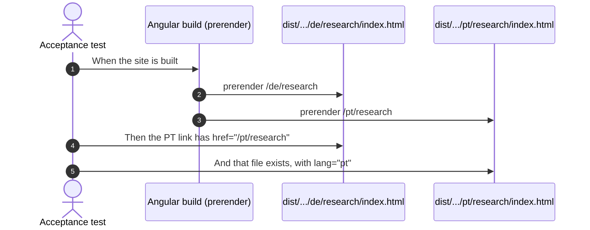

# Examples: Shell

Status: **drafted on 2026-11-02, waiting for the developer's agreement,** with
`docs/examples/home.md`.

The header, language links and footer that every page shares. Design:
`docs/mockups/home/home-spec.md` (frame option A, agreed 2026-11-02). Built together with
the home hero, because the hero's page needs them.

## Cases

| ID | Given | When | Then | Covered |
|----|-------|------|------|---------|
| SHELL-01 | the built `/de/home` | the header is read | a navigation labelled "Sprache" has three links, `EN`, `DE`, `PT`, to `/en/home`, `/de/home`, `/pt/home`; each has `hreflang`, `lang` and the accessible name of its language in that language (English, Deutsch, Português); `DE` has `aria-current` and is underlined | |
| SHELL-02 | a visitor on `/de/research` | they follow `PT` | they reach `/pt/research`: the same page in the other language | |
| SHELL-03 | the built `/pt/home` | the footer is read | it lists English, Deutsch, Português as links, Português with `aria-current` | |
| SHELL-04 | the built `/de/home` | the main navigation is read | it reads Software, Forschung, Texte *(proposed)*, Über mich, to `/de/software`, `/de/research`, `/de/writing`, `/de/about`; no link drops the language prefix | |
| SHELL-05 | the built header | it is read in each language | the contact button reads en "⊥ write to me", de "⊥ Kontakt", pt "⊥ Contacto", to `/xx/contact` | |
| SHELL-06 | a phone (the CDK `Handset` query) | the page loads | the bar shows the mark, `EN DE PT`, the theme button and the menu button, each at least 44 px, with no horizontal scroll at 390 px in all three languages; the name "Zua Caldeira" and the menu links are not in the bar | |
| SHELL-07 | any language | the footer is read | it shows "⊥ end · every protocol ends here" (de, pt *(proposed)*), the heading "Let's talk about your system." (de "Sprechen wir über Ihr System." *(proposed)*, pt "Vamos falar do seu sistema." *(proposed)*), the availability line (open, `home.md` Q4), `hello@zuacaldeira.com`, GitHub, LinkedIn and CV | |
| SHELL-08 | the phone's menu is open | it is read | it lists the four navigation links and the contact link, each at least 44 px high, translated; Escape or the close button closes it and focus returns to the menu button | |
| SHELL-09 | the 404 page at `/fr/home` | it is read | the header and footer are English, and `EN`, `DE`, `PT` lead to the three home pages; none is marked current | |
| SHELL-10 | a keyboard user on `/de/home` | they press Tab once | focus lands on "Zum Hauptinhalt springen", visibly, and following it moves to `<main>` | |

## Diagram: SHELL-02 (acceptance, at build time)

## Width of the header

The bar is the tightest part of the page, so these were measured in the mock-up in all three
languages. The real header needs a check at both sides of the CDK `Handset` query.

| Width | Bar |
|-------|-----|
| 390 | mark, `EN DE PT`, theme, menu |
| 768 | mark, four links, `EN DE PT`, contact button, theme (below 980 px the name gives way to the mark) |
| 1280, 1440 | mark and name, four links, `EN DE PT`, contact button, theme |

## Decisions

- **Frame option A** (2026-11-02): language codes in the bar, at every width.
- **Language names in full appear in the footer** too, as a second way to reach them.
- **"⊥ Kontakt" and "⊥ Contacto"** use today's translated nav words, because "Kontakt
  aufnehmen" does not fit the bar at 768 px.
