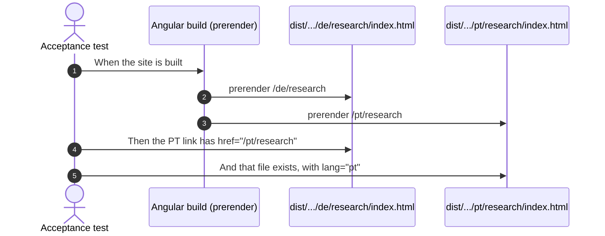
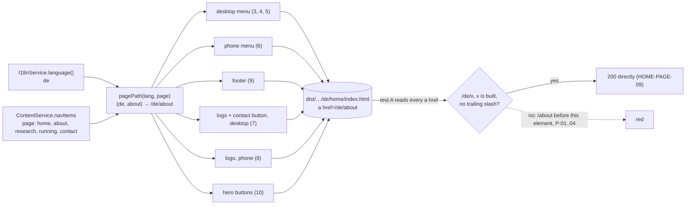
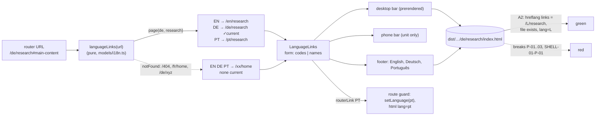
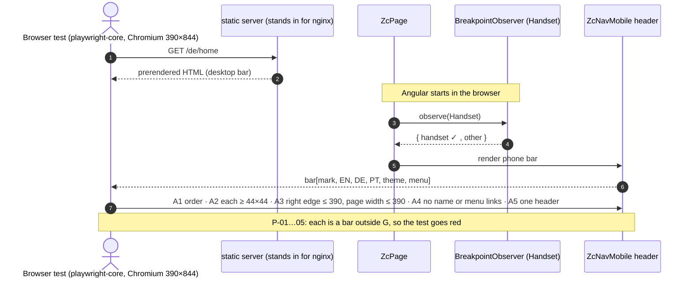
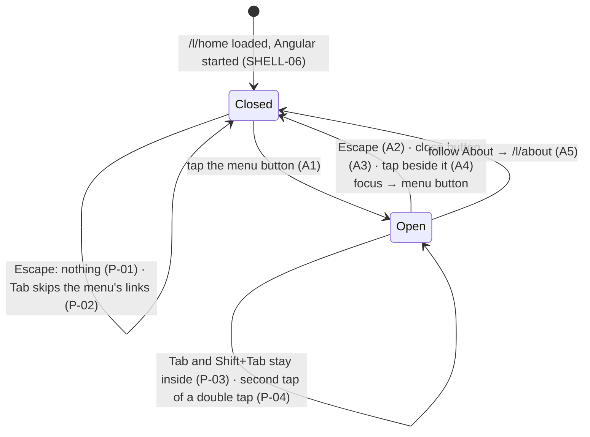
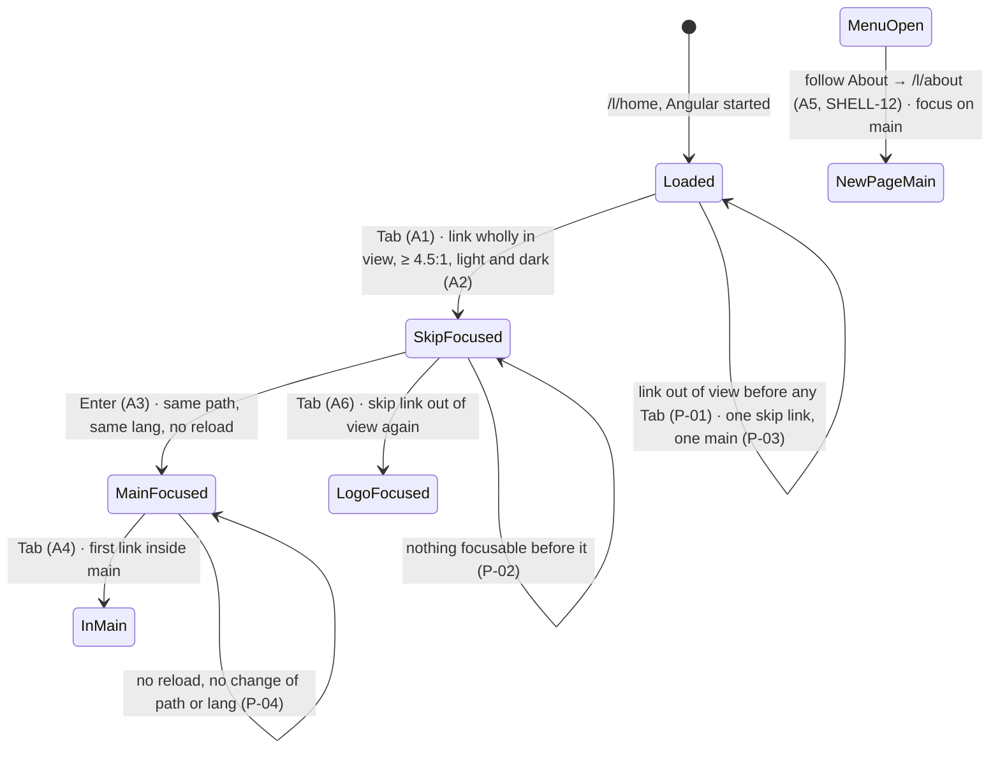
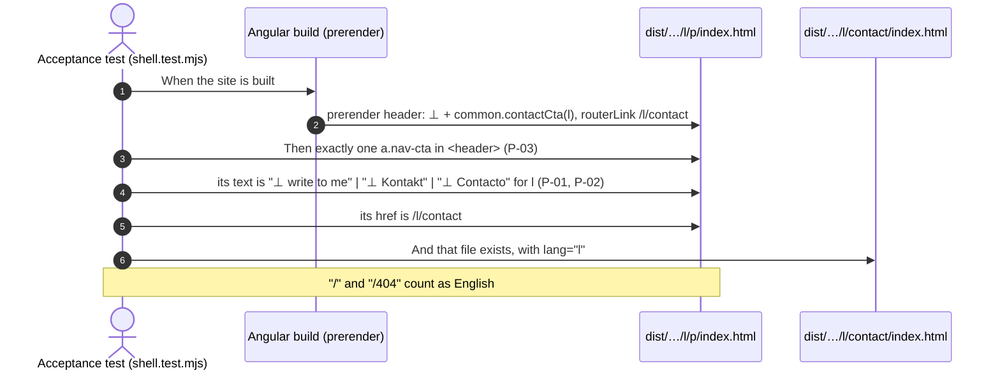
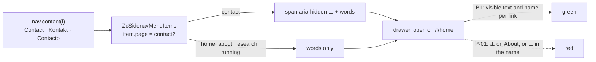

# Examples: Shell

Status: **agreed with the developer on 2026-11-02.**

The header, language links and footer that every page shares. Design:
`docs/mockups/home/home-spec.md` (frame option A, agreed 2026-11-02). Built together with
the home hero, because the hero's page needs them.

## Cases

| ID | Given | When | Then | Covered |
|----|-------|------|------|---------|
| SHELL-01 | the built `/de/home` | the header is read | a navigation labelled "Sprache" has three links, `EN`, `DE`, `PT`, to `/en/home`, `/de/home`, `/pt/home`; each has `hreflang`, `lang` and an accessible name that gives the language's name in that language and its code, "English (EN)", "Deutsch (DE)", "Português (PT)" (WCAG 2.5.3); `DE` has `aria-current` and is underlined | yes (build and unit, 2026-11-04; the underline not yet seen in a browser) |
| SHELL-02 | a visitor on `/de/research` | they follow `PT` | they reach `/pt/research`: the same page in the other language | yes (build, every page, and unit, 2026-11-04) |
| SHELL-03 | the built `/pt/home` | the footer is read | it lists English, Deutsch, Português as links, Português with `aria-current` | yes (build and unit, 2026-11-04) |
| SHELL-04 | the built pages in en, de and pt, and `/` and the 404 page (both English) | their links inside the site are read: the menu, the phone menu, the logo, the contact button, the footer, the hero's buttons | each starts with the page's language, `/de/about` on a German page, names a page of the build and has no trailing slash; none is an old path (`/about`), so no click takes a redirect (the D42 finding in `home.md`). Links to files (the paper's PDF) are not read; the language links (they carry `hreflang`) go to the same page in their own language instead (SHELL-02); links to a spot on the same page (its own path and `#…`, the skip link) are not read either, a `#…` link to another page is (D19) | yes (build, 2026-11-04; P-01 to P-04; D19 2026-11-06) |
| SHELL-05 | the built header | it is read in each language | the contact button reads en "⊥ write to me", de "⊥ Kontakt", pt "⊥ Contacto", to `/xx/contact` | yes (build, every page, and unit, 2026-11-06) |
| SHELL-05b | a phone at 390 px, on `/en/home`, `/de/home`, `/pt/home`, the menu open | it is read | its Contact link reads en "⊥ Contact", de "⊥ Kontakt", pt "⊥ Contacto" (the `nav.contact` words), the `⊥` hidden from screen readers, so its name is the words alone; Home, About, Research and Running read as before | yes (browser and unit, 2026-11-06) |
| SHELL-06 | a phone (the CDK `Handset` query) | the page loads and has started in the browser | the bar shows the mark, `EN DE PT`, the theme button and the menu button, each at least 44 px, with no horizontal scroll at 390 px in all three languages; the name "Zua Caldeira" and the menu links are not in the bar | yes (browser and unit, 2026-11-05) |
| SHELL-07 | any language | the footer is read | it shows en "⊥ end · every protocol ends here", de "⊥ end · hier endet jedes Protokoll", pt "⊥ end · todo o protocolo acaba aqui", the heading "Let's talk about your system." (de "Sprechen wir über Ihr System.", pt "Vamos falar do seu sistema."), the availability line en "Open to software engineering and research roles, and to collaborations on protocols, verification and agent systems.", de "Offen für Stellen in Softwareentwicklung und Forschung und für Zusammenarbeit zu Protokollen, Verifikation und Agentensystemen.", pt "Aberto a funções em engenharia de software e investigação, e a colaborações em protocolos, verificação e sistemas de agentes.", `hello@zuacaldeira.com`, GitHub, LinkedIn and CV | |
| SHELL-08 | a phone at 390 px, on `/en/home`, `/de/home`, `/pt/home`, the menu open | it is read | it slides in from the right, is a dialog named Menu / Menü / Menu, and lists Home, About, Research, Running and Contact, translated, to `/xx/…`, each at least 44 px high; Escape, the close button or a tap beside it closes it and focus returns to the menu button; following a link closes it on the new page | yes (browser and unit, 2026-11-05) |
| SHELL-09 | the 404 page at `/fr/home` | it is read | the header and footer are English, and `EN`, `DE`, `PT` lead to the three home pages; none is marked current | the language links only (build `/404` and unit, 2026-11-04); the English contact button (build `/404`, SHELL-05, 2026-11-06) |
| SHELL-10 | a keyboard user on `/en/home`, `/de/home`, `/pt/home`, at 390 and 1280 px, in the light and the dark theme | they press Tab once | focus lands on the skip link, en "Skip to main content", de "Zum Hauptinhalt springen", pt "Saltar para o conteúdo principal", its box wholly inside the viewport and its text at 4.5:1 or more; following it moves focus to `<main>` on the same page, with no reload and the same language, and the next Tab lands inside `<main>` | yes (browser and unit, 2026-11-06) |
| SHELL-12 | a phone at 390 px, the menu open on `/xx/home` | they follow About | `/xx/about` opens with the menu closed and focus on its `<main>` (D9) | yes (browser and unit, 2026-11-06) |
| SHELL-11 | the built `/de/home` | the main navigation is read | it reads Software, Forschung, Texte, Über mich, to `/de/software`, `/de/research`, `/de/writing`, `/de/about`; no link drops the language prefix (waits for the Software and Texte pages) | |
| SHELL-01-P-01 | a language page in the build | its language links are read | exactly one is `aria-current`, the page's own language; none, or two, is refused | yes (break in the build) |
| SHELL-02-P-01 | `/de/research` | its language links are read | a language link to another page (`PT` → `/pt/home`) is refused | yes (break in the build) |
| SHELL-02-P-02 | any built page | its language links are read | a link whose `hreflang` and `href` disagree (`hreflang="pt"`, `/en/research`) is refused, here and by SHELL-04 | yes (break in the build, both) |
| SHELL-02-P-03 | any built page | its language links are read | a language the site does not offer (a fourth link, `/fr/research`) is refused | yes (break in the build) |
| SHELL-02-P-04 | a visitor in the browser on `/de/research` | they move to `/de/about` | `PT` follows at once to `/pt/about`; links left at `/pt/research` are refused | yes (unit) |
| SHELL-06-P-01 | a phone at 390 px, on `/en/home`, `/de/home`, `/pt/home` | the bar is measured | a control smaller than 44 × 44 px (its visible box) is refused || yes (browser: red before, 40 px) |
| SHELL-06-P-02 | the same | the bar is measured | a bar or a page wider than 390 px is refused || yes (break in the CSS) |
| SHELL-06-P-03 | the same | the bar is read | the name "Zua Caldeira" or a link of the menu in the bar is refused || yes (break, browser and unit) |
| SHELL-06-P-04 | the same | the bar is read | any order other than mark, `EN`, `DE`, `PT`, theme, menu is refused || yes (browser and unit: red before) |
| SHELL-06-P-05 | the same | the page is read | a second header (the desktop bar as well) is refused || yes (break in `ZcPage`) |
| SHELL-08-P-01 | a phone at 390 px, the menu closed | Escape is pressed | nothing changes: the menu stays closed, focus stays where it was | yes (browser; break) |
| SHELL-08-P-02 | the same | Tab is pressed from the menu button | focus never lands on a link of the closed menu | yes (browser; break) |
| SHELL-08-P-03 | the menu open | Tab or Shift+Tab is pressed, over and over | focus never leaves the menu for the page behind | yes (browser; break) |
| SHELL-08-P-04 | the menu closed | the menu button is tapped twice quickly | the menu is open, not opened and closed again (refused, D11) | yes (browser and unit: red before) |
| SHELL-10-P-01 | a page loaded, no key pressed | it is read | a skip link in view before any Tab is refused | yes (browser; break) |
| SHELL-10-P-02 | the same | Tab is pressed | anything focusable before the skip link is refused | yes (browser; break) |
| SHELL-10-P-03 | the same | it is read | a second skip link or a second `#main-content` is refused | yes (browser; break) |
| SHELL-10-P-04 | the skip link focused | it is followed | a reload, a change of path or a change of language is refused | yes (browser: red before, path `/`; break) |
| SHELL-05-P-01 | a built page | its header is read | a contact button in another language than the page ("⊥ write to me" on `/de/home`) is refused | yes (break in the build) |
| SHELL-05-P-02 | the same | its header is read | a contact button without its `⊥`, or with two, is refused | yes (break in the build, both) |
| SHELL-05-P-03 | the same | its header is read | a second contact button in the header, or none, is refused | yes (break in the build, both) |
| SHELL-05b-P-01 | the phone menu open | it is read | a `⊥` on any link but Contact (About), or a `⊥` a screen reader reads, is refused | yes (break in the template, browser, both) |

## Diagram: SHELL-02 (acceptance, at build time)



## Diagram: SHELL-04 (links inside the site keep the language)



Session type. The visitor's projection loses the `moved301` branch: a change of behaviour, not a
refactor.

```
G_pre  = Page → Visitor : links(hrefs) .
         Visitor → Nginx : get(href) .
         Nginx → Visitor : { ok200(page) . end ,
                             moved301(loc) . Visitor → Nginx : get(loc) . Nginx → Visitor : ok200(page) . end }
G_post = Page → Visitor : links(hrefs) . Visitor → Nginx : get(href) . Nginx → Visitor : ok200(page) . end
Visitor ↾ : Page?links . Nginx!get(href) . Nginx?ok200 . end
Page ↾    : Visitor!links(hrefs) . end      (hrefs ⊆ { /lang/x | x is built })
```

| Diagram arrow | Step in G_post | Rows |
|---|---|---|
| `pagePath` → components → `dist` | `Page → Visitor : links` | 1–10 |
| test A reads every `a href` | `links(hrefs)`, hrefs of the form `/lang/x` | A |
| yes → `200` directly | `Nginx → Visitor : ok200` | HOME-PAGE-09 |
| no → red | the forbidden `moved301` branch, hrefs outside the set | P-01 to P-04 |

Test list. Acceptance A (`frontend/acceptance/shell.test.mjs`): every link inside the site on every
built page (the 15, `/` and `/404` as English) keeps its language and is a page of the build. Unit:
1 `pagePath('de', 'about')` → `/de/about`; 2 `pagePath('pt', 'home')` → `/pt/home`; 3 the desktop
menu on a German page links to `/de/home`, `/de/about`, `/de/research`, `/de/running`, without
contact; 4 it follows a change of language; 5 on `/de/about` only About is active; 6 the phone menu
links to `/pt/…`; 7 the desktop logo → `/de/home`, the contact button → `/de/contact`; 8 the phone
logo → `/de/home`; 9 the footer's menu → `/de/…`; 10 the hero's buttons → `/de/about`,
`/de/contact`. Protocol rows, each a link A must refuse: P-01 an old path `/about` (the first red),
P-02 another language `/en/about` on a German page, P-03 a trailing slash `/de/about/`, P-04 a page
not built `/de/software`; P-02 to P-04 each by a declared break in the built
`de/home/index.html`, then restored.

**Done 2026-11-04.** A went red with `en/home → /home`, `en/home → /about`, … on every page
(P-01) and green after the unit tests 1 to 10. The breaks in the built `de/home/index.html`, each
restored to the same file (md5 checked), turned A red with: P-02 `de/home → /en/about`, P-03
`de/home → /de/about/`, P-04 `de/home → /de/software`. Tests 4 and 5 were green on their first
run and shown to bite: test 4 by reading the language once when the menu is made, test 5 by
removing `routerLinkActive`.

Leftovers, not built:
- The desktop menu's `routerLinkActiveOptions` (`exact` for Home) no longer changes anything: with
  it removed, test 5 stayed green, because `/de/home` is no prefix of another page. It can go.
- The phone menu and the footer build the same list (label and link per nav item); a third copy
  would be the moment to share it.
- `zc-sidenav-menu-items.ts` and `footer.ts` were not Prettier-clean before this element (a
  missing trailing comma); left as they were.

## Diagram: SHELL-01, 02, 03 and the language links of SHELL-09



Session type. Convention: a role that a branch never calls just ends there (I18n and Links on
`leave`).

```
G = μX . Router → Links : at(url) .
         Links → Visitor : { page(l, p) : links{ L ↦ /L/p | L ∈ {en,de,pt} }, current = l ,
                             notFound   : links{ L ↦ /L/home | L ∈ {en,de,pt} }, current = none } .
         Visitor → Router : { follow(L) . Router → I18n : setLanguage(L) . X ,
                              leave . end }

Visitor ↾ = μX . Links ? { page(l,p) , notFound } . Router ! { follow(L) . X , leave . end }
Links ↾   = μX . Router ? at(url) . Visitor ! { page(l,p) , notFound } . X
```

| Diagram arrow | Step in G | Rows |
|---|---|---|
| URL → `languageLinks` | `Router → Links : at(url)` | unit 1–6 |
| `page(de, research)` → three links, DE current | `Links → Visitor : page(l,p)` | unit 1, 2, 4; A1, A2 |
| notFound → home pages, none current | `Links → Visitor : notFound` | unit 3, 5, 6; A2 (404) |
| `LanguageLinks` → bars, footer | links reach the Visitor | unit 7–11; A1, A3 |
| `routerLink` PT → guard | `follow(L) . setLanguage(L) . X` | unit 12 (P-04); A2 (target has `lang=L`) |
| forbidden links | outside `links{…}` | SHELL-02-P-01 to P-03, SHELL-01-P-01 |

Test list. Acceptance (`frontend/acceptance/shell.test.mjs`): A2 SHELL-02 on every built page (the
15, `/`, `/404`), the `hreflang` links are exactly en, de, pt to `/L/<same page>` (`/L/home` on the
404 page), each target built with `<html lang="L">`, exactly one `aria-current` (none on the 404
page); A1 SHELL-01 on `/de/home`; A3 SHELL-03 on `/pt/home`; SHELL-04 skips the `hreflang` links.
Unit: 1 `/de/research` → en, de, pt to `/x/research`, de current; 2 `/` → home, en current;
3 `/404` → homes, none current; 4 `/de/research#main-content` drops the fragment; 5 `/fr/home` →
notFound; 6 `/de/xyz` → notFound; 7 `LanguageLinks` codes: nav labelled from the translations, three
links with href, `hreflang`, `lang`, accessible name; 8 only the current link has `aria-current`;
9 names form; 10 desktop and phone bars show the codes; 11 the footer shows the names; 12
SHELL-02-P-04, the links follow a navigation. Then the key `common.language` in en, de, pt, and
`LanguageSwitcher` deleted (D2 in `i18n.md`). Breaks in the built files for SHELL-02-P-01 to P-03
and SHELL-01-P-01, each declared and restored. The underline of the current link is styling,
reviewed visually.

**Done 2026-11-04.** A2 (SHELL-02) went red with `en/home: expected [ 'de /de/home', 'en /en/home
current', 'pt /pt/home' ] but got []`, and green after the unit tests 1 to 12. SHELL-04 then went red as
foreseen (`de/home → /en/home` on every page) and green with its exception. A1 and A3 were green on
their first run and shown to bite, each by a declared break in the built file, restored with md5
checked. SHELL-01-P-01 (`aria-current` moved from DE to PT on `de/home`) turned A1 and A2 red. The
footer's `aria-current` taken off Português on `pt/home` turned A3 and A2 red. The other breaks were in
`de/research`. P-01 (`PT` → `/pt/home`) and P-03 (a fourth link, `/fr/research`) turned A2 red. P-02
(`hreflang="pt"` with `/en/research`) at first turned only A2 red, because SHELL-04 skipped every
`hreflang` link. SHELL-04 now checks a language link against the language its `hreflang` names, and went
red too (`de/research → /en/research`).

Unit 5's example is `/fr/research`, not `/fr/home`. On `/fr/home`, a break that takes any two letters
for a language gave the same links, so the test did not bite. Unit 12 (P-04) was red first
(`/xx/research` after moving to `/de/about`). `SITE_PAGES` (in `models/i18n.ts`) names the pages each
language has; a route spec ties it to the routes. The footer's SHELL-04 unit test now reads its menu only.

Leftovers, not built:
- **Not seen in a browser.** The styles are the mock-up's, with the tokens, but no screenshot could be
  taken in the session. Review the header and footer on the preview at 390, 768 and 1280
  (`docs/design.md`).
- **The initial bundle is over its warning budget:** 509.92 kB against 500 kB (the error budget is
  1 MB). Not checked whether it was over before this element.
- **The footer's list** sits in its bottom row, without a heading, until SHELL-07 rebuilds the footer.
- **The bars' order** (mark, `EN DE PT`, theme, menu on the phone) and the 44 px check belong to
  SHELL-06.
- `app.routes.spec.ts` and `i18n/de.ts`, `en.ts`, `pt.ts` were not Prettier-clean before this element;
  left as they were.

## Diagram: SHELL-06 (acceptance, in the browser)

The prerendered HTML holds the desktop bar only (the server does not know the screen), so the
phone bar is seen only in a browser, after Angular has started.



Session type. Convention: a role that a branch never reaches just ends there.

```
G = Phone → Srv : get(/l/home) . Srv → Phone : html(desktopBar) .
    Page → BO : observe(Handset) .
    BO → Page : { handset . Page → Phone : bar[mark, langs(EN,DE,PT), theme, menu]  (each ≥ 44², total width ≤ 390) . end ,
                  other   . Page → Phone : desktopBar . end }

Phone ↾ = Srv!get . Srv?html . Page?{ bar[mark,langs,theme,menu] . end , desktopBar . end }
Page ↾  = BO!observe . BO?{ handset . Phone!bar[…] . end , other . Phone!desktopBar . end }
```

| Diagram arrow | Step in G | Rows |
|---|---|---|
| 1–2 GET / HTML | `get` / `html(desktopBar)` | (setup) |
| 3–4 observe / handset | `observe`, `handset` branch | A5, P-05 |
| 5–6 phone bar | `bar[mark, langs, theme, menu]` | A1, unit 1, P-04 |
| item sizes | `each ≥ 44²` | A2, P-01 |
| widths | `total ≤ 390` | A3, P-02 |
| nothing else in the bar | the bar's list is closed | A4, unit 2, P-03 |
| `other` branch | the desktop bar | SHELL-01, 04 (build) |

Test list. Acceptance (`frontend/acceptance/browser/shell-phone.test.mjs`, `npm run acceptance:browser`):
the built site served locally, opened at 390×844 in portrait, after Angular has started, on `/en/home`,
`/de/home`, `/pt/home`: A1 the bar's controls are exactly mark, EN, DE, PT, theme, menu, in order; A2
each is at least 44×44 px; A3 the header's right edge and the page's width are at most 390 px; A4 no
"Zua Caldeira" and no menu link in the bar; A5 exactly one header. Unit (`zc-nav-mobile.spec.ts`):
1 the bar's order is logo, language links, theme, menu button; 2 the header holds no name and no menu
list. The sizes are CSS, driven by A2 only. Protocol rows: P-01 and P-04 are red before this element
(40 px buttons, the menu first); P-02, P-03 and P-05 by declared breaks, then restored.

**Done 2026-11-05.** The browser test went red in all three languages with order `[menu, mark, EN,
DE, PT, theme]` and `small: [menu 40×40, mark 26.4375×28, theme 40×40]` (P-04, P-01). Unit 1 was red
first (`button` before the mark) and green with the menu button moved to the end; unit 2 was green on
its first run and bit when the name and the menu list were put into the bar. The sizes: the mark
`min-width`/`min-height` 44 px, and `--mat-icon-button-state-layer-size: 44px` on the bar, so the
icons sit 10 px inside each side. Breaks against the browser test, each rebuilt, then restored:
P-02 (`min-width: 480px` on the bar) **stayed green at first**: the test measured the header's own
box, which always has the viewport's width, and the page does not scroll because the bar is clipped.
A3 now takes the bar's scroll width and the right edge of everything in it, and went red
(`barRight 480`). P-05 (the desktop bar rendered as well) went red with `headers 2`; P-03 (the name in
the bar) with `name true` and `barRight 421`. Seen in a screenshot at 390 px on `/de/home`: mark,
`EN DE PT` with DE underlined, theme, menu.

**Finding (D4), before Angular starts.** With JavaScript off at 390 px, `/en/home`, `/de/home` and
`/pt/home` hold the prerendered desktop bar: the page does not scroll (`scrollWidth` 390), but the
bar is 756 px wide inside its header and its last control ends at 752 px, so `EN DE PT`, the contact
button and the theme are cut off until Angular starts. A switch in CSS instead of
`BreakpointObserver` would fix it; that is a change of `ZcPage`, its own element.

Leftovers, not built:
- **The drawer's side** (from the right, in the spec) stays with SHELL-08 (D5).
- **The theme icon** is a lighter grey than the menu icon in the phone bar; styling, for the design
  review.
- **The page width on the other pages** (D3: only the three home pages are measured).
- **The initial bundle** is still over its warning budget: 510.08 kB against 500 kB.
- Locally the browser test finds a Chromium in `~/.cache/ms-playwright` when playwright-core's own is
  not installed; `CHROMIUM_PATH` overrides both.

## Diagram: SHELL-08 (rules with states, in the browser)

The test enters through Chromium at 390×844 against the built site on the local static server, as in
SHELL-06. No fakes.



Session type. Convention: a role that a branch never calls just ends there (Router on all but
`follow`, Menu on `leave`).

```
G = μX . Visitor → Bar : { open . Bar → Menu : show .
          Menu → Visitor : menu(dialog name, side = end, links[home, about, research, running, contact] → /l/…, each ≥ 44 px) .
          Visitor → Menu : { escape    . Menu → Bar : closed . Bar → Visitor : focus(menuButton) . X ,
                             close     . Menu → Bar : closed . Bar → Visitor : focus(menuButton) . X ,
                             backdrop  . Menu → Bar : closed . Bar → Visitor : focus(menuButton) . X ,
                             follow(p) . Menu → Router : navigate(/l/p) . Router → Menu : navigationEnd .
                                         Menu → Visitor : closed . X } ,
                         leave . end }

Visitor ↾ = μX . Bar ! { open . Menu ? menu(…) . Menu ! { escape . Bar ? focus . X , close . Bar ? focus . X ,
                                                          backdrop . Bar ? focus . X , follow(p) . Menu ? closed . X } ,
                         leave . end }
Menu ↾    = μX . Bar ? show . Visitor ! menu(…) . Visitor ? { escape . Bar ! closed . X , close . Bar ! closed . X ,
                         backdrop . Bar ! closed . X , follow(p) . Router ! navigate . Router ? navigationEnd . Visitor ! closed . X }
```

Forbidden by G: while closed, any `Visitor → Menu` step (P-01 Escape, P-02 Tab into its links);
while open, a step that skips `Menu` (P-03, the page behind) and a second `open` (P-04). No token or
version, so no stale-token row.

| Diagram arrow | Step in G | Rows |
|---|---|---|
| Closed → Open | `open . show . menu(…)` | A1, U1, U2, U3 |
| Escape | `escape . closed . focus` | A2 |
| close button | `close . closed . focus` | A3 |
| tap beside it | `backdrop . closed . focus` | A4 |
| follow About | `follow(p) . navigate . navigationEnd . closed` | A5 |
| Closed → Closed | `Visitor → Menu` refused while closed | P-01, P-02 |
| Open → Open | leaving `Menu`, a second `open` refused | P-03, P-04 |

Test list. Acceptance (`frontend/acceptance/browser/shell-phone.test.mjs`), in en, de and pt on
`/xx/home` at 390×844 after Angular has started: A1 a tap on the menu button opens a dialog named
from the translations, its right edge at 390, its left edge above 0, with exactly five links,
translated, to `/xx/home, about, research, running, contact`, each at least 44 px high; A2 Escape
closes it and the menu button has focus; A3 the close button, the same; A4 a tap beside it (the
backdrop), the same; A5 following About reaches `/xx/about` with the menu closed. P-01 to P-04, each
refused with the menu's state, the focus and the URL unchanged. Unit (`zc-nav-mobile.spec.ts`): U1 the
drawer opens from the end; U2 the drawer is named from `common.menu`; U3 the menu's `<nav>` is named
from `common.mainNav`. Unit (`zc-desktop-menu-items.spec.ts`): the desktop menu's navigation is named
from `common.mainNav`. The five links are already unit-tested in `zc-sidenav-menu-items.spec.ts`; the
44 px heights are CSS, driven by A1. Rows green on their first run (Material's behaviour) are each
shown to bite by a declared break, then restored.

**Done 2026-11-05.** A1 went red in all three languages with `name null, navName 'Main navigation',
left 0, right 280` (no name, English, from the left) and green after U1 (`'start'` → `'end'`), U2
(`null` → `'Menü'`) and U3 (`'Main navigation'` → `'Hauptnavigation'`); the desktop menu's name went
red the same way (`'Navegação principal'`). The links and their 44 px were green at once; the height
check bit with the list items at 32 px. A2 to A5 and P-01 to P-03 were green on their first run
(Material's drawer), and each was shown to bite by a declared break, rebuilt, then restored:
A2 by `[disableClose]` (`open: true, focus: 'in menu: close'`) and by blurring the menu button on
`(closed)` (`focus: 'body'`); A3 by removing the close button's click; A4 and P-03 by
`[hasBackdrop]="false"` (Material traps focus only while the backdrop shows); A5 by removing
`drawer.close()` on `NavigationEnd` (the shell lives once in `app.html`, so that handler is what
closes it); P-01 by an Escape handler that opens the drawer.

Three things about the test itself:
- **A2 and A4 were flaky at first** (de A2 `open: true`, pt A4 `focus: 'body'`). Material moves focus
  into the drawer, and notes the element to give it back to, in an `openedChange` handler a tick after
  the slide; a key or tap in that gap finds nothing noted and blurs to `body`. The tests now act only
  once focus is inside the drawer, G's open state (three runs, 12/12).
- **P-02's first version checked nothing.** With `position="end"` Material puts the drawer after the
  content, so its links come after the footer; 30 Tabs from the top never got there and stayed green
  under the break. The walk now goes from the menu button to the end of the document. Lifting the
  drawer's `visibility` alone also stayed green: Material hides a closed drawer twice, with
  `visibility: hidden` and `display: none` on its inner container; with both lifted P-02 reached
  the close button and all five links.
- **P-04 was a real finding.** The second tap of a quick double tap reached the button before the
  backdrop covered it, and `toggle()` closed the menu mid-slide (`open: false`). Material then left the
  closed drawer marked `mat-drawer-animating`, so it was not hidden and Tab reached its six controls
  off-screen, against P-02. Refused (D11): the button only opens the menu. The unit test was red first
  (`expected false to be true`). No other `toggle()` is left in `src/app`.

The browser suite: 30/30 (SHELL-06 and SHELL-08). The unit suite 195 passed, 5 skipped;
`acceptance` 22/22; the build prerenders 20 routes, and the built `/de/home` names its navigation
"Hauptnavigation".

Leftovers, not built:
- **The logo's `aria-label="Home"`** (`zc-nav-mobile.html`, `zc-nav-desktop.html`) and **the theme
  button's labels** (`theme-toggle.html`) are not translated (D8).
- **`aria-current`** on the current page's link in the menu (D10).
- **Focus after following a link** in the menu: Material gives it back to the menu button; whether it
  should go to `<main>` or the new page's heading is for SHELL-10 (D9).
- **A tap just after the menu has slid in** (the gap above) loses focus to `body` for a real visitor
  too. It lasts a tick; not worked around.
- **The initial bundle** is still over its warning budget: 510.21 kB against 500 kB during the
  element, 510.19 kB after `toggle()` went.

**Reviewed 2026-11-05.** After `63f5946` was pushed and deployed, the developer reviewed the phone
menu on next.zuacaldeira.com on a phone, against the mock-up's drawer: "good as it is". That settles
the leftover of a visual comparison with the mock-up's drawer (white, `--zc-shadow-lg`, Plex Mono
links); no change asked for.

## Diagram: SHELL-10 and SHELL-12 (rules with states, in the browser)

The test enters through Chromium against the built site on the local static server, as in SHELL-06
and SHELL-08, at 390×844 and 1280×800, in en, de and pt. No fakes.



Session type. Convention: a role that a branch never calls just ends there (Router on `tab`).

```
G = Visitor → Page : tab .
    Page → Visitor : focus(skipLink, inView, contrast ≥ 4.5) .
    Visitor → Page : { follow . Page → Router : fragment(#main-content) . Router → Page : same(/l/home, lang l) .
                                Page → Visitor : focus(main) . Visitor → Page : tab .
                                Page → Visitor : focus(firstInMain) . end ,
                       tab    . Page → Visitor : focus(logo), skipLink out of view . end }

Visitor ↾ = Page!tab . Page?focus(skipLink) . Page!{ follow . Page?focus(main) . Page!tab . Page?focus(firstInMain) . end ,
                                                    tab . Page?focus(logo) . end }
Page ↾    = Visitor?tab . Visitor!focus(skipLink) . Visitor?{ follow . Router!fragment . Router?same .
                          Visitor!focus(main) . Visitor?tab . Visitor!focus(firstInMain) . end ,
                          tab . Visitor!focus(logo) . end }
```

SHELL-12 changes SHELL-08's `follow(p)` branch, a change of behaviour: the Visitor's projection gains
one step, `… Menu → Visitor : closed . X` becomes `… Menu → Visitor : closed . Page → Visitor :
focus(main) . X`.

| Diagram arrow | Step in G | Rows |
|---|---|---|
| Loaded → SkipFocused | `tab . focus(skipLink, inView, contrast)` | A1, A2, U1, U2 |
| SkipFocused → MainFocused | `follow . fragment . same . focus(main)` | A3, U3 |
| MainFocused → InMain | `tab . focus(firstInMain)` | A4 |
| SkipFocused → LogoFocused | `tab . focus(logo)` | A6 |
| MenuOpen → NewPageMain | SHELL-08's `follow(p) … closed . focus(main)` | A5 |
| forbidden | in view before Tab; something before it; two of each; `same` broken | P-01 to P-04 |

Test list. Acceptance (`frontend/acceptance/browser/shell-keyboard.test.mjs`, `npm run
acceptance:browser`), on `/en/home`, `/de/home`, `/pt/home` at 390×844 and 1280×800 after Angular
has started: A1 the first Tab focuses the skip link, with its translated text; A2 its box is wholly
inside the viewport, its text at 4.5:1 or more in the light and the dark theme; A3 Enter puts focus
on `<main id="main-content">`, the path, `<html lang>` and a marker on `window` unchanged; A4 the next
Tab lands on the first focusable inside `<main>`; A6 a second Tab instead focuses the logo, the skip
link out of view again; A5 (SHELL-12, phone only) with the menu open, following About reaches
`/xx/about` with focus on `<main>`. P-01 to P-04 each by a declared break, then restored: P-01 `top:
0` on `.skip-link`, P-02 a focusable element before it, P-03 a second skip link and `<main>`, P-04
`href="/en/home#main-content"`. Unit (`zc-nav-desktop.spec.ts`, `zc-nav-mobile.spec.ts`): U1, U2 each
bar's first element is the skip link, `href="#main-content"`, text from `common.skipToContent`; U3
each bar's `<main>` has `tabindex="-1"`; U4 only if SHELL-12 needs logic in `ZcNavMobile`. The colour
is CSS, driven by A2.

**Done 2026-11-06.** The skip link was there but broken. A bare `#main-content` resolves against
`<base href="/">`, so on `/de/home` following it opened `/` in English, a new document. The
acceptance test went red in all twelve runs with `follow: { focus: 'body', path: '/', lang: 'en',
sameDocument: false }`, and in the dark theme with contrast 1.81 (white on the pale `--zc-azul-deep`).
It went green after U1, U2 (each bar's href from the router's URL, `/de/research#main-content`), U3
(`tabindex="-1"` on each `<main>`) and the colour `var(--zc-bg-white)` (D14). A4 was green from the
start: Chromium moves the Tab starting point to the target even when it cannot take focus.
- **A6 did not bite at first.** It asked whether the link was wholly in view, and stayed green with
  the link at `top: -30px`, 6 px into the page. It now asks whether any part of it shows (`seen`), and
  went red under that break. P-01 uses the same check.
- **SHELL-12** was red in all three languages with focus on the menu button. Green: on
  `NavigationEnd`, only when the menu was open, close it and then focus `<main>`. A unit test pins
  D15: with the menu closed, `PT` in the bar keeps focus; removing the `opened` check turned it red.
- **P-01 to P-04** were green on their first run and each was shown to bite by a declared break, then
  restored: P-01 `top: 0` (`seen: true`), P-02 a link before the shell (`tab: 'other: a break'`), P-03
  a second skip link and `<main>` (`mainContent: 2`), P-04 the bare `#main-content` back
  (`path: '/'`, `sameDocument: false`), on `/xx/research`.
- **SHELL-04 went red** on the new href: `/#main-content` on `/` and `/404#main-content` on the 404
  page, both the page itself. D19: SHELL-04 leaves out links to a spot on the same page; its test was
  red first (`root: [ '. → /' ]`).
- **D18, JavaScript off,** measured once. Before the fix, `/de/home` went to `/` in English. After it,
  focus is on `<main>` and the URL stays `/de/home#main-content`.
- The router URL as a signal is shared as `injectPageUrl()` in `models/i18n.ts`.

Unit 201 passed, 5 skipped; `acceptance` 23/23; browser 45/45 (`shell-keyboard`) and 30/30
(`shell-phone`); the build prerenders 20 routes.

Leftovers, not built:
- **The 404 page with JavaScript off.** nginx serves the prerendered 404 at any path; its skip link
  reads `/404#main-content` until Angular starts, so following it then moves to `/404`. Once Angular
  has started it reads `/fr/home#main-content` (D19).
- **The hiding margin is 4 px.** The link is 36 px tall at `top: -40px`; larger text would let it
  peek out. Hiding it with `translate: 0 -100%` would not depend on its height.
- **HOME-PAGE-04 times out under load.** The first lazy load of the home route took 6 to 8 s against
  the 5 s limit while the machine was busy, with or without this element's change; it passes
  otherwise.
- **The initial bundle** is 510.62 kB against the 500 kB warning budget (510.73 kB during the element).
- **The skip link's href** (`path#main-content`) is one line written in both bars.
- **Focus after the desktop menu's links** is a new example for later (D15).

**Reviewed 2026-11-06.** After `def0378` was pushed and deployed, the developer reviewed the skip link
(SHELL-10) and the focus after a link in the phone menu (SHELL-12) on next.zuacaldeira.com: "done". No
change asked for.

## Diagram: SHELL-05 (acceptance, at build time)



Session type. Convention: a role that a branch never calls just ends there (Site on `leave`).

```
G = Header → Visitor : cta(text = "⊥ " · label(l), href = /l/contact) .
    Visitor → Site : { follow . Site → Visitor : page(/l/contact, lang l) . end ,
                       leave  . end }

Visitor ↾ = Header ? cta(…) . Site ! { follow . Site ? page . end , leave . end }
Header ↾  = Visitor ! cta(…) . end          (label ∈ { en "write to me", de "Kontakt", pt "Contacto" })
```

Forbidden by G: a `cta` whose label is another language's (P-01); any text other than one `⊥` and
the label (P-02); a second `cta`, or none (P-03). An old path or another language in the href is
SHELL-04-P-01 and P-02 already. No state, token or race, so no repeat or stale row.

| Diagram arrow | Step in G | Rows |
|---|---|---|
| 2 prerender header | `Header → Visitor : cta(…)` | U1, U2 |
| 3 exactly one | `cta` occurs once | A, P-03 |
| 4 text for l | `text = "⊥ " · label(l)` | A, U1, U2, U3, P-01, P-02 |
| 5 href | `href = /l/contact` | A (and SHELL-04, unit 7) |
| 6 target with `lang=l` | `follow . page(/l/contact, lang l)` | A |

Test list. Acceptance A (`frontend/acceptance/shell.test.mjs`): on every built page (the 15, `/` and
`/404` as English) the `<header>` has exactly one `a.nav-cta`, its text "⊥ write to me", "⊥ Kontakt"
or "⊥ Contacto" for the page's language, its href `/l/contact`, that page built with `<html
lang="l">`. Unit (`zc-nav-desktop.spec.ts`): U1 on a German page the button reads "⊥ Kontakt"; U2 on
an English page "⊥ write to me" (triangulation); U3 the `⊥` sits in an element with
`aria-hidden="true"` (D21). P-01 to P-03 by declared breaks in the built `de/home/index.html`, then
restored (md5 checked).

**Done 2026-11-06.** A went red on every built page with the hero's text in the bar (`en/home:
expected '⊥ write to me → /en/contact' but got 'Get in touch → /en/contact'`, de "Kontakt
aufnehmen", pt "Entrar em contacto"); the href was right already (SHELL-04). U1 was red with
`expected 'Kontakt aufnehmen' to be '⊥ Kontakt'` and green with `common.contactCta` and "⊥ " in the
template. U2 was green on its first run and bit with the label hard-coded as "⊥ Kontakt". U3 was red
with `expected [ [], '⊥ Kontakt' ]` and green with the `⊥` in a `<span aria-hidden="true">`. After
the build, A was green on all 17 pages. Each P row was green after the build. Each was then shown to
bite by a declared break in the built `de/home/index.html`, restored with the md5 checked: P-01
"⊥ write to me" (`'⊥ write to me → /de/contact'`), P-02 no `⊥` (`'Kontakt → /de/contact'`) and two
(`'⊥ ⊥ Kontakt → /de/contact'`), P-03 a second button (an extra `'⊥ Kontakt → /de/contact'`) and
none (`'de/home': []`).

The first P-03 break stayed green, but the fault was in the break, not the test. The edit lost the
space after `nav-cta`, so it added one button and took the class off the real one; the count stayed
one. That was restored (md5 checked), and the break was redone with its edge away from the space.

Unit 204 passed, 5 skipped; `acceptance` 24/24; the build prerenders 20 routes. The browser suites
were not run: the element changes only the bar's text, and no browser test reads it.

Leftovers, not built:
- **The bar at 768 px** with "⊥ write to me", one character longer than "Get in touch": for the
  developer on the preview (D24).
- **The phone menu's Contact link** still reads `nav.contact` ("Contact", "Kontakt", "Contacto"),
  with no `⊥`; the phone bar has no contact button (SHELL-06). Taken up as SHELL-05b.
- **The initial bundle** is 510.75 kB against the 500 kB warning budget.

**Reviewed 2026-11-06.** After `f722abf` was pushed and deployed, the developer saw the contact
button on next.zuacaldeira.com: the `⊥` as intended. The phone menu's Contact link gets it too
(SHELL-05b). After `ad16d99`, both reviewed together: "yes, it looks right!" (see SHELL-05b's notes).

## Diagram: SHELL-05b (the phone menu's Contact, in the browser)

The test enters through Chromium at 390×844 against the built site on the local static server, as in
SHELL-08. No fakes.



Session type. It refines SHELL-08's `menu(…)` message; the rest of SHELL-08's G is unchanged.

```
G = Menu → Visitor : menu(links[ home, about, research, running : text = name = nav.p(l) ,
                                 contact : text = "⊥ " · nav.contact(l), name = nav.contact(l) ]) . end

Visitor ↾ = Menu ? menu(links[…]) . end
Menu ↾    = Visitor ! menu(links[…]) . end
```

Forbidden by G: a `⊥` in the text of any other link, and a `⊥` in any link's name (P-01).

| Diagram arrow | Step in G | Rows |
|---|---|---|
| contact → `⊥` + words | `contact : text = "⊥ " · nav.contact(l)` | B1, U1 |
| the `⊥` hidden | `name = nav.contact(l)` | B1, U2 |
| others → words only | `home … running : text = name = nav.p(l)` | B1, U1 |
| forbidden | `⊥` elsewhere or in a name | P-01 |

Test list. Acceptance B1 (`frontend/acceptance/browser/shell-phone.test.mjs`), on `/en/home`,
`/de/home`, `/pt/home` at 390×844 with the menu open: each link's visible text (without its icon)
and its name (without the `aria-hidden` parts) are the words, except Contact, whose text is "⊥ " and
the words. SHELL-08 A1 then reads each link's name, so its labels stay. Unit
(`zc-sidenav-menu-items.spec.ts`): U1 on a German page the links' titles read Startseite, Über mich,
Forschung, Laufen, "⊥ Kontakt"; U2 the Contact link's `⊥` sits in an element with
`aria-hidden="true"`, the only one in the list. P-01 by two declared breaks in the template (the phone menu exists only
after Angular starts, not in the prerendered HTML), each rebuilt, then restored: the `⊥` on every
link, and the `⊥` without `aria-hidden`.

**Done 2026-11-06.** B1 went red in all three languages with only Contact wrong (`expected '⊥ Contact |
Contact' but got 'Contact | Contact'`, de, pt alike). U1 went red with `"Kontakt"` for `"⊥ Kontakt"`.
It went green with `@if (item.page === 'contact')` and a plain `⊥` in the title. U2 went red with
`expected [] to deeply equal [ [ '/de/contact', '⊥' ] ]` and went green with the `⊥` in a `<span
aria-hidden="true">`. SHELL-08 A1 now reads each link's name (without the icon and anything
`aria-hidden`); `mat-icon` is `aria-hidden` itself, so it asks what it asked before. After the build
B1 was green. P-01 was shown to bite by two declared breaks in the template, each rebuilt, then
restored: the `⊥` on every link (`'⊥ Home | Home'`, …) and the `⊥` without `aria-hidden` (`'⊥
Contact | ⊥ Contact'`), red in all three languages each time.

Unit 206 passed, 5 skipped; `acceptance` 24/24; browser 33/33 (`shell-phone`) and 45/45
(`shell-keyboard`); the build prerenders 20 routes.

- **The unit suite failed under load.** Other sessions' suites and an e2e backend pushed the load to
  37 on 8 cores, and one to eight tests in other specs failed at random (`SHELL-12` focus, `Home should
  create`). Each passed on another run. After waiting for the load to drop, the suite was clean before
  each commit.

Leftovers, not built:
- **The footer's menu** lists Contact without the `⊥`; not asked for.
- **The initial bundle** is 510.88 kB against the 500 kB warning budget.

**Reviewed 2026-11-06.** After `ad16d99` was pushed and deployed, the developer reviewed the top bar's
contact button (SHELL-05) and the phone menu's Contact (SHELL-05b) on next.zuacaldeira.com: "yes, it
looks right!". No change asked for.

## Width of the header

The bar is the tightest part of the page, so these were measured in the mock-up in all three
languages. The real header needs a check at both sides of the CDK `Handset` query.

| Width | Bar |
|-------|-----|
| 390 | mark, `EN DE PT`, theme, menu |
| 768 | mark, four links, `EN DE PT`, contact button, theme (below 980 px the name gives way to the mark) |
| 1280, 1440 | mark and name, four links, `EN DE PT`, contact button, theme |

## In plain words

| ID | English | Deutsch | Português |
|----|---------|---------|-----------|
| SHELL-01 | At the top, EN, DE and PT switch the language; screen readers say each full name, and the current one is underlined. | Oben wechseln EN, DE und PT die Sprache; Vorleseprogramme nennen den vollen Namen, die aktuelle ist unterstrichen. | No topo, EN, DE e PT mudam a língua; os leitores de ecrã dizem o nome completo, e a atual está sublinhada. |
| SHELL-02 | Switching language keeps the visitor on the same page, only in the other language. | Beim Sprachwechsel bleibt man auf derselben Seite, nur in der anderen Sprache. | Ao mudar de língua, o visitante fica na mesma página, só que na outra língua. |
| SHELL-03 | The footer offers the three languages again, written out in full, with the current one marked. | Die Fußzeile bietet die drei Sprachen noch einmal ausgeschrieben an, die aktuelle ist markiert. | O rodapé volta a oferecer as três línguas, escritas por extenso, com a atual assinalada. |
| SHELL-04 | Every link inside the site keeps the visitor in their language, except the language links, and opens the page straight away, with no detour. | Jeder Link innerhalb der Website bleibt in der Sprache des Besuchers, außer den Sprachlinks, und öffnet die Seite direkt, ohne Umweg. | Cada link dentro do site mantém o visitante na sua língua, exceto os links de língua, e abre a página logo, sem desvios. |
| SHELL-05 | The contact button at the top is in the page's language and leads to the contact page. | Der Kontakt-Knopf oben steht in der Sprache der Seite und führt zur Kontaktseite. | O botão de contacto no topo está na língua da página e leva à página de contacto. |
| SHELL-06 | On a phone the top bar fits without sideways scrolling, and every button is big enough for a thumb. | Auf dem Handy passt die obere Leiste ohne seitliches Scrollen, und jeder Knopf ist groß genug für den Daumen. | No telemóvel, a barra de cima cabe sem deslizar para o lado, e cada botão tem tamanho para o polegar. |
| SHELL-07 | The footer ends with an invitation to talk, the work Zua is open to, an email address and profile links. | Die Fußzeile endet mit einer Einladung zum Gespräch, der Arbeit, für die Zua offen ist, E-Mail und Profil-Links. | O rodapé termina com um convite para conversar, o trabalho a que o Zua está aberto, um e-mail e links de perfil. |
| SHELL-08 | On a phone the menu slides in from the right and lists every link, easy to tap; Escape, its button or a tap beside it closes it, and focus returns. | Auf dem Handy gleitet das Menü von rechts herein und zeigt alle Links, leicht zu tippen; Escape, der Knopf oder ein Tippen daneben schließt es, der Fokus kehrt zurück. | No telemóvel, o menu desliza da direita e mostra todos os links, fáceis de tocar; fecha com Escape, o botão ou um toque ao lado, e o foco volta. |
| SHELL-09 | On the "page not found" page, the top and bottom are in English, and the language links lead home. | Auf der Seite „Seite nicht gefunden“ sind Kopf- und Fußzeile englisch, und die Sprachlinks führen zur Startseite. | Na página «página não encontrada», o topo e o rodapé estão em inglês, e os links de língua levam ao início. |
| SHELL-11 | The main menu has four translated links, and none of them takes the visitor into another language. | Das Hauptmenü hat vier übersetzte Links, und keiner führt in eine andere Sprache. | O menu principal tem quatro links traduzidos, e nenhum leva o visitante para outra língua. |
| SHELL-01-P-01 | Exactly one language is marked as current. | Genau eine Sprache ist als aktuell markiert. | Exatamente uma língua está assinalada como atual. |
| SHELL-02-P-01 | A language link never moves the visitor to a different page. | Ein Sprachlink führt nie auf eine andere Seite. | Um link de língua nunca leva o visitante a outra página. |
| SHELL-02-P-02 | A language link always goes to the language it names. | Ein Sprachlink führt immer in die Sprache, die er nennt. | Um link de língua leva sempre à língua que indica. |
| SHELL-02-P-03 | The language links offer exactly English, German and Portuguese. | Die Sprachlinks bieten genau Englisch, Deutsch und Portugiesisch an. | Os links de língua oferecem exatamente inglês, alemão e português. |
| SHELL-02-P-04 | After moving to another page, the language links follow at once. | Nach einem Seitenwechsel folgen die Sprachlinks sofort. | Depois de mudar de página, os links de língua acompanham logo. |
| SHELL-06-P-01 | Every control in the phone bar is at least 44 px each way. | Jedes Bedienelement der Handy-Leiste ist in beide Richtungen mindestens 44 px groß. | Cada controlo da barra do telemóvel tem pelo menos 44 px em cada direção. |
| SHELL-06-P-02 | Nothing in the phone bar reaches past the edge of the screen. | Nichts in der Handy-Leiste ragt über den Bildschirmrand. | Nada na barra do telemóvel passa da margem do ecrã. |
| SHELL-06-P-03 | The phone bar never shows the name or the menu's links. | Die Handy-Leiste zeigt nie den Namen oder die Links des Menüs. | A barra do telemóvel nunca mostra o nome nem os links do menu. |
| SHELL-06-P-04 | The phone bar keeps its order: mark, languages, theme, menu. | Die Handy-Leiste behält ihre Reihenfolge: Zeichen, Sprachen, Farbschema, Menü. | A barra do telemóvel mantém a ordem: marca, línguas, tema, menu. |
| SHELL-06-P-05 | A phone shows only the phone bar, never the desktop bar as well. | Ein Handy zeigt nur die Handy-Leiste, nie zusätzlich die Desktop-Leiste. | Um telemóvel mostra só a barra do telemóvel, nunca também a do computador. |
| SHELL-08-P-01 | Escape does nothing while the menu is closed. | Ist das Menü zu, bewirkt Escape nichts. | Com o menu fechado, Escape não faz nada. |
| SHELL-08-P-02 | A closed menu's links can't be reached with the keyboard. | Die Links eines geschlossenen Menüs sind mit der Tastatur nicht erreichbar. | Os links de um menu fechado não se alcançam com o teclado. |
| SHELL-08-P-03 | While the menu is open, the keyboard stays inside it. | Solange das Menü offen ist, bleibt die Tastatur darin. | Enquanto o menu está aberto, o teclado fica dentro dele. |
| SHELL-08-P-04 | A quick double tap on the menu button leaves the menu open. | Ein schnelles Doppeltippen auf den Menüknopf lässt das Menü offen. | Um toque duplo rápido no botão do menu deixa o menu aberto. |

From 2026-11-06 the plain sentences of new or changed examples are in English only (the developer's
rule; the site's own texts stay in en, de and pt).

| ID | English |
|----|---------|
| SHELL-10 | A keyboard user's first press of Tab shows a clearly readable link that jumps straight to the main content, without leaving the page. |
| SHELL-12 | After choosing a page in the phone menu, the keyboard starts at the new page's main content. |
| SHELL-10-P-01 | The skip link stays out of sight until Tab is pressed. |
| SHELL-10-P-02 | Nothing comes before the skip link when tabbing. |
| SHELL-10-P-03 | A page has one skip link and one main content. |
| SHELL-10-P-04 | Following the skip link never reloads the page or changes its language. |
| SHELL-05-P-01 | The contact button never speaks another language than the page. |
| SHELL-05-P-02 | The contact button's `⊥` appears exactly once, before the words. |
| SHELL-05-P-03 | The top bar has exactly one contact button. |
| SHELL-05b | In the phone menu, Contact carries the same ⊥ as the contact button at the top; the other links stay as they are. |
| SHELL-05b-P-01 | In the phone menu only Contact has the ⊥, and screen readers never read it. |

## Decisions

Agreed with the developer on 2026-11-06, for SHELL-05:

- **D20, the text** is a new key `common.contactCta`, en "write to me", de "Kontakt", pt "Contacto";
  the template adds "⊥ " (notation, as on the 404 page), the translations never hold it.
- **D21, the `⊥` is `aria-hidden="true"`,** so the accessible name is the words alone (WCAG 2.5.3
  lets a symbol stay out of the name).
- **D22, where:** the acceptance test reads every built page, `/` and `/404` as English.
- **D23, the hero's button** keeps `hero.contactCta` ("Get in touch", "Kontakt aufnehmen",
  "Entrar em contacto").
- **D24, the bar at 768 px** gets no browser test; the developer checks it on the preview.

Agreed with the developer on 2026-11-06, for SHELL-10 and SHELL-12:

- **D12, where:** en, de and pt, at 390 and 1280 px.
- **D13, "visibly":** the link's box wholly inside the viewport and its text at 4.5:1 or more in both
  themes, computed in the browser.
- **D14, the link's text colour** is `var(--zc-bg-white)` instead of `#ffffff` (white on the dark
  theme's light `--zc-azul-deep` fails 4.5:1).
- **D9, after a link in the phone menu** focus goes to the new page's `<main>` (SHELL-12).
- **D15, the phone menu only;** focus after the desktop menu's links is a new example for later.
- **D16, no focus ring on `main:focus`,** checked visually.
- **D17, a new `acceptance/browser/shell-keyboard.test.mjs`,** run by `npm run acceptance:browser`.
- **D18, JavaScript off** is measured once in the first red run and recorded as a finding.
- **Plain sentences in English only** from now on, for examples added or changed.

Agreed with the developer on 2026-11-06, after SHELL-04 went red on the skip link:

- **D19, links to a spot on the same page** (the page's own path plus `#…`, the skip link's
  `/#main-content` on `/`, `/404#main-content` on the 404 page) are not navigation and SHELL-04 leaves
  them out; a `#…` link to another page is still checked like any link and refused when wrong. The
  404 page with JavaScript off is a leftover.
- **The router URL as a signal** is shared as `injectPageUrl()` next to `pagePath` in
  `models/i18n.ts`, used by both bars and `LanguageLinks`.

- **Frame option A** (2026-11-02): language codes in the bar, at every width.
- **Language names in full appear in the footer** too, as a second way to reach them.
- **"⊥ Kontakt" and "⊥ Contacto"** use today's translated nav words, because "Kontakt
  aufnehmen" does not fit the bar at 768 px.

Agreed with the developer on 2026-11-05, for SHELL-08:

- **D5, the drawer's side:** from the right, `position="end"`, as the spec and the mock-up.
- **D6, a tap beside the menu** closes it, a branch of G with its own row (A4).
- **D7, names:** the dialog is named from `common.menu`; the nav from a new key `common.mainNav`, en
  "Main", de "Hauptnavigation", pt "Navegação principal".
- **D8, `common.mainNav` in the desktop menu too,** with its own unit test. The logo's
  `aria-label="Home"` (`zc-nav-mobile.html`, `zc-nav-desktop.html`) and the theme button's labels
  (`theme-toggle.html`) are leftovers.
- **D9, after following a link** A5 checks only that the menu closes; where focus goes stays open for
  SHELL-10.
- **D10, `aria-current`** on the current page's link in the menu is a leftover.
- **D11, a double tap on the menu button** (P-04's finding) is refused: the button only opens the
  menu, `(click)="drawer.open()"` instead of `toggle()`; closing stays with Escape, the close button,
  a tap beside the menu and a link.

Agreed with the developer on 2026-11-05, for SHELL-06:

- **D1, a browser test:** `playwright-core` (no bundled browser) as a dev dependency of `frontend/`,
  `npm run acceptance:browser`, and one CI step that installs Chromium and runs it after `acceptance`.
- **D2, 44 px is the visible box** of each control, not Material's invisible 48 px touch target; the
  theme and menu buttons become 44 px.
- **D3, the width check:** the header and the page's width, on the three home pages.
- **D4, after Angular has started.** The prerendered HTML holds the desktop bar; the page's width before
  Angular starts is measured once, in the first red run, and recorded as a finding.
- **D5, the drawer's side** (from the right, in the spec) stays with SHELL-08; here the menu button
  only moves to the end of the bar.

Agreed with the developer on 2026-11-04, for SHELL-04:

- **Every link inside the site,** not only the menu: the logo, the contact button, the footer and
  the hero's buttons took the same `301`. The v2 menu (Software, Forschung, Texte, Über mich) moves
  to SHELL-11, which waits for its pages.
- **`pagePath(lang, page)`,** a pure function next to `LANGUAGES` in `models/i18n.ts`, makes every
  such link; `NavItem.route: '/about'` becomes `page: 'about'`.
- **`/` and the 404 page are English,** so their links go to `/en/…` (D1 in `home.md`, SHELL-09).
- **No nginx run for this element:** test A shows each link has the form HOME-PAGE-09 already
  answers `200`.

Agreed with the developer on 2026-11-04, for SHELL-01, 02 and 03:

- **Scope:** SHELL-01, 02 and 03 together, with the language links of SHELL-09 (on the 404 page
  they lead to the three home pages, none current).
- **`languageLinks(url)`,** a pure function next to `pagePath` in `models/i18n.ts`, fed by the
  router's URL as a signal, decides the links and the current one.
- **Accessible names "English (EN)", "Deutsch (DE)", "Português (PT)"**, so the visible code is in
  the name (WCAG 2.5.3, Label in Name); "Português" alone does not contain "PT".
- **`common.language`:** en "Language", de "Sprache", pt "Língua", the label of the bar's nav.
- **The footer's list** is a plain list, not a second `<nav>`.
- **`LanguageLinks`** in `common/language-links/`, input `form: 'codes' | 'names'`.
- **`routerLink`,** so the route guard sets the language and `<html lang>` without a reload.
- **SHELL-04's exception:** the language links, recognised by `hreflang`; SHELL-02-P-02 keeps the
  exception honest.
