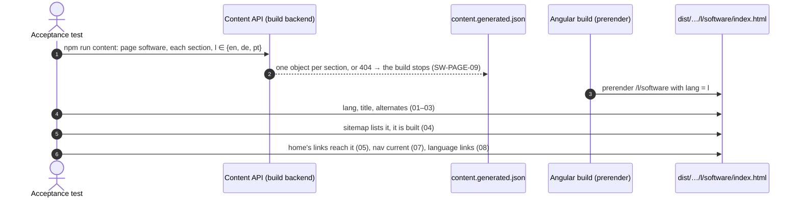
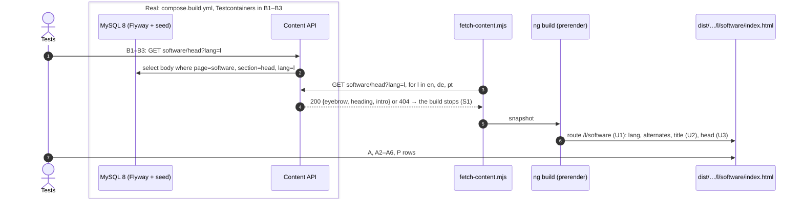

# Examples: Software page

Status: **agreed with the developer on 2026-11-08** (D1–D4 and D6 first; D3's wording, D5, D7, D8
and D9 answered the same day, then D10 to D16 for the build; D17 to D19 taken in slice 2's plan). The Portuguese copy is a draft nobody
has read yet: it is built as drafted and reviewed by the developer on the preview (D16).

The Software page in three languages, at `/en/software`, `/de/software` and `/pt/software`.
Design: `docs/mockups/software/software-spec.md` (option 1, lead plus list), with the mock-up
and screenshots beside it. The page exists so that the home page's "See selected work" and the
lattice's `software` atom (HOME-HERO-01 to 03, 09) reach a page instead of the 404 (D15 in
`home.md`), and it is the first of the two pages SHELL-11 waits for.

Sections, in build order:
1. **Page frame** (`SW-PAGE-nn`): the three pages, their `lang`, title, alternates, sitemap and
   the links that reach them.
2. **Head** (`SW-HEAD-nn`): eyebrow, `<h1>`, intro.
3. **Lead case study** (`SW-LEAD-nn`): the TDD monitor.
4. **More work** (`SW-WORK-nn`): reticulateP, Kita Dienstplan, Casa Azul website.
5. **How I work** (`SW-HOW-nn`): three steps and the checked global type.
6. **Proof** (`SW-PROOF-nn`): Theorem 15 and the evidence line.

Not in this file: the header, language links and footer (`shell.md`), the colours (`theme.md`).
All wording below is in the spec's copy table, en, de and pt; a case names a key and gives one
language as its example.

"In plain words" says what each case means for a visitor, in English.

## 1. Page frame

| ID | In plain words | Given | When | Then | Covered |
|----|----------------|-------|------|------|---------|
| SW-PAGE-01 | The Software page exists in all three languages. | the software content in en, de and pt | the site is built | `/en/software/index.html`, `/de/software/index.html`, `/pt/software/index.html` exist, with `<html lang="en">`, `"de"`, `"pt"` | yes (build and unit, 2026-11-08) |
| SW-PAGE-02 | Search engines learn that the three pages are one page in three languages. | the built `/de/software` | it is read | `<link rel="alternate">` for `hreflang` en, de, pt to `https://zuacaldeira.com/{en,de,pt}/software`, and `x-default` to `/en/software` | yes (build, 2026-11-08) |
| SW-PAGE-03 | The browser tab names the page. | the built pages | they are read | `<title>` is "Alexandre Zua Caldeira — Software" in en, de and pt (D9) | yes (build and unit, 2026-11-08) |
| SW-PAGE-04 | The sitemap lists the new pages, and only built ones. | the built site | `sitemap.xml` is read | it lists `https://zuacaldeira.com/{en,de,pt}/software` beside the 15 pages of HOME-PAGE-07, 18 in all, and each is a built page (HOME-PAGE-08) | |
| SW-PAGE-05 | "See selected work" on the home page now opens the Software page, not the 404 page. | the built `/de/home` | its links are read | the hero's "Ausgewählte Arbeiten" and the lattice's `software` go to `/de/software`, which is built (SHELL-04 now accepts it; its P-04 example moves to `/de/writing`) | moved to the v2 hero (D12): the home page has no such link yet; HOME-HERO-01, 03 and 09 hold it |
| SW-PAGE-06 | In the web server, the new page opens straight away. | the built site in the web image's nginx | `/en/software`, `/de/software`, `/pt/software` are requested | each answers `200`, not the 404 page, with no redirect (HOME-PAGE-09); `/de/software/` answers `301` to `/de/software` (HOME-PAGE-10) | |
| SW-PAGE-07 | The header shows "Software" as the page you are on. | the built `/pt/software` | the main navigation is read | its "software" link goes to `/pt/software` and carries `aria-current="page"`; no other link does | |
| SW-PAGE-08 | The language links lead to the same page in the other language. | the built `/de/software` | its language links are read | `EN` → `/en/software`, `PT` → `/pt/software`, `DE` current (SHELL-01, 02 on the new page) | yes (build, the shell's tests on the three pages, 2026-11-08) |
| SW-PAGE-09 | A missing German text stops the build instead of showing English. | no software content stored for de | the site is built | the build fails, naming page `software`, the section and `de`; nothing is deployed (as HOME-HERO-06, D4 in `home.md`) | yes (the snapshot script, 2026-11-08) |
| SW-PAGE-10 | The page is in the main navigation, and the menu still waits only for Writing. | the built `/de/home` | the main navigation is read | it holds Software → `/de/software`; SHELL-11 is covered except Texte → `/de/writing` | |
| SW-PAGE-P-01 | A software page in only one or two languages is refused. | the build | a language's software page is missing | SW-PAGE-01 goes red, naming the language | yes (break in the build: `pt` moved out) |
| SW-PAGE-P-02 | A link to the Software page that drops the language is refused. | any built page | a link to `/software` (no prefix) is read | SHELL-04 goes red (an old path, P-01) | yes (break in the build) |

## 2. Head

| ID | In plain words | Given | When | Then | Covered |
|----|----------------|-------|------|------|---------|
| SW-HEAD-01 | The page opens with its name and one sentence about it. | the built `/en/software` | the head is read | eyebrow "Selected work", `<h1>` "Software", the intro (`head.intro`, en); the page has exactly one `<h1>` | yes (build, 2026-11-08) |
| SW-HEAD-02 | The German page reads in German, the eyebrow matching the home page's button. | the built `/de/software` | the head is read | "Ausgewählte Arbeiten" (the same words as HOME-HERO-01's link), "Software", `head.intro` de | yes (build and unit, 2026-11-08) |
| SW-HEAD-03 | The Portuguese page reads in Portuguese. | the built `/pt/software` | the head is read | "Trabalhos selecionados", "Software", `head.intro` pt | yes (build, 2026-11-08) |
| SW-HEAD-04 | When the site asks for the German head, it gets its three texts exactly as stored. | `software/head` stored for de | `GET /api/content/software/head?lang=de` | 200 with `{"eyebrow": "Ausgewählte Arbeiten", "heading": "Software", "intro": "Software, die ich gebaut habe, …"}`, the stored JSON as it is (D10, D11) | yes (integration, 2026-11-08) |
| SW-HEAD-05 | A fresh database, filled with the starting texts, gives the head in every language, none empty. | an empty MySQL with Flyway and the `seed` profile | `GET /api/content/software/head?lang=en`, `de`, `pt` | 200 with the spec's copy for `eyebrow`, `heading`, `intro`, each non-empty | yes (integration, 2026-11-08) |
| SW-HEAD-P-01 | English text on the German page's head is refused. | the built `/de/software` | the English intro is put in | SW-HEAD-02 goes red | yes (break in the build) |
| SW-HEAD-P-02 | A second main heading is refused. | the built `/de/software` | a second `<h1>` is put in | SW-HEAD-02 goes red | yes (break in the build) |
| SW-HEAD-P-03 | A language the site does not have, or a section that does not exist, gets nothing. | `software/head` stored, with a stray `fr` row | `?lang=fr`, or `software/nope?lang=en` | 404 with an empty body, no fallback (as HOME-HERO-07, 12) | yes (integration: red before for `fr`; break for the section) |

## 3. Lead case study

| ID | In plain words | Given | When | Then | Covered |
|----|----------------|-------|------|------|---------|
| SW-LEAD-01 | The first piece of work is the TDD monitor, told as a case study. | the built `/en/software` | the first section after the head is read | kicker "Case study · AI agents", `<h2>` "A monitor that holds a coding agent to its TDD protocol", status "In use on this site since November 2026" | yes (build and unit, 2026-11-08) |
| SW-LEAD-02 | The case study answers five questions, in this order. | the same | its blocks are read | five headings in order: The question, What I built, The protocol behind it, The live view, The result; each followed by its text (`lead.*`, en); then Stack | yes (build and unit, 2026-11-08) |
| SW-LEAD-03 | The German and Portuguese case studies are fully translated. | the built `/de/software` and `/pt/software` | the lead is read | every text is the de or pt copy; no English sentence (P-02) | yes (build, 2026-11-08) |
| SW-LEAD-04 | The protocol is shown as the real line from the checked workflow type. | any language | the protocol block is read | a `<pre translate="no">` whose text, with whitespace collapsed, is exactly `Run = &{runTest: +{RED: Code, WRONG_RED: Fix, GREEN: Green}}`, the same in en, de and pt, and equal to the recorded checked line (D5); its caption is `lead.runCaption` | yes (build and unit, 2026-11-08; `docs/notation/run.st`, D17) |
| SW-LEAD-05 | A small drawing shows the one action and its three results. | any language | the figure is read | an SVG with `role="img"` and the translated `lead.figure` as its name and caption; its labels `Run`, `&{runTest}`, `+RED`, `+WRONG_RED`, `+GREEN`, `Code`, `Fix`, `Green` in every language | |
| SW-LEAD-06 | A screenshot shows the live view, light or dark to match the page. | `/en/software` in the browser, light and dark theme | the screenshot is read | exactly one image shows: `reticulab-live-light.png` on a light glaze, `-dark.png` on a dark one; its alt text is `lead.shotAlt` in the page's language; it links to the full-size file; its caption is `lead.shotCaption` | |
| SW-LEAD-07 | The result says only what is true: in use on this site. | any language | the result is read | `lead.result`; the page makes no claim of better or worse results, and gives no figures for the experiment | yes (build, 2026-11-08: the lead's only numbers are 2026, 56, 89, 2026) |
| SW-LEAD-08 | The case study has no link to the lab, which is private. | the built pages | the lead's links are read | it has none: no repository, no write-up (D2) | yes (build and unit, 2026-11-08) |
| SW-LEAD-09 | A fresh database, filled with the starting texts, gives the whole case study in every language, none empty. | an empty MySQL with Flyway and the `seed` profile | `GET /api/content/software/lead?lang=en`, `de`, `pt` | 200; en is the spec's copy (D19's shape), and de and pt have the same fields, each non-empty | yes (integration, 2026-11-08) |
| SW-LEAD-P-01 | A Run line that differs from the checked one is refused. | the built page | its Run line is changed (a label renamed, `WRONG_RED` dropped) or the recorded line changes while the page does not | SW-LEAD-04 goes red | yes (break in the build; break in `run.st`) |
| SW-LEAD-P-02 | English text on a German or Portuguese case study is refused. | the built `/de/software` | an English block is put in | SW-LEAD-03 goes red | yes (break in the build) |
| SW-LEAD-P-04 | A screenshot that does not match the theme, or both at once, is refused. | `/en/software` in the browser, light and dark | the dark image shows on a light page, both show, or the hidden one is downloaded too | SW-LEAD-06 goes red | |
| SW-LEAD-P-03 | Notation translated on a German page is refused. | the built `/de/software` | the figure reads `+ROT` or the line `Lauf = …` | SW-LEAD-04 or 05 goes red | the line only (break in the build: `Lauf = …`, `ROT`); the figure's `+ROT` comes with slice 3 |

## 4. More work

| ID | In plain words | Given | When | Then | Covered |
|----|----------------|-------|------|------|---------|
| SW-WORK-01 | Three more pieces follow, in a fixed order. | the built `/en/software` | the section is read | `<h2>` "More work", then three rows, in order: reticulateP, Kita Dienstplan, Casa Azul website, each with its kicker, `<h3>` title, text and stack (spec) | |
| SW-WORK-02 | reticulateP links to the paper, not to its private repository. | any language | the reticulateP row's links are read | exactly one: the paper's PDF, labelled `work.ret.paper` | |
| SW-WORK-03 | Kita Dienstplan links to its repository. | any language | its links are read | exactly one: https://github.com/zuacaldeira/kita-dienstplan, labelled `work.repo` (D8) | |
| SW-WORK-04 | The Casa Azul website links to the live site and its repository. | any language | its links are read | https://casa-azul-berlin.de, labelled `casa-azul-berlin.de`, and https://github.com/zuacaldeira/ca-website, labelled `work.repo` (D8) | |
| SW-WORK-05 | The rows are translated; the names and stacks are not. | `/de/software`, `/pt/software` | the rows are read | kicker and text in the page's language; the names reticulateP and Kita Dienstplan and the stacks the same as in en; the Casa Azul title `work.casa.title` translated | |
| SW-WORK-P-01 | A fourth piece, or a different order, is refused. | the built page | the Embassy line is put back, or Dienstplan moved first | SW-WORK-01 goes red | |

## 5. How I work

| ID | In plain words | Given | When | Then | Covered |
|----|----------------|-------|------|------|---------|
| SW-HOW-01 | Three steps say how the work is done. | the built `/en/software` | the section is read | `<h2>` "How I work", an ordered list of three: Protocol first, Test-first one step at a time, Every forbidden path shown red, each with its sentence (`how.*`) | |
| SW-HOW-02 | The strip shows this site's own links protocol, exactly as checked. | any language | its session type is read | a `<pre translate="no">` whose text is exactly `Page -> Visitor : {links: Visitor -> Nginx : {get: Nginx -> Visitor : {ok200: end}}}`, the same in every language, equal to the recorded checked line (D5); the caption `how.caption` | |
| SW-HOW-03 | The strip is translated, except the type. | `/de/software`, `/pt/software` | the section is read | headings, steps and caption in the page's language | |
| SW-HOW-P-01 | The old arrow notation in the strip is refused. | the built page | the type reads `Page → Visitor : links(hrefs) . …` | SW-HOW-02 goes red | |

## 6. Proof

| ID | In plain words | Given | When | Then | Covered |
|----|----------------|-------|------|------|---------|
| SW-PROOF-01 | The page ends on the theorem that makes the protocols hold. | the built `/de/software` | the band is read | "Aus dem Paper — Session Type State Spaces Form Lattices · ICE 2026", "Warum die Protokolle halten", the statement "For every well-formed session type S, ℒ(S)/≡ is a bounded lattice." (untranslated), the home band's German evidence line | |
| SW-PROOF-02 | Two buttons lead on: the paper, and the research page in the same language. | any language | its buttons are read | "Read the paper (PDF)" / "Paper lesen (PDF)" / "Ler o artigo (PDF)" → the paper's PDF; "All research" / "Zur Forschung" / "Toda a investigação" → `/xx/research` | |

## In the browser (after the build, `npm run acceptance:browser`)

| ID | In plain words | Given | When | Then | Covered |
|----|----------------|-------|------|------|---------|
| SW-PAGE-11 | The page fits a phone: nothing runs off the side. | a phone at 390 px, `/en/software`, `/de/software`, `/pt/software` | the page is measured | no horizontal scroll; no `<pre>` scrolls sideways | |
| SW-PAGE-12 | Every link on the page is easy to tap. | the same | the page's links and buttons are measured | each is at least 44 px tall | |
| SW-PAGE-13 | Keyboard users get to the content first. | `/de/software`, 390 and 1280 px | Tab, then Enter | the skip link goes to `<main>` on the same page (SHELL-10 on the new page) | |

## Diagram: SW-PAGE (the page frame, at build time)



Session type (the visitor's path from the home page), in the convention of `shell.md`:

```
G = Home → Visitor : links(work = /l/software, atom = /l/software) .
    Visitor → Nginx : get(/l/software) .
    Nginx → Visitor : ok200(softwarePage, lang l) . end
```

Before this page, `ok200` was `notFound404`: the change is in what the visitor receives, so it is a
change of behaviour, not a refactor.

## Slices (D10, agreed 2026-11-08)

Each slice ships on `next` with the route live but **no navigation link and no sitemap entry**
until slice 7, so a merge of `next` mid-way leaves the page out of reach (`docs/tdd.md`).

1. **Frame + head:** route, `lang`, title, alternates, the content pipeline, the head. SW-PAGE-01,
   02, 03, 08, 09, P-01, P-02; SW-HEAD-01 to 05, P-01 to P-03.
2. **Lead, text and Run line:** `SessionType`, `docs/notation/run.st`. SW-LEAD-01 to 04, 07, 08,
   P-01 to P-03.
3. **Lead, figure and screenshot:** `RunFigure`, `MonitorShot`. SW-LEAD-05, 06.
4. **More work:** SW-WORK-01 to 05, P-01.
5. **How I work:** `HowStrip`, `docs/notation/links.global`. SW-HOW-01 to 03, P-01.
6. **Proof:** SW-PROOF-01, 02 (D14).
7. **Open the page:** navigation (D13), current marker, sitemap (18 URLs), nginx, phone and
   keyboard checks. SW-PAGE-04, 06, 07, 10 to 13.

## Slice 1: frame + head

Test list:
- **Backend** (Testcontainers, one class per run): B1 SW-HEAD-04, the stored German head as it is;
  B2 SW-HEAD-05, the seed in en, de, pt; B3 SW-HEAD-P-03, `fr` and an unknown section answer 404.
- **Script:** S1 SW-PAGE-09, the snapshot asks for `software/head` in each language, and a 404 for
  `de` stops it naming page `software`, section `head`, language `de`.
- **Unit:** U1 the route `/de/software` loads the Software page in German; U2 SW-PAGE-03, the title
  (D9, D11); U3 SW-HEAD-02, the head from `CONTENT` on a German page.
- **Acceptance:** A SW-HEAD-02, the outer test; A2 SW-PAGE-01; A3 SW-PAGE-02; A4 SW-PAGE-03; A5
  SW-HEAD-01 and 03; A6 the three pages join `PAGES` in `shell.test.mjs` (SW-PAGE-08, SHELL-04 and
  SHELL-07b on the new pages).
- **Protocol rows:** SW-PAGE-P-01 (a built page deleted), SW-PAGE-P-02 (a link to `/software`),
  SW-HEAD-P-01 (the English intro on `/de/software`), SW-HEAD-P-02 (a second `<h1>`).



Session type. Convention: a role that a branch never calls just ends there.

```
G = Build → API : get(software, head, l) .
    API → Build : { ok200(head_l) .
                    Build → Page : prerender(l, title, alternates, head_l) .
                    Page → Visitor : page(lang = l, h1, links) . end ,
                    missing404 . Build → CI : fail(software, head, l) . end }

Build ↾   = API!get . API?{ ok200 . Page!prerender . end , missing404 . CI!fail . end }
Visitor ↾ = Page?page(lang = l, h1, links) . end
API ↾     = Build?get . Build!{ ok200 . end , missing404 . end }
```

| Arrow | Step in G | Rows |
|---|---|---|
| 1–2 test → API → DB | `get`, `ok200(head_l)` | B1, B2 |
| 1 with `fr` or an unknown section | `missing404` | B3 |
| 3–4 F → API | `get` × 3, `{ok200, missing404}` | S1 |
| 5–6 NG → P | `prerender(l, title, alternates, head_l)` | U1, U2, U3 |
| 7 T → P | `page(lang, h1, links)` | A, A2–A6 |
| forbidden: a page missing for some `l` | `prerender` for every `l` | SW-PAGE-P-01 |
| forbidden: `head_en` on an `l = de` page | `ok200(head_l)` | SW-HEAD-P-01 |
| forbidden: `h1` twice | `page` carries one `h1` | SW-HEAD-P-02 |
| forbidden: a link to `/software` | `links ⊆ /l/x` (SHELL-04) | SW-PAGE-P-02 |

The build is read-only: no repeat, stale-token or race rows.

**Done 2026-11-08** (`2a0a8f6` to `b85d8a5`). Red first, each for its own reason: B1
`expected: 200 but was: 404` (after a first run that found no table, before the V2 migration);
B3 `fr` with a stray row answered 200; B2 404 in all three languages; S1 "Missing expected
rejection"; U1 `expected 'APP-NOT-FOUND' to be 'APP-SOFTWARE'`; U2 `expected '' to be 'Alexandre Zua
Caldeira — heading de'`; U3 `expected [] to deeply equal [ 'eyebrow de' ]`; A `ENOENT` on
`de/software/index.html`. Declared to the monitor: A as `writeAcceptance`, every break and restore.
Green at first and shown to bite, each break in the built page restored from a copy (md5 checked):
B3's unknown section (the query ignoring the section), A2 (`pt` moved out: SW-PAGE-P-01), A3 (the
`pt` alternate to `/pt/home`), A4 ("Alexandre Caldeira — Software"), A5 (the German intro on
`pt`), and A's two protocol rows (SW-HEAD-P-01, P-02). A6 put the three pages into the shell's
`PAGES`; SHELL-04's D19 test went red on its `/de/software#x` example, which moved to
`/de/writing#x`; SW-PAGE-P-02 (a link to `/software`) then turned SHELL-04 red.

Results: unit 216 passed, 5 skipped (31 files); scripts 4/4; `acceptance` 32/32; `acceptance:nginx`
11/11; backend `./mvnw verify` 16 integration tests; the build prerenders 23 routes. The browser
tests (`acceptance:browser`) were not run: they read the home pages only, and this slice adds no
link or control to them.

Leftovers, not built:
- **The two route-list tests** in `app.routes.spec.ts` were updated with the route in U1, not run
  red first.
- **SHELL-12** (`zc-nav-mobile.spec.ts`) failed once in a whole-suite run under load (1.7 s), then
  passed alone and in the next whole run. Watch it.
- **HOME-HERO-16** checks that the default profile runs no `R__home_hero.sql`; it does not name
  `R__software.sql`. Both live in `db/seed`, which only the `seed` profile adds.
- **The head at 390, 768 and 1280 px,** in the five glazes, light and dark: for the developer on the
  preview; it is styled from the spec, not measured.
- **The initial bundle** is 513.03 kB against the 500 kB warning budget (512.27 kB before).

## Slice 2: the lead's text and the Run line

Test list:
- **Backend:** B1 SW-LEAD-09, the seed's `software/lead` in en, de, pt (added to
  `SoftwareSeedIntegrationTest`).
- **Script:** S1 SW-PAGE-09, a lead missing in `pt` stops the snapshot, naming `software`, `lead`,
  `pt`.
- **Unit:** U1 `codeSpans()` cuts a text at its backticks into words and notation (D18); U2 it
  leaves a text without backticks whole; U3 `SessionType` shows its text in a `<pre
  translate="no">` with its caption; U4 the lead on a German page: kicker, `<h2>`, status (SW-LEAD-01);
  U5 its five block headings and texts in order, then Stack (SW-LEAD-02); U6 notation in a block is
  `<code translate="no">` (D18); U7 the protocol block shows the Run line over three lines with
  `runCaption` (SW-LEAD-04); U8 the lead has no link (SW-LEAD-08).
- **Acceptance:** A SW-LEAD-01, the outer test (en: the first section after the head); A2 SW-LEAD-02;
  A3 SW-LEAD-03 (de and pt, every text the copy); A4 SW-LEAD-04 (the Run line in en, de, pt equals
  `run.st`'s checked line, which is pinned to the agreed one); A5 SW-LEAD-07 (the result, no `%`
  in the lead); A6 SW-LEAD-08 (no `<a>` in the lead).
- **Protocol rows:** SW-LEAD-P-01 (in the built page `WRONG_RED` dropped; in `run.st` a label
  renamed), SW-LEAD-P-02 (an English block on `/de/software`), SW-LEAD-P-03 (`Lauf = …` and
  `+{ROT: …` on `/de/software`). The figure's half of P-03 comes with slice 3.

```mermaid
sequenceDiagram
    autonumber
    actor T as Tests
    box Real: compose.build.yml, Testcontainers in B1
        participant DB as MySQL 8 (seed R__software.sql)
        participant API as Content API
    end
    participant F as fetch-content.mjs
    participant NG as ng build (prerender)
    participant ST as docs/notation/run.st (checked in the lab, D5)
    participant P as dist/…/l/software/index.html
    T->>API: B1: GET software/lead?lang=l
    F->>API: GET software/lead?lang=l, for l in en, de, pt
    API-->>F: 200 lead_l, or 404 → the build stops (S1)
    F->>NG: snapshot
    NG->>P: WorkLead (U4–U8): texts, code spans (U1, U2), SessionType (U3) with the Run line
    T->>ST: read the checked line, pinned to the agreed one
    T->>P: A–A6; the Run line equals the checked line (A4), P rows
```

Session type. Convention: a role that a branch never calls just ends there. The Run line is not
content: like the footer's `Zua = …` it is notation in the template, and only the test reads
`run.st`.

```
G = Build → API : get(software, lead, l) .
    API → Build : { ok200(lead_l) .
                    Build → Page : prerender(lead_l, run) .
                    Page → Visitor : lead(kicker, h2, status, blocks[question, built, protocol(run),
                                          live, result], stack) . end ,
                    missing404 . Build → CI : fail(software, lead, l) . end }
  run = checked(run.st), the same for every l

Build ↾   = API!get . API?{ ok200 . Page!prerender . end , missing404 . CI!fail . end }
Visitor ↾ = Page?lead(…) . end
Page ↾    = Build?prerender . Visitor!lead(…) . end
```

| Arrow | Step in G | Rows |
|---|---|---|
| 1 test → API | `get`, `ok200(lead_l)` | B1 |
| 2–3 F → API | `get` × 3, `{ok200, missing404}` | S1 |
| 5 NG → P | `prerender(lead_l, run)` | U1–U8 |
| 6 test → run.st | `run = checked(run.st)` | A4 (the pin) |
| 7 test → P | `lead(kicker, h2, status, blocks, stack)` | A, A2, A3, A5 |
| 7, the protocol block | `protocol(run)` | A4 |
| forbidden: `run` ≠ checked | `run = checked(run.st)` | SW-LEAD-P-01 |
| forbidden: `lead_en` on `l = de` | `ok200(lead_l)` | SW-LEAD-P-02 |
| forbidden: notation translated | `run` the same for every `l` | SW-LEAD-P-03 |
| forbidden: blocks out of order | `blocks[…]` in this order | A2 |
| forbidden: a link in the lead | `lead(…)` carries no link (D2) | A6 |

The build is read-only: no repeat, stale-token or race rows.

**Done 2026-11-08.** Red first, each for its own reason: A (on slice 1's build) "the lead does not
follow the head"; B1 404 in all three languages; S1 "Missing expected rejection"; U1 `expected []`
(after a stub, so the red was not a missing module); U3 `expected undefined to be 'no'`; U4 `expected
[] to deeply equal [ 'kicker de' ]`; U5 no `<h3>`; U6 `expected [] to deeply equal [ 'no &{…}', … ]`;
U7 no `<pre>`. U6's first red came partly from the test reading the wrong paragraph; the test was
fixed and shown red once more against the plain-text block. Declared to the monitor: A as
`writeAcceptance`, every break and restore. Green at first and shown to bite: U2 (the empty-piece
filter taken out), U8 and A6 (a link put in), A2 (the result block moved before the live view), A3
(SW-LEAD-P-02), A4 (SW-LEAD-P-01 in the page and in `run.st`, SW-LEAD-P-03's `Lauf = …`), A5 (a
"40%" claim). A2's first run failed only because the test's reader did not decode `&amp;`; the
reader was fixed before the result was taken.

Results: unit 224 passed, 5 skipped (34 files); scripts 5/5; `acceptance` 38/38;
`acceptance:nginx` 11/11; backend `./mvnw verify` 19 integration tests; the build prerenders 23
routes. The browser tests were not run: they read the home pages only.

Leftovers, not built:
- **The initial bundle** grew to 519.27 kB (513.03 kB after slice 1): the content snapshot is
  imported in `app.config.ts`, so every page's text is in the initial bundle. Each slice adds more.
  Worth a decision before slice 4: load each page's part of the snapshot with its route.
- **Port 8081** was taken on this machine by another project's Java process; the build's backend ran
  on 8091 through an override on stdin and `CONTENT_API` from an env file, nothing in the repo
  changed. `compose.build.yml` fixes the port.
- **SW-LEAD-P-03's figure half** (`+ROT`) comes with slice 3.
- **The lead at 390, 768 and 1280 px:** one column for now; the side column (figure, screenshot)
  comes with slice 3. The Run line's three lines at 390 px are for the developer on the preview.

## Slice 3: the Run figure and the monitor screenshot

Test list:
- **Backend:** B1 SW-LEAD-09 grows by the lead's `figure`, `shotAlt` and `shotCaption` (D22).
- **Unit:** U1 `RunFigure` is an `<svg role="img">` named by its label, with the label as its
  `<figcaption>` (SW-LEAD-05); U2 its labels are exactly `Run`, `&{runTest}`, `+RED`, `+WRONG_RED`,
  `+GREEN`, `Code`, `Fix`, `Green`; U3 the action edge is solid, the three result edges dashed (the
  spec: not colour alone); U4 `MonitorShot` has the light and the dark image, each in a link to its
  own file, with the alt text, `width="1440"`, `height="900"`, `loading="lazy"`, and one caption; U5
  the lead's side column holds the figure and the shot with the lead's texts; U6 SW-LEAD-08 narrowed:
  the lead's only links go to the two screenshot files (D23).
- **Acceptance (build):** A SW-LEAD-05, the outer test (the figure's name and caption in en, de, pt,
  its labels the same in every language); A2 SW-LEAD-06's build half (both images in each page with
  the page's alt text, the links, the caption; the files are in the build); A3 SW-LEAD-08 narrowed.
- **Browser (one file, one Chromium, closed after):** C SW-LEAD-06 on `/en/software` at 1280, light
  and dark: exactly one image shows, the one that matches, and only its file is downloaded.
- **Protocol rows:** SW-LEAD-P-03's figure half (`+ROT` in the built `/de/software`, A red);
  SW-LEAD-P-04 (a break in the CSS: the dark image on a light page; and `loading="eager"`: the hidden
  one downloaded; C red).

```mermaid
sequenceDiagram
    autonumber
    actor T as Tests
    participant NG as ng build (prerender)
    participant P as dist/…/l/software/index.html
    participant B as Chromium (C), light or dark
    participant F as /assets/software/reticulab-live-{light,dark}.png
    NG->>P: RunFigure (U1–U3): role=img, label_l, fixed labels; MonitorShot (U4): both images, lazy
    T->>P: A, A2, A3 (build)
    T->>B: C: open /en/software with colorScheme light | dark
    B->>B: ThemeService sets html.dark-theme (or not); CSS shows one image
    B->>F: only the shown image is fetched (lazy, the other display: none)
    T->>B: which image is displayed, which files were requested
```

Session type. Convention: a role that a branch never calls just ends there.

```
G = Build → Page : prerender(figure(label_l, labels), shot(alt_l, caption_l, light, dark)) .
    Visitor → Page : open(mode) .
    Page → Visitor : { light: show(light.png) . Visitor → Files : get(light.png) . end ,
                       dark:  show(dark.png)  . Visitor → Files : get(dark.png)  . end }
  labels = [Run, &{runTest}, +RED, +WRONG_RED, +GREEN, Code, Fix, Green], the same for every l

Visitor ↾ = Page!open(mode) . Page?{ light: Files!get(light.png) . end , dark: Files!get(dark.png) . end }
Page ↾    = Build?prerender . Visitor?open . Visitor!{ light . end , dark . end }
```

| Arrow | Step in G | Rows |
|---|---|---|
| 1 NG → P | `prerender(figure, shot)` | U1–U6 |
| 2 T → P | `figure(label_l, labels)`, `shot(alt_l, caption_l, …)` | A, A2, A3 |
| 3–4 open, mode | `Visitor → Page : open(mode)` | C (light, dark) |
| 4 show one | `{ light: show(light.png) , dark: show(dark.png) }` | C |
| 5 fetch | `get(light.png)` or `get(dark.png)`, never both | C |
| forbidden: the other image shown, or both | the branch's one `show` | SW-LEAD-P-04 |
| forbidden: the hidden image fetched | one `get` per branch | SW-LEAD-P-04 |
| forbidden: a label translated | `labels` the same for every `l` | SW-LEAD-P-03 |

The page is read-only: no repeat, stale-token or race rows.

## Decisions

Taken in slice 3's plan on 2026-11-08, following the spec (the developer may change them):

- **D22. The lead grows by three texts:** `figure` (the figure's name and caption), `shotAlt`,
  `shotCaption`, the spec's copy in en, de and pt.
- **D23. SW-LEAD-08 is narrowed to its own words:** no link to the lab, no repository, no write-up.
  The screenshot's link to its full-size file (SW-LEAD-06, the spec's `MonitorShot`) is allowed;
  slice 2's tests refused every link and are narrowed to "only the two screenshot files".
- **D24. Light or dark** is the one theme the site has today, `html.dark-theme` from `ThemeService`
  (the five glazes of the spec are not built). Both images are in the page; CSS shows one, and the
  other is never downloaded (`loading="lazy"` and `display: none`). Without JavaScript the page is
  light and shows the light image.

Taken in slice 2's plan on 2026-11-08, following D5, D11 and the spec (the developer may change
them):

- **D17. `run.st`** holds the Run line as shown on the page, after `#` comment lines that say it
  is line 10 of the lab's `types/agent/workflow/ext-generic.st` (checked there, D5), not a whole
  program. reticulateP's parser has no comments; its own fixture loader skips `#` lines and takes
  the first other line, and the tests read `run.st` the same way. The file is not meant for
  `reticulatep.cli -f`: on its own, `Code`, `Fix` and `Green` are not defined.
- **D18. Notation inside a sentence** is written between backticks in the content, as in the
  spec's copy (`` `&{…}` ``, `` `reticulab serve` ``), and shown as `<code translate="no">`.
- **D19. `software/lead`** is one object: `kicker`, `title`, `status`, `labels` (`question`,
  `built`, `protocol`, `live`, `result`, `stack`), `question`, `built`, `built2`, `protocol`,
  `runCaption`, `live`, `result`, `stack`. The stack is the same in every language. The figure's
  and the screenshot's texts come with slice 3. The Run line is in the template, not the content.

Decided by the developer on 2026-11-08, after slice 2 (its leftover on the initial bundle):

- **D20. Each page loads only its own text, with its route,** built as its own small step before
  slice 3. The pages' texts and the build's stop on a missing language stay as they are. Measured
  before, on slice 2's build: the initial bundle is 519.27 kB (the build's "Initial total", raw),
  `main-*.js` 88.5 kB, and `main-*.js` holds the home hero and the Software page's texts in all three
  languages, so `/en/home` downloads the Software page's text too.
- **D21. How (2026-11-08): the short name `@page-content/<page>`.** The snapshot script writes one
  file per page (`src/app/content/generated/<page>.json`, git-ignored). `tsconfig.app.json` points
  `@page-content/*` at those files, `tsconfig.spec.json` at small test files
  (`src/app/content/testing/<page>.ts`, from today's test text), so the specs and CI's order stay as
  they are. Each page's route file imports its text and provides it to the page (`HOME_CONTENT`,
  `SOFTWARE_CONTENT`). Its test: SW-PAGE-14, below.

| ID | English |
|----|---------|
| SW-PAGE-14 | Each page downloads only its own text: the home page carries none of the Software page's, and the Software page none of the home page's. |

| ID | Given | When | Then | Covered |
|----|-------|------|------|---------|
| SW-PAGE-14 | the built site | the files `/en/home` and `/en/software` load at once are read (`<script>`, `modulepreload`, and their static imports) | each page's own text is among them; none of `/en/home`'s holds a Software text ("A monitor that holds a coding agent to its TDD protocol"), none of `/en/software`'s the home hero's sentence ("I build software, and prove its protocols hold.") | yes (build and unit, 2026-11-08) |

**Done 2026-11-08.** Red first: SW-PAGE-14 on slice 2's build, `main-*.js` holding both texts
(its first sentence, "Case study · AI agents", could not be found at all: the minifier escapes `·`
in the scripts, so the test uses ASCII sentences); the script's one-file-per-page test (no files);
the route test (`NullInjectorError` with no content at the root). A build without the snapshot
still stops (`Could not resolve "@page-content/home"`), and the unit tests ran with no fetched files
on this machine, as in CI. The check that each page's own text is among its files was added after
the first green and found that `/en/home` had lost its preload: `/` and `/xx/home` shared one loader
function. Each route now has its own inline `import()`, and `/en/home` preloads its chunk again.

Measured on the build: the initial bundle 519.27 kB before, 510.65 kB after (raw; 128.54 kB
transferred); `main-*.js` 88.5 kB before, 80.00 kB after. Each page's text now sits in its own lazy
chunk.

Leftovers:
- **Still 10.65 kB over the 500 kB warning budget:** that is the app itself (512.27 kB before any
  page text came from the API), not the content.
- **`/` has no preload of the home chunk** in the server's manifest (the root route, `pathMatch:
  'full'`); the page is prerendered, and the chunk loads once Angular starts. Whether `/` had one
  before is not known: its text was in `main-*.js` then.
- **SHELL-12** timed out once more in a whole-suite run right after a build (1.8 s), and passed
  alone and in the next whole run.

Agreed with the developer on 2026-11-08:

- **D1. Option 1, lead plus list.** The pieces, in order: the TDD monitor (the lead), then
  reticulateP, Kita Dienstplan, Casa Azul website. This website is not a piece. The Embassy of
  Angola line, the lattice-wall generator and ConGu are out.
- **D2. No links to private work.** The lab and reticulateP are private repositories: no
  repository link for either. The experiment's write-up does not exist yet: no link and no
  placeholder.
- **D3. The intro sentence** is a draft by ui-design-peer from the hero's line, in en and de (pt
  in the spec); the developer reviews its wording before the build.
- **D4. The notation shown** is the checked text: the Run line is line 10 of the lab's
  `types/agent/workflow/ext-generic.st` (56 states, 89 transitions, a lattice), and the links
  protocol is the global type `Page -> Visitor : {links: Visitor -> Nginx : {get: Nginx -> Visitor
  : {ok200: end}}}`, both checked by the developer with reticulateP main `7d20ba416` on 2026-11-08.
  The strip shows the global type, not the `→ … .` notation of `shell.md`.
- **D6. No employers or years** on the page; the stack as plain words in Plex Mono.
- **The screenshot** of `reticulab serve` (session `68601dc0`, while it built HOME-PAGE-05) is the
  live view's picture, in light and dark, at `frontend/public/assets/software/`.

Answered by the developer on 2026-11-08:

- **D3, the intro sentence:** the draft stands: "Software I have built, and how I hold it to its
  protocol: written down first, checked, then built test-first.", with the de and pt versions in
  the spec.
- **D5. The checked lines** live in `docs/notation/run.st` and `docs/notation/links.global`, and the
  build's tests compare each page's line with its file, as they do with `zua.st`. Both were
  **checked in the lab** with the pinned reticulateP (main `7d20ba416`) on 2026-11-08: `Run =
  &{runTest: +{RED: Code, WRONG_RED: Fix, GREEN: Green}}` is line 10 of the lab's workflow type,
  which parses (56 states, 89 transitions, a lattice); `Page -> Visitor : {links: Visitor -> Nginx :
  {get: Nginx -> Visitor : {ok200: end}}}` parses as a global type. `run.st` holds the one line as
  shown on the page, and says that it is a line of the lab's checked workflow type, not a whole
  program.
- **D7. The text comes from the content API,** seeded like the home hero (`docs/tdd.md`).
- **D8. Both repositories are public** (checked 2026-11-08): `github.com/zuacaldeira/kita-dienstplan`
  and `github.com/zuacaldeira/ca-website`. The links stay. reticulateP's repository is private: no
  link.
- **D9. The title** is "Alexandre Zua Caldeira — Software" in all three languages: the full name,
  as the footer has it, not "Alexandre Caldeira".

Agreed with the developer on 2026-11-08, for the build:

- **D10. Seven slices,** as listed above; slice 1 is frame + head with its test list.
- **D11. The content table:** one generic table `content_section(page, section, lang, body JSON)`,
  keyed on all three, in one Flyway migration; the controller answers the stored JSON as it is.
  `software/head` is `{eyebrow, heading, intro}`; the title is built in the component as
  `Alexandre Zua Caldeira — ${heading}`, so the name stays in the template. `home_hero` stays as it
  is (backlog).
- **D12. SW-PAGE-05 moves to the v2 hero:** the home page has no link to `/software` yet.
- **D13. The navigation** (slice 7): Software before Research; the rest waits for Writing
  (SHELL-11).
- **D14. The proof band** (slice 6): a shared theorem-band component and one shared content section
  for the paper's labels; the home band reuses both later.
- **D15. The home page's title stays** "Alexandre Caldeira — …"; "Zua" in it goes to the backlog.
- **D16. The Portuguese copy** in the spec is a draft nobody has read: built as drafted, and listed
  for the developer's review on the preview.

## Backlog

- **`home_hero` into `content_section`** (D11): a refactor, the API's answers unchanged
  (HOME-HERO-05 to 16 stay green).
- **"Alexandre Zua Caldeira" in the home page's title** (D15, HOME-PAGE-03).
