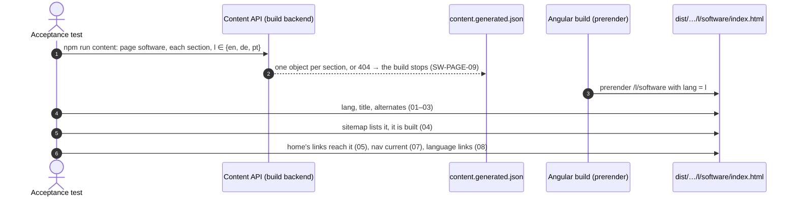

# Examples: Software page

Status: **draft for the developer to agree** (written 2026-11-08). Decisions D1–D4 and D6 were
agreed on 2026-11-08; D5, D7, D8 and D9 are open and are answered before the build.

The Software page in three languages, at `/en/software`, `/de/software` and `/pt/software`.
Design: `docs/mockups/software/software-spec.md` (option 1, lead plus list), with the mock-up
and screenshots beside it. The page exists so that the home page's "See selected work" and the
lattice's `software` atom (HOME-HERO-01 to 03, 09) reach a page instead of the 404 (D15 in
`home.md`), and it is the first of the two pages SHELL-11 waits for.

Sections, in build order:
1. **Page frame** (`SW-PAGE-nn`): the three pages, their `lang`, title, alternates, sitemap and
   the links that reach them.
2. **Head** (`SW-HEAD-nn`): eyebrow, `<h1>`, intro.
3. **Lead case study** (`SW-LEAD-nn`): the TDD monitor.
4. **More work** (`SW-WORK-nn`): reticulateP, Kita Dienstplan, Casa Azul website.
5. **How I work** (`SW-HOW-nn`): three steps and the checked global type.
6. **Proof** (`SW-PROOF-nn`): Theorem 15 and the evidence line.

Not in this file: the header, language links and footer (`shell.md`), the colours (`theme.md`).
All wording below is in the spec's copy table, en, de and pt; a case names a key and gives one
language as its example.

"In plain words" says what each case means for a visitor, in English.

## 1. Page frame

| ID | In plain words | Given | When | Then | Covered |
|----|----------------|-------|------|------|---------|
| SW-PAGE-01 | The Software page exists in all three languages. | the software content in en, de and pt | the site is built | `/en/software/index.html`, `/de/software/index.html`, `/pt/software/index.html` exist, with `<html lang="en">`, `"de"`, `"pt"` | |
| SW-PAGE-02 | Search engines learn that the three pages are one page in three languages. | the built `/de/software` | it is read | `<link rel="alternate">` for `hreflang` en, de, pt to `https://zuacaldeira.com/{en,de,pt}/software`, and `x-default` to `/en/software` | |
| SW-PAGE-03 | The browser tab names the page. | the built pages | they are read | `<title>` is "Alexandre Caldeira — Software" in en, de and pt (D9) | |
| SW-PAGE-04 | The sitemap lists the new pages, and only built ones. | the built site | `sitemap.xml` is read | it lists `https://zuacaldeira.com/{en,de,pt}/software` beside the 15 pages of HOME-PAGE-07, 18 in all, and each is a built page (HOME-PAGE-08) | |
| SW-PAGE-05 | "See selected work" on the home page now opens the Software page, not the 404 page. | the built `/de/home` | its links are read | the hero's "Ausgewählte Arbeiten" and the lattice's `software` go to `/de/software`, which is built (SHELL-04 now accepts it; its P-04 example moves to `/de/writing`) | |
| SW-PAGE-06 | In the web server, the new page opens straight away. | the built site in the web image's nginx | `/en/software`, `/de/software`, `/pt/software` are requested | each answers `200`, not the 404 page, with no redirect (HOME-PAGE-09); `/de/software/` answers `301` to `/de/software` (HOME-PAGE-10) | |
| SW-PAGE-07 | The header shows "Software" as the page you are on. | the built `/pt/software` | the main navigation is read | its "software" link goes to `/pt/software` and carries `aria-current="page"`; no other link does | |
| SW-PAGE-08 | The language links lead to the same page in the other language. | the built `/de/software` | its language links are read | `EN` → `/en/software`, `PT` → `/pt/software`, `DE` current (SHELL-01, 02 on the new page) | |
| SW-PAGE-09 | A missing German text stops the build instead of showing English. | no software content stored for de | the site is built | the build fails, naming page `software`, the section and `de`; nothing is deployed (as HOME-HERO-06, D4 in `home.md`) | |
| SW-PAGE-10 | The page is in the main navigation, and the menu still waits only for Writing. | the built `/de/home` | the main navigation is read | it holds Software → `/de/software`; SHELL-11 is covered except Texte → `/de/writing` | |
| SW-PAGE-P-01 | A software page in only one or two languages is refused. | the build | a language's software page is missing | SW-PAGE-01 goes red, naming the language | |
| SW-PAGE-P-02 | A link to the Software page that drops the language is refused. | any built page | a link to `/software` (no prefix) is read | SHELL-04 goes red (an old path, P-01) | |

## 2. Head

| ID | In plain words | Given | When | Then | Covered |
|----|----------------|-------|------|------|---------|
| SW-HEAD-01 | The page opens with its name and one sentence about it. | the built `/en/software` | the head is read | eyebrow "Selected work", `<h1>` "Software", the intro (`head.intro`, en); the page has exactly one `<h1>` | |
| SW-HEAD-02 | The German page reads in German, the eyebrow matching the home page's button. | the built `/de/software` | the head is read | "Ausgewählte Arbeiten" (the same words as HOME-HERO-01's link), "Software", `head.intro` de | |
| SW-HEAD-03 | The Portuguese page reads in Portuguese. | the built `/pt/software` | the head is read | "Trabalhos selecionados", "Software", `head.intro` pt | |

## 3. Lead case study

| ID | In plain words | Given | When | Then | Covered |
|----|----------------|-------|------|------|---------|
| SW-LEAD-01 | The first piece of work is the TDD monitor, told as a case study. | the built `/en/software` | the first section after the head is read | kicker "Case study · AI agents", `<h2>` "A monitor that holds a coding agent to its TDD protocol", status "In use on this site since November 2026" | |
| SW-LEAD-02 | The case study answers five questions, in this order. | the same | its blocks are read | five headings in order: The question, What I built, The protocol behind it, The live view, The result; each followed by its text (`lead.*`, en); then Stack | |
| SW-LEAD-03 | The German and Portuguese case studies are fully translated. | the built `/de/software` and `/pt/software` | the lead is read | every text is the de or pt copy; no English sentence (P-02) | |
| SW-LEAD-04 | The protocol is shown as the real line from the checked workflow type. | any language | the protocol block is read | a `<pre translate="no">` whose text, with whitespace collapsed, is exactly `Run = &{runTest: +{RED: Code, WRONG_RED: Fix, GREEN: Green}}`, the same in en, de and pt, and equal to the recorded checked line (D5); its caption is `lead.runCaption` | |
| SW-LEAD-05 | A small drawing shows the one action and its three results. | any language | the figure is read | an SVG with `role="img"` and the translated `lead.figure` as its name and caption; its labels `Run`, `&{runTest}`, `+RED`, `+WRONG_RED`, `+GREEN`, `Code`, `Fix`, `Green` in every language | |
| SW-LEAD-06 | A screenshot shows the live view, light or dark to match the page. | `/en/software` in the browser, light and dark theme | the screenshot is read | exactly one image shows: `reticulab-live-light.png` on a light glaze, `-dark.png` on a dark one; its alt text is `lead.shotAlt` in the page's language; it links to the full-size file; its caption is `lead.shotCaption` | |
| SW-LEAD-07 | The result says only what is true: in use on this site. | any language | the result is read | `lead.result`; the page makes no claim of better or worse results, and gives no figures for the experiment | |
| SW-LEAD-08 | The case study has no link to the lab, which is private. | the built pages | the lead's links are read | it has none: no repository, no write-up (D2) | |
| SW-LEAD-P-01 | A Run line that differs from the checked one is refused. | the built page | its Run line is changed (a label renamed, `WRONG_RED` dropped) or the recorded line changes while the page does not | SW-LEAD-04 goes red | |
| SW-LEAD-P-02 | English text on a German or Portuguese case study is refused. | the built `/de/software` | an English block is put in | SW-LEAD-03 goes red | |
| SW-LEAD-P-03 | Notation translated on a German page is refused. | the built `/de/software` | the figure reads `+ROT` or the line `Lauf = …` | SW-LEAD-04 or 05 goes red | |

## 4. More work

| ID | In plain words | Given | When | Then | Covered |
|----|----------------|-------|------|------|---------|
| SW-WORK-01 | Three more pieces follow, in a fixed order. | the built `/en/software` | the section is read | `<h2>` "More work", then three rows, in order: reticulateP, Kita Dienstplan, Casa Azul website, each with its kicker, `<h3>` title, text and stack (spec) | |
| SW-WORK-02 | reticulateP links to the paper, not to its private repository. | any language | the reticulateP row's links are read | exactly one: the paper's PDF, labelled `work.ret.paper` | |
| SW-WORK-03 | Kita Dienstplan links to its repository. | any language | its links are read | exactly one: https://github.com/zuacaldeira/kita-dienstplan, labelled `work.repo` (D8) | |
| SW-WORK-04 | The Casa Azul website links to the live site and its repository. | any language | its links are read | https://casa-azul-berlin.de, labelled `casa-azul-berlin.de`, and https://github.com/zuacaldeira/ca-website, labelled `work.repo` (D8) | |
| SW-WORK-05 | The rows are translated; the names and stacks are not. | `/de/software`, `/pt/software` | the rows are read | kicker and text in the page's language; the names reticulateP and Kita Dienstplan and the stacks the same as in en; the Casa Azul title `work.casa.title` translated | |
| SW-WORK-P-01 | A fourth piece, or a different order, is refused. | the built page | the Embassy line is put back, or Dienstplan moved first | SW-WORK-01 goes red | |

## 5. How I work

| ID | In plain words | Given | When | Then | Covered |
|----|----------------|-------|------|------|---------|
| SW-HOW-01 | Three steps say how the work is done. | the built `/en/software` | the section is read | `<h2>` "How I work", an ordered list of three: Protocol first, Test-first one step at a time, Every forbidden path shown red, each with its sentence (`how.*`) | |
| SW-HOW-02 | The strip shows this site's own links protocol, exactly as checked. | any language | its session type is read | a `<pre translate="no">` whose text is exactly `Page -> Visitor : {links: Visitor -> Nginx : {get: Nginx -> Visitor : {ok200: end}}}`, the same in every language, equal to the recorded checked line (D5); the caption `how.caption` | |
| SW-HOW-03 | The strip is translated, except the type. | `/de/software`, `/pt/software` | the section is read | headings, steps and caption in the page's language | |
| SW-HOW-P-01 | The old arrow notation in the strip is refused. | the built page | the type reads `Page → Visitor : links(hrefs) . …` | SW-HOW-02 goes red | |

## 6. Proof

| ID | In plain words | Given | When | Then | Covered |
|----|----------------|-------|------|------|---------|
| SW-PROOF-01 | The page ends on the theorem that makes the protocols hold. | the built `/de/software` | the band is read | "Aus dem Paper — Session Type State Spaces Form Lattices · ICE 2026", "Warum die Protokolle halten", the statement "For every well-formed session type S, ℒ(S)/≡ is a bounded lattice." (untranslated), the home band's German evidence line | |
| SW-PROOF-02 | Two buttons lead on: the paper, and the research page in the same language. | any language | its buttons are read | "Read the paper (PDF)" / "Paper lesen (PDF)" / "Ler o artigo (PDF)" → the paper's PDF; "All research" / "Zur Forschung" / "Toda a investigação" → `/xx/research` | |

## In the browser (after the build, `npm run acceptance:browser`)

| ID | In plain words | Given | When | Then | Covered |
|----|----------------|-------|------|------|---------|
| SW-PAGE-11 | The page fits a phone: nothing runs off the side. | a phone at 390 px, `/en/software`, `/de/software`, `/pt/software` | the page is measured | no horizontal scroll; no `<pre>` scrolls sideways | |
| SW-PAGE-12 | Every link on the page is easy to tap. | the same | the page's links and buttons are measured | each is at least 44 px tall | |
| SW-PAGE-13 | Keyboard users get to the content first. | `/de/software`, 390 and 1280 px | Tab, then Enter | the skip link goes to `<main>` on the same page (SHELL-10 on the new page) | |

## Diagram: SW-PAGE (the page frame, at build time)



Session type (the visitor's path from the home page), in the convention of `shell.md`:

```
G = Home → Visitor : links(work = /l/software, atom = /l/software) .
    Visitor → Nginx : get(/l/software) .
    Nginx → Visitor : ok200(softwarePage, lang l) . end
```

Before this page, `ok200` was `notFound404`: the change is in what the visitor receives, so it is a
change of behaviour, not a refactor.

## Decisions

Agreed with the developer on 2026-11-08:

- **D1. Option 1, lead plus list.** The pieces, in order: the TDD monitor (the lead), then
  reticulateP, Kita Dienstplan, Casa Azul website. This website is not a piece. The Embassy of
  Angola line, the lattice-wall generator and ConGu are out.
- **D2. No links to private work.** The lab and reticulateP are private repositories: no
  repository link for either. The experiment's write-up does not exist yet: no link and no
  placeholder.
- **D3. The intro sentence** is a draft by ui-design-peer from the hero's line, in en and de (pt
  in the spec); the developer reviews its wording before the build.
- **D4. The notation shown** is the checked text: the Run line is line 10 of the lab's
  `types/agent/workflow/ext-generic.st` (56 states, 89 transitions, a lattice), and the links
  protocol is the global type `Page -> Visitor : {links: Visitor -> Nginx : {get: Nginx -> Visitor
  : {ok200: end}}}`, both checked by the developer with reticulateP main `7d20ba416` on 2026-11-08.
  The strip shows the global type, not the `→ … .` notation of `shell.md`.
- **D6. No employers or years** on the page; the stack as plain words in Plex Mono.
- **The screenshot** of `reticulab serve` (session `68601dc0`, while it built HOME-PAGE-05) is the
  live view's picture, in light and dark, at `frontend/public/assets/software/`.

Open, to answer before the build:

- **D5. Where the checked lines live.** Recommended: `docs/notation/run.st` (the line, with a
  comment naming the lab file and reticulateP commit) and `docs/notation/links.global`, and the
  build's acceptance test compares each page's line with its file, as SHELL-07b does with
  `zua.st`. Other options: the lines only in the content seed; or a test that runs reticulateP in
  CI (it is not available there today).
- **D7. Where the text lives.** Recommended: the content API, page `software`, one object per
  section, seeded like the hero (the architecture in `docs/tdd.md`). Other option: the i18n files,
  as the 404 page does (D28 in `home.md`), quicker but against the architecture.
- **D8. The two repository links.** Kita Dienstplan and the Casa Azul website link to GitHub
  (from `ContentService.projects`). Are both repositories public? If not, drop the link, as for
  reticulateP.
- **D9. The page title.** Recommended: "Alexandre Caldeira — Software" in all three languages
  (SW-PAGE-03), short, like the 404 page's (D29 in `home.md`). Other option: the intro sentence
  after the name, as the home page does with its sentence.
