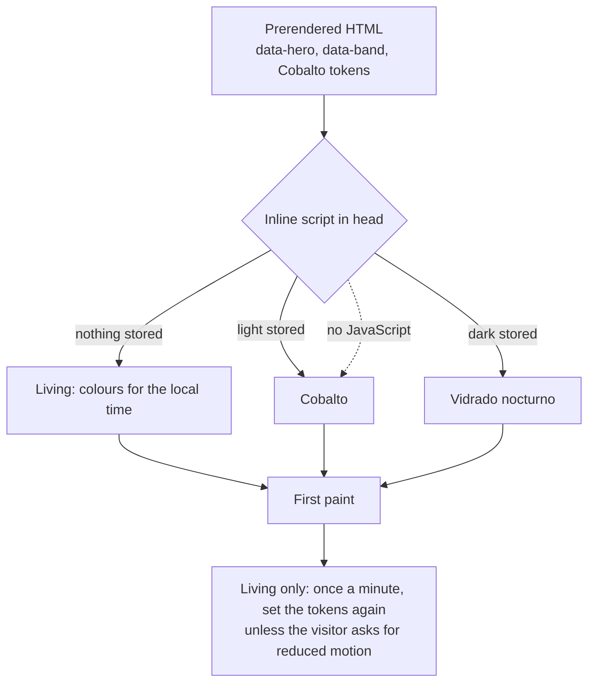
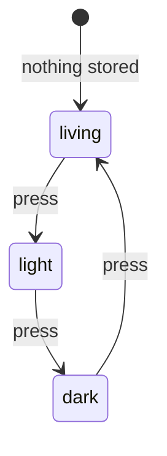

# Examples: Theme

Status: **agreed with the developer on 2026-11-02.**

The living glaze and the theme settings. Design: the Living Glaze study,
https://claude.ai/artifact/LGHSasJRc4DXdBmk95CGyD, agreed unchanged on 2026-11-02. Its engine
is copied in `docs/mockups/home/home.html`, marked "The glaze engine". Unit tests inject the
time; none reads a real clock (`docs/tdd.md`).

## Living glaze

| ID | Given | When | Then | Covered |
|----|-------|------|------|---------|
| THEME-01 | the time is 12:30 | the glaze is computed | it is Cobalto: background `#e9eff4`, accent `#14417a` | |
| THEME-02 | the time is 02:00 | the glaze is computed | it is Vidrado nocturno: background `#0b1526`, accent `#7fa5ce` | |
| THEME-03 | the times 07:30, 19:00 and 21:00 | the glaze is computed | they are Manganês (background `#f0ebf2`), Amarelo e verde (`#f2eedf`) and Manganês nocturno (`#160f1f`) | |
| THEME-04 | every minute of the day | the glaze is computed | text is at least 4.5:1 and lattice edges and ochre at least 3:1, against both the background and the surface; the button label is at least 4.5:1 against the accent | |
| THEME-05 | a first visit, nothing stored | the page loads | the state is living, and the colours follow the visitor's local time | |
| THEME-06 | the state is living | the theme button is pressed repeatedly | the state goes light, dark, living, and its accessible name says which (de "Farbschema: hell", "dunkel", "lebendige Glasur"; pt "Tema: claro", "escuro", "vidrado vivo"; en "Theme: light", "dark", "living glaze"); the choice is stored | |
| THEME-07 | light or dark is stored | the page loads at any time | the colours do not follow the clock: light is Cobalto, dark is Vidrado nocturno, as today's two themes | |
| THEME-08 | the visitor asks for reduced motion and the state is living | time passes | the page keeps the glaze it loaded with until the next load | |
| THEME-09 | the built `/de/home` | it is read | `<html>` carries `data-hero="b"` and `data-band="c"` in the prerendered HTML, before any script runs | |
| THEME-10 | the built page and a stored or clock-chosen glaze | the page loads | the colours are set by an inline script in `<head>`, before first paint, so the wrong colours never flash; without JavaScript the page shows Cobalto and stays readable | for today's two themes (build, browser and unit, 2026-11-08, D25 in `software.md`); the living glaze's colours come with the glaze |
| THEME-11 | a Material component on any page, in any glaze | it renders | it takes the glaze's accent, not teal: `--mat-sys-*` are mapped to the same tokens | |

## Diagram: first paint

## Diagram: THEME-06

## In plain words

| ID | English | Deutsch | Português |
|----|---------|---------|-----------|
| THEME-01 | At lunchtime the site wears its cobalt-blue glaze, like a blue tile. | Zur Mittagszeit trägt die Seite ihre kobaltblaue Glasur, wie eine blaue Fliese. | À hora de almoço, o site veste o seu vidrado azul-cobalto, como um azulejo. |
| THEME-02 | In the middle of the night the site turns to its dark night glaze. | Mitten in der Nacht wechselt die Seite zu ihrer dunklen Nachtglasur. | A meio da noite, o site passa ao seu vidrado noturno escuro. |
| THEME-03 | Morning, early evening and late evening each have their own glaze: manganese violet, yellow and green, night violet. | Morgen, früher Abend und später Abend haben je eine eigene Glasur: Manganviolett, Gelb und Grün, Nachtviolett. | A manhã, o fim da tarde e a noite têm cada um o seu vidrado: violeta-manganês, amarelo e verde, violeta noturno. |
| THEME-04 | At every minute of the day, text and drawings stay clearly readable against their background. | Zu jeder Minute des Tages bleiben Text und Zeichnungen vor ihrem Hintergrund gut lesbar. | Em qualquer minuto do dia, o texto e os desenhos continuam bem legíveis sobre o fundo. |
| THEME-05 | On a first visit, the colours follow the time of day where the visitor is. | Beim ersten Besuch folgen die Farben der Tageszeit dort, wo der Besucher ist. | Na primeira visita, as cores seguem a hora do dia onde o visitante está. |
| THEME-06 | The theme button cycles through light, dark and living, says which one is on, and remembers the choice. | Der Farbschema-Knopf wechselt zwischen hell, dunkel und lebendig, sagt, welches gilt, und merkt sich die Wahl. | O botão de tema alterna entre claro, escuro e vivo, diz qual está ativo e lembra-se da escolha. |
| THEME-07 | A visitor who chose light or dark keeps those colours, whatever the time. | Wer hell oder dunkel gewählt hat, behält diese Farben, egal zu welcher Uhrzeit. | Quem escolheu claro ou escuro mantém essas cores, seja qual for a hora. |
| THEME-08 | For a visitor who prefers less motion, the colours stay still until the page is opened again. | Wer weniger Bewegung wünscht, sieht dieselben Farben, bis die Seite neu geöffnet wird. | Para quem prefere menos movimento, as cores ficam paradas até a página ser aberta de novo. |
| THEME-09 | The opening and the paper band appear in their chosen design at once, not after a moment. | Eröffnung und Paper-Band erscheinen sofort in ihrer gewählten Gestaltung, nicht erst nach einem Moment. | A abertura e a faixa do artigo aparecem logo no design escolhido, não só passado um momento. |
| THEME-10 | The right colours are there from the first moment, with no flash; with scripts turned off the page stays blue and readable. | Die richtigen Farben sind vom ersten Moment an da, ohne Aufblitzen; ohne Skripte bleibt die Seite blau und lesbar. | As cores certas estão lá desde o primeiro instante, sem piscar; sem scripts, a página fica azul e legível. |
| THEME-11 | Buttons and other ready-made controls take the colours of the current glaze, not a foreign teal. | Knöpfe und andere fertige Bedienelemente übernehmen die Farben der aktuellen Glasur, kein fremdes Türkis. | Botões e outros controlos prontos usam as cores do vidrado atual, não um verde-azulado estranho. |

## Decisions

Decided by the developer on 2026-11-08 (D25 in `docs/examples/software.md`):

- **THEME-10 is built first for today's two themes,** light and dark (`html.dark-theme`): an inline
  script in `index.html`'s `<head>` applies the site's rule (the saved choice `zc-theme`, else the
  device's setting) before first paint. One table of cases, `theme-rule.cases.json`, holds the rule
  for the script and for `ThemeService`. The living glaze extends the same script when it is built.

Agreed with the developer on 2026-11-02:

- **The living glaze as the study has it,** and **living is the default state.** Light and
  dark are manual overrides.
- **Hero and band are theme settings,** `{ hero: 'b', band: 'c' }`. Only these defaults are
  built now; another value is added when it is first wanted, with its own cases. The frame is
  not a setting. A changed setting goes live with the next build.

Not designed yet, and not in these cases:

- **Reacting to events** (a new post, a social event). The settings above are where it
  would attach.
