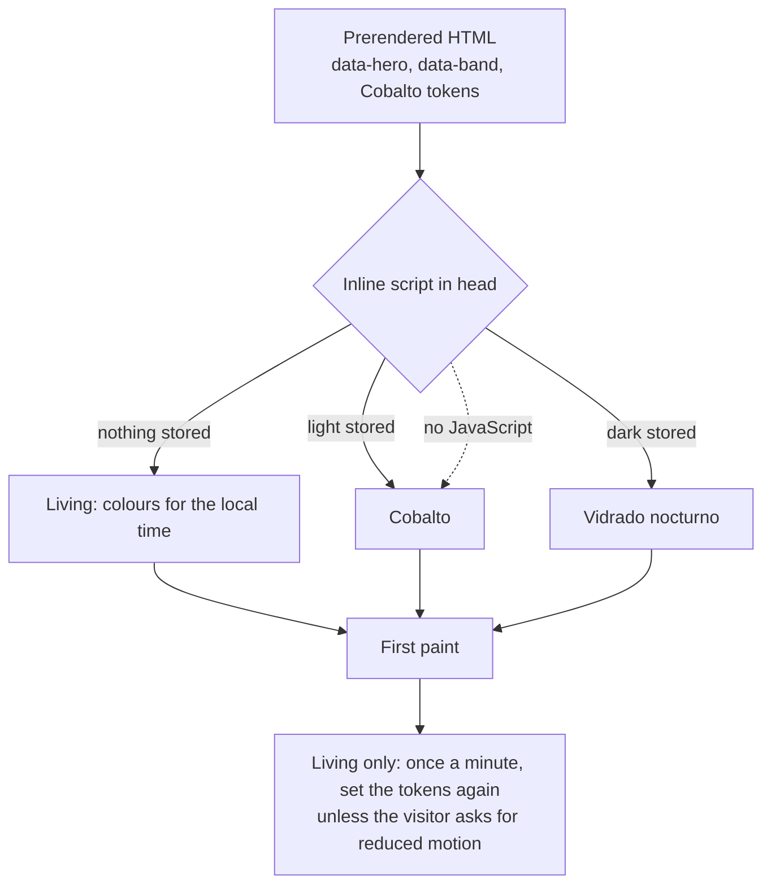
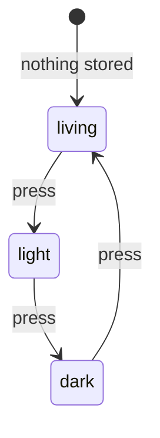

# Examples: Theme

Status: **agreed with the developer on 2026-11-02.**

The living glaze and the theme settings. Design: the Living Glaze study,
https://claude.ai/artifact/LGHSasJRc4DXdBmk95CGyD, agreed unchanged on 2026-11-02. Its engine
is copied in `docs/mockups/home/home.html`, marked "The glaze engine". Unit tests inject the
time; none reads a real clock (`docs/tdd.md`).

## Living glaze

| ID | Given | When | Then | Covered |
|----|-------|------|------|---------|
| THEME-01 | the time is 12:30 | the glaze is computed | it is Cobalto: background `#e9eff4`, accent `#14417a` | |
| THEME-02 | the time is 02:00 | the glaze is computed | it is Vidrado nocturno: background `#0b1526`, accent `#7fa5ce` | |
| THEME-03 | the times 07:30, 19:00 and 21:00 | the glaze is computed | they are Manganês (background `#f0ebf2`), Amarelo e verde (`#f2eedf`) and Manganês nocturno (`#160f1f`) | |
| THEME-04 | every minute of the day | the glaze is computed | text is at least 4.5:1 and lattice edges and ochre at least 3:1, against both the background and the surface; the button label is at least 4.5:1 against the accent | |
| THEME-05 | a first visit, nothing stored | the page loads | the state is living, and the colours follow the visitor's local time | |
| THEME-06 | the state is living | the theme button is pressed repeatedly | the state goes light, dark, living, and its accessible name says which (de "Farbschema: hell", "dunkel", "lebendige Glasur"; pt "Tema: claro", "escuro", "vidrado vivo"; en "Theme: light", "dark", "living glaze"); the choice is stored | |
| THEME-07 | light or dark is stored | the page loads at any time | the colours do not follow the clock: light is Cobalto, dark is Vidrado nocturno, as today's two themes | |
| THEME-08 | the visitor asks for reduced motion and the state is living | time passes | the page keeps the glaze it loaded with until the next load | |
| THEME-09 | the built `/de/home` | it is read | `<html>` carries `data-hero="b"` and `data-band="c"` in the prerendered HTML, before any script runs | |
| THEME-10 | the built page and a stored or clock-chosen glaze | the page loads | the colours are set by an inline script in `<head>`, before first paint, so the wrong colours never flash; without JavaScript the page shows Cobalto and stays readable | |
| THEME-11 | a Material component on any page, in any glaze | it renders | it takes the glaze's accent, not teal: `--mat-sys-*` are mapped to the same tokens | |

## Diagram: first paint

## Diagram: THEME-06

## Decisions

Agreed with the developer on 2026-11-02:

- **The living glaze as the study has it,** and **living is the default state.** Light and
  dark are manual overrides.
- **Hero and band are theme settings,** `{ hero: 'b', band: 'c' }`. Only these defaults are
  built now; another value is added when it is first wanted, with its own cases. The frame is
  not a setting. A changed setting goes live with the next build.

Not designed yet, and not in these cases:

- **Reacting to events** (a new post, a social event). The settings above are where it
  would attach.
