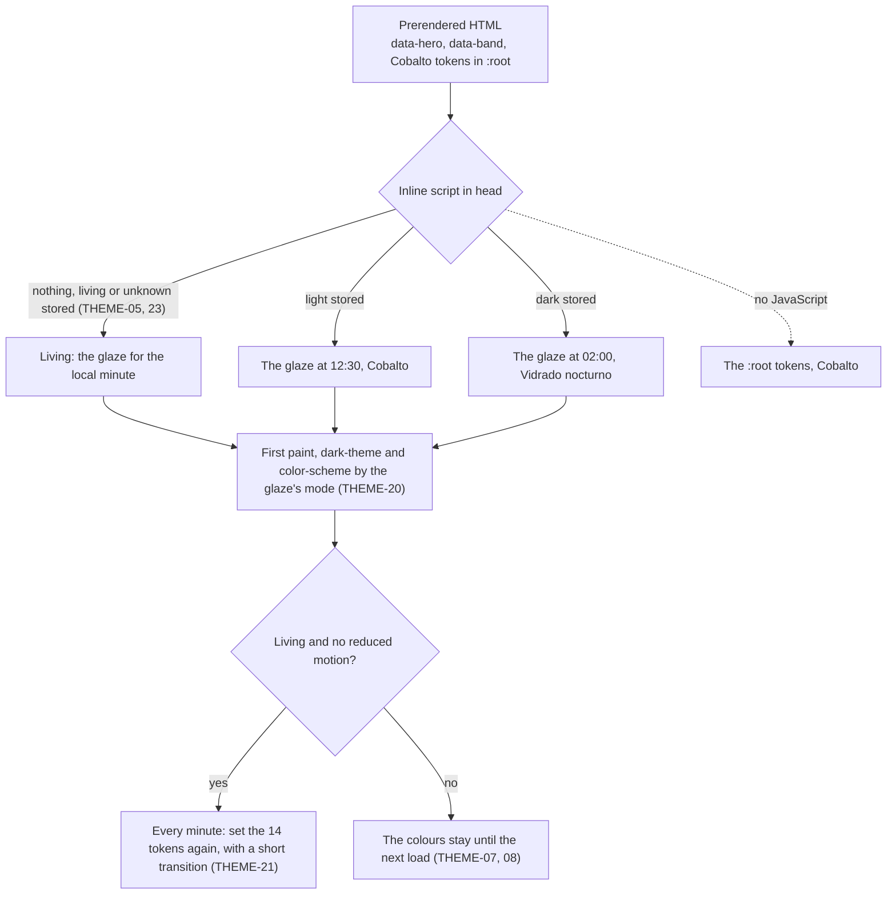
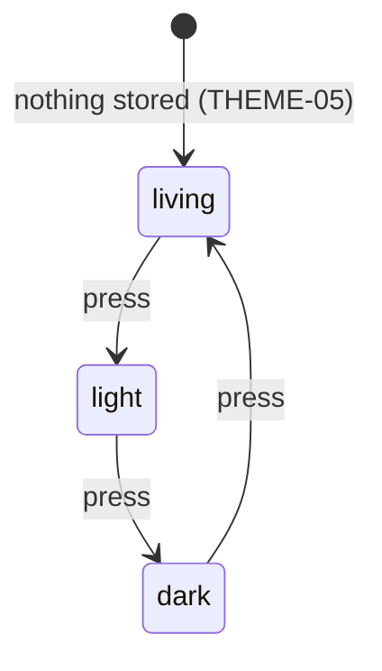

# Examples: Theme

Status: **draft for Zua, 2026-11-15.** THEME-01 to 11 were agreed on 2026-11-02; this rewrite makes
the living glaze the site's one colour reference (Zua, 2026-11-15, the first section of "Settled" in
`docs/design.md`) and adds the removal of the five sources of drift, B1 to B5. Waiting for Zua: the
cases, the slices and D1 to D10 (D1 is the one question before the build). Nothing is built yet,
except THEME-10 for today's two themes.

The site's colours follow the visitor's local time through five azulejo glazes. Design: the Living
Glaze study, https://claude.ai/artifact/LGHSasJRc4DXdBmk95CGyD, agreed unchanged on 2026-11-02. Its
engine is copied, identical, in all five agreed mock-ups (marked "The glaze engine"; the tables,
keyframes, guard, token map and state minutes compared on 2026-11-15). Unit tests inject the time;
none reads a real clock (`docs/tdd.md`).

**Changed from the 2026-11-02 version,** because the engine says otherwise:
- THEME-03 named 07:30 and 21:00, which are blends (Manganês into Cobalto, Manganês nocturno into
  Vidrado nocturno); the pure glazes are at 06:30, 19:00 and 20:00.
- THEME-07's dark is Vidrado nocturno as the guard leaves it: its edge is `#526c8c`, not the
  table's `#516b8b`, which is 2.96:1 on the dark surface (THEME-16).
- The "In plain words" table in three languages is now the column below, English only, as in the
  other example files. THEME-06's labels in de and pt stay in the case.

**Already there,** so not cases here: THEME-10 for light and dark (`acceptance/theme.test.mjs`,
`acceptance/browser/theme-paint.test.mjs`, `services/theme-rule.cases.json`); the contrast reader
(`acceptance/browser/contrast.mjs`); the hero's v2 cases (HOME-HERO-01 to 09 in
`docs/examples/home.md`). Each must stay green, or be changed here on purpose (THEME-05 changes the
rule table).

Sections, in build order:
1. **The glaze** (THEME-01 to 04, 12 to 15): the engine, with the time injected.
2. **The tokens and Material** (THEME-11, 16 to 19): B1, B2, B3; the tokens from the glaze.
3. **Living, light and dark** (THEME-05 to 10, 20 to 24): B4; the toggle, first paint, the tick.
4. **The old hero goes** (THEME-25 to 26): B5. The new hero is home.md's (HOME-HERO-01 to 09).
5. **In the browser, every glaze** (THEME-27 to 29): no fixed colour anywhere, contrast in all five.
6. **Refused paths** (THEME-P-01 to P-09).

## 1. The glaze

| ID | In plain words | Given | When | Then | How a test checks it | Covered |
|----|----------------|-------|------|------|----------------------|---------|
| THEME-01 | At lunchtime the site wears its cobalt-blue glaze. | the time 12:30 | the glaze is computed | it is Cobalto, exactly as its table: background `#e9eff4`, surface `#f7fafc`, accent `#14417a`, edge `#6987ab`; nothing moved by the guard | unit (the engine, time injected) | |
| THEME-02 | In the middle of the night the site wears its dark night glaze. | the time 02:00 | the glaze is computed | it is Vidrado nocturno: background `#0b1526`, accent `#7fa5ce`; edge `#526c8c`, the one token the guard moves | unit | |
| THEME-03 | Morning, early evening and evening each have their own glaze. | the times 06:30, 19:00 and 20:00 | the glaze is computed | Manganês (background `#f0ebf2`, accent `#5b2f73`), Amarelo e verde (`#f2eedf`, `#2f5b3b`) and Manganês nocturno (`#160f1f`, `#c4a3dc`), each exactly as its table | unit | |
| THEME-04 | At every minute of the day, text and drawings stay readable. | every minute from 00:00 to 23:59 | the glaze is computed and written as the hex values the page gets | heading, body, muted, accent, accent hover and ochre text at least 4.5:1, ochre and edge at least 3:1, each against both background and surface; on accent at least 4.5:1 against the accent; the footer's text and gold, and the band's text, at least 4.5:1 against their grounds (derived by mode, as the mock-ups' `paint()`; D5). Red with the study's engine: the fixed gold falls to 2.21:1 at 06:14 and 19:46 (12 minutes below), the footer text to the edge at 06:15 | unit, 1440 minutes, measured on the rounded hex values (D2) | |
| THEME-12 | Between night and morning, and evening and night, the ground fades and the ink switches once. | the minutes 06:00 to 06:30 and 19:30 to 20:00 | the glaze is computed | the background changes every minute; the inks are the dark side's up to 06:14 and the light side's from 06:15, the light side's up to 19:45 and the dark side's from 19:46; the mode changes at those two minutes and at no other minute of the day | unit | |
| THEME-13 | A colour too faint for its ground is darkened or lightened until it is readable. | a glaze below its minimum: Vidrado nocturno's edge `#516b8b` (2.96:1 on its surface); and a test glaze whose muted is 2:1 on a light ground | the glaze is computed | the edge becomes `#526c8c` (3.00:1); the test muted moves toward black, only as far as 4.5:1; a token already above its minimum is left as its table has it (THEME-01) | unit (the night edge; a test table injected) | |
| THEME-14 | Two glazes blend smoothly between their times. | the time 08:15, halfway from Manganês (06:30) to Cobalto (10:00) | the glaze is computed | each token is the Oklab midpoint of the two glazes' values (the study's smoothstep at t = ½; background `#ededf3`), before the guard; 06:30 and 10:00 give the pure glazes | unit | |
| THEME-15 | The glaze's values are kept in one table, the same the mock-ups use. | the build's glaze table (D3) and the engine in `docs/mockups/home/home.html` | both are read | the five glazes, 14 tokens each, the keyframes and the minimums are equal | the scripts' test (`npm run test:scripts`) | |

## 2. The tokens and Material

| ID | In plain words | Given | When | Then | How a test checks it | Covered |
|----|----------------|-------|------|------|----------------------|---------|
| THEME-16 | The site's colour tokens are the glaze's, not typed by hand. | `styles.css` | its colour blocks are read | the `:root` block equals the glaze at 12:30 and the `html.dark-theme` block the glaze at 02:00, token for token, through the mock-ups' map (`bg` → `--zc-bg-warm`, `surface` → `--zc-bg-white`, `accent` → `--zc-azul` and `--zc-accent`, …); no other colour token is declared except the footer's gold pair (D5). Red today: the dark `--zc-edge` is `#516b8b`; `--zc-azul-pale`, `--zc-accent-light`, `--zc-ochre-wash`, `--zc-tile` and `--zc-grout` are declared | the scripts' test (D4) | |
| THEME-11 | Buttons and other ready-made controls take the current glaze's colours, not a foreign teal. | a Material filled button and an icon button on a built page, in light, dark and living at 06:30, 19:00, 20:00 | they render | the filled button's background is the glaze's `--zc-accent` and its label `--zc-on-accent`; the icon button's glyph is its bar's ink. Red today: `#006a6a` in light, `#00dddd` in dark | browser | |
| THEME-17 | Material has no palette of its own any more. (B1) | the built stylesheet | its `--mat-sys-*` declarations are read | every `--mat-sys-*` colour is a `var(--zc-…)` or a mix of them (D9); no colour literal; `material-theme.scss` names no `$cyan-palette` or `$violet-palette`. Red today: the cyan and violet palettes, `--mat-sys-primary: #006a6a` | build and a source check | |
| THEME-18 | The page's ground is the glaze's ground, on a phone too. (B2) | `/en/software` at 390 (the phone layout inside the Material sidenav) and at 1280, light, dark and living at 20:00 | the ground behind `<main>` is measured | `body`, the sidenav container and the sidenav content are each `--zc-bg-warm` or transparent over it; `material-theme.scss`'s `body` no longer takes `--mat-sys-surface`. Expected red today at 390: the sidenav's ground is Material's (measure when the test is written) | browser, and a source check | |
| THEME-19 | No override is left that Material no longer reads. (B3) | the app's sources and the built CSS | they are searched | no `--mdc-` anywhere; the header's "write to me" button is `--zc-accent` with `--zc-on-accent` as in the home mock-up; the header's icon buttons draw in `--nav-fg`. Red today: eight `--mdc-` declarations in `zc-nav-desktop.css`, `zc-nav-mobile.css`, `hero.css`; the button is teal | source check, build and browser | |

## 3. Living, light and dark

| ID | In plain words | Given | When | Then | How a test checks it | Covered |
|----|----------------|-------|------|------|----------------------|---------|
| THEME-05 | On a first visit, the colours follow the time of day where the visitor is. | nothing stored, or `living` stored; a device clock at 20:00 local (and 18:00 UTC) | the page loads | the state is living and the page wears Manganês nocturno, from the local hours, not UTC; the device's light or dark setting is not read (D1). Red today: the device setting decides, and only light or dark exist (B4) | unit (service, clock injected); build (the head script in a VM, as today's THEME-10); the rule table `theme-rule.cases.json` changes with it | |
| THEME-06 | The theme button cycles light, dark and living, says which is on, and remembers the choice. | the state is living, on `/de/home` | the theme button is pressed three times | the state goes light, dark, living; its accessible name names the state, in the page's language (en "Theme: light", "Theme: dark", "Theme: living glaze"; de "Farbschema: hell", "dunkel", "lebendige Glasur"; pt "Tema: claro", "escuro", "vidrado vivo"); the icon is the sun, the moon, the half lozenge of the mock-up; each choice is stored as `zc-theme`. Red today: two states, English names ("Switch to dark mode") | unit (component and service); browser (keyboard press, name read) | |
| THEME-07 | A visitor who chose light or dark keeps those colours, whatever the time. | `light` stored, or `dark` stored; the clock at 06:30, 12:30, 20:00, 02:00 | the page loads and an hour passes | light is the glaze at 12:30 (Cobalto) and dark the glaze at 02:00 (Vidrado nocturno, THEME-02) at every one of those times; nothing changes over the hour | unit; build (head script) | |
| THEME-08 | For a visitor who prefers less motion, the colours stay as they loaded until the page is opened again. | living, reduced motion asked, loaded at 19:40 | three hours pass, through the 19:46 switch | the tokens stay those of 19:40; no tick runs. Pressing the button still changes the state at once, without a transition | unit (fake timers) | |
| THEME-09 | The opening and the paper band appear in their chosen design at once. | the built `/de/home` | it is read | `<html>` carries `data-hero="b"` and `data-band="c"` in the prerendered HTML, before any script runs | build | |
| THEME-10 | The right colours are there from the first paint; without scripts the page is the blue glaze and readable. | the built `/en/software`, `/de/home`, `/`, `/404`; nothing stored and the clock at 02:00, 06:15, 12:30, 20:00; `light` and `dark` stored | the head's inline scripts run in a VM | before any other script, the glaze's colour tokens on `<html>` equal the glaze of THEME-05 or 07 for that case; without JavaScript the page shows the `:root` tokens, Cobalto | build (VM); browser with JavaScript off | for today's two themes (build, browser and unit, 2026-11-08, D25 in `software.md`); the living glaze's colours come with slice 3 |
| THEME-20 | The page is a dark page to the browser whenever the glaze is dark. | living at 20:00 and at 12:30; dark stored; light stored | the page loads | at 20:00 and with dark, `<html>` has `dark-theme` and `color-scheme: dark`; at 12:30 and with light, neither; in living the class changes at 06:15 and 19:46 with the inks (THEME-12, D7) | unit; build (VM) | |
| THEME-21 | While a living page stays open, its colours keep following the clock, gently. | living, no reduced motion, opened at 19:45 | one minute passes | the tokens are set again for 19:46 (the dark side); each colour token changes through a transition of about a second (D6), not at once | unit (fake timers); browser (the transition read from the computed style) | |
| THEME-22 | Leaving living stops the clock. | living, opened at 19:40 | the button is pressed (light), then an hour passes | the tokens are Cobalto and do not change; no tick remains; the same when the page's root is destroyed | unit (fake timers) | |
| THEME-23 | A stored value the site does not know counts as nothing stored. | `blue` stored; or the storage throws when read | the page loads at 20:00 | the state is living (Manganês nocturno); the page is painted; nothing is written until the button is pressed. Red today: `blue` follows the device setting | unit; build (head script, VM; the rule table's `blue` row changes) | |
| THEME-24 | The choice holds on every page and language. | `dark` stored on `/de/home` | `/pt/research` and `/404` are opened | both are dark from first paint, with the button named in their language | browser | |

### Diagram: first paint

### Diagram: the toggle (THEME-06)

### Diagram: the day (THEME-01 to 03, 12)

```mermaid
flowchart LR
    A["00:00 to 05:00<br/>Vidrado nocturno"] --> B["05:00 to 06:00<br/>into Manganês nocturno"]
    B --> X1["06:00 to 06:30 crossing<br/>inks switch at 06:15"]
    X1 --> C["06:30 Manganês<br/>into Cobalto"]
    C --> D["10:00 to 15:00<br/>Cobalto"]
    D --> E["15:00 to 18:00<br/>into Amarelo e verde"]
    E --> F["18:00 to 19:30<br/>Amarelo e verde"]
    F --> X2["19:30 to 20:00 crossing<br/>inks switch at 19:46"]
    X2 --> G["20:00 Manganês nocturno<br/>into Vidrado nocturno"]
    G --> A2["23:00 Vidrado nocturno"]
```

## 4. The old hero goes (B5)

The new hero (the sentence and the 2³ lattice on the lozenge tile, hero option B) is built by
HOME-HERO-01 to 09 in `docs/examples/home.md`, from `docs/mockups/home/home.html` and its spec.
These two cases say the old one is gone and leaves nothing behind.

| ID | In plain words | Given | When | Then | How a test checks it | Covered |
|----|----------------|-------|------|------|----------------------|---------|
| THEME-25 | The old photo opening is gone from the home page. | the built `/`, `/en/home`, `/de/home`, `/pt/home` | the pages and the build's files are read | no `<picture>`, no `hero-placeholder` file or reference, no "Misty sunrise", no `app-lattice-wall`, no "74 distinct lattices" credit, no `hero__glass`; no file under `assets/hero/` in the build (D8). Red today: all of them | build | |
| THEME-26 | The site's own styles hold no fixed colour. | every `.css` under `src/app` and `src/styles.css` outside its generated blocks | they are searched for colour literals (hex, `rgb()`, `hsl()`, colour names) | none, apart from `transparent`, `currentColor` and the shadows' black (D5). Red today: 19, in `hero.css` (17), `zc-nav-desktop.css` (1) and `lattice-wall.css` (1) | source check (`npm run test:scripts`) | |

## 5. In the browser, every glaze

| ID | In plain words | Given | When | Then | How a test checks it | Covered |
|----|----------------|-------|------|------|----------------------|---------|
| THEME-27 | Nothing on a page keeps its colour when the glaze changes. | `/en/home`, `/en/software`, `/en/research`, `/en/writing`, `/en/about`, `/404`, at 390 and 1280 | each is shown at 12:30 (Cobalto) and at 20:00 (Manganês nocturno), and the computed `color`, `background-color`, `border-color`, `fill`, `stroke` of every visible element are compared | every non-transparent colour differs between the two, except the footer's gold pair (D5). Red today (with light and dark in place of the two times): the hero's white and gold | browser | |
| THEME-28 | Pages stay readable in all five glazes, and at the worst minutes of the crossings. | `/en/home`, `/de/software`, `/de/about` at 1280 and 390 | shown at 06:30, 12:30, 19:00, 20:00, 02:00, 06:15 and 19:48 | every text in `<main>`, header and footer at least 4.5:1 against its ground, lattice edges and ochre marks at least 3:1 | browser, with the shared contrast reader | |
| THEME-29 | The glaze is the same on every page. | the same pages at 20:00 | the glaze's colour tokens on `<html>` are read | equal on every page, and equal to THEME-03's Manganês nocturno | browser | |

## 6. Refused paths

| ID | In plain words | Given | When | Then | How a test checks it | Covered |
|----|----------------|-------|------|------|----------------------|---------|
| THEME-P-01 | A guard that leaves a colour below its minimum is refused. | the engine with its guard taken out | the day is computed | THEME-04 goes red, naming the minute and the token (02:00, edge, 2.96:1) | break in the engine | |
| THEME-P-02 | Reduced motion never changes the glaze with time. | living, reduced motion, the tick forced to run | three hours pass | THEME-08 goes red if any token changes | break in the service | |
| THEME-P-03 | A fixed colour put back in a component is refused. | `hero.css` | `color: #ffffff` is put back | THEME-26 goes red, naming the file and line | break in the source | |
| THEME-P-04 | A dead `--mdc-` override put back is refused. | `zc-nav-desktop.css` | `--mdc-filled-button-container-color` is put back | THEME-19 goes red | break in the source | |
| THEME-P-05 | Material's own palette put back is refused. | `material-theme.scss` | `primary: mat.$cyan-palette` is put back | THEME-17 goes red, naming `--mat-sys-primary` | break in the build | |
| THEME-P-06 | A hand edit of a generated colour token is refused. | `styles.css` | the dark `--zc-edge` is set back to `#516b8b` | THEME-16 goes red, naming the token, the value and the glaze's `#526c8c` | break in the source | |
| THEME-P-07 | A glaze table missing a token, or with a token not in the map, is refused. | the glaze table | Amarelo e verde's `edge` is removed, or a token `teal` is added | the table's check fails naming the glaze and the token; nothing is generated | the scripts' test | |
| THEME-P-08 | The study's rounding slip does not reach the site. | the minutes 19:48 and 19:52, where the study's engine, rounded to hex, gives body 4.455:1 and edge 2.969:1 | the glaze is computed | the hex values set pass 4.5:1 and 3:1 (D2) | unit (named minutes, inside THEME-04) | |
| THEME-P-09 | The device's dark setting does not override living. | nothing stored, the device asking for dark, the clock at 12:30 | the page loads | Cobalto, not Vidrado nocturno (D1, recommended option) | unit; build (VM) | |

## Decisions

Open, for Zua (recommendation first):

- **D1. A device set to dark, on a first visit.** The study and the 2026-11-02 agreement make living
  the default; today's site follows the device's dark setting.
  1. *(recommended)* Living, as agreed: the device setting is not read. A visitor in a dark room at
     noon sees Cobalto and can press the button once for dark. THEME-05, P-09 as written.
  2. A device set to dark starts in dark, until the visitor presses the button. P-09 turns
     around; living is the default only for light devices.
  3. Living, but a dark device sees only the two nocturnal glazes. Not in the study: it needs a
     design round first.
- **D2. The guard is measured on the colours the page gets.** The study's engine checks before
  rounding to hex, so at 113 token-minutes of the crossings it leaves a value up to 0.05 below
  (body 4.455:1 at 19:48, edge 2.969:1 at 19:52; measured 2026-11-15).
  1. *(recommended)* The site's engine rounds, checks, and steps on until the rounded value passes.
     The study's rule, kept where it matters; the study itself stays as it is.
  2. Port the engine unchanged and accept the slips. WCAG's minimums have no tolerance.
- **D3. One engine, one table.** The head script must paint before Angular runs, and the service
  must tick after it.
  1. *(recommended)* A plain module `glaze.mjs` with no imports, and the table `glaze.json` (the
     study's values). A build step inlines the module into `index.html`'s head, as the content
     snapshot is written before the build; `ThemeService` imports the same module; the tests read
     the same table, as `theme-rule.cases.json` is read today.
  2. The engine only in `index.html`; the service reads what it left on `window`. Unit tests cannot
     import it.
  3. A precomputed table of 1440 minutes. About 100 KB in every page's head.
- **D4. The `styles.css` colour blocks are generated.**
  1. *(recommended)* A script writes the `:root` and `html.dark-theme` colour lines between two
     marker comments from `glaze.json`, and THEME-16 fails on a hand edit (as the lattice wall's
     `render.py` and its test today).
  2. Hand-written, with THEME-16 checking only. A wrong value is found, not prevented.
- **D5. Colours outside the 14.**
  1. *(recommended)* The footer's gold pair (`--zc-foot-gold` `#d9a94a`, `--zc-foot-on-gold`
     `#1a1205`) keeps its values but joins the guard: in the crossings the footer's ground is a
     blended grey, and the fixed gold falls to 2.21:1 (06:14, 19:46; 12 minutes under 4.5:1), so
     the guard pushes it toward white there, and the label on it against it. The footer's and
     band's text join the guard against their grounds too (THEME-04). The shadows' black stays. `--zc-azul-pale`, `--zc-accent-light`, `--zc-ochre-wash`, `--zc-tile`
     and `--zc-grout` go: their only users are the old hero and its wall; hero B's tile lines are
     `color-mix(in oklab, var(--zc-edge) 28%, transparent)` as in the mock-up. The footer's and
     band's grounds stay derived by mode, as the mock-up's `paint()` does.
  2. The gold fixed and unguarded, as the mock-ups have it: 12 minutes a day under 4.5:1.
  3. The gold follows the glaze's ochre. The footer's mail button would change colour by the
     hour, which the mock-ups never showed.
- **D6. The tick's transition.**
  1. *(recommended)* The 14 colour tokens are registered with `@property` (syntax `<color>`) and
     transition on `<html>` for 1 s, so every user of a token follows without a rule per element;
     none under reduced motion. The study's own duration replaces the 1 s if Zua prefers it.
  2. A transition on `background-color` and `color` of `body` only. Cards, borders and the lattice
     would jump.
- **D7. `dark-theme` follows the glaze's mode,** so the rules already written for
  `html.dark-theme` (the footer, the band, the shadows) apply in Manganês nocturno and Vidrado
  nocturno, and switch at 06:15 and 19:46 with the inks. Alternative: a new attribute for the mode,
  and every `html.dark-theme` rule rewritten. Recommended: the class.
- **D8. The old hero's parts are deleted,** not parked: the photo and its files, `hero__glass`, the
  lattice wall component, its generator (`scripts/lattice-wall/`, `render.py`,
  `scripts/lattice-wall.test.mjs`) and the lines naming them in `CLAUDE.md`. Git keeps them; D6 in
  `home.md` says how the wall would return. Alternative: keep the generator in `scripts/`, unused.
  Recommended: delete ("delete all other sources that are provoking the drift").
- **D9. Material's colours, mapped.** Recommended: `primary`, `secondary`, `tertiary` and
  `surface-tint` → `--zc-accent`; their `on-` roles → `--zc-on-accent`; their containers →
  `--zc-azul-wash`, on them `--zc-text-heading`; `background`, `surface`, `surface-bright`,
  `surface-dim` → `--zc-bg-warm`; `surface-container-lowest` and `-low` → `--zc-bg-white`;
  `surface-container`, `-high`, `-highest`, `surface-variant` → `--zc-bg-light`; `on-background`,
  `on-surface` → `--zc-text-body`; `on-surface-variant` → `--zc-text-muted`; `outline` →
  `--zc-edge`; `outline-variant` → `--zc-border-light`; `inverse-surface` → `--zc-text-heading`,
  `inverse-on-surface` → `--zc-bg-warm`, `inverse-primary` → `--zc-azul-wash`; `error` roles →
  `--zc-ochre-text` and `--zc-bg-light` (the site shows no error state today). How (for example
  `mat.theme-overrides`) is the build's choice; THEME-17 checks the result.
- **D10. The hero is its own element.** B5 is a page change, not a colour change: the new hero
  builds from HOME-HERO-01 to 09 with `home.md`'s slices; this file only adds THEME-25 and 26.
  Recommended. Alternative: the hero inside slice 2 here, which would make one slice of a
  colour fix and a new opening.

Agreed with the developer on 2026-11-02, still standing:

- **The living glaze as the study has it,** and **living is the default state.** Light and dark
  are manual overrides.
- **Hero and band are theme settings,** `{ hero: 'b', band: 'c' }`. Only these defaults are built;
  another value is added when it is first wanted, with its own cases. The frame is not a setting.
  A changed setting goes live with the next build.

Decided on 2026-11-08 (D25 in `docs/examples/software.md`):

- **THEME-10 was built first for today's two themes:** an inline script in `index.html`'s `<head>`
  applies the saved choice, else the device's setting, before first paint; `theme-rule.cases.json`
  holds the rule for the script and for `ThemeService`. The living glaze extends the same script
  and table (THEME-05, 23).

Not designed yet, and not in these cases:

- **Reacting to events** (a new post, a social event). The settings above are where it would
  attach.

## Slices (proposed)

Each slice ends green and visible on the preview. Slice 2 comes before 3: living with Material's
teal still in place would show teal on violet and green grounds.

1. **The glaze and the tokens.** `glaze.json`, `glaze.mjs`, the generated colour blocks in
   `styles.css` (D3, D4, D5). Visible: only the night edge, one step lighter; the five hand-made
   tokens go once nothing uses them (with slice 4 for the hero's). Cases: THEME-01 to 04, 12 to
   16, P-01, P-06, P-07, P-08.
2. **Material follows the glaze (B1, B2, B3).** The palettes go, `--mat-sys-*` mapped (D9), the
   page ground, the `--mdc-` overrides go, the header button as the mock-up. Visible: no teal, the
   phone's ground. `docs/design.md`'s teal trap and `CLAUDE.md`'s "Material 3 theme" lines change
   with it. Cases: THEME-11, 17, 18, 19, P-04, P-05.
3. **Living, light and dark (B4).** The head script and `ThemeService` on the engine, the three
   states, the toggle's names and icons, the tick and its transition, `dark-theme` by mode, the
   rule table rewritten. Visible: the site follows the clock. Cases: THEME-05 to 08, 10, 20 to 24,
   P-02, P-09; THEME-09 stays green.
4. **The hero (B5), its own element** (D10): HOME-HERO-01 to 09 build the new hero; the old one
   goes with THEME-25, 26, P-03 (D8).
5. **Every glaze in the browser.** After 3 and 4: THEME-27 to 29, then the design review on the
   preview under all five glazes, at 390 and 1280, in en and de.
