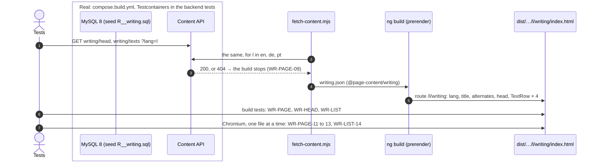
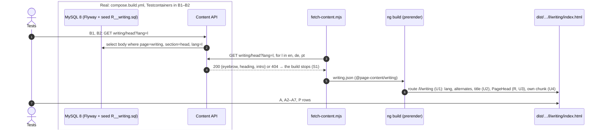

# Examples: Writing page

Status: **agreed with the developer on 2026-11-08:** D1 to D10, then the cases, the two added
wordings (the ICE note, the POPL link), D11, D12, the menu in slice 3 and the three slices. The
Portuguese copy is a draft nobody has read: it is built as drafted and listed for the developer's
review on the preview (D9).

The Writing page in three languages, at `/en/writing`, `/de/writing` and `/pt/writing`. Design:
`docs/mockups/writing/writing-spec.md` (option 1, one quiet list), with the mock-up and screenshots
beside it. It is the last page SHELL-11 waits for (Software, Forschung, Texte, Über mich, in
`shell.md`). `home.md` names writing among the home page's later sections (line 20), and
`/de/writing` is the example of a page that is not built in SHELL-04's P-04 and SW-PAGE-P-04
(`software.md`): both move to another example with this page (WR-PAGE-04).

Sections, in build order:
1. **Page frame** (`WR-PAGE-nn`): the three pages, their `lang`, title, alternates, sitemap, menu
   and the links that reach them.
2. **Head** (`WR-HEAD-nn`): eyebrow, `<h1>`, intro.
3. **The list** (`WR-LIST-nn`): the four texts.

Not in this file: the header, language links and footer (`shell.md`), the colours (`theme.md`).
All wording is in the spec's copy table, en, de and pt; a case names a key and gives a language as
its example. "In plain words" says what each case means for a visitor, in English.

## Who reads it (from `docs/design.md`)

- **Researchers and reviewers** (laptop, from a paper or a talk): title, venue, year, co-authors,
  and the text itself, without hunting.
- **Hiring managers** (a quick look on a phone): does he publish, and where?
- **Teams building AI agents:** write-ups such as the monitor experiment, once they exist (D2 in
  `software.md`).

## 1. Page frame

| ID | In plain words | Given | When | Then | Covered |
|----|----------------|-------|------|------|---------|
| WR-PAGE-01 | The Writing page exists in all three languages. | the writing content in en, de and pt | the site is built | `/en/writing/index.html`, `/de/writing/index.html`, `/pt/writing/index.html` exist, with `<html lang="en">`, `"de"`, `"pt"` | yes (build and unit, 2026-11-08) |
| WR-PAGE-02 | Search engines learn that the three pages are one page in three languages. | the built `/de/writing` | it is read | `<link rel="alternate">` for `hreflang` en, de, pt to `https://zuacaldeira.com/{en,de,pt}/writing`, and `x-default` to `/en/writing` | yes (build, 2026-11-08) |
| WR-PAGE-03 | The browser tab names the page in its language. | the built pages | they are read | `<title>` is "Alexandre Zua Caldeira — Writing", "— Texte", "— Textos" | yes (build and unit, 2026-11-08) |
| WR-PAGE-04 | The sitemap lists the new pages, and only built ones. | the built site | `sitemap.xml` is read | it lists `https://zuacaldeira.com/{en,de,pt}/writing` beside the 18 pages of SW-PAGE-04, 21 in all, and each is a built page (HOME-PAGE-08); the "page not built" examples of SHELL-04 P-04 and SW-PAGE-P-04 move from `/de/writing` to `/de/nope` | |
| WR-PAGE-05 | In the web server, the new page opens straight away. | the built site in the web image's nginx | `/en/writing`, `/de/writing`, `/pt/writing` are requested | each answers `200` with no redirect (HOME-PAGE-09); `/de/writing/` answers `301` to `/de/writing` (HOME-PAGE-10) | |
| WR-PAGE-06 | The menu is complete: Software, Research, Writing, About, in the reader's language. | the built `/de/home` | the main navigation is read | it reads Software, Forschung, Texte, Über mich, to `/de/software`, `/de/research`, `/de/writing`, `/de/about`, in that order (SHELL-11; Home and Running leave the menu, D13 in `software.md`); pt "textos" → `/pt/writing` | |
| WR-PAGE-07 | The header shows Writing as the page you are on. | the built `/pt/writing` | the main navigation is read | its writing link goes to `/pt/writing` and carries `aria-current="page"`; no other link does (D34 in `software.md`) | |
| WR-PAGE-08 | The language links lead to the same page in the other language. | the built `/de/writing` | its language links are read | `EN` → `/en/writing`, `PT` → `/pt/writing`, `DE` current (SHELL-01, 02 on the new page) | yes (build, the shell's tests on the three pages, 2026-11-08) |
| WR-PAGE-09 | A missing German text stops the build instead of showing English. | no writing content stored for de | the site is built | the build fails, naming page `writing`, the section and `de`; nothing is deployed (as HOME-HERO-06) | yes (the snapshot script, 2026-11-08) |
| WR-PAGE-10 | Each page downloads only its own text. | the built site | the files `/en/writing` loads at once are read | its own text is among them; none holds the home hero's sentence or the Software lead's title (SW-PAGE-14 on the new page) | yes (build and unit, 2026-11-08) |
| WR-PAGE-P-01 | A Writing page in only one or two languages is refused. | the build | a language's writing page is missing | WR-PAGE-01 goes red, naming the language | yes (break in the build) |
| WR-PAGE-P-02 | A link to the Writing page that drops the language is refused. | any built page | a link to `/writing` (no prefix) is read | SHELL-04 goes red (an old path) | yes (break in the build) |
| WR-PAGE-P-03 | Two links marked as the current page are refused. | the built `/pt/writing` | a second menu link carries `aria-current="page"` | WR-PAGE-07 goes red | |
| WR-PAGE-P-04 | A menu in another order, or with Running back in it, is refused. | the built `/de/home` | the menu reads Forschung before Software, or holds Laufen | WR-PAGE-06 goes red | |

## 2. Head

| ID | In plain words | Given | When | Then | Covered |
|----|----------------|-------|------|------|---------|
| WR-HEAD-01 | The page opens with its name and one sentence about it. | the built `/en/writing` | the head is read | eyebrow "Published work", `<h1>` "Writing", the intro (`head.intro`, en); the page has exactly one `<h1>` | yes (build, 2026-11-08) |
| WR-HEAD-02 | The German page reads in German. | the built `/de/writing` | the head is read | "Veröffentlichungen", "Texte", `head.intro` de | yes (build and unit, 2026-11-08) |
| WR-HEAD-03 | The Portuguese page reads in Portuguese. | the built `/pt/writing` | the head is read | "Publicações", "Textos", `head.intro` pt | yes (build, 2026-11-08) |
| WR-HEAD-04 | When the site asks for the German head, it gets its three texts exactly as stored. | `writing/head` stored for de | `GET /api/content/writing/head?lang=de` | 200 with `{"eyebrow": "Veröffentlichungen", "heading": "Texte", "intro": "Paper über Session-Typen …"}`, the stored JSON as it is | yes (integration, 2026-11-08) |
| WR-HEAD-05 | A fresh database, filled with the starting texts, gives the head in every language, none empty. | an empty MySQL with Flyway and the `seed` profile | `GET /api/content/writing/head?lang=en`, `de`, `pt` | 200 with the spec's copy, each field non-empty | yes (integration, 2026-11-08) |
| WR-HEAD-P-01 | English text on the German page's head is refused. | the built `/de/writing` | the English intro is put in | WR-HEAD-02 goes red | yes (break in the build) |
| WR-HEAD-P-02 | A language the site does not have, or a section that does not exist, gets nothing. | `writing/head` stored, with a stray `fr` row | `?lang=fr`, or `writing/nope?lang=en` | 404 with an empty body, no fallback (as SW-HEAD-P-03) | yes (integration: green at first, the table is page-agnostic; a break in ContentService) |

## 3. The list

| ID | In plain words | Given | When | Then | Covered |
|----|----------------|-------|------|------|---------|
| WR-LIST-01 | The four papers are listed, newest first. | the built `/en/writing` | the list after the head is read | a `<ul>` of four texts, in order: Session Type State Spaces Form Lattices (2026), Modular Session Types for Distributed Object-Oriented Programming (2010), Dynamic Interfaces (2009), ConGu, Checking Java Classes Against Property-Driven Algebraic Specifications (2007) (D3) | |
| WR-LIST-02 | Each text shows its year, kind, title, authors and venue. | the same | each text is read | the spec's table: year, kind (`texts.kinds.*`, en), `<h3>` title, the authors in the order published, the venue as "short · full" | |
| WR-LIST-03 | The author's own name stands out in each author list. | the same | the authors are read | exactly one name per text is in `<b>`: "Alexandre Zua Caldeira", "Alexandre Z. Caldeira", "Alexandre Z. Caldeira", "Alexandre Caldeira", as published | |
| WR-LIST-04 | The newest paper says it is the camera-ready copy, to appear in EPTCS. | any language | the texts are read | only the ICE text has a note: en "Camera-ready · to appear in EPTCS", de "Druckfassung · erscheint in EPTCS", pt "Versão final · a publicar na EPTCS" | |
| WR-LIST-05 | The ICE paper opens as a PDF from this site. | any language | the ICE text's link is read | exactly one link, labelled `texts.read` (en "Read (PDF)", de "Lesen (PDF)", pt "Ler (PDF)"), to `/assets/pdfs/SessionTypeStateSpacesFormLattices-CameraReady.pdf` from the site root, same tab, `hreflang="en"`; the file is in the build | |
| WR-LIST-06 | The older papers link to where they are published, in a new tab, and say so. | any language | the other three links are read | POPL → `https://doi.org/10.1145/1706299.1706335` "ACM Digital Library (DOI)"; FOOL → `https://eprints.gla.ac.uk/47911/` "eprints.gla.ac.uk"; ConGu → `https://repositorio.ulisboa.pt/handle/10451/14164` "repositorio.ulisboa.pt"; each `target="_blank"`, `rel="noopener noreferrer"`, `hreflang="en"`, its name ending with the page language's `texts.newTab` ("öffnet in einem neuen Tab" on `/de/writing`), the `↗` hidden from screen readers | |
| WR-LIST-07 | On the German page, the labels are German; titles, names and venues stay as published. | the built `/de/writing` | the list is read | kinds "Workshop-Paper", "Konferenz-Paper", "Technischer Bericht"; titles, authors, venues, years and link targets identical to `/en/writing`; each title `translate="no"` and `lang="en"` | |
| WR-LIST-08 | The Portuguese page does the same in Portuguese. | the built `/pt/writing` | the list is read | kinds "Artigo de workshop", "Artigo de conferência", "Relatório técnico"; the rest as WR-LIST-07 | |
| WR-LIST-09 | German and Portuguese readers are told each paper is in English. | `/de/writing`, `/pt/writing` | each text is read | each of the four shows "Auf Englisch" (de) or "Em inglês" (pt); `/en/writing` shows no such line (D10) | |
| WR-LIST-10 | A text shows no summary or abstract. | any language | the texts are read | no abstract text from `ContentService.publications` and no other sentence than the fields above (D4) | |
| WR-LIST-11 | The training papers are not on the page. | any language | the page is read | none of the four `facharbeiten` titles or PDFs appear (D2) | |
| WR-LIST-12 | When the site asks for the Portuguese list, it gets its labels and the four texts as stored. | `writing/texts` stored for pt | `GET /api/content/writing/texts?lang=pt` | 200 with the stored JSON as it is (D11's shape) | |
| WR-LIST-13 | A fresh database, filled with the starting texts, gives the list in every language, none empty. | an empty MySQL with Flyway and the `seed` profile | `GET /api/content/writing/texts?lang=en`, `de`, `pt` | 200; en is the spec's copy and table; de and pt have the same four items with the same ids, years, titles, authors, venues and targets, every label non-empty | |
| WR-LIST-P-01 | A different order, or a fifth text, is refused. | the built page | ConGu is moved first, or a training paper is added | WR-LIST-01 goes red | |
| WR-LIST-P-02 | A translated title or a translated venue is refused. | the built `/de/writing` | the title reads "Zustandsräume von Session-Typen bilden Verbände" | WR-LIST-07 goes red | |
| WR-LIST-P-03 | English labels on a German page are refused. | the built `/de/writing` | a kind reads "Workshop paper" | WR-LIST-07 goes red | |
| WR-LIST-P-04 | An outside link that does not say it opens a new tab is refused. | the built `/de/writing` | the hidden "(öffnet in einem neuen Tab)" is taken out of the FOOL link | WR-LIST-06 goes red | |
| WR-LIST-P-05 | An abstract put back under a text is refused. | the built page | the POPL abstract's first sentence is put in | WR-LIST-10 goes red | |

## In the browser (after the build, `npm run acceptance:browser`)

| ID | In plain words | Given | When | Then | Covered |
|----|----------------|-------|------|------|---------|
| WR-PAGE-11 | The page fits a phone: nothing runs off the side. | a phone at 390 px, `/en/writing`, `/de/writing`, `/pt/writing` | the page is measured | no horizontal scroll; no element in `<main>` ends right of 390 px | |
| WR-PAGE-12 | Every link on the page is easy to tap. | the same | the links in `<main>` are measured | each is at least 44 px tall | |
| WR-PAGE-13 | Keyboard users get to the content first. | `/de/writing`, 390 and 1280 px | Tab, then Enter | the skip link goes to `<main>` on the same page (SHELL-10 on the new page) | |
| WR-LIST-14 | The list's text is easy to read in light and dark. | `/en/writing` and `/de/writing` at 1280, light and dark | the list's texts are measured | each is at 4.5:1 or more against what is behind it (the mock-up's lowest: 4.91 light, 5.36 dark) | |

## Diagram: the build (all slices)



Session type (the visitor's path), in the convention of `shell.md`:

```
G = Build → API : get(writing, s, l) .
    API → Build : { ok200(s_l) .
                    Build → Page : prerender(head_l, texts_l) .
                    Page → Visitor : page(lang l, h1, list[ice2026, popl2010, fool2009, congu2007]) .
                    Visitor → Page : { pdf(ice2026) . end ,
                                       out(popl2010) . end , out(fool2009) . end , out(congu2007) . end ,
                                       stay . end } ,
                    missing404 . Build → CI : fail(writing, s, l) . end }
  titles, authors, venues, targets: the same for every l

Visitor ↾ = Page?page(…) . Page!{ pdf . end , out(…) . end , stay . end }
Page ↾    = Build?prerender . Visitor!page(…) . Visitor?{ … }
```

| Arrow | Step in G | Rows |
|---|---|---|
| 1, 3 test/F → API | `get`, `{ok200, missing404}` | WR-HEAD-04, 05, P-02; WR-LIST-12, 13; WR-PAGE-09 |
| 5 NG → P | `prerender(head_l, texts_l)` | WR-PAGE-01 to 03, 10; WR-HEAD-01 to 03 |
| 6 the list | `list[ice2026, popl2010, fool2009, congu2007]` | WR-LIST-01 to 04, 07 to 11 |
| 6 the links | the Visitor's choice `{pdf, out(…), stay}` | WR-LIST-05, 06 |
| forbidden: another order or a fifth text | `list[…]` fixed | WR-LIST-P-01 |
| forbidden: a title or venue translated | the same for every `l` | WR-LIST-P-02 |
| forbidden: `texts_en` on `l = de` | `ok200(s_l)` | WR-HEAD-P-01, WR-LIST-P-03 |
| forbidden: `out` without saying so | `out(…)` named with `newTab_l` | WR-LIST-P-04 |

The page is read-only: no repeat, stale-token or race rows.

## Slices (agreed 2026-11-08)

As on the Software page, each slice ships on `next` with the route live but **no menu link and no
sitemap entry** until slice 3, so a merge of `next` mid-way leaves the page out of reach.

1. **Frame + head:** route `/l/writing`, `lang`, title, alternates, `writing/head` through the
   content pipeline (`@page-content/writing`, `WRITING_CONTENT`), the head. WR-PAGE-01 to 03, 08,
   09, 10, P-01, P-02; WR-HEAD-01 to 05, P-01, P-02.
2. **The list:** `writing/texts` seed and pipeline, `TextRow`. WR-LIST-01 to 13, P-01 to P-05.
3. **Open the page:** the menu as SHELL-11 has it (WR-PAGE-06, the menu's words in `nav.*`), the
   current marker, the sitemap (21 URLs, HOME-PAGE-07's count and the "page not built" examples
   move), nginx, and the browser checks. WR-PAGE-04 to 07, 11 to 13, P-03, P-04; WR-LIST-14.
   SHELL-11 is covered here. Older tests that pin today's menu (Home, About, Software, Research,
   Running, Contact) change with it, as D13 in `software.md` foresaw: the desktop and phone menu
   specs, `ContentService`, SHELL-08 A1 and SHELL-05b.

Not in these slices: the Research page linking to this list instead of its own copy (D1), and the
home page's writing section; each comes with its page.

## Slice 1: frame + head

Test list (crossed off in the "Done" note below as each is committed):
- **Backend** (Testcontainers, one class per run):
  - B1 WR-HEAD-05, the seed answers the agreed head in en, de, pt (`WritingSeedIntegrationTest`).
  - B2 WR-HEAD-04, the stored German head as it is, and WR-HEAD-P-02, `fr` with a stray row and
    `writing/nope` answer 404 (`ContentSectionIntegrationTest`). The table is page-agnostic (D11),
    so B2 is expected green at once; it is shown to bite by a break in `ContentService`.
- **Script:** S1 WR-PAGE-09, the snapshot asks for `writing/head` in each language, and a 404 for
  `de` stops it naming page `writing`, section `head`, language `de`.
- **Refactor first (D13):** R the Software page's head becomes the shared `PageHead` component; the
  Software specs and acceptance tests stay green (only their class selectors move).
- **Unit:**
  - U1 WR-PAGE-01, the route `/de/writing` shows the Writing page in German (`SITE_PAGES` too, so the
    language links know it, WR-PAGE-08).
  - U2 WR-PAGE-03, the title `Alexandre Zua Caldeira — ${heading}` (D11).
  - U3 WR-HEAD-02, the head from `WRITING_CONTENT` on a German page.
  - U4 WR-PAGE-10, `/de/writing` brings its own text with its route (no content at the root).
- **Acceptance** (`acceptance/writing.test.mjs`):
  - A WR-HEAD-02, the outer test, declared first.
  - A2 WR-PAGE-01, A3 WR-PAGE-02, A4 WR-PAGE-03, A5 WR-HEAD-01 and 03, A6 WR-PAGE-10.
  - A7 the three pages join `PAGES` in `shell.test.mjs` (WR-PAGE-08, SHELL-04, SHELL-07b on the new
    pages); SHELL-04's D19 example `/de/writing#x` moves to `/de/nope#x`.
- **Protocol rows:** WR-PAGE-P-01 (a built page moved out), WR-PAGE-P-02 (a link to `/writing`),
  WR-HEAD-P-01 (the English intro on `/de/writing`), WR-HEAD-P-02 (B2); each green row shown red
  by its break, then restored.

Not in slice 1: no menu link, no sitemap entry, no nginx or browser checks (slice 3).



Session type. Convention: a role that a branch never calls just ends there.

```
G = Build → API : get(writing, head, l) .
    API → Build : { ok200(head_l) .
                    Build → Page : prerender(l, title, alternates, head_l) .
                    Page → Visitor : page(lang = l, h1, links) . end ,
                    missing404 . Build → CI : fail(writing, head, l) . end }

Build ↾   = API!get . API?{ ok200 . Page!prerender . end , missing404 . CI!fail . end }
Page ↾    = Build?prerender . Visitor!page(lang = l, h1, links) . end
Visitor ↾ = Page?page(lang = l, h1, links) . end
API ↾     = Build?get . Build!{ ok200 . end , missing404 . end }
```

| Arrow | Step in G | Rows |
|---|---|---|
| 1–2 test → API → DB | `get`, `ok200(head_l)` | B1, B2 (WR-HEAD-04) |
| 1 with `fr` or `writing/nope` | `missing404` | B2 (WR-HEAD-P-02) |
| 3–4 F → API | `get` × 3, `{ok200, missing404}` | S1 |
| 5–6 NG → P | `prerender(l, title, alternates, head_l)` | U1, U2, U3, U4 |
| 7 T → P | `page(lang, h1, links)` | A, A2–A7 |
| forbidden: a page missing for some `l` | `prerender` for every `l` | WR-PAGE-P-01 |
| forbidden: `head_en` on an `l = de` page | `ok200(head_l)` | WR-HEAD-P-01 |
| forbidden: a link to `/writing` | `links ⊆ /l/x` (SHELL-04) | WR-PAGE-P-02 |

The build is read-only: no repeat, stale-token or race rows.

The refactor R (D13), on the Software page: `G_pre` is slice 1's G of `software.md` with
`prerender(l, title, alternates, head_l)` drawn by the page's own markup; `G_post` is the same G
with the head drawn by `PageHead`. `Visitor ↾` is identical in both (`Page?page(lang = l, h1,
links) . end`, the same eyebrow, `<h1>` and intro), so R changes no behaviour; the Software specs and
acceptance tests hold it.

**Done 2026-11-08** (`bed9007` to `4eb34fe`). Red first, each for its own reason: A `ENOENT` on
`de/writing/index.html`; B1 `expected: 200 but was: 404` in en, de, pt; S1 "Missing expected
rejection"; U1 `expected 'APP-NOT-FOUND' to be 'APP-WRITING'`, with the route-list tests red too this
time (Software's were not run red first); U2 `expected '' to be 'Alexandre Zua Caldeira — writing
heading de'`; U3 `expected [] to deeply equal [ 'writing eyebrow de' ]`; U4 `NullInjectorError`;
A7 SHELL-04's D19 test, its example `/de/writing#x` now a built page. Green at first and shown to
bite, each break in the built page restored from a copy (md5 checked): B2 (the language check
removed and the query ignoring the section, both WR-HEAD-P-02 rows red), A2 (`pt` moved out:
WR-PAGE-P-01), A3 (the `pt` alternate to `/pt/home`), A4 (the German title "— Writing"), A5 (the
German intro on `pt`), A6 (the home hero's sentence in the Writing chunk), A's WR-HEAD-P-01 (the
English intro on `de`), A7's WR-PAGE-P-02 (a link to `/writing`). R was green before and after:
the Software specs, the unit suite and the Software acceptance tests on the build.

Results: unit 255 passed, 5 skipped (40 files); scripts 11/11; `acceptance` 63/63;
`acceptance:nginx` 12/12; backend, one class at a time: `WritingSeedIntegrationTest` 3,
`ContentSectionIntegrationTest` 6, and the other seed classes with the new seed file
(`SoftwareSeed` 15, `SharedSeed` 3, `HomeHeroSeed` 3); the build prerenders 26 routes. Not run:
`HomeHeroIntegrationTest` (untouched, no seed) and the browser tests (slice 3; this slice adds no
link or control to the pages they read).

Leftovers, not built:
- **SHELL-12** (`zc-nav-mobile.spec.ts`) timed out in 3 of 8 whole-suite runs today, under a load
  average of 13 on 8 cores, and passed alone and in the next run. Its `vi.waitFor` waits the
  default 1 s for focus after the drawer closes. A longer wait there is a small fix, for the
  developer to decide.
- **The head at 390, 768 and 1280 px,** in light and dark, on the preview: styled from the
  Software page's head, not measured.
- **The Portuguese copy** (D9): "Publicações", "Textos" and the intro, for the developer's review on
  the preview.
- **The initial bundle** is 511.49 kB against the 500 kB warning budget (510.65 kB after D20 in
  `software.md`).
- **`software.md`'s slice 1 note** still names the classes `sw-head*`; they are `page-head*` since
  R (D13).

## Decisions

Answered by the developer on 2026-11-08:

- **D11: a,** the stored list's shape as proposed below.
- **D12: a,** the texts come from the content API, like the Software page;
  `ContentService.publications` stays for the Research page until it links here.
- **The menu** changes in slice 3, as SHELL-11 says: Software, Forschung, Texte, Über mich; Home
  and Running leave the menu.
- **The cases** and the two added wordings (the ICE note, the POPL link) are agreed. The Portuguese
  copy is built as drafted and listed for the developer's review on the preview.
- **The three slices** as proposed: 1 frame and head, 2 the list, 3 open the page.

Taken in slice 1's plan on 2026-11-08, following the spec (the developer may change it):

- **D13. One head for both pages.** The spec asks for the Software page's head "shared, not
  copied": it becomes `common/page-head/` (`PageHead`, input `head`), with its text type
  `PageHead` (`SoftwareHead` renamed, the same three fields). The Software page uses it first, as a
  refactor (its built HTML changes only in class names, `sw-head*` to `page-head*`), then the
  Writing page.

Agreed with the developer on 2026-11-08 (all six of ui-design-peer's recommendations):

- **D1. What counts as Writing:** the four papers now, and write-ups and essays as they come. The
  Research page later links to this list instead of keeping its own copy of the publications.
- **D2. The training papers** (`ContentService.facharbeiten`, F1 to F4, on the hidden
  `/paedagogik` page) stay out.
- **D3. Order:** newest first, one list: Session Type State Spaces Form Lattices (ICE 2026),
  Modular Session Types for Distributed Object-Oriented Programming (POPL 2010), Dynamic Interfaces
  (FOOL 2009), ConGu (DI/FCUL TR-07-7, 2007). The data is `ContentService.publications`.
- **D4. No sentence under a text** for now: no summary and no abstract.
- **D5. The Portuguese menu word and heading are "Textos"** (de "Texte", en "Writing"). The home
  mock-up's "escrita" is replaced.
- **D6. Every text links out, or to its PDF,** for now. A reading page for a text hosted on the site
  gets its own mock-up when the first such text exists.
- **D7. The Website v2 boards are not needed** for this page; it is designed from the repository.

Agreed with the developer on 2026-11-08, after seeing the screenshots (all three recommendations):

- **D8. Option 1, one quiet list.** Option 2 (lead plus list) stays in the mock-up, not built.
- **D9. The head as drafted:** eyebrow "Published work" / "Veröffentlichungen" / "Publicações", and
  the intro in the spec's copy table. The Portuguese copy is a draft nobody has read, built as
  drafted and reviewed on the preview.
- **D10. "Auf Englisch" / "Em inglês" on each text** of the German and Portuguese pages; nothing on
  the English page.
- The design hook's "overused font" warning on Fraunces stays as it is: Fraunces is the settled
  display face (`docs/design.md`).

Proposed by ui-design-peer on 2026-11-08 for the build (the developer may change them):

- **D11. `writing/texts`** is one object: `inEnglish`, `read`, `newTab`, `kinds` (`workshop`,
  `conference`, `report`), and `items`, an array in the page's order, each `id`, `year`, `kind`,
  `title`, `authors` (each `name`, and `self: true` on the author's own), `venue`, `note` (or none),
  `href`, `label` (or none: then `read`), `external`. Everything but the labels and the note is the
  same in every language, and a test holds it (WR-LIST-13). `writing/head` is `{eyebrow, heading,
  intro}`, and the title is built as `Alexandre Zua Caldeira — ${heading}` (D11 in `software.md`).
- **D12. The texts come from the content API,** like the Software page, not from
  `ContentService.publications`. `ContentService.publications` stays for the Research page and the
  home band's paper statements until the Research page links here (D1); then it goes.
